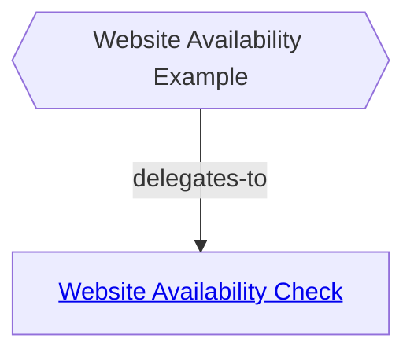

# Website Availability Example

## Purpose

An example project that shows how a small scheduled job is specified and built with CRAFT: a job script that checks whether a configured website is up and, when it is down, asks a notification system for an email alert.

## Navigation

**Website Availability Example**

- [Components](#components)
- [Design](#design)
  - [Diagram](#diagram)
- [Technology](#technology)
- [Links](#links)

## Components

| Component | Purpose |
| --- | --- |
| [Website Availability Check](website-availability-check/README.md#purpose) | A job script that checks one configured website URL, stays silent when it is up and requests one email alert through a notifier when it is down. |

## Design

The root owns no code. It holds the shared rules ([requirements](requirements.md#requirements), [contract](contract.md#contract)) and the `test` and `coverage` checks in `craft.json` that run over the one child. The child, [Website Availability Check](website-availability-check/README.md#design), is the job script: it reads its configuration from the environment, checks the website once, and hands one alert to a notifier port when the site is down. Only a dry-run notifier is delivered; the real email system is outside this project.

### Diagram

## Technology

- Node 26 with TypeScript run natively (type stripping), ES modules, no runtime or dev dependencies, tests with `node:test` and hand-written mocks. Detail is in [requirements.md](requirements.md#requirements).

## Links

- [requirements.md](requirements.md#requirements) — shared rules of the project.
- [contract.md](contract.md#contract) — shared interfaces and data shapes.
