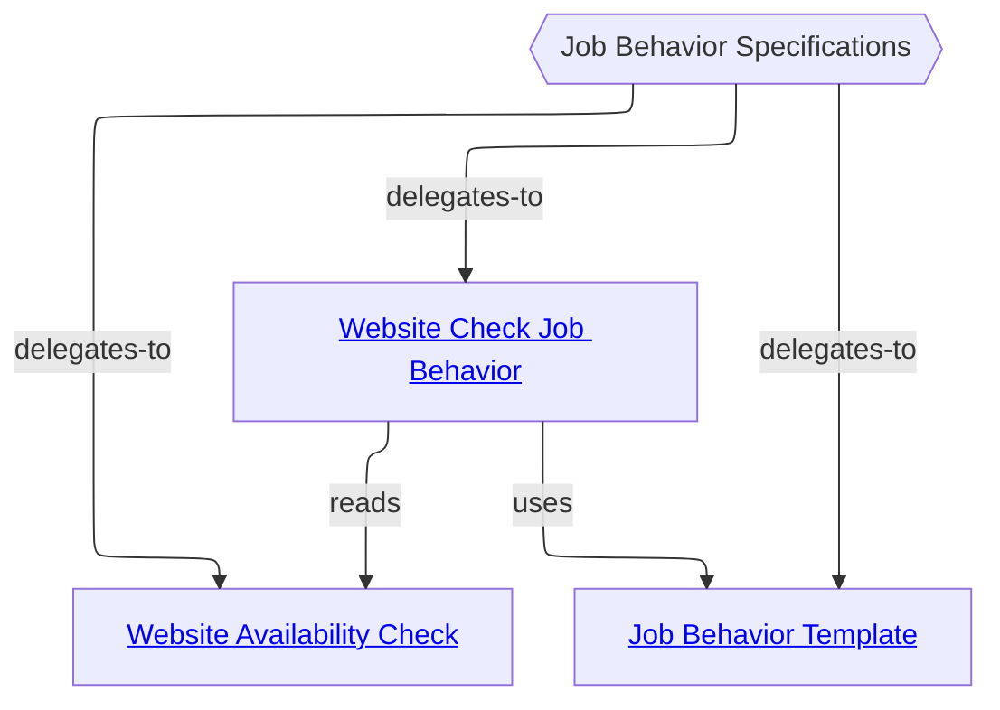
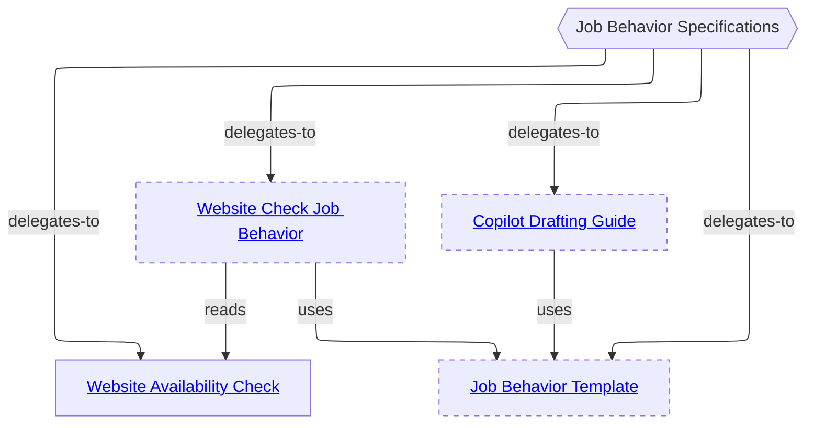

# Job Behavior Specifications

## Purpose

A set of job behavior documents: a blank template and a GitHub Copilot skill with usage guidance for our team, and a completed reference specification that the vendor receives, so the vendor can review and acknowledge a versioned record of each job's current behavior before the jobs are migrated onto our client's platform as workflows.

## Navigation

**Job Behavior Specifications**

- [Components](#components)
- [Design](#design)
  - [Diagram](#diagram)
- [Technology](#technology)
- [Behavior](#behavior)
- [Plan](#plan)
- [Links](#links)

## Components

| Component | Purpose |
| --- | --- |
| [Website Availability Check](website-availability-check/README.md#purpose) | A job script that checks one configured website URL, stays silent when it is up and requests one email alert through a notifier when it is down; kept unchanged as read-only source evidence. |
| [Job Behavior Template](job-behavior-template/README.md#purpose) | The blank, reusable form our team fills in to document one vendor use case from its source code, with a short filling guide. |
| [Website Check Job Behavior](website-check-job-behavior/README.md#purpose) | The completed reference specification of the website-check job in plain business language. |
| [Copilot Drafting Guide](copilot-drafting-guide/README.md#purpose) | A GitHub Copilot agent skill that creates, drafts, updates and versions a job behavior document from source, with usage and model guidance. |

## Design

The root owns no job code. It holds the shared rules ([requirements](requirements.md#requirements), [contract](contract.md#contract)). The built children are the illustrative job script [Website Availability Check](website-availability-check/README.md#design), kept unchanged and read-only as source evidence and declaring its own `test` and `coverage` checks, the [Job Behavior Template](job-behavior-template/README.md#design) and the [Website Check Job Behavior](website-check-job-behavior/README.md#design) reference specification. The [Copilot Drafting Guide](copilot-drafting-guide/README.md#purpose) is not built yet, and the template and the specification are planned for a revision.

### Diagram

## Technology

- Documents in Markdown with a Mermaid diagram and a plain-text description, read on GitHub; our team's instructions are a GitHub Copilot agent skill. No runtime code is added. Only the retained source-evidence component uses Node 26 with native TypeScript, no dependencies, and `node:test` with injected mocks (see its README). Detail is in [requirements.md](requirements.md#requirements).

## Behavior

- **B01** When the template, the reference specification and the template copy inside the skill folder are compared, then they share the same part headings and the same ID scheme (`B`, `Q`, `AC`), and the copy is identical to the template. (untested: benchmark pending)
- **B02** When the pack files (`job-behavior-template.md`, `filling-guide.md`, `website-availability-check.md`, the `document-job-behavior/` skill folder, `usage-and-model-guidance.md` and `drafting-prompt.md`) are inspected, then none contains a Craft file name, command or term, they can be used with plain Markdown and GitHub Copilot in VS Code agent mode alone, and the specification's links and diagram work when it is viewed in a repository on GitHub. (untested: benchmark pending)
- **B03** When the skill is run in Copilot on the website job source, then the draft reconciles with the reference specification, its self-check report is returned and its acknowledgement log is blank. (untested: benchmark pending)

## Plan

### Planned Navigation

**Job Behavior Specifications**

- [Planned Components](#planned-components)
- [Planned Design](#planned-design)
  - [Planned Diagram](#planned-diagram)
- [Steps](#steps)
- [Acceptance Mapping](#acceptance-mapping)
- [Assumptions And Open Questions](#assumptions-and-open-questions)
- [Planned Links](#planned-links)

### Planned Components

| Component | Purpose |
| --- | --- |
| [Website Availability Check](website-availability-check/README.md#purpose) | A job script that checks one configured website URL, stays silent when it is up and requests one email alert through a notifier when it is down; kept unchanged as read-only source evidence. |
| [Job Behavior Template](job-behavior-template/README.md#planned-design) | The blank, reusable form our team fills in to document one vendor use case from its source code, with a short filling guide. |
| [Website Check Job Behavior](website-check-job-behavior/README.md#planned-design) | The completed reference specification of the website-check job in plain business language. |
| [Copilot Drafting Guide](copilot-drafting-guide/README.md#planned-design) | A GitHub Copilot agent skill that creates, drafts, updates and versions a job behavior document from source, with usage and model guidance. |

### Planned Design

The root composes the three document components and checks that they agree. The [template](job-behavior-template/README.md#planned-design) is rebuilt first. The [reference specification](website-check-job-behavior/README.md#planned-design) and the [drafting guide](copilot-drafting-guide/README.md#planned-design) both use the revised template, and the reference specification also reads the illustrative job as evidence. The root is built last: it rewrites its Design from the built children and runs its own review checklist. This diagram shows the components of the project; it is separate from the one-box job diagram that each job document carries.

#### Planned Diagram

### Steps

1. Rebuild `job-behavior-template` first, then `website-check-job-behavior` and `copilot-drafting-guide` (one at a time, since a build runs one component), then this root. The earlier blocked guide build branches are superseded.
2. Root build: rewrite this README's Design and diagram from the built children, dissolve this Plan, and keep the Components table.
3. Root build: create `review-checklist.md` with one item per root behavior, tagged `[B01]` to `[B03]`, including the check that the skill's template copy matches the template, the check that the specification renders on GitHub, and the dry run of the skill on the website job source.
4. Planning-time changes already made: the shared requirements and contract, the backlog, and the Design sentence above now reflect that the template and the specification are built.

### Acceptance Mapping

| Acceptance condition | Behaviors | Step | Validation check |
| --- | --- | --- | --- |
| Template, reference specification and the skill's template copy share headings and IDs, and the copy is identical | B01 | 3 | `review-checklist.md` item [B01], comparing the documents |
| No Craft term in the pack files and the specification works on GitHub | B02 | 3 | `review-checklist.md` item [B02], a scan of the files and a view on GitHub |
| The skill run on the website job source reconciles with the reference specification, returns its self-check report and leaves the acknowledgement log blank | B03 | 3 | `review-checklist.md` item [B03], a Copilot dry run (needs Copilot access) |

Checks: the root declares no automated check. The record validators run at the end of the plan and each build.

### Assumptions And Open Questions

Assumptions (override any of them in chat before `/craft:build`). This plan follows the user's review of a generated specification on 2026-11-15 and replaces the earlier plan:

1. The project root keeps its name and the components keep their folders. The built template and reference specification get a new Plan and task; the guide's plan is rewritten. Override: ask for other names.
2. The illustrative job `website-availability-check` stays in place, unchanged and read-only, as source evidence, and declares its own `test` and `coverage` checks. Override: ask for it to be moved.
3. The root has a task and a build because it lists integration behaviors B01 to B03. Its limits cover three children.
4. Documents are not run by any tool. Every behavior is marked "untested: benchmark pending" and each component's `review-checklist.md` plus a manual dry-run review is the stand-in. The first Copilot dry run of the earlier skill was exploratory and ticked nothing. Override: build the benchmark verification first (backlog item `prompt-skill-benchmark`).
5. The vendor acknowledges through a tracker, not by editing the documents. The tracker is a later backlog item (`job-migration-tracker`); until it exists the acknowledgement is recorded by our team from the vendor's email reply. Grouping jobs into workflows is our own later internal decision (backlog item `workflow-grouping-document`), not vendor-signed. No similarity field is added to any job document.
6. One file per use case with a change log and a repository tag at each acknowledgement replaces the earlier copy-per-version design. The job document has no job ID; the use case name is the identity and file name; our internal ID lives only in the tracker. Developers create each document when they pick up the job; the tracker rows for all use cases are created up front. Override: keep a job ID or stub all documents first.
7. Job document IDs are `B`, `Q` and `AC`; they are distinct from this project's `B01` component-record behavior IDs because they are in different files.
8. The Copilot Drafting Guide is an agent skill because our team's developers use VS Code agent mode where skills work; the fallback prompt exists only for surfaces without skills.
9. Build order is the template, then the reference specification and the guide, then the root.
10. Open item: the vendor will read the document through a GitHub link shared in the later tracker. The vendor needs access to that repository, and a link to a repository may expose other files, so the repository layout and visibility (for example one folder per use case, or a repository per vendor) must be confirmed. Recorded as backlog item `vendor-document-access-and-layout`.
11. Other open items for the user: whether skill support is enabled by the developers' Copilot plan and administrator policy and which VS Code harness they use (the docs read do not say), and the model guidance for the GPT-6 models, which the GitHub pages read do not cover. Behavior questions: none open.

### Planned Links

- [requirements.md](requirements.md#requirements) — shared rules of the project.
- [contract.md](contract.md#contract) — the pack and shared wording rules.
- [backlog.md](backlog.md) — later items: the tracker, the grouping document, the skill benchmark, the notification-system decision and the vendor access and layout decision.

## Links

- [requirements.md](requirements.md#requirements) — shared rules of the project.
- [contract.md](contract.md#contract) — the pack and shared wording rules.
- [backlog.md](backlog.md) — later items: the tracker, the grouping document, the skill benchmark, the notification-system decision and the vendor access and layout decision.
