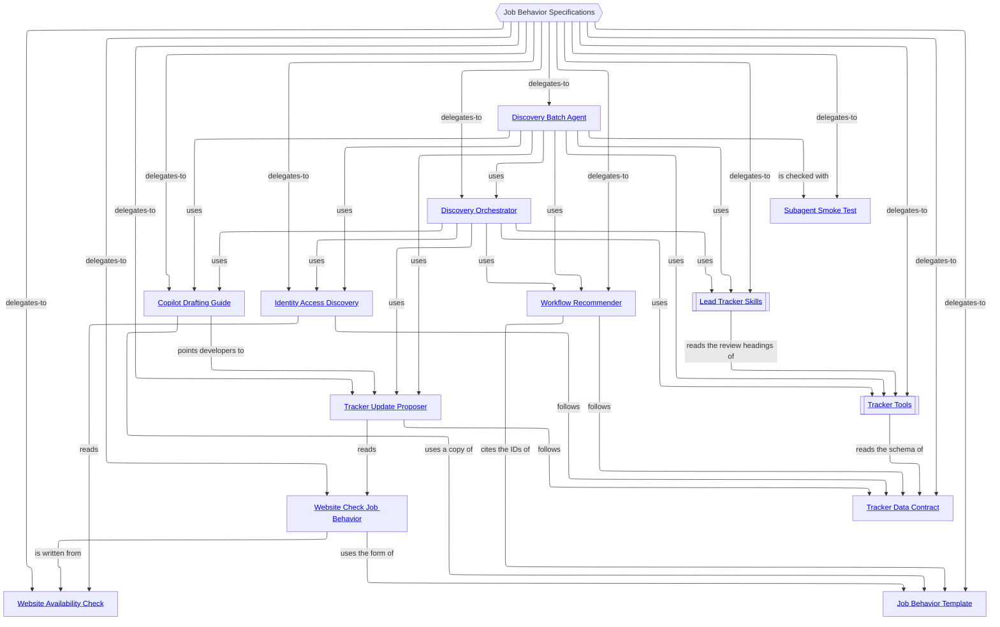
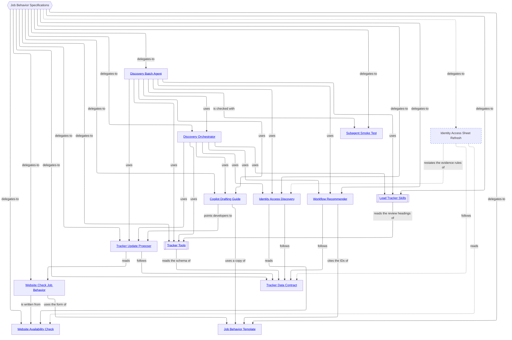

# Job Behavior Specifications

## Purpose

Two things for the vendor-to-platform migration: a job behavior pack (a blank template, a completed reference specification and a GitHub Copilot drafting skill with usage guidance) so a vendor can review and acknowledge a versioned record of each use case's current behavior before it is migrated onto our client's platform as a workflow; and a use case tracker toolkit (one shared data contract, three more Copilot skills and the lead Node tools) so proposed use cases, questions, access requests and workflow mappings reach a SharePoint tracker as reviewable changes and nothing reaches a vendor that it should not see.

## Navigation

**Job Behavior Specifications**

- [Components](#components)
- [Design](#design)
  - [Diagram](#diagram)
- [Technology](#technology)
- [Behavior](#behavior)
- [Links](#links)

## Components

| Component | Purpose |
| --- | --- |
| [Website Availability Check](website-availability-check/README.md#purpose) | A job script that checks one configured website URL, stays silent when it is up and requests one email alert through a notifier when it is down; kept unchanged as read-only source evidence. |
| [Job Behavior Template](job-behavior-template/README.md#purpose) | The blank, reusable form our team fills in to document one vendor use case from its source code, with a short filling guide. |
| [Website Check Job Behavior](website-check-job-behavior/README.md#purpose) | The completed reference specification of the website-check job in plain business language. |
| [Copilot Drafting Guide](copilot-drafting-guide/README.md#purpose) | A GitHub Copilot agent skill that creates, drafts, updates and versions a job behavior document from source, with usage and model guidance. |
| [Tracker Data Contract](tracker-data-contract/README.md#purpose) | The one shared data contract for the use case tracker: tabs, columns, references, status lists, vendor visibility, the proposal file format and the export format, with a guide for building the SharePoint workbooks, so every skill and tool reads and writes the same shapes. |
| [Tracker Update Proposer](tracker-update-proposer/README.md#purpose) | A GitHub Copilot agent skill that turns a use case specification into proposed use case and question rows in `tracker-updates.csv`, so developers hand a lead reviewable tracker changes with each specification and no one retypes questions. |
| [Identity Access Discovery](identity-access-discovery/README.md#purpose) | A GitHub Copilot agent skill that reads a use case's source and configuration and proposes Identity & Access rows (services, environments, observed operations and identity references), so access requests can start from day one and leads can see possible shared requests. |
| [Identity Access Sheet Refresh](identity-access-sheet-refresh/README.md#purpose) | A GitHub Copilot agent skill that takes one vendor's hand-filled Identity & Access sheet, saved as CSV, and the source of the use cases in it, and writes a separate CSV in the sheet's own columns with values corrected from the source, missing endpoints added and evidence filled, so developers can paste it back into the sheet as a quick stopgap. |
| [Workflow Recommender](workflow-recommender/README.md#purpose) | A GitHub Copilot agent skill that compares use case specifications by their behaviors and generates internal use-case-to-workflow recommendations, with the format of the lead-owned decisions file, so leads can decide which use cases can share one reusable workflow. |
| [Discovery Orchestrator](discovery-orchestrator/README.md#purpose) | A GitHub Copilot agent skill that takes one use-case folder through the discovery stages in order, refreshes the consolidated review CSVs and walks a lead through the pending rows, so leads review and decide in one flow and each folder is processed without duplicates. |
| [Tracker Tools](tracker-tools/README.md#purpose) | The lead-facing Node tools for the use case tracker: a shared CSV table library, a reconciler that turns reviewed proposals and a tracker export into reviewable changes, and a daily summary. Leads run them by hand; the authoritative tracker stays an Excel workbook on SharePoint. |
| [Lead Tracker Skills](lead-tracker-skills/README.md#components) | The Copilot agent skills a lead uses in chat on top of the lead tracker tools' output, starting with Review Decisions, which records and revisits decisions on the review CSVs. |
| [Discovery Batch Agent](discovery-batch-agent/README.md#purpose) | A GitHub Copilot custom agent that runs discovery for several use cases in one go, each in an isolated subagent, then recommends workflows and exports the review once and hands the review to the lead in chat. |
| [Subagent Smoke Test](subagent-smoke-test/README.md#purpose) | Two prompts a developer runs in Copilot Chat in the client environment to check that subagents run, that their context is isolated and that a subagent can use an installed skill. |

## Design

The root owns no job code and no tool code. It holds the shared rules ([requirements](requirements.md#requirements), [contract](contract.md#contract)), a [review checklist](review-checklist.md) for the document and skill behaviors, and an integration test that runs the built tools against the real example proposal and schema. Three document components make the pack: the [Job Behavior Template](job-behavior-template/README.md#design), the [Website Check Job Behavior](website-check-job-behavior/README.md#design) reference specification filled in from it, and the [Copilot Drafting Guide](copilot-drafting-guide/README.md#design) skill that drafts a specification from source with a copy of the template; the illustrative job [Website Availability Check](website-availability-check/README.md#design) stays unchanged and read-only as the source evidence. The toolkit has one shared interface, the [Tracker Data Contract](tracker-data-contract/README.md#design): three Copilot skills write proposals in its format, the [Tracker Update Proposer](tracker-update-proposer/README.md#design), the [Identity Access Discovery](identity-access-discovery/README.md#design) skill and the [Workflow Recommender](workflow-recommender/README.md#design), each holding byte-identical copies of the contract files, and the [Tracker Tools](tracker-tools/README.md#diagram) (a table library, a reconciler and a daily summary) read the schema from the contract component, reconcile proposals with an export and write the vendor-safe views and the internal summary for a lead to apply by hand. The end-to-end handoffs are in [contract.md](contract.md#end-to-end-handoffs). Each job document carries its own one-box diagram; this diagram shows the components of the project. The [Subagent Smoke Test](subagent-smoke-test/README.md#design) is two prompts a developer runs in the client environment to check Copilot's subagent support; it is a check, not part of the toolkit's data flow. The [Discovery Orchestrator](discovery-orchestrator/README.md#design) skill takes one use-case folder through the discovery skills in order, runs the review CSV exporter and hands the review to the lead; the [Discovery Batch Agent](discovery-batch-agent/README.md#design) runs discovery for several use cases in isolated subagents and hands the review over the same way; and [Lead Tracker Skills](lead-tracker-skills/README.md#components) holds the skill that records the lead's review decisions. The [Tracker Tools](tracker-tools/README.md#diagram) also hold the review exporter and the vendor and master workbook updaters. A use case is identified everywhere in the tracker by its use case ID `uc-<vendor-slug>-<use-case-slug>`, defined once in the Tracker Data Contract and derived by the table library's one `useCaseId` helper, so two vendors' same-named use cases are never merged or matched to each other's rows; the root tests `B09` and `B10` check that.

### Diagram

## Technology

- The documents are Markdown (and CSV for the contract files) with Mermaid diagrams and plain-text descriptions, read on GitHub. Our team's instructions are GitHub Copilot agent skills and one custom agent (VS Code agent mode); no Craft installation is needed to use them. Only the retained source-evidence job and the lead tools use code: Node 26 with native TypeScript (erasable syntax, `.ts` import extensions), no dependencies, ES modules and `node:test`, with real temporary directories in the tool tests (see [Tracker Tools](tracker-tools/README.md#technology) and [Website Availability Check](website-availability-check/README.md#technology)).
- The root integration tests in [test](test/) use the same stack, import the tools' `cli` modules by relative path, read the real example proposal and the real schema, run in real temporary directories and need no root `package.json`. The root declares only the `test` and `testGlob` checks in [craft.json](craft.json); the document and skill components declare none and the code components declare their own. Detail is in [requirements.md](requirements.md#requirements).

## Behavior

- **B01** When the template, the reference specification and the template copy inside the skill folder are compared, then they share the same part headings and the same ID scheme (`B`, `Q`, `AC`), and the copy is identical to the template.
- **B02** When the pack files (`job-behavior-template.md`, `filling-guide.md`, `website-availability-check.md`, the three skill folders, the tracker contract files, `usage-and-model-guidance.md` and `drafting-prompt.md`) are inspected, then none contains a Craft file name, command or term, they can be used with plain Markdown, CSV and GitHub Copilot in VS Code agent mode alone, and the specification's links and diagram work when it is viewed in a repository on GitHub. (untested: benchmark pending)
- **B03** When the drafting skill's instructions, its guidance and its fallback prompt are read, then they say it never ticks, confirms or records an acknowledgement on its own and leaves the acknowledgement log blank unless a developer gives the facts, and they accept the core files, tagged documents and supplied findings as they are; results of the user's manual tests of the skill in the client environment on real use cases are recorded as user-reported evidence for the version tested and are not claimed as a pass here. (untested: benchmark pending)
- **B04** When the team-facing files are scanned, then `use case` names the business unit, `job` or `script` names only the vendor's script, `workflow` is defined once as the reusable implementation, and no vendor-readable file mentions workflows or grouping. (untested: benchmark pending)
- **B05** When the three skill folders and the tracker tools' schema path are compared with the Tracker Data Contract, then every copy of the contract and schema files is identical.
- **B06** When the example `tracker-updates.csv` for the website use case is validated and reconciled against an empty export fixture, the additions are applied by test code, and it is reconciled again, then the first run produces additions and the second produces none.
- **B07** When the reconciler and the summary run on a three-vendor fixture, then vendor-safe outputs hold no internal column, question group, link, mapping, unreleased question row or other vendor's row, and the summary is the only place the three tracks appear together.
- **B08** When a revised specification's proposal is reconciled against an export that holds a vendor's answer to a question row, an owner and a decided mapping, then the existing question row, its answer and its owner are preserved with no duplicate record, a wording edit gives a text-review suggestion and no withdrawal, a change that could affect grouping suggests re-review of the decided mapping, a behavior change with no grouping impact suggests none, an unknown impact is listed as unknown, a version-only change suggests none, and nothing is released or applied.
- **B09** When two vendors each have a use case of the same name and their proposals add each use case and its question 1, then the reconciler and the exporter list two use case additions and two question additions under two different use case IDs, and neither is merged, held or matched to the other's row.
- **B10** When a proposal's local reference names a use case ID that no export row and no added use case has, then the run stops naming the file and line and writes nothing, and a reference in the old use case name or slug-alone form is not accepted.

`B01` and `B05` to `B10` are checked by the root tests in [test](test/) (file comparisons for `B01` and `B05`, the built tools for `B06` to `B10`), each test titled with its tag. `B02` to `B04` are checked by the file review and the scans in [review-checklist.md](review-checklist.md), and the Copilot skills are tested manually by the user in the client environment on real use cases; no Copilot or client-environment result is claimed here.

## Plan

### Planned Navigation

**Job Behavior Specifications**

- [Planned Components](#planned-components)
- [Planned Design](#planned-design)
  - [Planned Diagram](#planned-diagram)
- [Steps](#steps)
- [Acceptance Mapping](#acceptance-mapping)
- [Assumptions And Open Questions](#assumptions-and-open-questions)
- [Planned Links](#planned-links)

### Planned Components

| Component | Purpose |
| --- | --- |
| Component | Purpose |
| --- | --- |
| [Website Availability Check](website-availability-check/README.md#purpose) | A job script that checks one configured website URL, stays silent when it is up and requests one email alert through a notifier when it is down; kept unchanged as read-only source evidence. |
| [Job Behavior Template](job-behavior-template/README.md#purpose) | The blank, reusable form our team fills in to document one vendor use case from its source code, with a short filling guide. |
| [Website Check Job Behavior](website-check-job-behavior/README.md#purpose) | The completed reference specification of the website-check job in plain business language. |
| [Copilot Drafting Guide](copilot-drafting-guide/README.md#purpose) | A GitHub Copilot agent skill that creates, drafts, updates and versions a job behavior document from source, with usage and model guidance. |
| [Tracker Data Contract](tracker-data-contract/README.md#purpose) | The one shared data contract for the use case tracker: tabs, columns, references, status lists, vendor visibility, the proposal file format and the export format, with a guide for building the SharePoint workbooks, so every skill and tool reads and writes the same shapes. |
| [Tracker Update Proposer](tracker-update-proposer/README.md#purpose) | A GitHub Copilot agent skill that turns a use case specification into proposed use case and question rows in `tracker-updates.csv`, so developers hand a lead reviewable tracker changes with each specification and no one retypes questions. |
| [Identity Access Discovery](identity-access-discovery/README.md#purpose) | A GitHub Copilot agent skill that reads a use case's source and configuration and proposes Identity & Access rows (services, environments, observed operations and identity references), so access requests can start from day one and leads can see possible shared requests. |
| [Identity Access Sheet Refresh](identity-access-sheet-refresh/README.md#purpose) | A GitHub Copilot agent skill that corrects a vendor's hand-filled Identity & Access sheet from the use case source, as a separate CSV in the sheet's own columns that a developer pastes back, so urgent access work does not wait for the proposal and review flow. |
| [Workflow Recommender](workflow-recommender/README.md#purpose) | A GitHub Copilot agent skill that compares use case specifications by their behaviors and generates internal use-case-to-workflow recommendations, with the format of the lead-owned decisions file, so leads can decide which use cases can share one reusable workflow. |
| [Discovery Orchestrator](discovery-orchestrator/README.md#purpose) | A GitHub Copilot agent skill that takes one use-case folder through the discovery stages in order, refreshes the consolidated review CSVs and walks a lead through the pending rows, so leads review and decide in one flow and each folder is processed without duplicates. |
| [Tracker Tools](tracker-tools/README.md#purpose) | The lead-facing Node tools for the use case tracker: a shared CSV table library, a reconciler that turns reviewed proposals and a tracker export into reviewable changes, and a daily summary. Leads run them by hand; the authoritative tracker stays an Excel workbook on SharePoint. |
| [Lead Tracker Skills](lead-tracker-skills/README.md#components) | The Copilot agent skills a lead uses in chat on top of the lead tracker tools' output, starting with Review Decisions, which records and revisits decisions on the review CSVs. |
| [Discovery Batch Agent](discovery-batch-agent/README.md#purpose) | A GitHub Copilot custom agent that runs discovery for several use cases in one go, each in an isolated subagent, then recommends workflows and exports the review once and hands the review to the lead in chat. |
| [Subagent Smoke Test](subagent-smoke-test/README.md#purpose) | Two prompts a developer runs in Copilot Chat in the client environment to check that subagents run, that their context is isolated and that a subagent can use an installed skill. |

### Planned Design

Two changes reach the root. First, a new child, [Identity Access Sheet Refresh](identity-access-sheet-refresh/README.md#purpose), a Copilot skill that takes a vendor's hand-filled Identity & Access sheet (saved as CSV, with the tracker's own column headings) and the source of its use cases and writes a separate CSV in the sheet's own columns plus a `change` column that exists only in that file. It is an urgent stopgap that skips the proposal and review flow, follows the Tracker Data Contract by a byte-identical copy of the contract and schema, and restates the evidence rules of Identity Access Discovery instead of sharing them. Its own plan holds its behaviors.

Second, the root owns the rule for where a use case's files live, because it is the common ancestor of the skills and the batch agent that disagree today. The use case index row (`use-case-index.csv` at the repository root, columns `folder` and `spec`) is the single lookup for a use case's specification and for the folder that holds `external_tools.md` and `logic.md`. A new specification is written in the use case's own folder as `<use case name>.md` (decided by the user, 2026-11-17), never in a proposal folder, because proposals are internal and the specification is vendor-readable; `spec` records its root-relative path. A skill or the batch agent run by hand with no path asks once for the repository root, finds the row by use case name, slug or derived ID, and uses `spec` and `folder`; a path the developer gives wins. A use case with no row, a blank `spec` or a missing file is reported as having no specification (the skill may ask once for a path), and nothing falls back to the inventory's source location or scans for the file. The proposal file stays at `<proposals root>/tracker-updates/<use-case-id>/tracker-updates.csv`. No existing folder or specification moves, and the Tracker Data Contract does not change.

The root is at its cap of ten behaviors, so root `B02` is amended instead of adding one: its three outcomes are that every skill and agent naming these locations names the same lookup and write location (a), that a skill run by hand with no path and an index row with a `spec` uses it without asking (b), and that a use case with no row, a blank `spec` or a missing file is reported as none with no fallback (c). `B05` stays as it is but its copy comparison grows to the new skill folder. The root tests cannot prove (a) to (c), so `B02` stays marked untested like the rest of it and is checked by the review checklist scan and the manual run sheet.

#### Planned Diagram

### Steps

1. Amend [contract.md](contract.md#contract) ("Inputs to the skills") and [requirements.md](requirements.md#requirements) with the one lookup, the one write location and the hand-run and no-row outcomes, and fold the planned-change sections into the main text.
2. Amend `B02` in this README with outcomes (a), (b) and (c), keeping its untested marker and the root at ten behaviors, and widen `B05` and `B02`'s file list to name the new skill folder.
3. Amend [review-checklist.md](review-checklist.md): the `B02` item and scan check that every skill and agent naming a specification, `external_tools.md` or `logic.md` location uses the same lookup wording, and the files in scope list the new skill folder.
4. Extend the copy comparison of `B05` in [test/documents.test.ts](test/documents.test.ts) to the fourth skill folder, `identity-access-sheet-refresh/refresh-identity-access-sheet`.
5. After the children are built, add the new child's row and node to Components and Diagram, and dissolve this Plan into Design.

Bounded requests to children (each plans and builds its own change; this root edits none of them):

- [Copilot Drafting Guide](copilot-drafting-guide/README.md#purpose): `document-job-behavior` creates a new specification at `<index row folder>/<use case name>.md`, reports its root-relative path, finds an existing one through the index `spec`, and reads `external_tools.md` and `logic.md` from that folder; keep `drafting-prompt.md` in step.
- [Tracker Update Proposer](tracker-update-proposer/README.md#purpose): in specification-update mode `propose-tracker-updates` resolves the specification from the index when no path is given and reports none otherwise, dropping the source-location fallback.
- [Identity Access Discovery](identity-access-discovery/README.md#purpose): `discover-identity-access` takes the folder of `external_tools.md` and `logic.md` from the index row's `folder` when no path is given.
- [Discovery Orchestrator](discovery-orchestrator/README.md#purpose): `run-discovery` stage 3 passes the use case folder as the specification's home and sets `spec` from the reported path; its contract states the same.
- [Discovery Batch Agent](discovery-batch-agent/README.md#purpose): the worker brief names the use case folder as the specification's location, the one exception to writing only under the proposals root, and `SPEC-PATH` is that path.
- [End-To-End Acceptance Test](end-to-end-acceptance-test/README.md#purpose): after the children above are built, its run sheet gains a step that runs the three skills by hand with no path after a batch run, and one for a use case with no row, so A2 and A3 below are exercised.
- No change: [Workflow Recommender](workflow-recommender/README.md#purpose) (it already reads the index `spec`), [Lead Tracker Skills](lead-tracker-skills/README.md#components), [Tracker Data Contract](tracker-data-contract/README.md#purpose) and the tracker tools. The Tracker Reconciler's Windows path fix has its own separate plan and changes nothing here.

### Acceptance Mapping

| Acceptance | Behaviors | Step | Check |
| --- | --- | --- | --- |
| A1: the root contract states the one lookup and write location, and the checklist scan finds the same wording in every skill and agent that names these locations | B02 (a) | 1, 2, 3 | the review checklist scan and file review |
| A2: a specification written by the batch agent is found with no path by the three skills run by hand | B02 (b) | 3 | the manual run sheet, after the children are built |
| A3: a use case with no row, a blank `spec` or a missing file is reported as none, with no fallback | B02 (c) | 3 | the manual run sheet |
| A4: the contract files and every copy of them, the fourth skill folder's included, are identical and the root tests pass | B05 | 4 | `node --test` on the root `test` folder |

### Assumptions And Open Questions

Assumptions (override any in chat):

1. **Policy.** Planned under `deciding-what-to-ask` from the CRAFT plugin, with no project override.
2. **Decisions confirmed.** The user chose the use case folder as the home of a new specification and confirmed the proposed behaviors, 2026-11-17. Override by naming the proposal folder instead: then step 1 of the lookup rule, the Drafting Guide request and the batch worker brief change, and a proposal folder would hold a vendor-readable file.
3. **File name.** `<use case name>.md`, as the reference specification is `website-availability-check.md` and the drafting skill already names a new document after the use case. Override by naming another pattern.
4. **No row.** A hand-run skill with no index row asks once for a path and otherwise reports no specification. Override by reporting none without asking.
5. **Tracker Data Contract unchanged.** It never defines where a specification lives, so no recopy into the skill folders and `B05` is not affected beyond the new folder.
6. **Both writers keep their roles.** The orchestrator and the batch agent both write the `spec` index row, as today.
7. **Untested marker.** The amended `B02` stays marked `(untested: benchmark pending)` like the rest of it.
8. **Existing specifications.** Specifications the batch agent already wrote keep working because their `spec` rows point at them; relocating them is outside this plan.

Open questions: none.

### Planned Links

- [requirements.md](requirements.md#planned-change-where-a-use-cases-files-live) — the planned rule for where a use case's files live.
- [contract.md](contract.md#planned-change-where-a-use-cases-files-live) — the planned lookup, write location and report wording.
- [identity-access-sheet-refresh](identity-access-sheet-refresh/README.md#plan) — the planned new child.

## Links

- [requirements.md](requirements.md#requirements) — shared rules of the project.
- [contract.md](contract.md#contract) — the pack, the vocabulary, the shared tracker pointer and the end-to-end handoffs.
- [review-checklist.md](review-checklist.md) — the file review and scans for the document and skill behaviors `B01` to `B05`.
- [test](test/) — the root integration tests for `B01` and `B05` to `B10`: [documents](test/documents.test.ts), [pipeline](test/pipeline.test.ts), [vendor safety](test/vendor-safety.test.ts) and [revision](test/revision.test.ts).
- [backlog.md](backlog.md) — later items: the skill benchmark, the notification-system decision, the vendor access and layout decision, the vendor inventory, direct tracker integration, the naming alignment, the skill grouping and the follow-ups found while building the toolkit.
- [end-to-end-acceptance-test](end-to-end-acceptance-test/README.md) — a standalone folder (not a component): the manual run sheet for the whole lead flow, fictional fixtures with expected outputs and the tests that prove every documented command.
