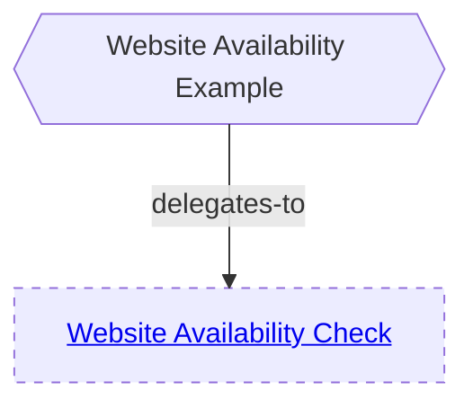

# Website Availability Example

## Purpose

An example project that shows how a small scheduled job is specified and built with CRAFT: a job script that checks whether a configured website is up and, when it is down, asks a notification system for an email alert.

## Navigation

**Website Availability Example**

- [Components](#components)
- [Design](#design)
- [Technology](#technology)
- [Plan](#plan)
- [Links](#links)

## Components

| Component | Purpose |
| --- | --- |
| [Website Availability Check](website-availability-check/README.md#purpose) | A job script that checks one configured website URL, stays silent when it is up and requests one email alert through a notifier when it is down. |

## Design

Not built yet.

## Technology

- Node 26 with TypeScript run natively (type stripping), ES modules, no runtime or dev dependencies, tests with `node:test` and hand-written mocks. Detail is in [requirements.md](requirements.md#requirements).

## Plan

### Planned Navigation

**Website Availability Example**

- [Planned Components](#planned-components)
- [Planned Design](#planned-design)
  - [Planned Diagram](#planned-diagram)
- [Planned Links](#planned-links)

### Planned Components

| Component | Purpose |
| --- | --- |
| [Website Availability Check](website-availability-check/README.md#planned-purpose) | A job script that checks one configured website URL, stays silent when it is up and requests one email alert through a notifier when it is down. |

### Planned Design

The root owns no code. It holds the shared rules (`requirements.md`, `contract.md`) and the `configuration.checks` in `craft.json` that every component of this one-stack project runs. The single child, [Website Availability Check](website-availability-check/README.md#planned-design), is planned in its own record.

#### Planned Diagram

### Planned Links

- [requirements.md](requirements.md#requirements) — shared technology, test and no-real-effects rules.
- [contract.md](contract.md#contract) — shared environment variables and exit codes.

## Links

- [requirements.md](requirements.md#requirements) — shared rules of the project.
- [contract.md](contract.md#contract) — shared interfaces and data shapes.
