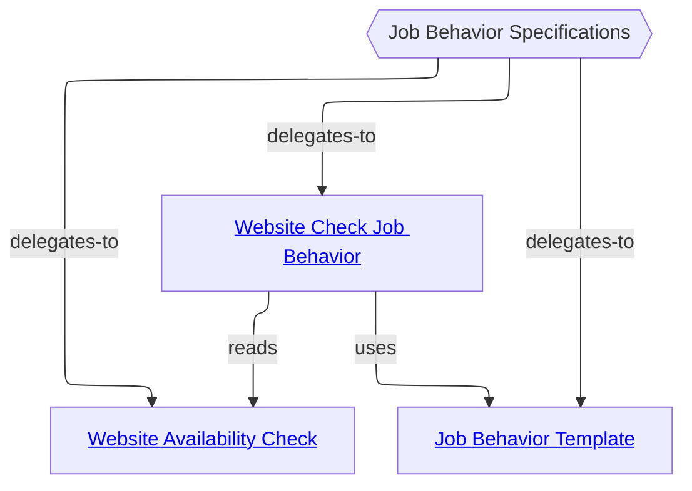
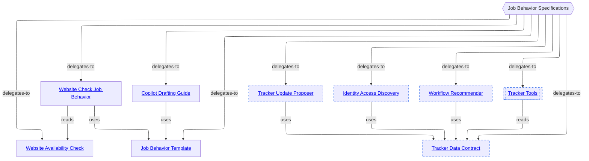

# Job Behavior Specifications

## Purpose

A set of job behavior documents: a blank template and a GitHub Copilot skill with usage guidance for our team, and a completed reference specification that the vendor receives, so the vendor can review and acknowledge a versioned record of each job's current behavior before the jobs are migrated onto our client's platform as workflows.

## Navigation

**Job Behavior Specifications**

- [Components](#components)
- [Design](#design)
  - [Diagram](#diagram)
- [Technology](#technology)
- [Behavior](#behavior)
- [Plan](#plan)
- [Links](#links)

## Components

| Component | Purpose |
| --- | --- |
| [Website Availability Check](website-availability-check/README.md#purpose) | A job script that checks one configured website URL, stays silent when it is up and requests one email alert through a notifier when it is down; kept unchanged as read-only source evidence. |
| [Job Behavior Template](job-behavior-template/README.md#purpose) | The blank, reusable form our team fills in to document one vendor use case from its source code, with a short filling guide. |
| [Website Check Job Behavior](website-check-job-behavior/README.md#purpose) | The completed reference specification of the website-check job in plain business language. |
| [Copilot Drafting Guide](copilot-drafting-guide/README.md#purpose) | A GitHub Copilot agent skill that creates, drafts, updates and versions a job behavior document from source, with usage and model guidance. |
| [Tracker Data Contract](tracker-data-contract/README.md#purpose) | The one shared data contract for the use case tracker: tabs, columns, references, status lists, vendor visibility, the proposal file format and the export format, with a guide for building the SharePoint workbooks, so every skill and tool reads and writes the same shapes. |
| [Tracker Update Proposer](tracker-update-proposer/README.md#purpose) | A GitHub Copilot agent skill that turns a use case specification into proposed use case and question rows in `tracker-updates.csv`, so developers hand a lead reviewable tracker changes with each specification and no one retypes questions. |
| [Identity Access Discovery](identity-access-discovery/README.md#purpose) | A GitHub Copilot agent skill that reads a use case's source and configuration and proposes Identity & Access rows (services, environments, observed operations and identity references), so access requests can start from day one and leads can see possible shared requests. |
| [Workflow Recommender](workflow-recommender/README.md#purpose) | A GitHub Copilot agent skill that compares use case specifications by their behaviors and generates internal use-case-to-workflow recommendations, with the format of the lead-owned decisions file, so leads can decide which use cases can share one reusable workflow. |
| [Tracker Tools](tracker-tools/README.md#components) | The lead-facing Node tools for the use case tracker: a shared CSV table library, a reconciler that turns reviewed proposals and a tracker export into reviewable changes, and a daily summary. Leads run them by hand; the authoritative tracker stays an Excel workbook on SharePoint. |

## Design

The root owns no job code. It holds the shared rules ([requirements](requirements.md#requirements), [contract](contract.md#contract)). The built children are the illustrative job script [Website Availability Check](website-availability-check/README.md#design), kept unchanged and read-only as source evidence and declaring its own `test` and `coverage` checks, the [Job Behavior Template](job-behavior-template/README.md#design) and the [Website Check Job Behavior](website-check-job-behavior/README.md#design) reference specification. The [Copilot Drafting Guide](copilot-drafting-guide/README.md#purpose) is not built yet, and the template and the specification are planned for a revision.

### Diagram

## Technology

- Documents in Markdown with a Mermaid diagram and a plain-text description, read on GitHub; our team's instructions are a GitHub Copilot agent skill. No runtime code is added. Only the retained source-evidence component uses Node 26 with native TypeScript, no dependencies, and `node:test` with injected mocks (see its README). Detail is in [requirements.md](requirements.md#requirements).

## Behavior

- **B01** When the template, the reference specification and the template copy inside the skill folder are compared, then they share the same part headings and the same ID scheme (`B`, `Q`, `AC`), and the copy is identical to the template. (untested: benchmark pending)
- **B02** When the pack files (`job-behavior-template.md`, `filling-guide.md`, `website-availability-check.md`, the `document-job-behavior/` skill folder, `usage-and-model-guidance.md` and `drafting-prompt.md`) are inspected, then none contains a Craft file name, command or term, they can be used with plain Markdown and GitHub Copilot in VS Code agent mode alone, and the specification's links and diagram work when it is viewed in a repository on GitHub. (untested: benchmark pending)
- **B03** When the skill is run in Copilot on the website job source, then the draft reconciles with the reference specification, its self-check report is returned and its acknowledgement log is blank. (untested: benchmark pending)
- **B04** When the team-facing files are scanned, then `use case` names the business unit, `job` or `script` names only the vendor's script, `workflow` is defined once as the reusable implementation, and no vendor-readable file mentions workflows or grouping. (untested: benchmark pending)
- **B05** When the three skill folders and the tracker tools' schema path are compared with the Tracker Data Contract, then every copy of the contract and schema files is identical. (untested: benchmark pending)
- **B06** When the example `tracker-updates.csv` for the website use case is validated and reconciled against an empty export fixture, the additions are applied by test code, and it is reconciled again, then the first run produces additions and the second produces none.
- **B07** When the reconciler and the summary run on a three-vendor fixture, then vendor-safe outputs hold no internal column, question group, link, mapping, unreleased question row or other vendor's row, and the summary is the only place the three tracks appear together.
- **B08** When a revised specification's proposal is reconciled against an export that holds a vendor's answer to a question row, an owner and a decided mapping, then the existing question row, its answer and its owner are preserved with no duplicate record, a wording edit gives a text-review suggestion and no withdrawal, a change that could affect grouping suggests re-review of the decided mapping, a behavior change with no grouping impact suggests none, an unknown impact is listed as unknown, a version-only change suggests none, and nothing is released or applied.

## Plan

### Planned Navigation

**Job Behavior Specifications**

- [Planned Components](#planned-components)
- [Planned Design](#planned-design)
  - [Planned Diagram](#planned-diagram)
- [Planned Behavior](#planned-behavior)
- [Steps](#steps)
- [Acceptance Mapping](#acceptance-mapping)
- [Assumptions And Open Questions](#assumptions-and-open-questions)
- [Planned Links](#planned-links)

### Planned Components

| Component | Purpose |
| --- | --- |
| [Website Availability Check](website-availability-check/README.md#purpose) | A job script that checks one configured website URL, stays silent when it is up and requests one email alert through a notifier when it is down; kept unchanged as read-only source evidence. |
| [Job Behavior Template](job-behavior-template/README.md#planned-design) | The blank, reusable form our team fills in to document one vendor use case from its source code, with a short filling guide. |
| [Website Check Job Behavior](website-check-job-behavior/README.md#planned-design) | The completed reference specification of the website-check job in plain business language. |
| [Copilot Drafting Guide](copilot-drafting-guide/README.md#planned-design) | A GitHub Copilot agent skill that creates, drafts, updates and versions a job behavior document from source, with usage and model guidance. |
| [Tracker Data Contract](tracker-data-contract/README.md#planned-design) | The one shared data contract for the use case tracker: tabs, columns, references, status lists, vendor visibility, the proposal file format and the export format, with a guide for building the SharePoint workbooks, so every skill and tool reads and writes the same shapes. |
| [Tracker Update Proposer](tracker-update-proposer/README.md#planned-design) | A GitHub Copilot agent skill that turns a use case specification into proposed use case and question rows in `tracker-updates.csv`, so developers hand a lead reviewable tracker changes with each specification and no one retypes questions. |
| [Identity Access Discovery](identity-access-discovery/README.md#planned-design) | A GitHub Copilot agent skill that reads a use case's source and configuration and proposes Identity & Access rows (services, environments, observed operations and identity references), so access requests can start from day one and leads can see possible shared requests. |
| [Workflow Recommender](workflow-recommender/README.md#planned-design) | A GitHub Copilot agent skill that compares use case specifications by their behaviors and generates internal use-case-to-workflow recommendations, with the format of the lead-owned decisions file, so leads can decide which use cases can share one reusable workflow. |
| [Tracker Tools](tracker-tools/README.md#planned-components) | The lead-facing Node tools for the use case tracker: a shared CSV table library, a reconciler that turns reviewed proposals and a tracker export into reviewable changes, and a daily summary. Leads run them by hand; the authoritative tracker stays an Excel workbook on SharePoint. |

### Planned Design

The root composes documents, Copilot skills and lead tools, and checks that they agree. The [Tracker Data Contract](tracker-data-contract/README.md#planned-design) is the one shared interface: three Copilot skills write proposals in its format and the [Tracker Tools](tracker-tools/README.md#planned-components) read and reconcile them. The template and the specification are reworded to `use case`, and the drafting guide tells developers to run the tracker-update skill next. Specifications are drafted across the whole use case set; recommendations are generated incrementally over the full set without waiting for acknowledgement; leads decide mappings and then select vendor batches; source screening of the whole inventory and access discovery run in parallel before any specification exists, as an early lightweight sweep, and leads review them and raise ready requests while drafting proceeds. The skills accept the core files `external_tools.md` and `logic.md`, manually tagged documents and existing findings, questions, corrections and dependency observations as they are, so the team supports both first generation and repeatable updates without duplicating records or losing IDs, history or human decisions. Questions are one row per use case per question with separate answers; grouping is internal. Missing source is a visible blocker from the start. The end-to-end handoffs are in [contract.md](contract.md#end-to-end-handoffs). This diagram shows the components of the project; each job document carries its own one-box diagram.

#### Planned Diagram

### Planned Behavior

`B02` is widened to cover the skill folders and contract files and `B03` is reworded to the confirmed testing policy; `B01` is unchanged. `B04` to `B07` are in `## Behavior` above, and `B08` is new and confirmed by the user on 2026-11-16. The text of `B03` in `## Behavior` above is stale until the root build replaces it.

- **B02** When the pack files (`job-behavior-template.md`, `filling-guide.md`, `website-availability-check.md`, the three skill folders, the tracker contract files, `usage-and-model-guidance.md` and `drafting-prompt.md`) are inspected, then none contains a Craft file name, command or term, they can be used with plain Markdown, CSV and GitHub Copilot in VS Code agent mode alone, and the specification's links and diagram work when it is viewed in a repository on GitHub. (untested: benchmark pending)
- **B03** When the drafting skill's instructions, its guidance and its fallback prompt are read, then they say it never ticks, confirms or records an acknowledgement on its own and leaves the acknowledgement log blank unless a developer gives the facts, and they accept the core files, tagged documents and supplied findings as they are; results of the user's manual tests of the skill in the client environment on real use cases are recorded as user-reported evidence for the version tested and are not claimed as a pass here. (untested: benchmark pending)
- **B08** When a revised specification's proposal is reconciled against an export that holds a vendor's answer to a question row, an owner and a decided mapping, then the existing question row, its answer and its owner are preserved with no duplicate record, a wording edit gives a text-review suggestion and no withdrawal, a change that could affect grouping suggests re-review of the decided mapping, a behavior change with no grouping impact suggests none, an unknown impact is listed as unknown, a version-only change suggests none, and nothing is released or applied.

### Steps

1. Build the leaves one at a time, dependencies first: `job-behavior-template`, `tracker-data-contract`, `website-check-job-behavior`, `copilot-drafting-guide`, `tracker-update-proposer`, `identity-access-discovery`, `workflow-recommender`, then the group `tracker-tools` (`tracker-tables`, `tracker-reconciler`, `tracker-summary`). Each leaf's own Plan holds its steps.
2. Root build, after all descendants are complete: rewrite this README's Purpose, Technology, Design and diagram from the built children, widen `B02` as the Planned Behavior says, remove the `untested` markers that a root test now covers, and dissolve this Plan.
3. Root build: create `review-checklist.md` with one item per document behavior (`[B01]` to `[B05]`) and the integration test `test/` with fixtures for `B06`, `B07` and `B08` (the example proposal, an empty export, a three-vendor export with unreleased rows and groups, a clarification-requested row whose answer is complete and an awaiting-review row, and an export holding a vendor answer, an owner and a decided mapping with a reworded question, a partial and a cannot-answer response, a behavior change that could affect grouping, one with no grouping impact, an unknown impact and a version-only change), and the root `test` check in `craft.json`.
4. Root build: update `backlog.md` (absorbed rows already replaced at planning). No Copilot dry run is required; `B03` stays marked untested until the user reports a manual client-environment result.

### Acceptance Mapping

| Acceptance condition | Behaviors | Step | Validation |
| --- | --- | --- | --- |
| The documents agree and need no Craft: the template, specification and skill copy match, the pack and skill folders have no Craft term, the vocabulary is used consistently and every contract copy is identical (B01, B02, B04, B05). | B01, B02, B04, B05 | 3 | `review-checklist.md` items `[B01]`, `[B02]`, `[B04]`, `[B05]`, a scan and a file comparison |
| The drafting skill's instructions say it never ticks or records an acknowledgement on its own and accept the core files, tagged documents and supplied findings as they are, checked by reading them; no Copilot dry run on the website source is required, and the user's manual client-environment results are recorded as user-reported evidence when reported (B03). | B03 | 4 | `review-checklist.md` item `[B03]` by file review; user-reported evidence noted, not ticked |
| The pipeline integration test passes: the example proposal reconciles to additions once and to none on the second run, vendor-safe outputs hold no group, link, unreleased row or other vendor's row, and a revised specification updates existing records with answers, owners and decisions preserved (B06, B07, B08). | B06, B07, B08 | 3 | `[B06]`, `[B07]` and `[B08]` tests in the root `test/` folder |

Checks: the root declares a `test` check for its integration tests only; the document and skill components declare none. The record validators run at the end of the plan and each build.

### Assumptions And Open Questions

Assumptions (override any of them in chat before `/craft:build`). This plan consolidates the direction the user aligned on in chat on 2026-11-15 and replaces the earlier plan:

1. The project root keeps its name, its folders and its record file names; the existing folders (`job-behavior-template`, `website-check-job-behavior`, the skill `document-job-behavior`) keep their names even though the vocabulary now says `use case`, because the installed skill path and every link depend on them. A rename is the later backlog item `use-case-naming-alignment`. Override: plan the `git mv` now.
2. This Plan replaces the earlier plan, which closed the three document components and is already built. The root `## Design` and `## Purpose` are not rewritten at planning (the root build does it); the root Design currently still says the drafting guide is not built, which is out of date and is corrected by that build.
3. Vocabulary: a `use case` is what the business needs done and carries the vendor's own name; a `script` is the vendor's implementation; a `workflow` is one reusable implementation on our platform supporting several use cases through configuration. Vendor-readable text never mentions workflows or grouping. The About sentence of the template is reworded for that reason.
4. The tracker toolkit is planned in this project as five new parts: a shared data contract, three Copilot skills (tracker updates, identity and access discovery, workflow recommendations) and the `tracker-tools` group (table library, reconciler, summary). Their output files (specifications, proposals, recommendations, decisions, exports) live in the specifications repository's internal area, outside any vendor-readable scope; the exact layout is decided by the backlog item `vendor-document-access-and-layout`.
5. Tracker flow (confirmed by the user): one internal master workbook on SharePoint is authoritative; each vendor gets a workbook with only its own rows and vendor-visible columns; a lead copies vendor answers (row for row, one per use case and question), acknowledgements and vendor-side access fields into the master. Leads apply the reconciler's output by hand; direct integration is deferred (backlog item `tracker-direct-integration`).
6. The leads have Node 26 for the tools (confirmed); developers need only Copilot. Export format is one CSV per tab with a manifest; the proposal format is one long-format `tracker-updates.csv` per proposal directory. Override: wide per-tab proposal files.
7. Emission of tracker rows is a companion skill (`propose-tracker-updates`) run after the drafting skill, because the drafting skill is at the ten-behavior cap with behaviors the user confirmed (confirmed). Override: fold it into the drafting skill.
8. Document and skill components are not run by any tool; each behavior is marked `untested: benchmark pending` and checked by its `review-checklist.md` file review. Testing policy (user decision, 2026-11-15): a revised skill does not require a fresh Copilot dry run; the user tests skills manually in the client environment on real use cases, gives feedback in ChatGPT, and the skills are iterated; reported results are kept as user-reported evidence for the version they cover. Code-tool tests are not waived. They declare an empty `checks` so they do not inherit the root's integration `test` check. The tools have real tests. The backlog item `prompt-skill-benchmark` is extended to the three new skills.
9. Budget (confirmed by the user on the 2026-11-15 assessment): `job-behavior-template`, `website-check-job-behavior`, `copilot-drafting-guide`, `identity-access-discovery` and `workflow-recommender` keep 1 USD and 1800 s; `tracker-data-contract`, `tracker-update-proposer`, `tracker-tables` and `tracker-summary` have 1.5 USD and 3600 s; `tracker-reconciler` has 3 USD and 7200 s. The root's own share is 2 USD and 3600 s, so its allocation is 16 USD and 34200 s (9.5 hours): the 14 USD and 30600 s of its descendants plus its own share, with up to 10 tasks and depth 2. The cost and time sources are `unavailable`, so these are authorization ceilings that block and escalate when reached, not measured or enforced spend. Override: change the allocations before `/craft:build`.
10. The vendor and use case counts are not known: the 70 to 80 per vendor against about 300 in total is unresolved and is not modelled anywhere. The schema reads vendors as free slugs, and the number of tracks (about three) is read from data. The trial limits (one candidate workflow group per vendor, 3 to 5 use cases, about 5 distinct questions) are provisional free text that leads enter, and the tools invent no distribution. The backlog item `vendor-inventory-intake` obtains the real inventory.
11. Two working days for written answers start at release and not at capture; overdue questions go on the daily call from day three. Release and capture are separate fields in the tracker contract.
12. The earlier blocked drafting-guide build and the stale worktrees under `.claude/worktrees` are not touched. The drafting guide's blocked task is replaced by a ready revision task, and its mandatory fresh Copilot dry run is removed by the testing policy in assumption 8; the old record stays in git history. The earlier-version results the user reported for the guide are recorded in the guide's `requirements.md`. Root `B03` still names a Copilot run on the website source because it is a confirmed behavior; it is not reworded here, and rewording it is the user's call.

13. Inputs and evidence (confirmed 2026-11-15): the core inputs are the source code and the exact files `external_tools.md` and `logic.md`; additional documents (original SOPs, vendor documents) are tagged manually. Statements are kept as source-observed, document-described, team analysis or inference, and recommendation. Existing analyses are starting inputs, not verified or approved baselines. A manually tagged folder of about four or five earlier workflow-analysis files may supplement recommendations; client paths and counts are not known and not assumed, and no exhaustive reconciliation is required. Developers review the output with their job context and add missing behaviors, questions and dependencies with evidence or mark them for confirmation, and do not rewrite supplied findings first.
14. Missing source (confirmed): an inventory-wide screening flags missing, empty and unlocated scripts upfront as discovery blockers with a responsible owner, keeps not-located, confirmed-unavailable and uncertain-mapping distinct, and shows them in the summary. Available SOPs support preliminary work and never clear the blocker. The screening is a confirmed mode of `propose-tracker-updates`, which owns the Use Cases tab. It runs over the entire inventory and source locations before any specification exists, proposes source and blocker updates with owners or `unassigned`, uses inventory or source-screening evidence and no specification anchor, and never sets confirmed-unavailable itself. Supporting documents allow preliminary findings without pretending the source is verified.
15. Vendor questions (user's provisional acceptance, to test and iterate): one vendor-facing row per use case per question on one simple Questions sheet with its own answer and status; grouping and links stay internal; no answer is inherited by a newly linked or newly added row; the vendor sees only its own released rows. `QN-####` now names that row, `QG-###` is the internal group, and the vendor's `answer_status` values record only the response (the planner's proposal); resolution is separate (assumption 24).
16. Repeatable updates (confirmed): minor wording edits of a question keep its identity, a possible change of meaning is flagged for a lead with earlier answers preserved, a lead decides any replacement, and no released question is withdrawn and replaced automatically. The earlier rule that refused chat or call questions is removed; supplied questions reach the tracker through the specification that records them, so every proposal row traces to a specification anchor (or, for access, to dependency evidence). Proposals are never released or applied automatically.
17. Access (confirmed): an early lightweight sweep runs in parallel with behavior discovery; rows are per use case and endpoint with environment, operations, identity references, evidence and unknowns with a resolver; the request wording follows the observed authentication (a website sign-in or an API); identical endpoints are only flagged and leads may consolidate while keeping per-use-case rows; approval or provisioning, verified access and behavior acknowledgement are separate. No secret value is stored.
18. Infrastructure (open, deferred): broader network connectivity, environment setup and router availability were deferred and then reopened for discussion pending a developer sample sheet. They are not authorized scope, have no column, behavior or step here, and are recorded in the backlog item `infrastructure-connectivity-scope`.
19. Recommender and reconciler (confirmed): comparison is behavior-based over the full set with not-compared coverage shown; draft specifications may generate recommendations before acknowledgement; only grouping-relevant unknowns block; leads own decisions and a rejected pairing needs new evidence; re-review is suggested only for a change that could affect grouping (behaviors, steps, parameters, dependencies), not for a version bump or spelling edit, and the reconciler follows the same rule through the grouping-impact assessment (assumption 25). Existing analyses supply candidates only.
20. Tools (confirmed): the SharePoint master stays authoritative and leads apply updates by hand; a conflict stays for a lead while unrelated conflict-free changes are still reported and the affected record and the rows that refer to it are held and the conflict is never resolved silently; invalid input stops with a clear error and no partial output; the summary is internal, flags unassigned owners and missing-source blockers, and its batch suggestions are advisory and never release questions or set commitments. Release-based two-working-day deadlines are unchanged.
21. Handoffs 9 to 12 in the [contract](contract.md#end-to-end-handoffs) are confirmed in substance (2026-11-15): a lead reviews the vendor answer for completeness, the developer uses the drafting skill to update the appropriate sections and version history, a lead verifies the update reflects the answer, and the vendor acknowledges the specific document version. Partial answers stay open, not every answer becomes a current behavior, and access requests proceed independently and do not wait for acknowledgement. The exact table wording remains subject to the final plan review.
22. Testing (confirmed): earlier-version Copilot evidence, its partial, pass and untested provenance and the additional feedback stay distinct from approvals; there is no mandatory fresh website-reference test because the guide is revised; the user tests skills manually in the client environment on real use cases and iterates from ChatGPT feedback; code-tool tests remain required. Root `B03` is reworded accordingly above, and no new test is claimed as passed.
23. The budget increase from the assessment is confirmed and applied (assumption 9): 13 USD and 27000 s became 16 USD and 34200 s, mainly for the data contract, proposer, reconciler and the root integration test.
24. Response versus resolution (confirmed): receiving a response is not resolving a question. A partial answer stays open with its original due date visible; a cannot-answer row stays open until a lead assigns a resolver or explicitly closes it, and a resolver alone does not mean it is answered. Neither response resets the deadline or removes the row from overdue visibility, and follow-up and overdue can both apply. The two-working-day-from-release rule is unchanged. Confirmed (correcting an earlier planner detail): a complete answer awaiting a lead's review is not vendor-overdue and shows its owner and age; a lead-requested clarification stays open on its original due date and can be overdue even when the vendor's `answer_status` is complete. The vendor owns `answer_status` and the lead owns the lifecycle `status`; the lead never edits the vendor's status. The `clarification-requested` and `closed` statuses and the `resolver` and `closed_reason` columns are the planner's way to record this; there is no `responded` status, because a received response is an `answer_status` other than `not-answered`, and the separate `answer_review` column is removed so one status lifecycle carries the lead's review.
25. Grouping impact (confirmed): behavior change and grouping impact are separate. The skill suggests whether a change could affect grouping with a short reason, a lead may override, a behavior change does not necessarily affect grouping, and unknown stays visible and is never treated as no impact. The recommender and the reconciler use the assessment for re-review and preserve existing lead decisions. The columns `grouping_impact` and `grouping_impact_lead` are the planner's proposal; the short reason travels in the proposal row's `reason` and not in a tracker column.
26. Skill roles and upfront sequence (confirmed): the drafting skill structures and verifies source, `external_tools.md`, `logic.md`, supplied findings and tagged documents and produces or updates the specification; the access skill independently proposes access rows per use case and endpoint with no specification; the tracker update skill has a source-screening mode upfront and a specification-update mode later, and extracts question and use case updates from the resulting specification, never directly from supplied findings. Source screening and inventory-wide access discovery may proceed in parallel before specifications are drafted; leads review and consolidate and raise ready requests while drafting proceeds. Missing sources stay explicit.
27. This revision applies the confirmed budget increase and nothing else about cost. Final plan approval and any build are not authorized by it.
28. Planning fixes of 2026-11-15 (from the consistency assessment): every column has one owner class in the data contract's ownership table; the recommender may read an optional, read-only Use Cases export for lead overrides; similarity checking is the reconciler's alone and no skill writes link or group rows; skills write human-owned columns only as `suggest` on existing records or as initial suggestions on an `add`; `request_status` is human (a skill may only suggest `proposed` or `ready-to-raise`) and `expected_availability` stays forbidden (blank is shown as `unknown`); proposals are called reviewed, not approved. Overrides are in each component's assumptions.
29. Vendor storage (confirmed deferral): the vendor specification storage and repository choice waits for the client's confirmation. Real, separate vendor access and internal-only analysis (mappings, recommendations, decisions, proposals, exports, groups and links) are required, but as an intake and deployment prerequisite that is settled before the first release to a vendor, and not as an implementation blocker; hidden tabs or folders do not count as separation. The assessment's one-repository-per-vendor suggestion is not adopted. Override: make it a build prerequisite.
30. Deadline logic (confirmed): a question row is overdue after `due_on` when it is open and either its lead-owned `status` is `clarification-requested` or its vendor-owned `answer_status` is not `answered`; a complete answer in `released` status is awaiting lead review and is not vendor-overdue. The change propagates to the data contract, tables, summary and their acceptance.
31. Behavior lists and acceptance (confirmed by the user on 2026-11-16): the behavior lists and acceptance of every component in this plan are confirmed as written. This confirms the plan's wording only; it is not a test result, final plan approval, a commit or a build, and the `untested: benchmark pending` markers stay.

Open questions: (a) the infrastructure scope, pending the developer sample sheet; (b) whether vendors get an optional `same as` shortcut, and whether a lead may prefill a reviewed answer into another row (neither is planned); (c) the vendor specification storage and repository choice, deferred pending the client's confirmation (assumption 29; backlog item `vendor-document-access-and-layout`). Open items outside this plan's decisions: the real inventory per vendor and the vendor-readable repository layout and access (backlog items `vendor-inventory-intake` and `vendor-document-access-and-layout`); no counts or layout are invented.

### Planned Links

- [requirements.md](requirements.md#requirements) — shared rules of the project.
- [contract.md](contract.md#contract) — the pack, the vocabulary, the shared tracker pointer and the end-to-end handoffs.
- [backlog.md](backlog.md) — later items: the skill benchmark, the notification-system decision, the vendor access and layout decision, the vendor inventory, direct tracker integration, the naming alignment and the skill grouping.

## Links

- [requirements.md](requirements.md#requirements) — shared rules of the project.
- [contract.md](contract.md#contract) — the pack and shared wording rules.
- [backlog.md](backlog.md) — later items: the tracker, the grouping document, the skill benchmark, the notification-system decision and the vendor access and layout decision.
