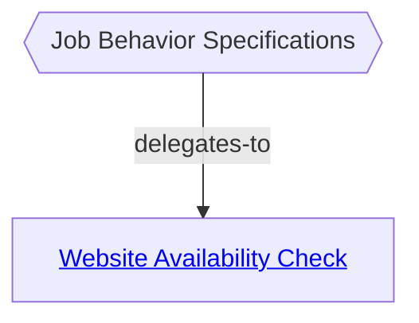
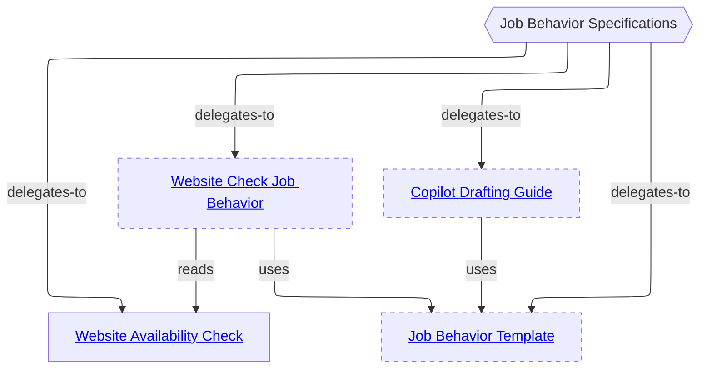

# Job Behavior Specifications

## Purpose

A set of job behavior documents: a blank template and a GitHub Copilot skill with usage guidance for our team, and a completed reference specification that the vendor receives, so the vendor can review and acknowledge a versioned record of each job's current behavior before the jobs are migrated onto our client's platform as workflows.

## Navigation

**Job Behavior Specifications**

- [Components](#components)
- [Design](#design)
  - [Diagram](#diagram)
- [Technology](#technology)
- [Behavior](#behavior)
- [Plan](#plan)
- [Links](#links)

## Components

| Component | Purpose |
| --- | --- |
| [Website Availability Check](website-availability-check/README.md#purpose) | A job script that checks one configured website URL, stays silent when it is up and requests one email alert through a notifier when it is down; kept unchanged as read-only source evidence. |
| [Job Behavior Template](job-behavior-template/README.md#purpose) | The blank, reusable form a developer fills in to document one vendor job from its source code. |
| [Website Check Job Behavior](website-check-job-behavior/README.md#purpose) | The completed reference specification of the website-check job in plain business language. |
| [Copilot Drafting Guide](copilot-drafting-guide/README.md#purpose) | A GitHub Copilot agent skill that creates, drafts and versions a job behavior document from source, with usage and model guidance. |

## Design

The root owns no job code. It holds the shared rules ([requirements](requirements.md#requirements), [contract](contract.md#contract)). The only built child, [Website Availability Check](website-availability-check/README.md#design), is the illustrative job script, kept unchanged and read-only as source evidence for the reference specification; it declares its own `test` and `coverage` checks. The three document components are planned and not built yet.

### Diagram

## Technology

- Vendor documents in Markdown with a Mermaid diagram and a plain-text description; our team's instructions are a GitHub Copilot agent skill. No runtime code is added. Only the retained source-evidence component uses Node 26 with native TypeScript, no dependencies, and `node:test` with injected mocks (see its README). Detail is in [requirements.md](requirements.md#requirements).

## Behavior

- **B01** When the template, the reference specification and the template copy inside the skill folder are compared, then they share the same section headings and the same ID scheme, and the copy is identical to the template. (untested: benchmark pending)
- **B02** When the pack files (`job-behavior-template.md`, `website-check-job-behavior-v1.md`, the `document-job-behavior/` skill folder, `usage-and-model-guidance.md` and `drafting-prompt.md`) are inspected, then none contains a Craft file name, command or term, and they can be used with plain Markdown and GitHub Copilot in VS Code agent mode alone. (untested: benchmark pending)
- **B03** When the skill is run in Copilot on the website job source, then the draft reconciles with the reference specification, its self-check report is returned and its acknowledgement block is blank. (untested: benchmark pending)

## Plan

### Planned Navigation

**Job Behavior Specifications**

- [Planned Components](#planned-components)
- [Planned Design](#planned-design)
  - [Planned Diagram](#planned-diagram)
- [Steps](#steps)
- [Acceptance Mapping](#acceptance-mapping)
- [Assumptions And Open Questions](#assumptions-and-open-questions)
- [Planned Links](#planned-links)

### Planned Components

| Component | Purpose |
| --- | --- |
| [Website Availability Check](website-availability-check/README.md#purpose) | A job script that checks one configured website URL, stays silent when it is up and requests one email alert through a notifier when it is down; kept unchanged as read-only source evidence. |
| [Job Behavior Template](job-behavior-template/README.md#planned-purpose) | The blank, reusable form a developer fills in to document one vendor job from its source code. |
| [Website Check Job Behavior](website-check-job-behavior/README.md#planned-purpose) | The completed reference specification of the website-check job in plain business language. |
| [Copilot Drafting Guide](copilot-drafting-guide/README.md#planned-purpose) | A GitHub Copilot agent skill that creates, drafts and versions a job behavior document from source, with usage and model guidance. |

### Planned Design

The root composes the three document components and checks that they agree. The [template](job-behavior-template/README.md#planned-design) is built first. The [reference specification](website-check-job-behavior/README.md#planned-design) and the [drafting guide](copilot-drafting-guide/README.md#planned-design) both use the template, and the reference specification also reads the illustrative job as evidence. The root is built last: it rewrites its Design from the built children and runs its own review checklist. This diagram shows the components of the project; it is separate from the one-box job diagram that each job document carries.

#### Planned Diagram

### Steps

1. Build `job-behavior-template` first, then `website-check-job-behavior` and `copilot-drafting-guide` (one at a time, since a build runs one component), then this root.
2. Root build: rewrite this README's Design and diagram from the built children, dissolve this Plan, and keep the Components table.
3. Root build: create `review-checklist.md` with one item per root behavior, tagged `[B01]` to `[B03]`, including the check that the skill's template copy matches the template and the dry run of the skill on the website job source.
4. Already done at planning time: the root `test` and `coverage` checks moved to `website-availability-check/craft.json` so no document build runs a test command, and the root and that component's lineage links use the new project name. The root `backlog.md` now holds the later items.

### Acceptance Mapping

| Acceptance condition | Behaviors | Step | Validation check |
| --- | --- | --- | --- |
| Template, reference specification and the skill's template copy share headings and IDs, and the copy is identical | B01 | 3 | `review-checklist.md` item [B01], comparing the documents |
| No Craft term in the pack files | B02 | 3 | `review-checklist.md` item [B02], a scan of the files |
| The skill run on the website job source reconciles with the reference specification, returns its self-check report and leaves the acknowledgement blank | B03 | 3 | `review-checklist.md` item [B03], a Copilot dry run (needs Copilot access) |

Checks: the root declares no automated check. The record validators run at the end of the plan and each build.

### Assumptions And Open Questions

Assumptions (override any of them in chat before `/craft:build`). This plan replaces the earlier plan of commit `8c80eed`, as the user revised the content on 2026-11-14:

1. The project root stays this folder and is retitled **Job Behavior Specifications**; the three components are new folders in kebab-case. Override: ask for other names.
2. The illustrative job `website-availability-check` stays in place, unchanged and read-only, as source evidence. It is not renamed, moved or deleted. Its `craft.json` declares the `test` and `coverage` checks the root had, and one lineage link in its README names the new project. Override: ask for it to be moved under the reference specification.
3. The root has a task and a build because it lists integration behaviors B01 to B03. Its limits cover three children.
4. Documents are not run by any tool. Every behavior is marked "untested: benchmark pending" and each component's `review-checklist.md` plus a manual dry-run review is the stand-in; this does not satisfy the test-tag rule. Override: build the benchmark verification first (backlog item `prompt-skill-benchmark`).
5. The vendor acknowledges through a tracker, not by editing the documents. The tracker is a later backlog item (`job-migration-tracker`), and until it exists the acknowledgement is recorded by our team from the vendor's tracker entry or reply. Grouping jobs into workflows is our own later internal decision (backlog item `workflow-grouping-document`), not vendor-signed. No similarity field is added to any job document.
6. The Copilot Drafting Guide is built as an agent skill, because our team's developers use VS Code agent mode where skills work; the fallback prompt exists only for surfaces without skills. Override: ask for a prompt only.
7. Build order is the template, then the reference specification and the guide, then the root.
8. Open items for the user: whether skill support is enabled by the developers' Copilot plan and administrator policy and which VS Code harness they use (the docs read do not say), and the model guidance for the GPT-6 models, which the GitHub pages read do not cover (task guidance for them was not read from the docs). Behavior questions: none open.

### Planned Links

- [requirements.md](requirements.md#requirements) — shared rules of the project.
- [contract.md](contract.md#contract) — the document pack and shared wording rules.
- [backlog.md](backlog.md) — later items: the tracker, the grouping document, the skill benchmark and the notification-system decision.

## Links

- [requirements.md](requirements.md#requirements) — shared rules of the project.
- [contract.md](contract.md#contract) — the document pack and shared wording rules.
- [backlog.md](backlog.md) — later items: the tracker, the grouping document, the skill benchmark and the notification-system decision.
