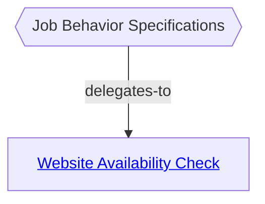
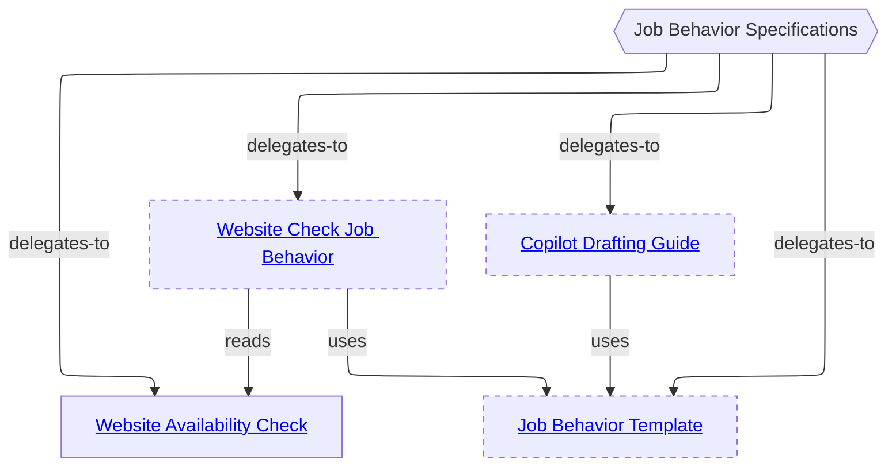

# Job Behavior Specifications

## Purpose

A set of client-facing job behavior specification documents: a blank template for documenting a job from its source code, a completed reference specification, and a GitHub Copilot prompt with usage guidance, so a client can review and explicitly acknowledge a versioned behavioral baseline before jobs are migrated onto our platform as workflows.

## Navigation

**Job Behavior Specifications**

- [Components](#components)
- [Design](#design)
  - [Diagram](#diagram)
- [Technology](#technology)
- [Behavior](#behavior)
- [Plan](#plan)
- [Links](#links)

## Components

| Component | Purpose |
| --- | --- |
| [Website Availability Check](website-availability-check/README.md#purpose) | A job script that checks one configured website URL, stays silent when it is up and requests one email alert through a notifier when it is down; kept unchanged as read-only source evidence. |
| [Job Behavior Template](job-behavior-template/README.md#purpose) | The blank, reusable form a developer fills in to document one client job from its source code. |
| [Website Check Job Behavior](website-check-job-behavior/README.md#purpose) | The completed reference specification of the website-check job in plain business language. |
| [Copilot Drafting Guide](copilot-drafting-guide/README.md#purpose) | A prompt that has GitHub Copilot draft a job behavior document from source, with usage and model guidance. |

## Design

The root owns no job code. It holds the shared rules ([requirements](requirements.md#requirements), [contract](contract.md#contract)). The only built child, [Website Availability Check](website-availability-check/README.md#design), is the illustrative job script, kept unchanged and read-only as source evidence for the reference specification; it declares its own `test` and `coverage` checks. The three document components are planned and not built yet.

### Diagram

## Technology

- Client documents in Markdown with a Mermaid diagram and a plain-text description; no runtime code is added. Only the retained source-evidence component uses Node 26 with native TypeScript, no dependencies, and `node:test` with injected mocks (see its README). Detail is in [requirements.md](requirements.md#requirements).

## Behavior

- **B01** When the template, the reference specification and the prompt's expected output are compared, then they share the same section headings and the same ID scheme. (untested: benchmark pending)
- **B02** When the four client-pack files (`job-behavior-template.md`, `website-check-job-behavior.md`, `drafting-prompt.md`, `usage-and-model-guidance.md`) are inspected, then none contains a Craft file name, command or term, and they can be used with plain Markdown and GitHub Copilot alone. (untested: benchmark pending)
- **B03** When the prompt is run in Copilot on the website job source, then the draft reconciles with the reference specification and contains no approved or acknowledged content. (untested: benchmark pending)

## Plan

### Planned Navigation

**Job Behavior Specifications**

- [Planned Components](#planned-components)
- [Planned Design](#planned-design)
  - [Planned Diagram](#planned-diagram)
- [Steps](#steps)
- [Acceptance Mapping](#acceptance-mapping)
- [Assumptions And Open Questions](#assumptions-and-open-questions)
- [Planned Links](#planned-links)

### Planned Components

| Component | Purpose |
| --- | --- |
| [Website Availability Check](website-availability-check/README.md#purpose) | A job script that checks one configured website URL, stays silent when it is up and requests one email alert through a notifier when it is down; kept unchanged as read-only source evidence. |
| [Job Behavior Template](job-behavior-template/README.md#planned-purpose) | The blank, reusable form a developer fills in to document one client job from its source code. |
| [Website Check Job Behavior](website-check-job-behavior/README.md#planned-purpose) | The completed reference specification of the website-check job in plain business language. |
| [Copilot Drafting Guide](copilot-drafting-guide/README.md#planned-purpose) | A prompt that has GitHub Copilot draft a job behavior document from source, with usage and model guidance. |

### Planned Design

The root composes the three document components and checks that they agree. The [template](job-behavior-template/README.md#planned-design) is built first. The [reference specification](website-check-job-behavior/README.md#planned-design) and the [drafting guide](copilot-drafting-guide/README.md#planned-design) both use the template, and the reference specification also reads the illustrative job as evidence. The root is built last: it rewrites its Design from the built children and runs its own review checklist. This diagram shows the components of the project; it is separate from the one-box job diagram that each job document carries.

#### Planned Diagram

### Steps

1. Build `job-behavior-template` first, then `website-check-job-behavior` and `copilot-drafting-guide`, then this root.
2. Root build: rewrite this README's Design and diagram from the built children, dissolve this Plan, and keep the Components table.
3. Root build: create `review-checklist.md` with one item per root behavior, tagged `[B01]` to `[B03]`, including the dry run of the prompt on the website job source.
4. Already done at planning time: the root `test` and `coverage` checks moved to `website-availability-check/craft.json` so no document build runs a test command, and the root and that component's lineage links use the new project name.

### Acceptance Mapping

| Acceptance condition | Behaviors | Step | Validation check |
| --- | --- | --- | --- |
| Template, reference specification and prompt output share headings and IDs | B01 | 3 | `review-checklist.md` item [B01], comparing the three documents |
| No Craft term in the four client-pack files | B02 | 3 | `review-checklist.md` item [B02], a scan of the four files |
| The prompt run on the website job source reconciles with the reference specification | B03 | 3 | `review-checklist.md` item [B03], a Copilot dry run (needs Copilot access) |

Checks: the root declares no automated check. The record validators run at the end of the plan and each build.

### Assumptions And Open Questions

Assumptions (override any of them in chat before `/craft:build`):

1. The project root stays this folder and is retitled **Job Behavior Specifications**; the three components are new folders in kebab-case. Override: ask for other names.
2. The illustrative job `website-availability-check` stays in place, unchanged and read-only, as source evidence. It is not renamed, moved or deleted. Its `craft.json` now declares the `test` and `coverage` checks the root had, and one lineage link in its README names the new project. Override: ask for it to be moved under the reference specification.
3. The root has a task and a build because it lists integration behaviors B01 to B03. Its limits cover three children.
4. Documents are not run by any tool. Every behavior is marked "untested: benchmark pending" and each component's `review-checklist.md` plus a manual dry-run review is the stand-in; this does not satisfy the test-tag rule. Override: build the benchmark verification first (suggested backlog item).
5. The grouping of similar jobs into workflows is our own later internal decision, in a separate document, not built here and not client-signed. No similarity field is added to any job document.
6. Backlog is elective and no backlog file exists here, so none was created. Suggested items if you want them recorded: the internal grouping document built from finished specs; benchmark verification of the Copilot prompt; the decision of which notification system and email transport the website-check job will use.
7. Build order is the template, then the reference specification and the guide (one at a time, since a build runs one component at a time), then the root.
8. The user-side open item: the exact Terra and Luna version names in the client's Copilot picker. Behavior questions: none open.

### Planned Links

- [requirements.md](requirements.md#requirements) — shared rules of the project.
- [contract.md](contract.md#contract) — the client pack and shared wording rules.

## Links

- [requirements.md](requirements.md#requirements) — shared rules of the project.
- [contract.md](contract.md#contract) — the client pack and shared wording rules.
