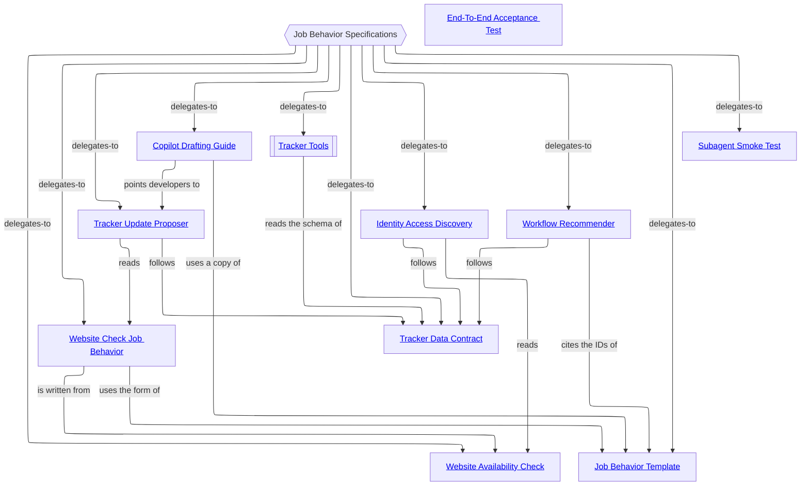
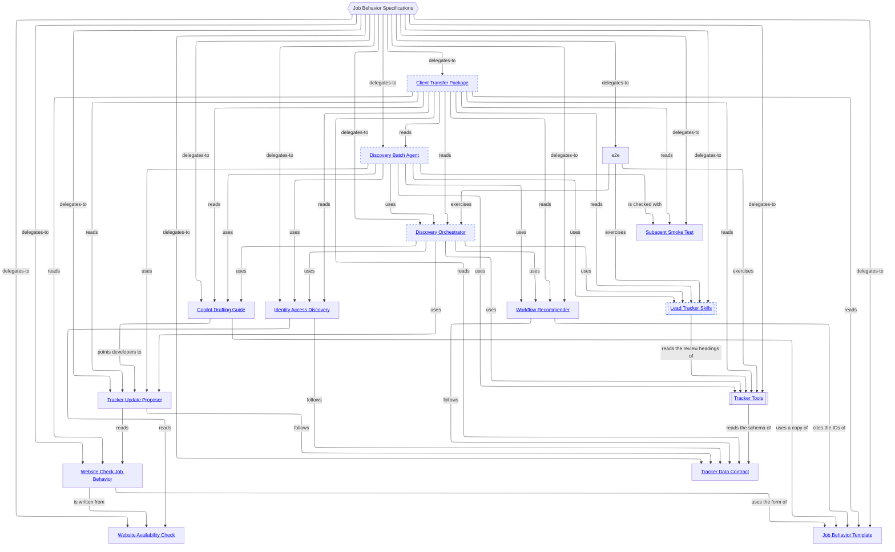

# Job Behavior Specifications

## Purpose

Two things for the vendor-to-platform migration: a job behavior pack (a blank template, a completed reference specification and a GitHub Copilot drafting skill with usage guidance) so a vendor can review and acknowledge a versioned record of each use case's current behavior before it is migrated onto our client's platform as a workflow; and a use case tracker toolkit (one shared data contract, three more Copilot skills and the lead Node tools) so proposed use cases, questions, access requests and workflow mappings reach a SharePoint tracker as reviewable changes and nothing reaches a vendor that it should not see.

## Navigation

**Job Behavior Specifications**

- [Components](#components)
- [Design](#design)
  - [Diagram](#diagram)
- [Technology](#technology)
- [Behavior](#behavior)
- [Links](#links)

## Components

| Component | Purpose |
| --- | --- |
| [Website Availability Check](website-availability-check/README.md#purpose) | A job script that checks one configured website URL, stays silent when it is up and requests one email alert through a notifier when it is down; kept unchanged as read-only source evidence. |
| [Job Behavior Template](job-behavior-template/README.md#purpose) | The blank, reusable form our team fills in to document one vendor use case from its source code, with a short filling guide. |
| [Website Check Job Behavior](website-check-job-behavior/README.md#purpose) | The completed reference specification of the website-check job in plain business language. |
| [Copilot Drafting Guide](copilot-drafting-guide/README.md#purpose) | A GitHub Copilot agent skill that creates, drafts, updates and versions a job behavior document from source, with usage and model guidance. |
| [Tracker Data Contract](tracker-data-contract/README.md#purpose) | The one shared data contract for the use case tracker: tabs, columns, references, status lists, vendor visibility, the proposal file format and the export format, with a guide for building the SharePoint workbooks, so every skill and tool reads and writes the same shapes. |
| [Tracker Update Proposer](tracker-update-proposer/README.md#purpose) | A GitHub Copilot agent skill that turns a use case specification into proposed use case and question rows in `tracker-updates.csv`, so developers hand a lead reviewable tracker changes with each specification and no one retypes questions. |
| [Identity Access Discovery](identity-access-discovery/README.md#purpose) | A GitHub Copilot agent skill that reads a use case's source and configuration and proposes Identity & Access rows (services, environments, observed operations and identity references), so access requests can start from day one and leads can see possible shared requests. |
| [Workflow Recommender](workflow-recommender/README.md#purpose) | A GitHub Copilot agent skill that compares use case specifications by their behaviors and generates internal use-case-to-workflow recommendations, with the format of the lead-owned decisions file, so leads can decide which use cases can share one reusable workflow. |
| [Discovery Orchestrator](discovery-orchestrator/README.md#purpose) | A GitHub Copilot agent skill that takes one use-case folder through the discovery stages in order, refreshes the consolidated review CSVs and walks a lead through the pending rows, so leads review and decide in one flow and each folder is processed without duplicates. |
| [Tracker Tools](tracker-tools/README.md#purpose) | The lead-facing Node tools for the use case tracker: a shared CSV table library, a reconciler that turns reviewed proposals and a tracker export into reviewable changes, and a daily summary. Leads run them by hand; the authoritative tracker stays an Excel workbook on SharePoint. |
| [Client Transfer Package](client-transfer-package/README.md#purpose) | A Python tool that packs the completed Copilot skills, tracker contract, guides and lead tools into one text-only zip with a manifest, a restore script and a Copilot restore prompt, so the pack can be sent into the client environment and restored there by Copilot Agent mode. |
| [Lead Tracker Skills](lead-tracker-skills/README.md#components) | The Copilot agent skills a lead uses in chat on top of the lead tracker tools' output, starting with Review Decisions, which records and revisits decisions on the review CSVs. |
| [Discovery Batch Agent](discovery-batch-agent/README.md#purpose) | A GitHub Copilot custom agent that runs discovery for several use cases in one go, each in an isolated subagent, then recommends workflows and exports the review once and hands the review to the lead in chat. |
| [Subagent Smoke Test](subagent-smoke-test/README.md#purpose) | Two prompts a developer runs in Copilot Chat in the client environment to check that subagents run, that their context is isolated and that a subagent can use an installed skill. |
| [End-To-End Acceptance Test](end-to-end-acceptance-test/README.md#purpose) | A manual acceptance test of the whole lead flow, run by a person in the client environment on fictional data: a run sheet with the exact prompt or command, the expected result and a pass or fail record at every step, plus the fictional fixtures and the tests that prove every documented command. |

## Design

The root owns no job code and no tool code. It holds the shared rules ([requirements](requirements.md#requirements), [contract](contract.md#contract)), a [review checklist](review-checklist.md) for the document and skill behaviors, and an integration test that runs the built tools against the real example proposal and schema. Three document components make the pack: the [Job Behavior Template](job-behavior-template/README.md#design), the [Website Check Job Behavior](website-check-job-behavior/README.md#design) reference specification filled in from it, and the [Copilot Drafting Guide](copilot-drafting-guide/README.md#design) skill that drafts a specification from source with a copy of the template; the illustrative job [Website Availability Check](website-availability-check/README.md#design) stays unchanged and read-only as the source evidence. The toolkit has one shared interface, the [Tracker Data Contract](tracker-data-contract/README.md#design): three Copilot skills write proposals in its format, the [Tracker Update Proposer](tracker-update-proposer/README.md#design), the [Identity Access Discovery](identity-access-discovery/README.md#design) skill and the [Workflow Recommender](workflow-recommender/README.md#design), each holding byte-identical copies of the contract files, and the [Tracker Tools](tracker-tools/README.md#diagram) (a table library, a reconciler and a daily summary) read the schema from the contract component, reconcile proposals with an export and write the vendor-safe views and the internal summary for a lead to apply by hand. The end-to-end handoffs are in [contract.md](contract.md#end-to-end-handoffs). Each job document carries its own one-box diagram; this diagram shows the components of the project. The [Subagent Smoke Test](subagent-smoke-test/README.md#design) is two prompts a developer runs in the client environment to check Copilot's subagent support; it is a check, not part of the toolkit's data flow.

### Diagram

## Technology

- The documents are Markdown (and CSV for the contract files) with Mermaid diagrams and plain-text descriptions, read on GitHub. Our team's instructions are four GitHub Copilot agent skills (VS Code agent mode); no Craft installation is needed to use them. Only the retained source-evidence job and the lead tools use code: Node 26 with native TypeScript (erasable syntax, `.ts` import extensions), no dependencies, ES modules and `node:test`, with real temporary directories in the tool tests (see [Tracker Tools](tracker-tools/README.md#technology) and [Website Availability Check](website-availability-check/README.md#technology)).
- The root integration tests in [test](test/) use the same stack, import the tools' `cli` modules by relative path, read the real example proposal and the real schema, run in real temporary directories and need no root `package.json`. The root declares only the `test` and `testGlob` checks in [craft.json](craft.json); the document and skill components declare none and the code components declare their own. Detail is in [requirements.md](requirements.md#requirements).

## Behavior

- **B01** When the template, the reference specification and the template copy inside the skill folder are compared, then they share the same part headings and the same ID scheme (`B`, `Q`, `AC`), and the copy is identical to the template.
- **B02** When the pack files (`job-behavior-template.md`, `filling-guide.md`, `website-availability-check.md`, the three skill folders, the tracker contract files, `usage-and-model-guidance.md` and `drafting-prompt.md`) are inspected, then none contains a Craft file name, command or term, they can be used with plain Markdown, CSV and GitHub Copilot in VS Code agent mode alone, and the specification's links and diagram work when it is viewed in a repository on GitHub. (untested: benchmark pending)
- **B03** When the drafting skill's instructions, its guidance and its fallback prompt are read, then they say it never ticks, confirms or records an acknowledgement on its own and leaves the acknowledgement log blank unless a developer gives the facts, and they accept the core files, tagged documents and supplied findings as they are; results of the user's manual tests of the skill in the client environment on real use cases are recorded as user-reported evidence for the version tested and are not claimed as a pass here. (untested: benchmark pending)
- **B04** When the team-facing files are scanned, then `use case` names the business unit, `job` or `script` names only the vendor's script, `workflow` is defined once as the reusable implementation, and no vendor-readable file mentions workflows or grouping. (untested: benchmark pending)
- **B05** When the three skill folders and the tracker tools' schema path are compared with the Tracker Data Contract, then every copy of the contract and schema files is identical.
- **B06** When the example `tracker-updates.csv` for the website use case is validated and reconciled against an empty export fixture, the additions are applied by test code, and it is reconciled again, then the first run produces additions and the second produces none.
- **B07** When the reconciler and the summary run on a three-vendor fixture, then vendor-safe outputs hold no internal column, question group, link, mapping, unreleased question row or other vendor's row, and the summary is the only place the three tracks appear together.
- **B08** When a revised specification's proposal is reconciled against an export that holds a vendor's answer to a question row, an owner and a decided mapping, then the existing question row, its answer and its owner are preserved with no duplicate record, a wording edit gives a text-review suggestion and no withdrawal, a change that could affect grouping suggests re-review of the decided mapping, a behavior change with no grouping impact suggests none, an unknown impact is listed as unknown, a version-only change suggests none, and nothing is released or applied.
- **B09** When two vendors each have a use case of the same name and their proposals add each use case and its question 1, then the reconciler and the exporter list two use case additions and two question additions under two different use case IDs, and neither is merged, held or matched to the other's row.
- **B10** When a proposal's local reference names a use case ID that no export row and no added use case has, then the run stops naming the file and line and writes nothing, and a reference in the old use case name or slug-alone form is not accepted.

`B09` and `B10` are planned for the root tests (see the Plan). `B01`, `B05` to `B08` are checked by the root tests in [test](test/) (file comparisons for `B01` and `B05`, the built tools for `B06` to `B08`), each test titled with its tag. `B02` to `B04` are checked by the file review and the scans in [review-checklist.md](review-checklist.md), and the Copilot skills are tested manually by the user in the client environment on real use cases; no Copilot or client-environment result is claimed here.

## Links

- [requirements.md](requirements.md#requirements) — shared rules of the project.
- [contract.md](contract.md#contract) — the pack, the vocabulary, the shared tracker pointer and the end-to-end handoffs.
- [review-checklist.md](review-checklist.md) — the file review and scans for the document and skill behaviors `B01` to `B05`.
- [test](test/) — the root integration tests for `B01` and `B05` to `B08`: [documents](test/documents.test.ts), [pipeline](test/pipeline.test.ts), [vendor safety](test/vendor-safety.test.ts) and [revision](test/revision.test.ts).
- [backlog.md](backlog.md) — later items: the skill benchmark, the notification-system decision, the vendor access and layout decision, the vendor inventory, direct tracker integration, the naming alignment, the skill grouping and the follow-ups found while building the toolkit.

## Plan

### Planned Navigation

**Job Behavior Specifications**

- [Planned Components](#planned-components)
- [Planned Design](#planned-design)
  - [Planned Diagram](#planned-diagram)
- [Planned Relationships](#planned-relationships)

### Planned Components

| Component | Purpose |
| --- | --- |
| [Website Availability Check](website-availability-check/README.md#purpose) | A job script that checks one configured website URL, stays silent when it is up and requests one email alert through a notifier when it is down; kept unchanged as read-only source evidence. |
| [Job Behavior Template](job-behavior-template/README.md#purpose) | The blank, reusable form our team fills in to document one vendor use case from its source code, with a short filling guide. |
| [Website Check Job Behavior](website-check-job-behavior/README.md#purpose) | The completed reference specification of the website-check job in plain business language. |
| [Copilot Drafting Guide](copilot-drafting-guide/README.md#purpose) | A GitHub Copilot agent skill that creates, drafts, updates and versions a job behavior document from source, with usage and model guidance. |
| [Tracker Data Contract](tracker-data-contract/README.md#purpose) | The one shared data contract for the use case tracker: tabs, columns, references, status lists, vendor visibility, the proposal file format and the export format, with a guide for building the SharePoint workbooks, so every skill and tool reads and writes the same shapes. |
| [Tracker Update Proposer](tracker-update-proposer/README.md#purpose) | A GitHub Copilot agent skill that turns a use case specification into proposed use case and question rows in `tracker-updates.csv`, so developers hand a lead reviewable tracker changes with each specification and no one retypes questions. |
| [Identity Access Discovery](identity-access-discovery/README.md#purpose) | A GitHub Copilot agent skill that reads a use case's source and configuration and proposes Identity & Access rows (services, environments, observed operations and identity references), so access requests can start from day one and leads can see possible shared requests. |
| [Workflow Recommender](workflow-recommender/README.md#planned-design) | A GitHub Copilot agent skill that compares use case specifications by their behaviors and generates internal use-case-to-workflow recommendations, with the format of the lead-owned decisions file, so leads can decide which use cases can share one reusable workflow. |
| [Discovery Orchestrator](discovery-orchestrator/README.md#planned-design) | A GitHub Copilot agent skill that takes one use-case folder through the discovery stages in order, refreshes the consolidated review CSVs and walks a lead through the pending rows, so leads review and decide in one flow and each folder is processed without duplicates. |
| [Tracker Tools](tracker-tools/README.md#purpose) | The lead-facing Node tools for the use case tracker: a shared CSV table library, a reconciler that turns reviewed proposals and a tracker export into reviewable changes, and a daily summary. Leads run them by hand; the authoritative tracker stays an Excel workbook on SharePoint. |
| [Client Transfer Package](client-transfer-package/README.md#planned-design) | A Python tool that packs the completed Copilot skills, tracker contract, guides and lead tools into one text-only zip with a manifest, a restore script and a Copilot restore prompt. |
| [Lead Tracker Skills](lead-tracker-skills/README.md#design) | The Copilot agent skills a lead uses in chat on top of the lead tracker tools' output, starting with Review Decisions, which records and revisits decisions on the review CSVs. |
| [Discovery Batch Agent](discovery-batch-agent/README.md#planned-design) | A GitHub Copilot custom agent that runs discovery for several use cases in one go, each in an isolated subagent, then recommends workflows and exports the review once and hands the review to the lead in chat. |
| [Subagent Smoke Test](subagent-smoke-test/README.md#purpose) | Two prompts a developer runs in Copilot Chat in the client environment to check that subagents run, that their context is isolated and that a subagent can use an installed skill. |
| [End-To-End Acceptance Test](end-to-end-acceptance-test/README.md#planned-design) | A manual acceptance test of the whole lead flow, run by a person in the client environment on fictional data: a run sheet with the exact prompt or command, the expected result and a pass or fail record at every step, plus the fictional fixtures and the tests that prove every documented command. |

### Planned Design

The root gains a tenth child, the [Discovery Orchestrator](discovery-orchestrator/README.md#planned-design), a Copilot skill that coordinates the four existing skills and runs the lead tools' new Review CSV Exporter (planned in [Tracker Tools](tracker-tools/README.md#plan)), so a lead takes one use-case folder through the discovery stages and reviews the pending rows in one flow. It writes no proposal file of its own and decides nothing for the lead. When the plan is built the root records change as proposed here, to be made by the root's owner (the root also gains an eleventh child, the [Client Transfer Package](client-transfer-package/README.md#planned-design), which reads the files of the skills, the contract, the guides and the tools to pack them and changes none of them, so its root test fixtures must not add copies of the contract or schema): the technology text counts five Copilot skills, root `B02` lists the new skill folder among the inspected pack files, the end-to-end handoffs note that steps 2, 4, 5 and 6 can run per folder through the orchestrator and the review CSVs with applying still by hand, and the review columns and their values are stated once in the contract.

The use case index change adds no component. The [Discovery Orchestrator](discovery-orchestrator/README.md#planned-design) will write a `use-case-index.csv` at the repository root and derive each folder's proposal ID, and the [Workflow Recommender](workflow-recommender/README.md#planned-design) will read the index for its list with a fixed proposal ID, so use-case folders can sit at any depth (for example `<vendor>/<job>/`). When that plan is built the root records change as proposed here, to be made by the root's owner: the technology text names the index, and the end-to-end handoffs say in step 4 that the orchestrator derives each folder's proposal ID as `uc-<vendor-slug>-<use-case-slug>` and in step 6 that the recommender runs over every index row, both pointing to the [orchestrator's contract](discovery-orchestrator/contract.md#planned-use-case-index-derived-proposal-id-and-fixed-recommendations-id) rather than restating the columns. The Tracker Data Contract and its copies are not changed, so `B05` is unaffected. This root Plan is extended, not replaced, because it still carries the unbuilt plans for the Client Transfer Package and the earlier root record changes; override by asking for the root Plan to be replaced.

The lead tool conversion plan is withdrawn and replaced: the user confirmed on 2026-11-16 that scripts can run in the client environment, so the lead tools stay Node tools in [Tracker Tools](tracker-tools/README.md#plan) and the [Client Transfer Package](client-transfer-package/README.md#planned-design) ships them. The [Lead Tracker Skills](lead-tracker-skills/README.md#design) child stays, now a group with one skill, [Review Decisions](lead-tracker-skills/review-decisions/README.md#design), that records and revisits the lead's decisions on the review CSVs; the [Discovery Orchestrator](discovery-orchestrator/README.md#planned-design) hands the review to it after the export and keeps the Node exporter call. When that plan is built the root records change as proposed here, to be made by the root's owner: the technology text and `requirements.md` say the lead tools are Node tools that ship to the client and the review decisions are made through a Markdown skill, the end-to-end handoffs say in step 7 that the lead records and revisits decisions through `record-review-decisions` (called by the orchestrator or alone), root `B02` lists the new skill folder among the inspected pack files, and the contract's pack table lists the group. Root `B05` and its test are unchanged, because the skill holds no copy of the contract or schema. The Tracker Data Contract is not changed.

The master workbook update adds no root child; it is the eighth member of [Tracker Tools](tracker-tools/README.md#plan), the [Master Workbook Updater](tracker-tools/master-workbook-updater/README.md#planned-design), which applies accepted review rows to the internal master workbook, copies vendor answers into it and rebuilds each named vendor's workbook (the backlog item `internal-tracker-apply`, now planned). When it is built the root records change as proposed here, to be made by the root's owner: the contract's end-to-end handoff steps 5, 9 and 12 gain "or run `update-master-workbook`", the pack table's `tracker-tools/` row is extended, and an optional root test runs the tool on the example data. Root `B07` keeps its confirmed wording and the Tracker Data Contract is unchanged. This Plan is extended, not replaced.

The batch agent adds one root child, the [Discovery Batch Agent](discovery-batch-agent/README.md#planned-design), a Copilot custom agent that runs discovery for several use cases in one go, each in an isolated subagent, and hands the review to `record-review-decisions` in the main conversation. It writes only use case index rows and changes no existing component. The [Subagent Smoke Test](subagent-smoke-test/README.md#design) child, two prompts that show whether the client's Copilot supports subagents, is listed with it, and the agent's claims are gated on it. When the agent is built the root records change as proposed here, to be made by the root's owner: the technology text names the custom agent file beside the Copilot skills; root `B02` adds `discovery-batch.agent.md` and the two smoke test prompt files to the inspected pack files, in one edit with the skill-folder additions already planned above; and the end-to-end handoffs note that steps 2, 4, 5 and 6 can also run for several folders through the batch agent, with the review still through `record-review-decisions` and applying still by hand. The index lines planned above stay as they are and are made when the [Workflow Recommender](workflow-recommender/README.md#planned-design) is built, which the batch agent is built after; the Tracker Data Contract and root `B05` are unchanged. The use case ID change replaces the use case name as the identity in every tracker local reference. The ID is `uc-<vendor-slug>-<use-case-slug>`, derived from `vendor` and `use_case_name` and never stored, so two vendors' same-named use cases no longer collide; it also settles the form of a question row's local reference (`<use-case-id>/Q<n>`). It is planned once for the backlog items `local-reference-form-decision` and `cross-vendor-use-case-name-collision`, whose rows are removed with this plan, and it supersedes the earlier decision not to put the vendor in the keys. It changes eleven components, each with its own bounded Plan: the [Tracker Data Contract](tracker-data-contract/README.md#planned-design) defines the ID once and builds every local reference from it; the three skill components that hold its byte-identical copy carry their key rules and examples ([Tracker Update Proposer](tracker-update-proposer/README.md#planned-design), [Identity Access Discovery](identity-access-discovery/README.md#planned-design) and [Workflow Recommender](workflow-recommender/README.md#planned-design)); the [Tracker Tools](tracker-tools/README.md#plan) gain one shared helper in the table library and match by ID in the reconciler, the review exporter and both workbook updaters, with the Sample Tracker Workbook's fixtures; and the [Discovery Orchestrator](discovery-orchestrator/README.md#planned-design) says its proposal ID is that same ID. The root's own part, built last, is the root test fixtures and support rewritten to ID keys with a pair of same-named use cases under two vendors, the behaviors `B09` and `B10`, and one `requirements.md` bullet (the vocabulary line that makes the name the identity becomes the vendor with the name); the end-to-end handoffs in `contract.md` and the review checklist change only if a search finds a key form, and none was found. Nothing in the Tracker Data Contract's schema changes, so `B05` stays unaffected once the three copies match. The [Discovery Batch Agent](discovery-batch-agent/README.md#planned-design) and the [Client Transfer Package](client-transfer-package/README.md#planned-design) need no change, but the package builds last so its zip carries the new keys. This Plan is extended, not replaced.

The end-to-end acceptance test adds one root child, the [End-To-End Acceptance Test](end-to-end-acceptance-test/README.md#planned-design), a run sheet, fictional fixtures and tests that let a person validate the whole lead flow in the client environment, from discovery of one use case through the review decisions, the master and vendor workbooks, a vendor answer, its incorporation into the specification and the daily summary. It owns none of the components it exercises and changes none of them, and the root's own tests and root `B05` are unaffected because its fixtures hold no copy of the contract or schema. The root's allocation and child limit are raised by the new child's share. It is built after the use case ID change, so its fixtures use ID keys. When it is built the root records change as proposed here, to be made by the root's owner: nothing in the technology text or the behaviors, and the end-to-end handoffs may point to the run sheet. This Plan is extended, not replaced.

#### Planned Diagram

### Steps

For the use case ID change. The root's own task is the last step; each other step is the named component's own task.

1. [Workflow Recommender](workflow-recommender/README.md#planned-design) (existing task, now carrying the key rules): after the Tracker Data Contract.
2. [Tracker Data Contract](tracker-data-contract/README.md#planned-design): the ID definition and the References table.
3. [Tracker Update Proposer](tracker-update-proposer/README.md#planned-design), [Identity Access Discovery](identity-access-discovery/README.md#planned-design) and the Workflow Recommender (step 1): straight after step 2, so the root copy test is red only until the last of them lands.
4. The table library, then the reconciler, the review exporter, the vendor workbook updater and the master workbook updater, in [Tracker Tools](tracker-tools/README.md#plan).
5. [Discovery Orchestrator](discovery-orchestrator/README.md#planned-design): wording.
6. The Sample Tracker Workbook (its task is blocked on an unrelated model block and is set ready by the user), then the Vendor Sample Workbook, which needs no plan.
7. Root task: `requirements.md` bullet, `test/fixtures.ts` and `test/support.ts` to ID keys with a same-named pair under two vendors, the `B09` and `B10` tests (tagged in their titles) in `test/pipeline.test.ts` and `test/vendor-safety.test.ts`, and a search that finds no `<use-case-name>/` or `<use-case-slug>/` key form in the pack.
8. [Client Transfer Package](client-transfer-package/README.md#planned-design) last, so the zip carries the new keys.

The [End-To-End Acceptance Test](end-to-end-acceptance-test/README.md#planned-design) is built after step 7, so its fixtures use the final ID keys; it changes no other component.

### Acceptance Mapping

| Acceptance | Behaviors | Step | Test |
| --- | --- | --- | --- |
| 1. Two vendors' same-named use cases and their question 1 reconcile and export as two use case additions and two question additions under two IDs. | B09 | 4, 7 | `[B09]` root pipeline test |
| 2. An unknown ID, or a reference in the old name or slug-alone form, stops the run naming file and line and writes nothing. | B10 | 4, 7 | `[B10]` root test |
| 3. The three contract copies are identical and the vendor-safety test still shows no other vendor's row, ID or name. | B05, B07 | 2, 3, 7 | `[B05]` in `test/documents.test.ts`; `test/vendor-safety.test.ts` extended with the same-named pair |

Validation: each component's own check, then the root `test` check once steps 1 to 6 are built.

### Assumptions And Open Questions

Assumptions (override by telling the planner, or by editing the file named):

- **Behavior confirmed** by the user on 2026-11-16: the key forms, the use case ID for both local references, the use case ID in the review CSV's `use_case` cell, and an unknown vendor means the skill asks once and writes no keyed row.
- **No live data** exists (the user confirmed), so there is no migration, no fallback and no transitional match; old-form references fail.
- **The Workflow Recommender's task carries the key rules** in the same build as its index change, instead of a second pass over the same file. Override by asking for it to be built first as written and the key rules planned after.
- **The Tracker Update Proposer's wording-only task is folded** into its key change, because its acceptance (key form unchanged) contradicts this change.
- **Each component owns its own change.** A child never edits another component's files, and the contract copies are carried by each skill component's task: its acceptance says its copy equals the contract component's file as built.
- **A root task, not a composite one.** The root's task builds only its own files after its children.

Open questions: none.

### Planned Relationships

None.
