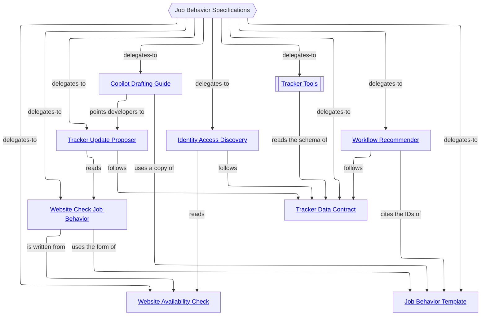
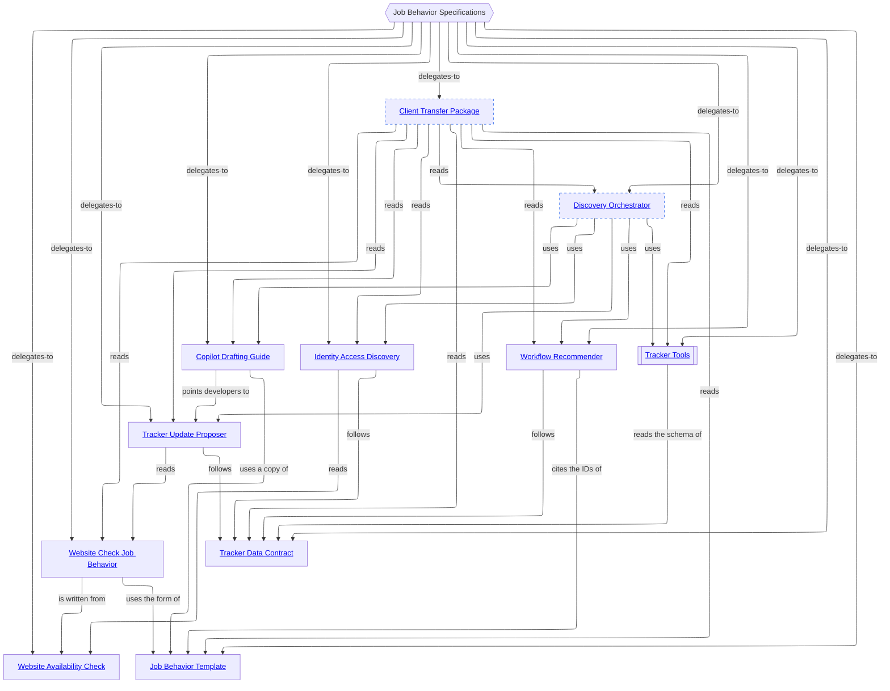

# Job Behavior Specifications

## Purpose

Two things for the vendor-to-platform migration: a job behavior pack (a blank template, a completed reference specification and a GitHub Copilot drafting skill with usage guidance) so a vendor can review and acknowledge a versioned record of each use case's current behavior before it is migrated onto our client's platform as a workflow; and a use case tracker toolkit (one shared data contract, three more Copilot skills and the lead Node tools) so proposed use cases, questions, access requests and workflow mappings reach a SharePoint tracker as reviewable changes and nothing reaches a vendor that it should not see.

## Navigation

**Job Behavior Specifications**

- [Components](#components)
- [Design](#design)
  - [Diagram](#diagram)
- [Technology](#technology)
- [Behavior](#behavior)
- [Links](#links)

## Components

| Component | Purpose |
| --- | --- |
| [Website Availability Check](website-availability-check/README.md#purpose) | A job script that checks one configured website URL, stays silent when it is up and requests one email alert through a notifier when it is down; kept unchanged as read-only source evidence. |
| [Job Behavior Template](job-behavior-template/README.md#purpose) | The blank, reusable form our team fills in to document one vendor use case from its source code, with a short filling guide. |
| [Website Check Job Behavior](website-check-job-behavior/README.md#purpose) | The completed reference specification of the website-check job in plain business language. |
| [Copilot Drafting Guide](copilot-drafting-guide/README.md#purpose) | A GitHub Copilot agent skill that creates, drafts, updates and versions a job behavior document from source, with usage and model guidance. |
| [Tracker Data Contract](tracker-data-contract/README.md#purpose) | The one shared data contract for the use case tracker: tabs, columns, references, status lists, vendor visibility, the proposal file format and the export format, with a guide for building the SharePoint workbooks, so every skill and tool reads and writes the same shapes. |
| [Tracker Update Proposer](tracker-update-proposer/README.md#purpose) | A GitHub Copilot agent skill that turns a use case specification into proposed use case and question rows in `tracker-updates.csv`, so developers hand a lead reviewable tracker changes with each specification and no one retypes questions. |
| [Identity Access Discovery](identity-access-discovery/README.md#purpose) | A GitHub Copilot agent skill that reads a use case's source and configuration and proposes Identity & Access rows (services, environments, observed operations and identity references), so access requests can start from day one and leads can see possible shared requests. |
| [Workflow Recommender](workflow-recommender/README.md#purpose) | A GitHub Copilot agent skill that compares use case specifications by their behaviors and generates internal use-case-to-workflow recommendations, with the format of the lead-owned decisions file, so leads can decide which use cases can share one reusable workflow. |
| [Discovery Orchestrator](discovery-orchestrator/README.md#purpose) | A GitHub Copilot agent skill that takes one use-case folder through the discovery stages in order, refreshes the consolidated review CSVs and walks a lead through the pending rows, so leads review and decide in one flow and each folder is processed without duplicates. |
| [Tracker Tools](tracker-tools/README.md#purpose) | The lead-facing Node tools for the use case tracker: a shared CSV table library, a reconciler that turns reviewed proposals and a tracker export into reviewable changes, and a daily summary. Leads run them by hand; the authoritative tracker stays an Excel workbook on SharePoint. |
| [Client Transfer Package](client-transfer-package/README.md#purpose) | A Python tool that packs the completed Copilot skills, tracker contract, guides and lead tools into one text-only zip with a manifest, a restore script and a Copilot restore prompt, so the pack can be sent into the client environment and restored there by Copilot Agent mode. |

## Design

The root owns no job code and no tool code. It holds the shared rules ([requirements](requirements.md#requirements), [contract](contract.md#contract)), a [review checklist](review-checklist.md) for the document and skill behaviors, and an integration test that runs the built tools against the real example proposal and schema. Three document components make the pack: the [Job Behavior Template](job-behavior-template/README.md#design), the [Website Check Job Behavior](website-check-job-behavior/README.md#design) reference specification filled in from it, and the [Copilot Drafting Guide](copilot-drafting-guide/README.md#design) skill that drafts a specification from source with a copy of the template; the illustrative job [Website Availability Check](website-availability-check/README.md#design) stays unchanged and read-only as the source evidence. The toolkit has one shared interface, the [Tracker Data Contract](tracker-data-contract/README.md#design): three Copilot skills write proposals in its format, the [Tracker Update Proposer](tracker-update-proposer/README.md#design), the [Identity Access Discovery](identity-access-discovery/README.md#design) skill and the [Workflow Recommender](workflow-recommender/README.md#design), each holding byte-identical copies of the contract files, and the [Tracker Tools](tracker-tools/README.md#diagram) (a table library, a reconciler and a daily summary) read the schema from the contract component, reconcile proposals with an export and write the vendor-safe views and the internal summary for a lead to apply by hand. The end-to-end handoffs are in [contract.md](contract.md#end-to-end-handoffs). Each job document carries its own one-box diagram; this diagram shows the components of the project.

### Diagram

## Technology

- The documents are Markdown (and CSV for the contract files) with Mermaid diagrams and plain-text descriptions, read on GitHub. Our team's instructions are four GitHub Copilot agent skills (VS Code agent mode); no Craft installation is needed to use them. Only the retained source-evidence job and the lead tools use code: Node 26 with native TypeScript (erasable syntax, `.ts` import extensions), no dependencies, ES modules and `node:test`, with real temporary directories in the tool tests (see [Tracker Tools](tracker-tools/README.md#technology) and [Website Availability Check](website-availability-check/README.md#technology)).
- The root integration tests in [test](test/) use the same stack, import the tools' `cli` modules by relative path, read the real example proposal and the real schema, run in real temporary directories and need no root `package.json`. The root declares only the `test` and `testGlob` checks in [craft.json](craft.json); the document and skill components declare none and the code components declare their own. Detail is in [requirements.md](requirements.md#requirements).

## Behavior

- **B01** When the template, the reference specification and the template copy inside the skill folder are compared, then they share the same part headings and the same ID scheme (`B`, `Q`, `AC`), and the copy is identical to the template.
- **B02** When the pack files (`job-behavior-template.md`, `filling-guide.md`, `website-availability-check.md`, the three skill folders, the tracker contract files, `usage-and-model-guidance.md` and `drafting-prompt.md`) are inspected, then none contains a Craft file name, command or term, they can be used with plain Markdown, CSV and GitHub Copilot in VS Code agent mode alone, and the specification's links and diagram work when it is viewed in a repository on GitHub. (untested: benchmark pending)
- **B03** When the drafting skill's instructions, its guidance and its fallback prompt are read, then they say it never ticks, confirms or records an acknowledgement on its own and leaves the acknowledgement log blank unless a developer gives the facts, and they accept the core files, tagged documents and supplied findings as they are; results of the user's manual tests of the skill in the client environment on real use cases are recorded as user-reported evidence for the version tested and are not claimed as a pass here. (untested: benchmark pending)
- **B04** When the team-facing files are scanned, then `use case` names the business unit, `job` or `script` names only the vendor's script, `workflow` is defined once as the reusable implementation, and no vendor-readable file mentions workflows or grouping. (untested: benchmark pending)
- **B05** When the three skill folders and the tracker tools' schema path are compared with the Tracker Data Contract, then every copy of the contract and schema files is identical.
- **B06** When the example `tracker-updates.csv` for the website use case is validated and reconciled against an empty export fixture, the additions are applied by test code, and it is reconciled again, then the first run produces additions and the second produces none.
- **B07** When the reconciler and the summary run on a three-vendor fixture, then vendor-safe outputs hold no internal column, question group, link, mapping, unreleased question row or other vendor's row, and the summary is the only place the three tracks appear together.
- **B08** When a revised specification's proposal is reconciled against an export that holds a vendor's answer to a question row, an owner and a decided mapping, then the existing question row, its answer and its owner are preserved with no duplicate record, a wording edit gives a text-review suggestion and no withdrawal, a change that could affect grouping suggests re-review of the decided mapping, a behavior change with no grouping impact suggests none, an unknown impact is listed as unknown, a version-only change suggests none, and nothing is released or applied.

`B01`, `B05` to `B08` are checked by the root tests in [test](test/) (file comparisons for `B01` and `B05`, the built tools for `B06` to `B08`), each test titled with its tag. `B02` to `B04` are checked by the file review and the scans in [review-checklist.md](review-checklist.md), and the Copilot skills are tested manually by the user in the client environment on real use cases; no Copilot or client-environment result is claimed here.

## Links

- [requirements.md](requirements.md#requirements) — shared rules of the project.
- [contract.md](contract.md#contract) — the pack, the vocabulary, the shared tracker pointer and the end-to-end handoffs.
- [review-checklist.md](review-checklist.md) — the file review and scans for the document and skill behaviors `B01` to `B05`.
- [test](test/) — the root integration tests for `B01` and `B05` to `B08`: [documents](test/documents.test.ts), [pipeline](test/pipeline.test.ts), [vendor safety](test/vendor-safety.test.ts) and [revision](test/revision.test.ts).
- [backlog.md](backlog.md) — later items: the skill benchmark, the notification-system decision, the vendor access and layout decision, the vendor inventory, direct tracker integration, the naming alignment, the skill grouping and the follow-ups found while building the toolkit.

## Plan

### Planned Navigation

**Job Behavior Specifications**

- [Planned Components](#planned-components)
- [Planned Design](#planned-design)
  - [Planned Diagram](#planned-diagram)
- [Planned Relationships](#planned-relationships)

### Planned Components

| Component | Purpose |
| --- | --- |
| [Website Availability Check](website-availability-check/README.md#purpose) | A job script that checks one configured website URL, stays silent when it is up and requests one email alert through a notifier when it is down; kept unchanged as read-only source evidence. |
| [Job Behavior Template](job-behavior-template/README.md#purpose) | The blank, reusable form our team fills in to document one vendor use case from its source code, with a short filling guide. |
| [Website Check Job Behavior](website-check-job-behavior/README.md#purpose) | The completed reference specification of the website-check job in plain business language. |
| [Copilot Drafting Guide](copilot-drafting-guide/README.md#purpose) | A GitHub Copilot agent skill that creates, drafts, updates and versions a job behavior document from source, with usage and model guidance. |
| [Tracker Data Contract](tracker-data-contract/README.md#purpose) | The one shared data contract for the use case tracker: tabs, columns, references, status lists, vendor visibility, the proposal file format and the export format, with a guide for building the SharePoint workbooks, so every skill and tool reads and writes the same shapes. |
| [Tracker Update Proposer](tracker-update-proposer/README.md#purpose) | A GitHub Copilot agent skill that turns a use case specification into proposed use case and question rows in `tracker-updates.csv`, so developers hand a lead reviewable tracker changes with each specification and no one retypes questions. |
| [Identity Access Discovery](identity-access-discovery/README.md#purpose) | A GitHub Copilot agent skill that reads a use case's source and configuration and proposes Identity & Access rows (services, environments, observed operations and identity references), so access requests can start from day one and leads can see possible shared requests. |
| [Workflow Recommender](workflow-recommender/README.md#purpose) | A GitHub Copilot agent skill that compares use case specifications by their behaviors and generates internal use-case-to-workflow recommendations, with the format of the lead-owned decisions file, so leads can decide which use cases can share one reusable workflow. |
| [Discovery Orchestrator](discovery-orchestrator/README.md#planned-design) | A GitHub Copilot agent skill that takes one use-case folder through the discovery stages in order, refreshes the consolidated review CSVs and walks a lead through the pending rows, so leads review and decide in one flow and each folder is processed without duplicates. |
| [Tracker Tools](tracker-tools/README.md#purpose) | The lead-facing Node tools for the use case tracker: a shared CSV table library, a reconciler that turns reviewed proposals and a tracker export into reviewable changes, and a daily summary. Leads run them by hand; the authoritative tracker stays an Excel workbook on SharePoint. |
| [Client Transfer Package](client-transfer-package/README.md#planned-design) | A Python tool that packs the completed Copilot skills, tracker contract, guides and lead tools into one text-only zip with a manifest, a restore script and a Copilot restore prompt. |

### Planned Design

The root gains a tenth child, the [Discovery Orchestrator](discovery-orchestrator/README.md#planned-design), a Copilot skill that coordinates the four existing skills and runs the lead tools' new Review CSV Exporter (planned in [Tracker Tools](tracker-tools/README.md#plan)), so a lead takes one use-case folder through the discovery stages and reviews the pending rows in one flow. It writes no proposal file of its own and decides nothing for the lead. When the plan is built the root records change as proposed here, to be made by the root's owner (the root also gains an eleventh child, the [Client Transfer Package](client-transfer-package/README.md#planned-design), which reads the files of the skills, the contract, the guides and the tools to pack them and changes none of them, so its root test fixtures must not add copies of the contract or schema): the technology text counts five Copilot skills, root `B02` lists the new skill folder among the inspected pack files, the end-to-end handoffs note that steps 2, 4, 5 and 6 can run per folder through the orchestrator and the review CSVs with applying still by hand, and the review columns and their values are stated once in the contract.

#### Planned Diagram

### Planned Relationships

None.
