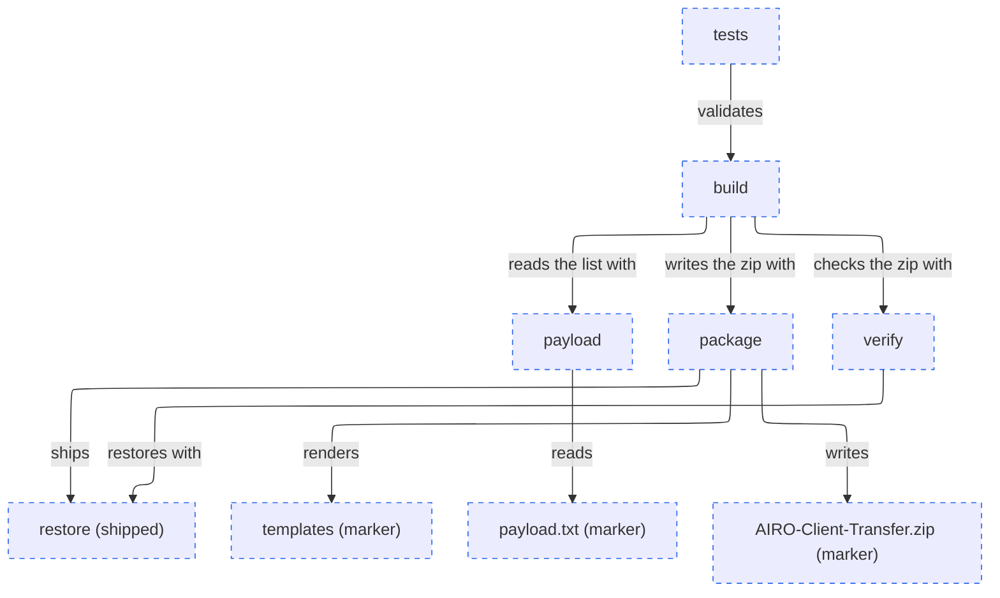

# Client Transfer Package

## Purpose

A Python tool that packs the completed Copilot skills, tracker contract, guides and lead tools into one text-only zip with a manifest, a restore script and a ready-to-paste Copilot restore prompt, so the pack can be sent into the client environment and restored there into the repository by Copilot Agent mode.

## Navigation

[Job Behavior Specifications](../README.md#navigation) / **Client Transfer Package**

- [Design](#design)
- [Technology](#technology)
- [Behavior](#behavior)
- [Relationships](#relationships)
- [Links](#links)

## Design

Not built yet.

## Technology

- Python 3.9 or later with the standard library only, so one language builds the package and ships the restore script the client runs; this departs from the project's Node 26 stack because Node has no built-in zip writer. The packaged tools still need Node 26 on the client. Detail is in [requirements.md](requirements.md#requirements).

## Behavior

- **B01** When `build` runs on a checkout of the repository, then it writes `AIRO-Client-Transfer.zip` in which every member is named `<original path>.txt` and holds the original file's exact bytes.
- **B02** When the payload list is read, then the package holds only the listed files: the five Copilot skill folders complete, the tracker contract, schema and templates with the workbook layout guide, the process guide and usage guidance, the job behavior template with its filling guide and the reference specification, the tracker tools with tests and fictional fixtures, and the root integration tests with the files they read; git history, secrets, `node_modules`, caches, generated client data, unrelated components and CRAFT metadata (unless runtime use needs it) are left out.
- **B03** When a listed file is missing, an excluded kind of file is listed, or a value looks like a secret, then it stops, names the item and writes no zip.
- **B04** When the package is written, then `MANIFEST.json.txt` holds the source revision and, for every payload file, its original path, packaged path and byte size.
- **B05** When the package is opened, then it holds `START-HERE.txt`, `COPILOT-RESTORE-PROMPT.txt`, `CLIENT-QUICKSTART.md.txt`, `VERIFICATION.txt` and `restore.py.txt`; the Copilot prompt carries every restoration rule (restore into a fresh approved staging folder, install the skill folders into `.github/skills` replacing existing copies of the same skills and listing what was replaced, confirm real skill discovery, flag differing existing files elsewhere before overwriting and leave identical ones, never replace `AGENTS.md` or unrelated configuration, run the packaged tests, report, and make no commits, pushes, releases, access changes or external calls); and all text says "Copilot".
- **B06** When `restore.py` runs on the package with a destination, then it validates paths and sizes before writing, refuses an existing destination, restores the original names and exact bytes into the new folder, and installs and changes nothing else.
- **B07** When a member is missing, has the wrong size or has an unsafe path, then `restore.py` stops, names it and writes nothing.
- **B08** When `build` runs twice on the same checkout, then the two zips are byte-identical.
- **B09** When `verify` runs, then it restores into a clean temporary directory, compares every restored file byte for byte with its source file, runs the packaged tests from the restored copy where Node is available, and checks that the zip is intact and every member is `.txt`.
- **B10** When `VERIFICATION.txt` is written, then it lists only checks actually performed and the checks left for the client environment, and it never claims that Copilot skill discovery or client use cases are validated.

## Relationships

- [Copilot Drafting Guide](../copilot-drafting-guide/README.md#purpose) — the drafting skill, template copy and usage and model guidance that are packed.
- [Tracker Update Proposer](../tracker-update-proposer/README.md#purpose) — the proposal skill and its example proposal that are packed.
- [Identity Access Discovery](../identity-access-discovery/README.md#purpose) — the identity and access skill that is packed.
- [Workflow Recommender](../workflow-recommender/README.md#purpose) — the recommendation skill and its templates that are packed.
- [Discovery Orchestrator](../discovery-orchestrator/README.md#purpose) — the coordinating skill that is packed.
- [Tracker Data Contract](../tracker-data-contract/README.md#purpose) — the contract, schema, templates and layout guide that are packed.
- [Tracker Tools](../tracker-tools/README.md#purpose) — the table library, reconciler, summary and review exporter, with tests, that are packed.
- [Job Behavior Template](../job-behavior-template/README.md#purpose) — the template and filling guide that are packed.
- [Website Check Job Behavior](../website-check-job-behavior/README.md#purpose) — the reference specification that is packed.

## Links

- [requirements.md](requirements.md#requirements) — what the package must do, the first-draft payload, what must match the source and what need not, and the follow-on work.
- [contract.md](contract.md#contract) — the commands, zip layout, manifest, restore script rules and instruction texts.

## Plan

### Planned Navigation

[Job Behavior Specifications](../README.md#plan) / **Client Transfer Package**

- [Planned Design](#planned-design)
  - [Planned Diagram](#planned-diagram)
- [Planned Behavior](#planned-behavior)
- [Steps](#steps)
- [Acceptance Mapping](#acceptance-mapping)
- [Assumptions And Open Questions](#assumptions-and-open-questions)
- [Planned Relationships](#planned-relationships)
- [Planned Links](#planned-links)

### Planned Design

`build.py` is the entry point with two commands, `build` and `verify`. `payload.py` reads `payload.txt`, expands each path or glob against the repository, applies the exclusion rules (git data, hidden files, `node_modules`, caches, component records, key and environment files) and scans each file for secret-like values, collecting every finding before stopping. `package.py` writes the deterministic zip: the manifest (source revision, original path, packaged path, byte size), `payload/<path>.txt` members in sorted order with fixed timestamps and permissions, and the instruction texts rendered from `templates/`, including the generated process guide. `restore.py` is shipped inside the zip as `restore.py.txt` and is also the code `verify` uses to restore into a clean directory. A build runs in two passes: it first writes the payload zip and verifies it (restore, byte comparison with the source, manifest, zip and member names, the packaged tests when Node 26 is available), then renders `VERIFICATION.txt` from those actual results and writes the final zip, so the file describes exactly the checks that ran and holds no timestamp or duration.

#### Planned Diagram

### Planned Behavior

Planned with the [Review Decisions](../lead-tracker-skills/README.md#design) skill, and after the user confirmed on 2026-11-16 that scripts can run in the client environment, so the tools stay in the package. This replaces the current wording of `B02` when built; the other behaviors are unchanged.

- **B02** When the payload list is read, then the package holds only the listed files: the six Copilot skill folders complete (the five existing and `record-review-decisions`), the tracker contract, schema and templates with the workbook layout guide, the process guide and usage guidance, the job behavior template with its filling guide and the reference specification, the tracker tools with tests and fictional fixtures (including the Vendor Workbook Updater with its `package.json` and lock file, and the sample's headings file it reads), and the root integration tests with the files they read; git history, secrets, `node_modules`, caches, generated client data, unrelated components and CRAFT metadata (unless runtime use needs it) are left out.

### Steps

1. **Scaffold.** `.gitignore` (`dist/`, `__pycache__/`), `src/`, `test/`, `templates/`, `payload.txt` as in `requirements.md`.
2. **`src/payload.py`** (B02, B03): reads and expands the list, applies the exclusion rules, scans for secret-like values, reports every finding.
3. **`src/package.py`** (B01, B04, B05, B08): source revision, manifest, deterministic zip, `.txt` naming, rendering of the templates and the generated process guide, with the "Copilot" wording and the check that each command in the quickstart names a packaged file.
4. **`src/restore.py`** (B06, B07): the standalone restore script, standard library only, as `contract.md` sets out.
5. **`src/verify.py`** and **`src/build.py`** (B03, B09, B10): the two commands, the two-pass build, the clean-directory restore, the byte comparison, the zip and member-name checks, and the packaged tests where Node is available (the Vendor Workbook Updater's are skipped until `npm ci` has run in its folder).
6. **`templates/`**: `START-HERE.txt`, `COPILOT-RESTORE-PROMPT.txt`, `CLIENT-QUICKSTART.md.txt`, `VERIFICATION.txt` (with fixed wording for the client-environment checks).
7. **Tests** in `test/`, tagged `[B01]` to `[B10]` in the test name and docstring: `test_build` (B01, B04, B08), `test_payload` (B02, B03), `test_texts` (B05, B10), `test_restore` (B06, B07), `test_verify` (B09). Unit tests build a small fixture tree in a temporary directory at test time; one run builds and verifies the real repository.
8. **Docs:** the built `Design` and diagram in this README, kept in step with `requirements.md` and `contract.md`.
9. **Validate:** the component's `test` check (`python3 -m unittest`), then `build` and `verify` on the real repository, then a restore of the built zip into a clean directory and a byte comparison.

### Acceptance Mapping

| Acceptance | Behaviors | Step | Test |
| --- | --- | --- | --- |
| 1. Deterministic zip of exactly the listed payload, `.txt` naming with original bytes, manifest of revision, paths and sizes, nothing written on a missing file, forbidden file or secret | B01, B02, B03, B04, B08 | 2, 3, 5 | `test_build` `[B01]` `[B04]` `[B08]`; `test_payload` `[B02]` `[B03]` |
| 2. Instruction and restore files with every Copilot rule; `restore.py` validates, refuses an existing destination, restores exact bytes, installs nothing, writes nothing on a bad member | B05, B06, B07 | 3, 4, 6 | `test_texts` `[B05]`; `test_restore` `[B06]` `[B07]` |
| 3. `verify` restores, compares, runs the packaged tests and checks the zip; `VERIFICATION.txt` holds only what was checked | B09, B10 | 5, 6 | `test_verify` `[B09]`; `test_texts` `[B10]` |

Validation: the commands in step 9, narrowest first.

### Assumptions And Open Questions

Assumptions (override by telling the builder, or by editing the file named):

- **Planner substitution.** The planner agent failed with an authentication error (HTTP 403) and was not retried. This plan was written from a direct read of the repository by the planning session. Re-run `/craft:plan` for this component later if an independent planner pass is wanted.
- **Python 3.9 or later, standard library only**, for the generator and the shipped restore script. To use Node, see `requirements.md`.
- **The tools are shipped and scripts run on the client**, by the user's confirmation of 2026-11-16. This withdraws the earlier plan to ship Markdown counterparts of the tools and to drop the Node prerequisite; the Lead Tracker Skills plan was revised the same way. Node 26 stays a prerequisite and the root integration tests are shipped. Override by naming a client where Node is not allowed.
- **`restore.py` runs on the client** and is the way to restore, as first planned. The Copilot restore prompt still tells Copilot to copy each member back with file operations if it cannot run the script. Override by dropping `restore.py`.
- **The Vendor Workbook Updater is shipped** with its `package.json`, `package-lock.json`, `src/`, `test/` and `data/`, and with `tracker-tools/sample-tracker-workbook/data/headings.csv`, which it reads by relative path. It needs the pinned `exceljs`, so the quickstart tells the client to run `npm ci` once in that tool's folder (a network step the client approves); `verify` skips its tests when `node_modules` is absent. The Master Workbook Updater, the Vendor Sample Workbook and the Sample Tracker Workbook are not packed in the first draft; `requirements.md` says what to add. Override by adding them to `payload.txt`.
- **The secret scan runs strictly on non-test files and, in `test/` folders, tolerates the fake values the reconciler's own tests contain** (a `password=` value, a `ghp_` token, a private key header and an `AKIA` key), listed in `requirements.md`, because the tests need them. Override by dropping the tests with those values from the payload.
- **The Review Decisions skill is packed** as the sixth skill folder and holds no copy of the contract, so the root copy test is unchanged.
- **No hashes**, by the user's decision. Size, the zip's CRC and the byte comparison of `verify` stand in; hashes are a follow-on.
- **Existing skills are replaced** by Copilot, which lists what it replaced, by the user's decision; other differing files are flagged first.
- **One restored folder** holds the whole tree (tools, tests, docs) in its original layout, and Copilot also copies each skill folder to `.github/skills`. The root tests walk the tree, so the folder must hold only those files; run them there, not in the client's repository root.
- **No component records are packed** (`craft.json`, `tasks.md`, `README.md`, `requirements.md`, `contract.md`, `review-checklist.md`), because no test or command reads them, and so the pack carries no internal process term. Override by adding them to `payload.txt` and removing the exclusion.
- **The process guide is generated** from the end-to-end handoffs table of the root `contract.md`. To ship a dedicated guide instead, add the file to the payload and drop the generator.
- **The Sample Tracker Workbook is not packed**; `requirements.md` says how to add its sources and data and why its `.xlsx` is left out.
- **Output at `dist/AIRO-Client-Transfer.zip`**, ignored by git.
- **Source revision** is the git revision, with `+dirty` for uncommitted changes and `unknown` outside a git checkout.
- **Budget:** USD 5 and 4,500 s, thin for four modules, four templates and five test files; keep tests compact.

Open questions (behavior or real ambiguity): none.

### Planned Relationships

- [Copilot Drafting Guide](../copilot-drafting-guide/README.md#purpose) — the drafting skill, template copy and guidance that are packed.
- [Tracker Update Proposer](../tracker-update-proposer/README.md#purpose) — the proposal skill and its example proposal that are packed.
- [Identity Access Discovery](../identity-access-discovery/README.md#purpose) — the identity and access skill that is packed.
- [Workflow Recommender](../workflow-recommender/README.md#purpose) — the recommendation skill and its templates that are packed.
- [Discovery Orchestrator](../discovery-orchestrator/README.md#purpose) — the coordinating skill that is packed.
- [Review Decisions](../lead-tracker-skills/review-decisions/README.md#design) — the skill that records and revisits review decisions, packed as the sixth skill folder.
- [Tracker Data Contract](../tracker-data-contract/README.md#purpose) — the contract, schema, templates and layout guide that are packed.
- [Tracker Tools](../tracker-tools/README.md#purpose) — the tools, with tests, that are packed.
- [Job Behavior Template](../job-behavior-template/README.md#purpose) — the template and filling guide that are packed.
- [Website Check Job Behavior](../website-check-job-behavior/README.md#purpose) — the reference specification that is packed.

### Planned Links

- [requirements.md](requirements.md#requirements) — requirements, the first-draft payload and follow-on work.
- [contract.md](contract.md#contract) — commands, zip layout, manifest, restore script and instruction texts.
