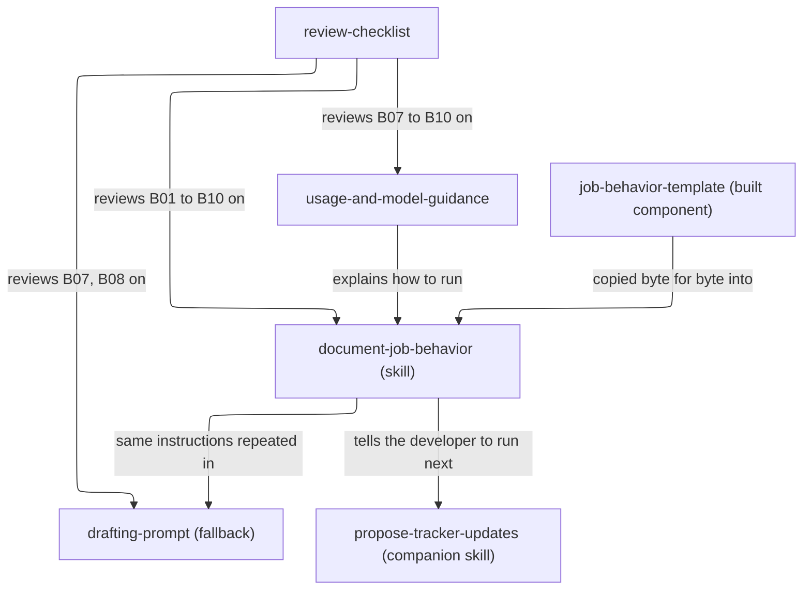

# Copilot Drafting Guide

## Purpose

A GitHub Copilot agent skill that creates, drafts, updates and versions a use case behavior document from the use case's source code, core files, tagged documents and supplied findings, with practical usage and model-selection guidance and a fallback prompt, for our team's developers who use Copilot and have no Craft.

## Navigation

[Job Behavior Specifications](../README.md#navigation) / **Copilot Drafting Guide**

- [Design](#design)
  - [Diagram](#diagram)
- [Behavior](#behavior)
- [Relationships](#relationships)
- [Links](#links)

## Design

The component delivers files our team uses and one internal checklist. The skill folder [document-job-behavior](document-job-behavior/SKILL.md) holds the instructions written once ([SKILL.md](document-job-behavior/SKILL.md)), the rules for the self-check and the question ([self-check.md](document-job-behavior/self-check.md)) and a byte-identical copy of the built template ([job-behavior-template.md](document-job-behavior/job-behavior-template.md)). The folder name and the skill `name` stay `document-job-behavior`, so the installed path does not change. The skill uses `use case` for the business unit and `script` only for the vendor's code.

The skill accepts what the developer has as it is: the use case's source, the core files `external_tools.md` and `logic.md` (a missing one is reported, never invented), additional documents the developer tags as vendor, original SOP or team analysis (vendor and original SOP documents first; team analysis is a starting input, not a verified description), and supplied findings, questions, corrections and dependency observations. It structures and verifies them and produces or updates the specification; it does not run the companion skill. It keeps four kinds of evidence apart (source-observed, document-described, team analysis or inference, recommendation), and only the first two become current behaviors. It checks that the cited evidence supports each statement and flags a conflict as a question without guessing. Updates are repeatable: IDs and history are kept, no duplicate is made, an answer updates the section it belongs to and becomes a current behavior ("resolved: now Bn") only when it establishes one, with a change-log entry and a version bump. It records an acknowledgement only from facts a developer gives. After drafting or updating it tells the developer to run `propose-tracker-updates`, which proposes the tracker rows from the specification, so supplied findings reach the tracker only through the specification.

[usage-and-model-guidance.md](usage-and-model-guidance.md) explains use in VS Code agent mode and carries the team-reported model advice with a valid-as-of date. [drafting-prompt.md](drafting-prompt.md) repeats the instructions for surfaces without skills and must be kept in step with the skill. [review-checklist.md](review-checklist.md) is internal, with one item per behavior. The skill folder, guidance and fallback never mention the internal records.

Testing policy and review state: a revised skill does not require a fresh website-reference Copilot dry run. The user tests the skills manually in the client environment on real use cases and iterates from ChatGPT feedback, and reported results are recorded as user-reported evidence labelled with the version they cover. Earlier-version evidence, user-reported (VS Code 1.144.0, Copilot Agent mode, "Sonnet 5.5 High"; not raw output and not a result for the revised version): B01 partial, B02 pass, B03 partial, B04 partial, B05 pass, B06 untested, vendor-document handling untested. B01 to B06 stay unticked in the checklist because they cannot be passed by reading the files; B07 to B10 and the wording rules are passed only by the file review of the revised files recorded in the checklist. The evidence and its gaps are in [requirements.md](requirements.md#testing-policy-and-earlier-version-evidence).

### Diagram

## Behavior

- **B01** When a developer asks the skill to document a use case, then it drafts from the use case's source, the core files `external_tools.md` and `logic.md`, manually tagged additional documents (including original SOP and vendor documents when available) and any findings, questions, corrections and dependency observations the developer supplies as they are, using only the template's parts, and the developer does not first rewrite supplied findings into a specification. (untested: benchmark pending)
- **B02** When the draft states something, then it is a current behavior (`B1`, ...) with an evidence pointer or a question (`Q1`, ...), only source-observed and document-described behavior is a current behavior while team analysis, inference and recommendation are questions or left out, it checks that the cited evidence supports the claim and flags a conflict without guessing, an existing analysis is a starting input and not a verified or approved baseline, and it asks only what the source cannot show and would change what the migrated use case must do, never what the source states and never the reason behind a shown behavior. (untested: benchmark pending)
- **B03** When asked to draft or update a document, then it never ticks, confirms or records an acknowledgement on its own, and it records one only from facts a developer gives it (company, date, version, reference), writing exactly those. (untested: benchmark pending)
- **B04** When the draft draws the diagram, then it is one black box laid out vertically with the project's settings, with the behavior IDs in the edge labels and linked in the text beside it, and internal names stay out of the business text. (untested: benchmark pending)
- **B05** When a draft is returned, then it ends with a self-check report listing the source, core files and documents it did not read or that are missing, current behaviors with no scenario, scenarios naming unknown IDs, and statements with no evidence pointer, with evidence that does not support them or in conflict, and says the check is best effort and a person must review. (untested: benchmark pending)
- **B06** When the developer gives answers, corrections or further findings (from the vendor or our team), then the skill updates the same file: an answer updates the section it belongs to and becomes a current behavior marked "resolved: now Bn" only when it establishes behavior, IDs and history are kept and no duplicate is made, it adds a change-log entry, bumps the version, never edits an earlier acknowledgement row, and reminds the developer to tag the repository. (untested: benchmark pending)
- **B07** When documents are given with tags, then vendor-provided documents take precedence over documents our team created, which are team analysis and not verified baselines and are used only where no vendor document covers the point, and where a document and the code disagree it records a question and does not guess. (untested: benchmark pending)
- **B08** When the skill folder, the usage guidance and the fallback prompt are read, then they contain no reference to Craft and the skill needs nothing installed in VS Code agent mode; a paste-in prompt with the same instructions exists only as a fallback for surfaces without skills. (untested: benchmark pending)
- **B09** When model advice is given, then it is marked team-reported and environment-dependent with a valid-as-of date, tells the user to check the model picker, plan and administrator policy, and calls no model guaranteed. (untested: benchmark pending)
- **B10** When the usage guidance is read, then it tells the developer that Copilot's output is a draft a person must review against the source, that a skill cannot block manual edits, that acknowledged versions are tagged in the repository and protected by repository settings outside this deliverable, that skill support must be confirmed in the developers' Copilot setup, that supplied findings, questions and corrections and the files `external_tools.md` and `logic.md` can be given as they are, and to run `propose-tracker-updates` after drafting or updating. (untested: benchmark pending)

## Relationships

- [Job Behavior Template](../job-behavior-template/README.md#purpose) — the form the skill fills in; a copy goes into the skill folder so the skill uses only that form's parts.
- [Tracker Update Proposer](../tracker-update-proposer/README.md#purpose) — the companion skill `propose-tracker-updates` the developer runs after drafting or updating.
- GitHub Docs, [Supported models](https://docs.github.com/en/copilot/reference/ai-models/supported-models), [Model comparison](https://docs.github.com/en/copilot/reference/ai-models/model-comparison) and [About agent skills](https://docs.github.com/en/copilot/concepts/agents/about-agent-skills) — official source of the model and skill advice, read on 2026-11-14.

## Links

- [requirements.md](requirements.md#requirements) — what the component must do and what it need not.
- [contract.md](contract.md#contract) — the content the document must carry and the wording rules.
- [review-checklist.md](review-checklist.md) — the internal review items tagged B01 to B10.
