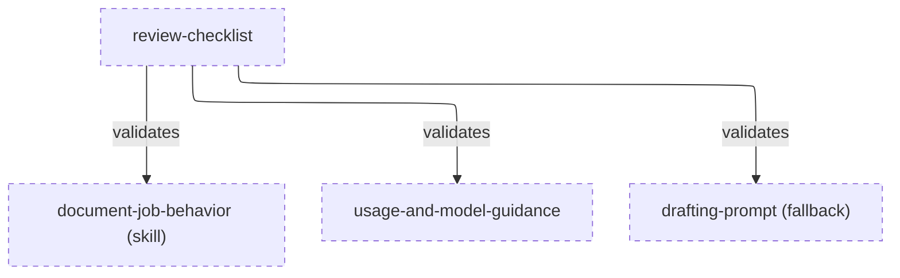

# Copilot Drafting Guide

## Purpose

A GitHub Copilot agent skill that creates, drafts, updates and versions a job behavior document from a job's source code (and vendor-provided documents when given), with practical usage and model-selection guidance and a fallback prompt, for our team's developers who use Copilot and have no Craft.

## Navigation

[Job Behavior Specifications](../README.md#navigation) / **Copilot Drafting Guide**

- [Design](#design)
- [Behavior](#behavior)
- [Plan](#plan)
- [Relationships](#relationships)
- [Links](#links)

## Design

Not built yet.

## Behavior

- **B01** When a developer asks the skill to document a job, then it drafts from the job's source, and from vendor-provided documents when given, using only the template's parts. (untested: benchmark pending)
- **B02** When the draft states something, then it is a current behavior (`B1`, ...) with an evidence pointer or a question (`Q1`, ...), anything inferred is a question or is left out, and it asks only what the source cannot show and would change the workflow, never what the source states and never the reason behind a shown behavior. (untested: benchmark pending)
- **B03** When asked to draft or update a document, then it never ticks, confirms or records an acknowledgement on its own, and it records one only from facts a developer gives it (company, date, version, reference), writing exactly those. (untested: benchmark pending)
- **B04** When the draft draws the diagram, then it is one black box laid out vertically with the project's settings, with the behavior IDs in the edge labels and linked in the text beside it, and internal names stay out of the business text. (untested: benchmark pending)
- **B05** When a draft is returned, then it ends with a self-check report listing the source and documents it did not read, current behaviors with no scenario, scenarios naming unknown IDs and statements without an evidence pointer, and says the check is best effort and a person must review. (untested: benchmark pending)
- **B06** When the developer gives answers (from the vendor or our team), then the skill updates the same file: it turns each answered question into a current behavior marked "resolved: now Bn", adds a change-log entry, bumps the version, never edits an earlier acknowledgement row, and reminds the developer to tag the repository. (untested: benchmark pending)
- **B07** When vendor-provided documents are given, then they take precedence over documents our team created, which it uses only where no vendor document covers the point, and where a vendor document and the code disagree it records a question and does not guess. (untested: benchmark pending)
- **B08** When the skill folder, the usage guidance and the fallback prompt are read, then they contain no reference to Craft and the skill needs nothing installed in VS Code agent mode; a paste-in prompt with the same instructions exists only as a fallback for surfaces without skills. (untested: benchmark pending)
- **B09** When model advice is given, then it is marked team-reported and environment-dependent with a valid-as-of date, tells the user to check the model picker, plan and administrator policy, and calls no model guaranteed. (untested: benchmark pending)
- **B10** When the usage guidance is read, then it tells the developer that Copilot's output is a draft a person must review against the source, that a skill cannot block manual edits, that acknowledged versions are tagged in the repository and protected by repository settings outside this deliverable, and that skill support must be confirmed in the developers' Copilot setup. (untested: benchmark pending)

## Plan

### Planned Navigation

[Job Behavior Specifications](../README.md#plan) / **Copilot Drafting Guide**

- [Planned Design](#planned-design)
  - [Planned Diagram](#planned-diagram)
- [Steps](#steps)
- [Acceptance Mapping](#acceptance-mapping)
- [Assumptions And Open Questions](#assumptions-and-open-questions)
- [Planned Relationships](#planned-relationships)
- [Planned Links](#planned-links)

### Planned Design

The component delivers a Copilot agent skill folder (`SKILL.md`, a copy of the template and `self-check.md`), a usage and model guidance file and a fallback prompt, plus an internal review checklist. These are the files our team uses. The skill drafts a job document, answers its questions when the developer gives it the answers, updates the same file with a change-log entry and a version bump, and records an acknowledgement only from facts a developer gives it. The guidance carries a valid-as-of date because model availability changes.

#### Planned Diagram

### Steps

1. Create the skill folder `document-job-behavior/` with `SKILL.md` (front matter `name: document-job-behavior`, identical to the folder name, and a description; the instructions written once covering create, draft, self-check, update with answers and next version), a copy of the finished revised template (copied from the built Job Behavior Template) and `self-check.md` (the self-check rules and the question rule).
2. Create `usage-and-model-guidance.md`: how to use the skill in VS Code agent mode (including the optional vendor documents input, applying answers, recording an acknowledgement from given facts), how to review the draft, tagging at each acknowledgement and repository protections as outside this deliverable, and the model advice marked team-reported and environment-dependent with a valid-as-of date.
3. Create `drafting-prompt.md`, the fallback with the same instructions for surfaces without skills.
4. Create `review-checklist.md` with one item per behavior tagged `[B01]` to `[B10]`, including the dry run on the website job source, left unticked until a fresh dry run passes.
5. Keep Craft names, commands and paths out of the skill folder, the guidance and the fallback prompt.

### Acceptance Mapping

| Acceptance condition | Behaviors | Step | Validation check |
| --- | --- | --- | --- |
| Skill, guidance and fallback pass the dry-run review | B01–B10 | 1, 2, 3, 4 | review-checklist.md items [B01]–[B10], dry run with Copilot on the website job source |
| No Craft term and model advice correctly marked | B08, B09 | 1, 2, 3 | review-checklist.md items [B08], [B09] |

Checks: the root declares no automated check for documents. The validation is the component's `review-checklist.md` dry-run review (see the verification gap in `requirements.md`) plus the record validators.

### Assumptions And Open Questions

Assumptions (override any of them in chat before `/craft:build`). This plan follows the user's review of a generated specification on 2026-11-15 and replaces the earlier plan:

1. Evidence: a current behavior cites the source (file and place) or a vendor-provided document (document and place). The skill takes an optional input of vendor-provided documents, which take precedence over documents our team created; our documents are used only where no vendor document covers the point, and where a vendor document and the code disagree it records a question and does not guess. Override: make the vendor documents mandatory or ignore them.
2. Question rule: ask the vendor only what the source cannot show and whose answer would change what the migrated workflow must do. Never ask what the source already states (a value, an address, a setting: it is a current behavior or a parameter, covered by the vendor's overall confirmation), and never ask the reason behind a behavior the source shows (for example why a certificate check is off): state the behavior and leave any security or design review to our team. Our team may answer questions from its own knowledge before sending, by running the skill with those answers. Override: list the kinds of question to add or remove.
3. The acknowledgement is typed in the Markdown source, since Markdown has no fill-in fields and checkbox clicking depends on the viewer. The skill records an acknowledgement only from facts a developer gives it (company, date, version, reference) and writes exactly those; it never ticks or confirms anything on its own. Override: never let the skill write it.
4. One file per use case with a version and change log; after acknowledgement a change adds a change-log entry and bumps the version, and our team tags the repository at each acknowledgement (for example `<use-case-name>-v<n>`) so that version is recoverable. This replaces the earlier "one file per version" design. Override: go back to a copy per version.
5. The skill folder is named `document-job-behavior`, which GitHub's docs place in `.github/skills`, `.claude/skills` or `.agents/skills`; the `name` in the `SKILL.md` front matter is identical to the folder name. The instructions are written once in `SKILL.md`; the fallback prompt repeats them and must be kept in step. Override: ask for another folder name.
6. The skill folder holds a copy of the template, copied from the Job Behavior Template once it is built; the root checks that the copy matches. The build depends on the revised template being built first. Override: build in a different order.
7. Our team's developers use VS Code agent mode, where the user says skills work. GitHub's docs say Copilot loads a skill when relevant and list the Copilot app, CLI, cloud agent and agent mode in VS Code, Visual Studio and JetBrains; they do not state plan or administrator requirements or preview status. Skill support must be confirmed in the developers' Copilot setup.
8. The user reports the models in the developers' Copilot picker as GPT-6 Luna, GPT-6.1 Sol, Claude Sonnet 5.5, GPT-5.6 Luna, GPT-6 Sol and GPT-5.3-Codex, and that Fable and Kimi are not available; Terra models are not in that list. All six appear on GitHub's supported-models page read on 2026-11-14, but the task guidance read from GitHub covers the GPT-5.6 family, GPT-5.3-Codex and Claude Sonnet 4.6, not the GPT-6 models, so the guide gives task advice only where the docs support it and otherwise tells the developer to try the model on the website job sample. The list comes from the user and is written as team-reported.
9. The dry run needs Copilot access. A first exploratory run of the earlier skill ticked nothing. Override: name who runs the formal dry run and on which models.
10. A skill cannot block manual edits; the guidance suggests tags per acknowledgement and repository protections (protected branches, required reviewers) as outside this deliverable.
11. The earlier blocked builder branches are superseded by this plan and are not merged. Override: ask to recover them.

### Planned Relationships

- [Job Behavior Template](../job-behavior-template/README.md#purpose) — the form the skill fills in; a copy goes into the skill folder so the skill uses only that form's parts.
- GitHub Docs, [Supported models](https://docs.github.com/en/copilot/reference/ai-models/supported-models), [Model comparison](https://docs.github.com/en/copilot/reference/ai-models/model-comparison) and [About agent skills](https://docs.github.com/en/copilot/concepts/agents/about-agent-skills) — official source of the model and skill advice, read on 2026-11-14.

### Planned Links

- [requirements.md](requirements.md#requirements) — what the component must do and what it need not.
- [contract.md](contract.md#contract) — the content the document must carry and the wording rules.
- [review-checklist.md](review-checklist.md) — the dry-run review items, tagged by behavior (created by the build).

## Relationships

- [Job Behavior Template](../job-behavior-template/README.md#purpose) — the form the skill fills in; a copy goes into the skill folder so the skill uses only that form's parts.
- GitHub Docs, [Supported models](https://docs.github.com/en/copilot/reference/ai-models/supported-models), [Model comparison](https://docs.github.com/en/copilot/reference/ai-models/model-comparison) and [About agent skills](https://docs.github.com/en/copilot/concepts/agents/about-agent-skills) — official source of the model and skill advice, read on 2026-11-14.

## Links

- [requirements.md](requirements.md#requirements) — what the component must do and what it need not.
- [contract.md](contract.md#contract) — the content the document must carry and the wording rules.
