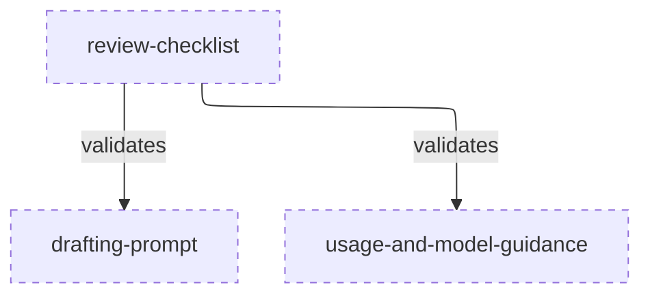

# Copilot Drafting Guide

## Purpose

A prompt that has GitHub Copilot draft a filled-in job behavior document from a job's source code, with practical usage guidance and model-selection advice, for developers who have Copilot and no Craft.

## Navigation

[Job Behavior Specifications](../README.md#navigation) / **Copilot Drafting Guide**

- [Design](#design)
- [Behavior](#behavior)
- [Plan](#plan)
- [Relationships](#relationships)
- [Links](#links)

## Design

Not built yet.

## Behavior

- **B01** When a developer gives the prompt a job's source and the template, then Copilot returns a draft that uses only the template's sections. (untested: benchmark pending)
- **B02** When the draft states a behavior, then it is labelled with one of the four kinds, and anything inferred goes to assumptions and unknowns, never to source-evidenced current behavior. (untested: benchmark pending)
- **B03** When the draft claims a behavior from source, then it cites the file and the place in it. (untested: benchmark pending)
- **B04** When the source is silent or unclear, then the draft writes an open question and does not guess. (untested: benchmark pending)
- **B05** When asked to draft, then it never writes approved migration behavior or an acknowledgement and leaves them blank for the client. (untested: benchmark pending)
- **B06** When the draft draws the diagram, then it follows the black-box rule and keeps internal names out of the business text. (untested: benchmark pending)
- **B07** When the source is too large for one pass, then the draft says which parts were not read. (untested: benchmark pending)
- **B08** When the prompt and guidance are read, then they contain no reference to Craft and the prompt runs in GitHub Copilot Chat without installing anything. (untested: benchmark pending)
- **B09** When model advice is given, then it is marked client-reported and environment-dependent with a valid-as-of date, tells the user to check the model picker, plan and administrator policy, and calls no model guaranteed. (untested: benchmark pending)
- **B10** When the usage guidance is read, then it tells the developer that Copilot's output is a draft that a person must review against the source before it goes to the client. (untested: benchmark pending)

## Plan

### Planned Navigation

[Job Behavior Specifications](../README.md#plan) / **Copilot Drafting Guide**

- [Planned Purpose](#planned-purpose)
- [Planned Design](#planned-design)
  - [Planned Diagram](#planned-diagram)
- [Steps](#steps)
- [Acceptance Mapping](#acceptance-mapping)
- [Assumptions And Open Questions](#assumptions-and-open-questions)
- [Planned Relationships](#planned-relationships)
- [Planned Links](#planned-links)

### Planned Purpose

A prompt that has GitHub Copilot draft a filled-in job behavior document from a job's source code, with practical usage guidance and model-selection advice, for developers who have Copilot and no Craft.

### Planned Design

The component is a prompt, a usage and model guidance file, and a review checklist. The prompt and the guidance are the two client-facing files. The guidance carries a valid-as-of date because model availability changes.

#### Planned Diagram

### Steps

1. Create `drafting-prompt.md`, the prompt the developer pastes into Copilot Chat with the job's source and the template.
2. Create `usage-and-model-guidance.md`: how to use the prompt, how to review the draft, and the model advice, marked client-reported and environment-dependent with a valid-as-of date.
3. Create `review-checklist.md` with one item per behavior tagged `[B01]` to `[B10]`, including the dry run on the website job source.
4. Keep Craft names, commands and paths out of the two client-facing files.

### Acceptance Mapping

| Acceptance condition | Behaviors | Step | Validation check |
| --- | --- | --- | --- |
| Prompt and guidance pass the dry-run review | B01–B10 | 1, 2, 3 | review-checklist.md items [B01]–[B10], dry run with Copilot on the website job source |
| No Craft term and model advice correctly marked | B08, B09 | 1, 2 | review-checklist.md items [B08], [B09] |

Checks: the root declares no automated check for documents. The validation is the component's `review-checklist.md` dry-run review (see the verification gap below) plus the record validators.

### Assumptions And Open Questions

Assumptions (override any of them in chat before `/craft:build`):

1. One component with two client-facing files, as agreed. Override: ask to split the model guidance into its own component if it goes stale faster than the prompt.
2. Model advice was checked on 2026-11-14 against GitHub's supported-models and model-comparison pages, read through a summarizer, truncated, with no last-updated date shown; it must be re-checked when published. The docs say availability depends on plan, client and administrator policy and suggest GPT-5.6 Terra for balanced work and GPT-5.3-Codex for complex engineering and review.
3. The client reports these models as available: Sonnet 5.5, GPT-6.1 Sol, Terra, Luna, GPT-5.6 Terra and GPT-5.3-Codex, and that Fable and Kimi are not available. This list comes from the user, not from the docs, and is written as client-reported. Open question: the exact Terra and Luna version names (the docs list them under GPT-5.6 and under GPT-6 and 6.1); until confirmed they are written as the client reported them.
4. The advice names categories of task and the client-reported models, and states no model as guaranteed; the Copilot model picker is the final authority.
5. The dry run needs Copilot access. If nobody can run it, the prompt's behaviors stay unverified and the report says so. Override: name who runs it and on which models.
6. Copilot output varies between models and runs, so behaviors B01 to B07 can be judged only on samples. This is the idea of the future benchmark, not built here.

### Planned Relationships

- [Job Behavior Template](../job-behavior-template/README.md#purpose) — the form the prompt asks Copilot to fill in, so the prompt uses only that form's sections.
- GitHub Docs, [Supported models](https://docs.github.com/en/copilot/reference/ai-models/supported-models) and [Model comparison](https://docs.github.com/en/copilot/reference/ai-models/model-comparison) — official source of the model advice, read on 2026-11-14.

### Planned Links

- [requirements.md](requirements.md#requirements) — what the component must do and what it need not.
- [contract.md](contract.md#contract) — the content the document must carry and the wording rules.
- [review-checklist.md](review-checklist.md) — the dry-run review items, tagged by behavior (created by the build).

## Relationships

- [Job Behavior Template](../job-behavior-template/README.md#purpose) — the form the prompt asks Copilot to fill in, so the prompt uses only that form's sections.
- GitHub Docs, [Supported models](https://docs.github.com/en/copilot/reference/ai-models/supported-models) and [Model comparison](https://docs.github.com/en/copilot/reference/ai-models/model-comparison) — official source of the model advice, read on 2026-11-14.

## Links

- [requirements.md](requirements.md#requirements) — what the component must do and what it need not.
- [contract.md](contract.md#contract) — the content the document must carry and the wording rules.
