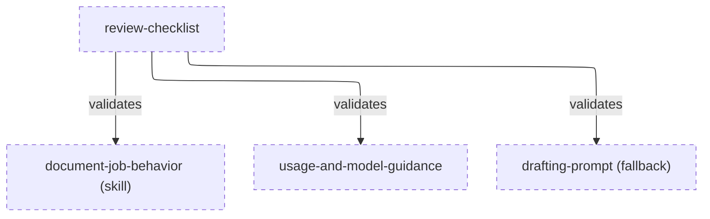

# Copilot Drafting Guide

## Purpose

A GitHub Copilot agent skill that creates, drafts and versions a job behavior document from a job's source code, with practical usage and model-selection guidance and a fallback prompt, for developers who use Copilot and have no Craft.

## Navigation

[Job Behavior Specifications](../README.md#navigation) / **Copilot Drafting Guide**

- [Design](#design)
- [Behavior](#behavior)
- [Plan](#plan)
- [Relationships](#relationships)
- [Links](#links)

## Design

Not built yet.

## Behavior

- **B01** When a developer asks the skill to document a job, then it drafts from the job's source using only the template's sections. (untested: benchmark pending)
- **B02** When the draft states a behavior, then it is labelled current behavior (`CUR-`) or assumption and unknown (`ASM-`), anything inferred goes to assumptions and unknowns, and every current behavior cites the file and the place in it; where the source is silent it writes an open question and does not guess. (untested: benchmark pending)
- **B03** When asked to draft or version a document, then it never writes the acknowledgement block, never marks anything confirmed and leaves them blank for our team to record. (untested: benchmark pending)
- **B04** When the draft draws the diagram, then it follows the one-box rule and keeps internal names out of the business text. (untested: benchmark pending)
- **B05** When a draft is returned, then it ends with a self-check report listing the source it did not read, current behaviors with no scenario, scenarios naming unknown IDs and statements without a source pointer, and says the check is best effort and a person must review. (untested: benchmark pending)
- **B06** When a new version is requested, then the skill creates it as a new copy, updates the header and change log, and never edits an acknowledged version in place. (untested: benchmark pending)
- **B07** When the skill folder and the guidance are read, then they contain no reference to Craft and the skill needs nothing installed in VS Code agent mode; a paste-in prompt with the same instructions exists only as a fallback for surfaces without skills. (untested: benchmark pending)
- **B08** When model advice is given, then it is marked team-reported and environment-dependent with a valid-as-of date, tells the user to check the model picker, plan and administrator policy, and calls no model guaranteed. (untested: benchmark pending)
- **B09** When the usage guidance is read, then it tells the developer that Copilot's output is a draft a person must review against the source before it goes to the vendor. (untested: benchmark pending)
- **B10** When the guidance describes protecting acknowledged versions, then it says a skill cannot block manual edits, suggests one file per version and repository protections such as protected branches and required reviewers as outside this deliverable, and says to confirm skill support in the developers' Copilot setup. (untested: benchmark pending)

## Plan

### Planned Navigation

[Job Behavior Specifications](../README.md#plan) / **Copilot Drafting Guide**

- [Planned Purpose](#planned-purpose)
- [Planned Design](#planned-design)
  - [Planned Diagram](#planned-diagram)
- [Steps](#steps)
- [Acceptance Mapping](#acceptance-mapping)
- [Assumptions And Open Questions](#assumptions-and-open-questions)
- [Planned Relationships](#planned-relationships)
- [Planned Links](#planned-links)

### Planned Purpose

A GitHub Copilot agent skill that creates, drafts and versions a job behavior document from a job's source code, with practical usage and model-selection guidance and a fallback prompt, for developers who use Copilot and have no Craft.

### Planned Design

The component delivers a Copilot agent skill folder (`SKILL.md`, a copy of the template and `self-check.md`), a usage and model guidance file and a fallback prompt, plus an internal review checklist. The skill, the guidance and the fallback are the files our team uses. The guidance carries a valid-as-of date because model availability changes.

#### Planned Diagram

### Steps

1. Create the skill folder `document-job-behavior/` with `SKILL.md` (the instructions, written once, covering create, draft, self-check and next version), a copy of the finished template (copied from the built Job Behavior Template) and `self-check.md` (the self-check rules the skill applies).
2. Create `usage-and-model-guidance.md`: how to use the skill in VS Code agent mode, how to review the draft, protecting acknowledged versions, and the model advice, marked team-reported and environment-dependent with a valid-as-of date.
3. Create `drafting-prompt.md`, the fallback with the same instructions for surfaces without skills.
4. Create `review-checklist.md` with one item per behavior tagged `[B01]` to `[B10]`, including the dry run on the website job source.
5. Keep Craft names, commands and paths out of the skill folder, the guidance and the fallback prompt.

### Acceptance Mapping

| Acceptance condition | Behaviors | Step | Validation check |
| --- | --- | --- | --- |
| Skill, guidance and fallback pass the dry-run review | B01–B10 | 1, 2, 3, 4 | review-checklist.md items [B01]–[B10], dry run with Copilot on the website job source |
| No Craft term and model advice correctly marked | B07, B08 | 1, 2, 3 | review-checklist.md items [B07], [B08] |

Checks: the root declares no automated check for documents. The validation is the component's `review-checklist.md` dry-run review (see the verification gap in `requirements.md`) plus the record validators.

### Assumptions And Open Questions

Assumptions (override any of them in chat before `/craft:build`). This plan replaces the earlier plan of commit `8c80eed`, as the user revised the content on 2026-11-14 (two statement kinds, "version", one overall confirmation, a skill):

1. The skill folder is named `document-job-behavior`, which GitHub's docs place in `.github/skills`, `.claude/skills` or `.agents/skills`. The instructions are written once in `SKILL.md`; the fallback prompt repeats them and must be kept in step. Override: ask for another folder name.
2. The skill folder holds a copy of the template, copied from the Job Behavior Template once it is built; the root checks that the copy matches. Override: ask for the skill to refer to a template stored elsewhere.
3. Our team's developers use VS Code agent mode, where the user says skills work. GitHub's docs say Copilot loads a skill when relevant and list the Copilot app, CLI, cloud agent and agent mode in VS Code, Visual Studio and JetBrains; they do not state plan or administrator requirements or preview status. Skill support must be confirmed in the developers' Copilot setup.
4. Lifecycle scope is create, draft, self-check and next version (the user took the recommendation). The skill never writes the acknowledgement and never edits an acknowledged version in place; it cannot block manual edits, so the guidance suggests one file per version and repository protections as outside this deliverable.
5. Model advice was checked on 2026-11-14 against GitHub's supported-models and model-comparison pages, read through a summarizer, truncated, with no last-updated date shown; re-check when published. The docs say availability depends on plan, vendor and administrator policy and suggest GPT-5.6 Terra for balanced work and GPT-5.3-Codex for complex engineering and review.
6. The user reports the models in the developers' Copilot picker as GPT-6 Luna, GPT-6.1 Sol, Claude Sonnet 5.5, GPT-5.6 Luna, GPT-6 Sol and GPT-5.3-Codex, and that Fable and Kimi are not available; Terra models are not in that list. All six appear on GitHub's supported-models page read on 2026-11-14, but the task guidance read from GitHub covers the GPT-5.6 family, GPT-5.3-Codex and Claude Sonnet 4.6, not the GPT-6 models, so the guide gives task advice only where the docs support it and otherwise tells the developer to try the model on the website job sample. The list comes from the user and is written as team-reported.
7. The dry run needs Copilot access. If nobody can run it, the skill's behaviors stay unverified and the report says so. Override: name who runs it and on which models.
8. Copilot output varies between models and runs, so B01, B02 and B05 can be judged only on samples. This is the idea of the future benchmark (a backlog item), not built here.

### Planned Relationships

- [Job Behavior Template](../job-behavior-template/README.md#purpose) — the form the skill fills in; a copy goes into the skill folder so the skill uses only that form's sections.
- GitHub Docs, [Supported models](https://docs.github.com/en/copilot/reference/ai-models/supported-models), [Model comparison](https://docs.github.com/en/copilot/reference/ai-models/model-comparison) and [About agent skills](https://docs.github.com/en/copilot/concepts/agents/about-agent-skills) — official source of the model and skill advice, read on 2026-11-14.

### Planned Links

- [requirements.md](requirements.md#requirements) — what the component must do and what it need not.
- [contract.md](contract.md#contract) — the content the document must carry and the wording rules.
- [review-checklist.md](review-checklist.md) — the dry-run review items, tagged by behavior (created by the build).

## Relationships

- [Job Behavior Template](../job-behavior-template/README.md#purpose) — the form the skill fills in; a copy goes into the skill folder so the skill uses only that form's sections.
- GitHub Docs, [Supported models](https://docs.github.com/en/copilot/reference/ai-models/supported-models), [Model comparison](https://docs.github.com/en/copilot/reference/ai-models/model-comparison) and [About agent skills](https://docs.github.com/en/copilot/concepts/agents/about-agent-skills) — official source of the model and skill advice, read on 2026-11-14.

## Links

- [requirements.md](requirements.md#requirements) — what the component must do and what it need not.
- [contract.md](contract.md#contract) — the content the document must carry and the wording rules.
