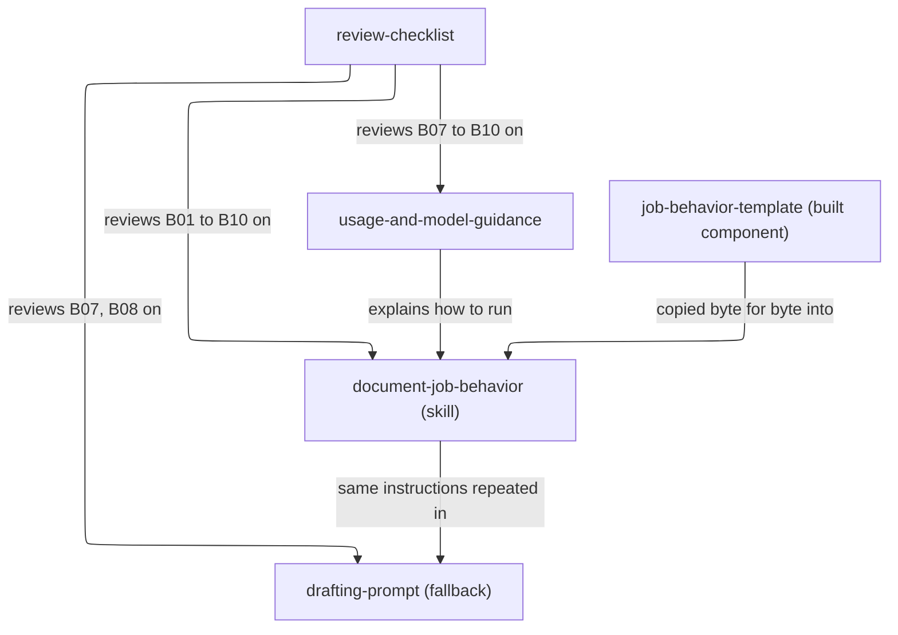
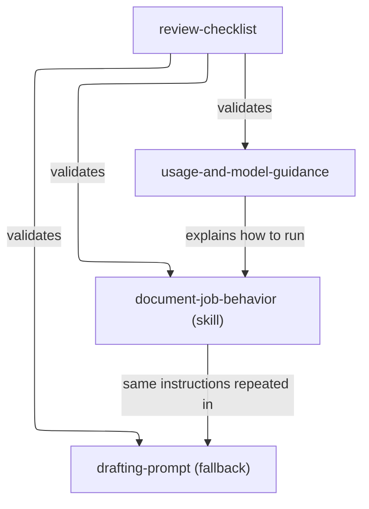

# Copilot Drafting Guide

## Purpose

A GitHub Copilot agent skill that creates, drafts, updates and versions a job behavior document from a job's source code (and vendor-provided documents when given), with practical usage and model-selection guidance and a fallback prompt, for our team's developers who use Copilot and have no Craft.

## Navigation

[Job Behavior Specifications](../README.md#navigation) / **Copilot Drafting Guide**

- [Design](#design)
  - [Diagram](#diagram)
- [Behavior](#behavior)
- [Plan](#plan)
- [Relationships](#relationships)
- [Links](#links)

## Design

The component delivers files our team uses and one internal checklist. The skill folder [document-job-behavior](document-job-behavior/SKILL.md) holds the instructions written once ([SKILL.md](document-job-behavior/SKILL.md)), the rules for the self-check and the question ([self-check.md](document-job-behavior/self-check.md)) and a byte-identical copy of the built template ([job-behavior-template.md](document-job-behavior/job-behavior-template.md)). The skill creates a document from the template, drafts from source and optional vendor documents (vendor documents first), updates the same file when answers are given (version bump, change-log entry), and records an acknowledgement only from facts a developer gives. [usage-and-model-guidance.md](usage-and-model-guidance.md) explains use in VS Code agent mode and carries the team-reported model advice with a valid-as-of date. [drafting-prompt.md](drafting-prompt.md) repeats the instructions for surfaces without skills and must be kept in step with the skill. [review-checklist.md](review-checklist.md) is internal, with one item per behavior. The skill folder, guidance and fallback never mention the internal records.

Review state: B07 to B10 and the wording rules passed a fresh file review. B01 to B06 are unticked: they need a real Copilot run of the skill on the website job source compared with the reference, which has not been done.

### Diagram

## Behavior

- **B01** When a developer asks the skill to document a job, then it drafts from the job's source, and from vendor-provided documents when given, using only the template's parts. (untested: benchmark pending)
- **B02** When the draft states something, then it is a current behavior (`B1`, ...) with an evidence pointer or a question (`Q1`, ...), anything inferred is a question or is left out, and it asks only what the source cannot show and would change the workflow, never what the source states and never the reason behind a shown behavior. (untested: benchmark pending)
- **B03** When asked to draft or update a document, then it never ticks, confirms or records an acknowledgement on its own, and it records one only from facts a developer gives it (company, date, version, reference), writing exactly those. (untested: benchmark pending)
- **B04** When the draft draws the diagram, then it is one black box laid out vertically with the project's settings, with the behavior IDs in the edge labels and linked in the text beside it, and internal names stay out of the business text. (untested: benchmark pending)
- **B05** When a draft is returned, then it ends with a self-check report listing the source and documents it did not read, current behaviors with no scenario, scenarios naming unknown IDs and statements without an evidence pointer, and says the check is best effort and a person must review. (untested: benchmark pending)
- **B06** When the developer gives answers (from the vendor or our team), then the skill updates the same file: it turns each answered question into a current behavior marked "resolved: now Bn", adds a change-log entry, bumps the version, never edits an earlier acknowledgement row, and reminds the developer to tag the repository. (untested: benchmark pending)
- **B07** When vendor-provided documents are given, then they take precedence over documents our team created, which it uses only where no vendor document covers the point, and where a vendor document and the code disagree it records a question and does not guess. (untested: benchmark pending)
- **B08** When the skill folder, the usage guidance and the fallback prompt are read, then they contain no reference to Craft and the skill needs nothing installed in VS Code agent mode; a paste-in prompt with the same instructions exists only as a fallback for surfaces without skills. (untested: benchmark pending)
- **B09** When model advice is given, then it is marked team-reported and environment-dependent with a valid-as-of date, tells the user to check the model picker, plan and administrator policy, and calls no model guaranteed. (untested: benchmark pending)
- **B10** When the usage guidance is read, then it tells the developer that Copilot's output is a draft a person must review against the source, that a skill cannot block manual edits, that acknowledged versions are tagged in the repository and protected by repository settings outside this deliverable, and that skill support must be confirmed in the developers' Copilot setup. (untested: benchmark pending)

## Plan

### Planned Navigation

[Job Behavior Specifications](../README.md#plan) / **Copilot Drafting Guide**

- [Planned Design](#planned-design)
  - [Planned Diagram](#planned-diagram)
- [Planned Behavior](#planned-behavior)
- [Steps](#steps)
- [Acceptance Mapping](#acceptance-mapping)
- [Assumptions And Open Questions](#assumptions-and-open-questions)
- [Planned Links](#planned-links)

### Planned Design

The skill, the guidance and the fallback prompt are reworded in place, and the skill's template copy is replaced by a copy of the revised template. One pointer is added to the skill and the guidance: after drafting or updating, run `propose-tracker-updates`. The skill folder stays `document-job-behavior/`, so the installed path does not change.

#### Planned Diagram

### Planned Behavior

B01, B02 and B10 were confirmed on 2026-11-15 in an earlier wording; B05, B06 and B07 and the further wording of B01, B02 and B10 carry the user's component-review decisions (2026-11-15) and are confirmed by the user on 2026-11-16. No behavior is added; the component stays at ten, and B03, B04, B08 and B09 are unchanged.

- **B01** When a developer asks the skill to document a use case, then it drafts from the use case's source, the core files `external_tools.md` and `logic.md`, manually tagged additional documents (including original SOP and vendor documents when available) and any findings, questions, corrections and dependency observations the developer supplies as they are, using only the template's parts, and the developer does not first rewrite supplied findings into a specification. (untested: benchmark pending)
- **B02** When the draft states something, then it is a current behavior (`B1`, ...) with an evidence pointer or a question (`Q1`, ...), only source-observed and document-described behavior is a current behavior while team analysis, inference and recommendation are questions or left out, it checks that the cited evidence supports the claim and flags a conflict without guessing, an existing analysis is a starting input and not a verified or approved baseline, and it asks only what the source cannot show and would change what the migrated use case must do, never what the source states and never the reason behind a shown behavior. (untested: benchmark pending)
- **B05** When a draft is returned, then it ends with a self-check report listing the source, core files and documents it did not read or that are missing, current behaviors with no scenario, scenarios naming unknown IDs, and statements with no evidence pointer, with evidence that does not support them or in conflict, and says the check is best effort and a person must review. (untested: benchmark pending)
- **B06** When the developer gives answers, corrections or further findings (from the vendor or our team), then the skill updates the same file: an answer updates the section it belongs to and becomes a current behavior marked "resolved: now Bn" only when it establishes behavior, IDs and history are kept and no duplicate is made, it adds a change-log entry, bumps the version, never edits an earlier acknowledgement row, and reminds the developer to tag the repository. (untested: benchmark pending)
- **B07** When documents are given with tags, then vendor-provided documents take precedence over documents our team created, which are team analysis and not verified baselines and are used only where no vendor document covers the point, and where a document and the code disagree it records a question and does not guess. (untested: benchmark pending)
- **B10** When the usage guidance is read, then it tells the developer that Copilot's output is a draft a person must review against the source, that a skill cannot block manual edits, that acknowledged versions are tagged in the repository and protected by repository settings outside this deliverable, that skill support must be confirmed in the developers' Copilot setup, that supplied findings, questions and corrections and the files `external_tools.md` and `logic.md` can be given as they are, and to run `propose-tracker-updates` after drafting or updating. (untested: benchmark pending)

### Steps

1. Replace the skill's template copy with the revised template (byte for byte) and reword `SKILL.md`, `self-check.md`, `drafting-prompt.md` and `usage-and-model-guidance.md` to use-case wording; add the core inputs `external_tools.md` and `logic.md`, the handling of manually tagged documents and of supplied findings, questions, corrections and dependency observations, the four evidence kinds (source-observed, document-described, team analysis or inference, recommendation), the evidence-support and conflict check, the repeatable update rules (IDs and history kept, no duplicates, answers update their section) and the pointer to `propose-tracker-updates`.
2. Update `contract.md`, `requirements.md` and `review-checklist.md` for the reworded lines.
3. Run the file review, the wording scan, the Craft-term scan and the record validators. No Copilot dry run is required of the build. Record the earlier-version user-reported results (see `requirements.md`) in the checklist as a labelled note and replace the `Review state` paragraph in `## Design` with the testing policy and that evidence; tick nothing for B01 to B06.
4. After the build the user tests the revised skill manually in the client environment on real use cases, gives feedback in ChatGPT, and the skill is iterated; those results are recorded as user-reported evidence when reported.

### Acceptance Mapping

| Acceptance condition | Behaviors | Step | Validation |
| --- | --- | --- | --- |
| B07 to B10 and the wording rules pass the file review of the revised folder; B01 to B06 stay unticked and are recorded with the earlier-version user-reported evidence, labelled as such; no fresh Copilot dry run on the website reference is required (B01 to B10). | B01 to B10 | 3 | `[B07]` to `[B10]` checklist items and the scans; the evidence note in `requirements.md` and the checklist |
| `SKILL.md`, the fallback prompt and the guidance accept `external_tools.md`, `logic.md`, tagged documents and supplied findings as they are, separate the four evidence kinds, check that evidence supports claims, tell the developer to run `propose-tracker-updates` next, use `use case` wording, and contain no Craft term (B01, B02, B05, B07, B08, B10). | B01, B02, B05, B07, B08, B10 | 3 | `[B01]`, `[B02]`, `[B05]`, `[B07]`, `[B08]`, `[B10]` file review and the scans |
| An update from answers, corrections or further findings keeps IDs and history, makes no duplicate, updates the right section and creates a behavior only when the answer establishes one (B06). | B06 | 3 | `[B06]` file review; user-reported manual test results recorded when reported |

Checks: none declared; verification is the component's `review-checklist.md` dry-run review, plus the record validators at the end of each plan and build.

### Assumptions And Open Questions

Assumptions (override any of them in chat before `/craft:build`):

1. The blocked task is superseded by this revision, and the mandatory fresh website-reference Copilot dry run is removed (user decision, 2026-11-15). The earlier blocked record stays in git history. Override: require a fresh Copilot dry run.
2. The companion skill is run next by the developer; the drafting skill does not run it. Override: fold emission into this skill and restructure its behaviors.
3. Tracker acknowledgement facts reach the developer from the lead (the guide's B03 and B06 already say a developer gives them); the guidance says so in one line.
4. Earlier-version results the user reported (B01, B03, B04 partial; B02, B05 pass; B06 and vendor-document handling untested; VS Code 1.144.0, Copilot Agent mode, Sonnet 5.5 High) are kept as user-reported evidence and not as revised-version passes or raw output. Going forward the user tests the skill manually in the client environment on real use cases and iterates from ChatGPT feedback. The additional feedback topics are compared with the documents in `requirements.md` and are not planned changes. Override: plan changes for them now.
5. The core inputs keep the exact filenames `external_tools.md` and `logic.md`; when one is missing the skill reports it and does not invent content. Tagging of additional documents is manual, by the developer.
6. Supplied findings are structured by this skill into the specification (and the sibling skills propose tracker rows from it), so no developer rewrites them first. Existing analyses are starting inputs, not verified or approved baselines.
7. The rule that an answer becomes a behavior only when it establishes behavior replaces the earlier rule that every answered question becomes one. Override: keep one behavior per answered question.
8. Roles (confirmed): this skill accepts the source, `external_tools.md`, `logic.md` and the supplied findings, questions, corrections and tagged documents, structures and verifies them, and produces or updates the specification. The tracker update skill then extracts the question and use case updates from that specification; supplied findings never go straight to tracker rows. Access and source screening are separate and need no specification. Updates after a vendor answer follow handoff steps 9 to 12: the developer updates the appropriate sections, version and history with this skill, and a lead verifies the update reflects the answer.

Open questions: none about behavior.

### Planned Links

- [requirements.md](requirements.md#requirements) — what the component must do and what it need not.
- [contract.md](contract.md#contract) — the shapes, formats and wording rules.

## Relationships

- [Job Behavior Template](../job-behavior-template/README.md#purpose) — the form the skill fills in; a copy goes into the skill folder so the skill uses only that form's parts.
- GitHub Docs, [Supported models](https://docs.github.com/en/copilot/reference/ai-models/supported-models), [Model comparison](https://docs.github.com/en/copilot/reference/ai-models/model-comparison) and [About agent skills](https://docs.github.com/en/copilot/concepts/agents/about-agent-skills) — official source of the model and skill advice, read on 2026-11-14.

## Links

- [requirements.md](requirements.md#requirements) — what the component must do and what it need not.
- [contract.md](contract.md#contract) — the content the document must carry and the wording rules.
- [review-checklist.md](review-checklist.md) — the internal review items tagged B01 to B10.
