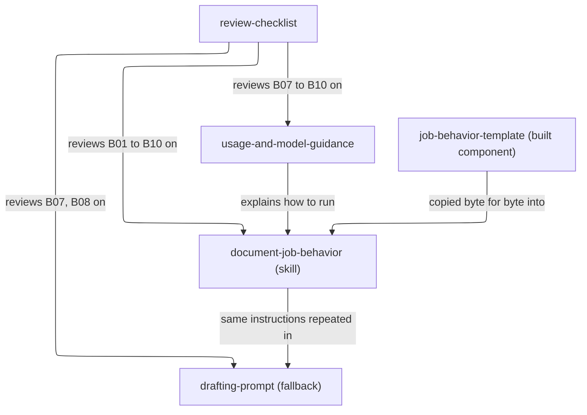

# Copilot Drafting Guide

## Purpose

A GitHub Copilot agent skill that creates, drafts, updates and versions a job behavior document from a job's source code (and vendor-provided documents when given), with practical usage and model-selection guidance and a fallback prompt, for our team's developers who use Copilot and have no Craft.

## Navigation

[Job Behavior Specifications](../README.md#navigation) / **Copilot Drafting Guide**

- [Design](#design)
  - [Diagram](#diagram)
- [Behavior](#behavior)
- [Relationships](#relationships)
- [Links](#links)

## Design

The component delivers files our team uses and one internal checklist. The skill folder [document-job-behavior](document-job-behavior/SKILL.md) holds the instructions written once ([SKILL.md](document-job-behavior/SKILL.md)), the rules for the self-check and the question ([self-check.md](document-job-behavior/self-check.md)) and a byte-identical copy of the built template ([job-behavior-template.md](document-job-behavior/job-behavior-template.md)). The skill creates a document from the template, drafts from source and optional vendor documents (vendor documents first), updates the same file when answers are given (version bump, change-log entry), and records an acknowledgement only from facts a developer gives. [usage-and-model-guidance.md](usage-and-model-guidance.md) explains use in VS Code agent mode and carries the team-reported model advice with a valid-as-of date. [drafting-prompt.md](drafting-prompt.md) repeats the instructions for surfaces without skills and must be kept in step with the skill. [review-checklist.md](review-checklist.md) is internal, with one item per behavior. The skill folder, guidance and fallback never mention the internal records.

Review state: B07 to B10 and the wording rules passed a fresh file review. B01 to B06 are unticked: they need a real Copilot run of the skill on the website job source compared with the reference, which has not been done.

### Diagram

## Behavior

- **B01** When a developer asks the skill to document a job, then it drafts from the job's source, and from vendor-provided documents when given, using only the template's parts. (untested: benchmark pending)
- **B02** When the draft states something, then it is a current behavior (`B1`, ...) with an evidence pointer or a question (`Q1`, ...), anything inferred is a question or is left out, and it asks only what the source cannot show and would change the workflow, never what the source states and never the reason behind a shown behavior. (untested: benchmark pending)
- **B03** When asked to draft or update a document, then it never ticks, confirms or records an acknowledgement on its own, and it records one only from facts a developer gives it (company, date, version, reference), writing exactly those. (untested: benchmark pending)
- **B04** When the draft draws the diagram, then it is one black box laid out vertically with the project's settings, with the behavior IDs in the edge labels and linked in the text beside it, and internal names stay out of the business text. (untested: benchmark pending)
- **B05** When a draft is returned, then it ends with a self-check report listing the source and documents it did not read, current behaviors with no scenario, scenarios naming unknown IDs and statements without an evidence pointer, and says the check is best effort and a person must review. (untested: benchmark pending)
- **B06** When the developer gives answers (from the vendor or our team), then the skill updates the same file: it turns each answered question into a current behavior marked "resolved: now Bn", adds a change-log entry, bumps the version, never edits an earlier acknowledgement row, and reminds the developer to tag the repository. (untested: benchmark pending)
- **B07** When vendor-provided documents are given, then they take precedence over documents our team created, which it uses only where no vendor document covers the point, and where a vendor document and the code disagree it records a question and does not guess. (untested: benchmark pending)
- **B08** When the skill folder, the usage guidance and the fallback prompt are read, then they contain no reference to Craft and the skill needs nothing installed in VS Code agent mode; a paste-in prompt with the same instructions exists only as a fallback for surfaces without skills. (untested: benchmark pending)
- **B09** When model advice is given, then it is marked team-reported and environment-dependent with a valid-as-of date, tells the user to check the model picker, plan and administrator policy, and calls no model guaranteed. (untested: benchmark pending)
- **B10** When the usage guidance is read, then it tells the developer that Copilot's output is a draft a person must review against the source, that a skill cannot block manual edits, that acknowledged versions are tagged in the repository and protected by repository settings outside this deliverable, and that skill support must be confirmed in the developers' Copilot setup. (untested: benchmark pending)

## Relationships

- [Job Behavior Template](../job-behavior-template/README.md#purpose) — the form the skill fills in; a copy goes into the skill folder so the skill uses only that form's parts.
- GitHub Docs, [Supported models](https://docs.github.com/en/copilot/reference/ai-models/supported-models), [Model comparison](https://docs.github.com/en/copilot/reference/ai-models/model-comparison) and [About agent skills](https://docs.github.com/en/copilot/concepts/agents/about-agent-skills) — official source of the model and skill advice, read on 2026-11-14.

## Links

- [requirements.md](requirements.md#requirements) — what the component must do and what it need not.
- [contract.md](contract.md#contract) — the content the document must carry and the wording rules.
- [review-checklist.md](review-checklist.md) — the internal review items tagged B01 to B10.
