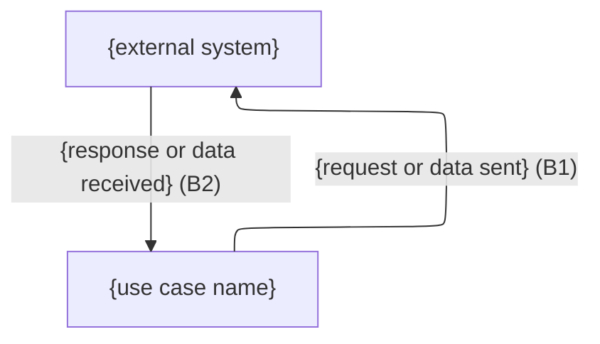

# Use Case Behavior: {use case name}

| Field | Value |
| --- | --- |
| Use case name | {the vendor's own name for the use case} |
| Version | {whole number: 1, 2, 3, ...} |
| Date | {date this version was issued, YYYY-MM-DD} |
| Status | {draft or acknowledged} |
| Source revision | {revision identifier of the script this version was written from} |
| Script link | {link to that script at that revision} |

## About this document

This document records what one use case does today, as seen in the vendor's script or in documents the vendor provided. It lists the questions the source cannot answer. It says nothing about how the use case will be migrated. It does not describe changes anyone might want, and it does not approve any behavior that was inferred rather than shown.

Words used here: the **vendor** runs and maintains the use case today and reviews this document. **Our team** writes it. A **use case** is what the business needs done; it carries the vendor's own name, and the vendor's **script** is how it is done today. A **tracker** is the shared spreadsheet our team keeps for each use case, where the vendor gives its answers and its acknowledgement. A **black box** is one closed box that stands for the whole use case, so only what goes in and out is shown.

### Contents

- [Change log](#change-log)
- [Current behaviors](#current-behaviors)
- [Questions](#questions)
- [Inputs, outputs, parameters and external dependencies](#inputs-outputs-parameters-and-external-dependencies)
- [Diagram](#diagram)
- [Acceptance scenarios](#acceptance-scenarios)
- [Operational context](#operational-context)
- [Acknowledgement log](#acknowledgement-log)

## Change log

| Version | Date | What changed, in plain words | Why (source change or answered question) |
| --- | --- | --- | --- |
| 1 | {date} | First version. | First documentation of the use case. |

## Current behaviors

Only what the evidence shows, and only the outcome it proves: a request that succeeded, a status the use case reports and an actual delivery are kept apart. The evidence shows whether a behavior is seen in the source or described in a vendor document. An explicit retry or failure-handling action in the source is a current behavior and is listed here.

| ID | When ... then ... (business language) | Evidence |
| --- | --- | --- |
| B1 | When {situation}, then {what the use case does, stating only the outcome the evidence proves}. | {source file and place, or vendor document and place} |

## Questions

Only what the source cannot show and whose answer would change what the migrated use case must do. Never what the source already states, and never the reason behind a behavior it shows. When a question is answered, the answer is added to the section it belongs to, and a new current behavior is added only if the answer establishes one.

| ID | Question for the vendor | Status |
| --- | --- | --- |
| Q1 | {one clear question} | open |

## Inputs, outputs, parameters and external dependencies

### Inputs

| Input | What it is | Where it comes from |
| --- | --- | --- |
| {name} | {plain description} | {source of the input} |

### Outputs

| Output | What it is | Who or what receives it |
| --- | --- | --- |
| {name} | {plain description} | {receiver} |

### Parameters

| Parameter name | This use case's value |
| --- | --- |
| {name} | {value the source states} |

### External dependencies

| System | Role | Direction of each request, response or data transfer |
| --- | --- | --- |
| {system name} | {what it does for the use case} | {outgoing: what is asked or sent; incoming: what comes back or is received} |

## Diagram

In plain text: {the use case sends ... to ... ([B1](#b1)) and receives ... ([B2](#b2))}.

## Acceptance scenarios

| ID | Given | When | Then | Covers |
| --- | --- | --- | --- | --- |
| AC1 | {starting situation} | {what happens} | {what the use case does} | covers: [B1](#b1) |

## Operational context

Not behavior. Each row cites a vendor document or a configuration in the source, otherwise it says `unknown`. A row may point to the current behavior that records an explicit retry or failure-handling action.

| Topic | Answer | Evidence |
| --- | --- | --- |
| Schedule and trigger | unknown | |
| Logging | unknown | |
| Monitoring and alerts | unknown | |
| Owner | unknown | |
| Failure handling | unknown | |

## Acknowledgement log

One row per version, added by our team from the tracker entry or the vendor's reply. Earlier rows are never edited. No person name or role is recorded.

| Company name | Date acknowledged | Version reviewed | Script link and revision | Production script | Overall confirmation | Tracker entry or reply |
| --- | --- | --- | --- | --- | --- | --- |
| | | | | [ ] The supplied script is the one running in production today. | [ ] The current behaviors are correct for this version. | |

What an acknowledgement confirms: the named script and revision are the current production script, and the documented behavior is current for that version. What it does not do: approve any future implementation, claim that the behavior is free of errors, answer any open question or approve any behavior that was inferred, or cover later versions.
