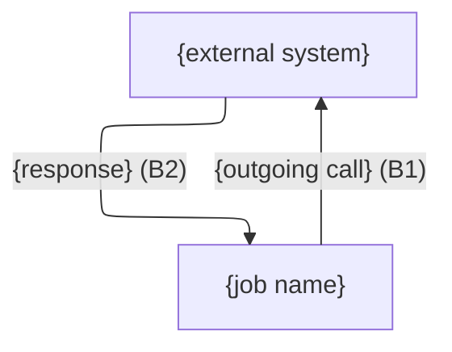

# Job Behavior: {use case name}

| Field | Value |
| --- | --- |
| Use case name | {the vendor's own name for the use case} |
| Version | {whole number: 1, 2, 3, ...} |
| Date | {date this version was issued, YYYY-MM-DD} |
| Status | {draft or acknowledged} |
| Source revision | {revision identifier of the script this version was written from} |
| Script link | {link to that script at that revision} |

## About this document

This document records what one job does today, as seen in its source code or in documents the vendor provided. It lists the questions the source cannot answer. It says nothing about how the job will be built or grouped on the migration platform. It does not describe changes anyone might want, and it does not approve any behavior that was inferred rather than shown.

Words used here: the **vendor** runs and maintains the job today and reviews this document. **Our team** writes it. A **tracker** is the shared spreadsheet our team keeps for each use case, where the vendor gives its answers and its acknowledgement. A **black box** is one closed box that stands for the whole job, so only what goes in and out is shown.

### Contents

- [Change log](#change-log)
- [Current behaviors](#current-behaviors)
- [Questions](#questions)
- [Inputs, outputs, parameters and external dependencies](#inputs-outputs-parameters-and-external-dependencies)
- [Diagram](#diagram)
- [Acceptance scenarios](#acceptance-scenarios)
- [Operational context](#operational-context)
- [Acknowledgement log](#acknowledgement-log)

## Change log

| Version | Date | What changed, in plain words | Why (source change or answered question) |
| --- | --- | --- | --- |
| 1 | {date} | First version. | First documentation of the job. |

## Current behaviors

| ID | When ... then ... (business language) | Evidence |
| --- | --- | --- |
| B1 | When {situation}, then {what the job does}. | {source file and place, or vendor document and place} |

## Questions

Only what the source cannot show and whose answer would change what the migrated workflow must do. Never what the source already states, and never the reason behind a behavior it shows.

| ID | Question for the vendor | Status |
| --- | --- | --- |
| Q1 | {one clear question} | open |

## Inputs, outputs, parameters and external dependencies

### Inputs

| Input | What it is | Where it comes from |
| --- | --- | --- |
| {name} | {plain description} | {source of the input} |

### Outputs

| Output | What it is | Who or what receives it |
| --- | --- | --- |
| {name} | {plain description} | {receiver} |

### Parameters

| Parameter name | This job's value |
| --- | --- |
| {name} | {value the source states} |

### External dependencies

| System | Role | Direction of each call |
| --- | --- | --- |
| {system name} | {what it does for the job} | {outgoing call: what is asked; response: what comes back} |

## Diagram

In plain text: {the job sends ... to ... ([B1](#b1)) and receives ... ([B2](#b2))}.

## Acceptance scenarios

| ID | Given | When | Then | Covers |
| --- | --- | --- | --- | --- |
| AC1 | {starting situation} | {what happens} | {what the job does} | covers: [B1](#b1) |

## Operational context

Not behavior. Each row cites a vendor document or a configuration in the source, otherwise it says `unknown`.

| Topic | Answer | Evidence |
| --- | --- | --- |
| Schedule and trigger | unknown | |
| Logging | unknown | |
| Monitoring and alerts | unknown | |
| Owner | unknown | |
| Failure handling | unknown | |

## Acknowledgement log

One row per version, added by our team from the tracker entry or the vendor's reply. Earlier rows are never edited. No person name or role is recorded.

| Company name | Date acknowledged | Version reviewed | Script link and revision | Production script | Overall confirmation | Tracker entry or reply |
| --- | --- | --- | --- | --- | --- | --- |
| | | | | [ ] The supplied script is the one running in production today. | [ ] The current behaviors are correct for this version. | |

What an acknowledgement claims: the vendor has reviewed the behavior stated in this document for the version and script named in that row. What it does not claim: that the behavior is free of errors, that any question is answered or any inferred behavior approved, or that later versions are covered.
