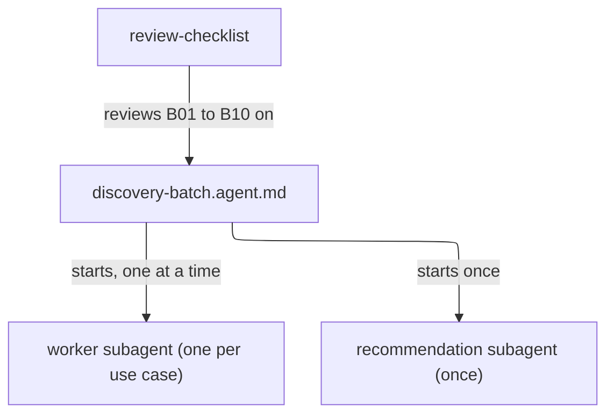
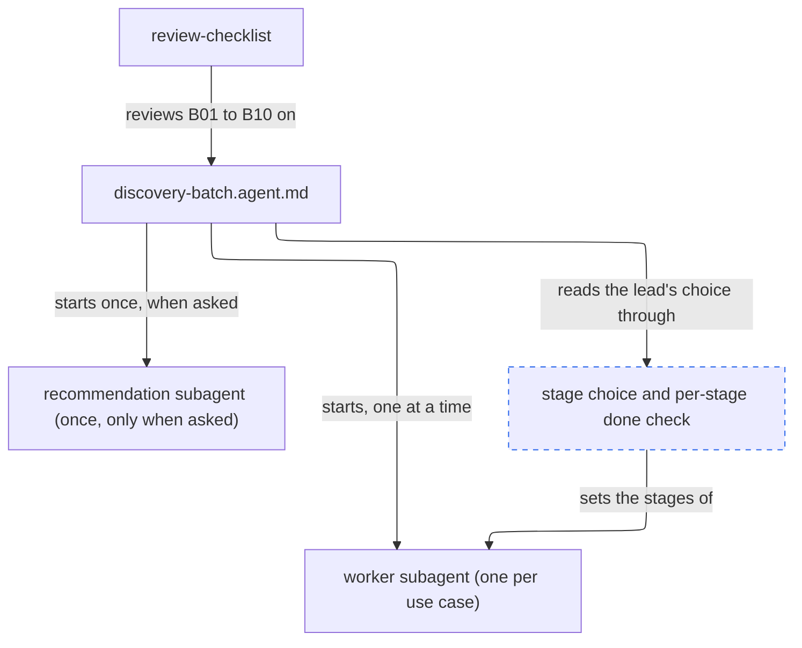

# Discovery Batch Agent

## Purpose

A GitHub Copilot custom agent, set to Claude Sonnet 5.5, that runs discovery for several use cases in one go, each use case in its own isolated subagent, then runs workflow recommendation and the review export once and hands the review to the lead in the main conversation, so a lead no longer starts `run-discovery` folder by folder.

## Navigation

[Job Behavior Specifications](../README.md#navigation) / **Discovery Batch Agent**

- [Design](#design)
  - [Diagram](#diagram)
- [Technology](#technology)
- [Behavior](#behavior)
- [Plan](#plan)
  - [Planned Navigation](#planned-navigation)
  - [Planned Design](#planned-design)
    - [Planned Diagram](#planned-diagram)
  - [Steps](#steps)
  - [Acceptance Mapping](#acceptance-mapping)
  - [Assumptions And Open Questions](#assumptions-and-open-questions)
  - [Planned Relationships](#planned-relationships)
  - [Planned Links](#planned-links)
- [Relationships](#relationships)
- [Links](#links)

## Design

One file, [discovery-batch.agent.md](discovery-batch.agent.md), first written ad hoc (see [README.original.md](README.original.md)). It asks the lead first which use cases to run (names or slugs), finds each one's folder, vendor and specification path in `use-case-index.csv`, derives the proposal ID `uc-<vendor-slug>-<use-case-slug>`, uses the fixed recommendations ID `recommendations`, and asks once only for what it can neither read nor derive. After one confirmation table it loops over the use cases one at a time. Each goes to a fresh subagent that runs source screening, identity and access, and behavior documentation through the installed skills and returns a fixed nine-line record, so no use case sees another one's context. Workflow recommendation runs once after the loop over every index row that has a specification, in its own subagent after one lead confirmation, the exporter runs once, and the review is handed to `record-review-decisions` in the main conversation, where the lead decides each row. The agent's only own write is a row of the use case index, following the index rules of `run-discovery`. It is reviewed against [review-checklist.md](review-checklist.md), one tagged item per behavior `B01` to `B10`, which is the check for a file that cannot be run; no Copilot run has been made, so no behavior is claimed to pass in the client until the lead has run the [Subagent Smoke Test](../subagent-smoke-test/README.md#design). A use case skipped because its proposal file exists but with no index row gets a row with a blank `spec` and is reported as `spec unknown`; the recommendation subagent's brief says the list is already confirmed; the final report lists every failed, blocked or malformed use case with its missing fact or reason.

Use: install the skills the agent names, copy `discovery-batch.agent.md` into the workspace's `.github/agents/` folder, choose the `discovery-batch` agent in Copilot Chat and name the use cases to run. Run the [Subagent Smoke Test](../subagent-smoke-test/README.md#design) first: it shows whether the client's Copilot starts subagents and whether a subagent can load a skill.

Decisions (record of the build; override in chat): runs are sequential, because the client's throttling and cost are unknown; the agent does not call `run-discovery` per use case, because that skill exports and walks the review for one folder and a subagent cannot ask the lead; the worker instructions sit inside the agent file and are passed to each subagent, so one file is installed; a worker never asks the lead anything, so a missing fact becomes a blocked stage that the final report lists; the index rules are read from `run-discovery`, not copied; `editFiles` stays in the front matter tools because the agent writes index rows, so `B09` rests on the agent's wording and the lead's review, not on the tool list, and the tool names are unverified in the client (narrow the list once known).

### Diagram

## Technology

- A GitHub Copilot custom agent (VS Code agent mode): one `discovery-batch.agent.md` in plain Markdown with YAML front matter (`name`, `description`, `model: Claude Sonnet 5.5 (copilot)`, `tools`), no code and no Craft term. It is installed by copying the file into the workspace's `.github/agents/` folder. It needs a subagent tool and the skills installed beside it (`propose-tracker-updates`, `discover-identity-access`, `document-job-behavior`, `recommend-workflows`, `record-review-decisions`, and `run-discovery` read only for its index rules), and Node 26 for the exporter's command line. It holds no copy of the Tracker Data Contract. It is non-executable, so its behaviors are checked by file review and end "(untested: benchmark pending)". Detail is in [requirements.md](requirements.md#requirements).

## Behavior

- **B01** When a lead asks for a batch, then it first asks only which use cases to run (names or slugs), which stages to run (screening, identity and access, specification; any combination; default all three) and whether to run workflow recommendation too (default no), finds each use case's folder, vendor and specification path in `use-case-index.csv` at the repository root, asks for a folder only for a name with no row, and then asks once only for what it can neither read nor derive (repository root, export folder, proposals root, exporter path, validator path, review folder, the lead's name and the date). (untested: benchmark pending)
- **B02** When it prepares the run, then it derives every proposal ID as `uc-<vendor-slug>-<use-case-slug>`, uses the fixed ID `recommendations`, asks for neither, stops and writes nothing (naming both folders) when two folders give the same ID, and shows one table (use case, vendor, folder, proposal ID and, for each stage, `run`, `skip: not chosen` or `skip: already done`) before anything runs. It also stops before anything runs, writing nothing, when the proposals root is `.`, does not exist or holds anything besides its `tracker-updates` folder. (untested: benchmark pending)
- **B03** When the lead confirms the table, then it writes or updates each folder's index row and runs one subagent per use case one after another, each running only that use case's `run` stages in the fixed order screening, identity and access, specification, through its installed skills, each stage writing only its own rows in the proposal file and leaving the other stages' rows as they are; it keeps only the fixed ten-line reply record, sets that row's `spec` after each use case, and a worker never asks the lead anything. After its stages each worker runs the Tracker Reconciler's `validate` on its own proposal folder, fixes nothing itself beyond rerunning its own stage once, and adds a tenth line `VALIDATION: ok` or `VALIDATION: failed: <file:line message; ...>` to the reply record. (untested: benchmark pending)
- **B04** When a use case fails, is blocked, or its subagent reply is not in the fixed record, then the batch goes on with the next one, the agent does not repair the reply, and the final report lists the failed stage with the missing fact or reason. A `VALIDATION: failed` line, a missing `VALIDATION` line or a validator that cannot run makes the use case failed, with the errors and their lines in the report. (untested: benchmark pending)
- **B05** When a stage's own result is already there (Identity & Access rows in the use case's proposal file for identity and access, a Use Cases row with `source_status` for screening, a non-blank `spec` in the index row for specification), then that stage is shown as `skip: already done` and not repeated unless the lead asks for a rerun of that stage, specification is never blocked for missing screening, and a use case with no index row gets a row with its folder and vendor and a blank `spec` and is listed as `spec unknown`. (untested: benchmark pending)
- **B06** When the lead asked for workflow recommendation, then it runs once after the loop, in its own subagent, over every index row that has a `spec` (earlier use cases included), with the fixed ID `recommendations`, after one lead confirmation that shows the list with the warning that a partial list drops the other use cases' mappings; when not asked, the agent says it was not run. (untested: benchmark pending)
- **B07** When the loop ends, or recommendation ends, then the exporter runs once after every run into the same review folder, so earlier review decisions are kept (it stops on exit 1 or 2 and shows the error unchanged), and the agent reports per use case the outcome of each stage (done, not chosen, already done, blocked or failed), the recommendation counts if it ran and the exporter's counts including rejected proposal rows. (untested: benchmark pending)
- **B08** When the export has run, then it hands the review folder, the lead's name and the date to `record-review-decisions` in the main conversation so the lead decides each row interactively; it reads no review cell, records no decision and does not rerun the exporter after a decision. (untested: benchmark pending)
- **B09** When it runs, then its only own write is an index row, and it never writes to the tracker, a proposal file, a specification or a review cell, and never releases, acknowledges, decides or applies anything. (untested: benchmark pending)
- **B10** When no subagent tool exists, then it says `NO SUBAGENT TOOL`, says that `run-discovery` handles one folder at a time, and stops without running any use case itself. (untested: benchmark pending)

## Plan

### Planned Navigation

[Job Behavior Specifications](../README.md#plan) / **Discovery Batch Agent**

- [Planned Design](#planned-design)
  - [Planned Diagram](#planned-diagram)
- [Steps](#steps)
- [Acceptance Mapping](#acceptance-mapping)
- [Assumptions And Open Questions](#assumptions-and-open-questions)
- [Planned Relationships](#planned-relationships)
- [Planned Links](#planned-links)

### Planned Design

Stage selection and a validation step are added inside the one agent file; no part is added and no file is created. The lead names the use cases, the stages (screening, identity and access, specification; any combination; default all three) and whether to run workflow recommendation (default no). Before the table, the agent reads each use case's proposal file and its index row and marks every stage `run`, `skip: not chosen` or `skip: already done`; it never writes to the proposal file. Each worker brief carries the per-stage choice, runs only the `run` stages in the fixed order, and writes only its own rows, so a later run of another stage adds to the same `tracker-updates.csv` without touching earlier rows (each stage skill rewrites only its own tab or rows). The export runs after every run into the same review folder, which keeps earlier review decisions. At intake the agent also checks that the proposals root is a dedicated folder (not `.`, existing, holding nothing besides `tracker-updates`) and asks once for the validator path; after its stages each worker runs the Tracker Reconciler's `validate` on its own proposal folder and reports a tenth record line `VALIDATION`, and the agent treats a failure as a failed use case.

#### Planned Diagram

### Steps

1. Edit `discovery-batch.agent.md` (stage selection first): the first question (use cases, stages, recommendation); the per-stage done detection and the confirmation table with a column per stage; the worker brief's `Stages to run:` line and its rule to run only those stages in order and write only their own rows; the nine-line record's new values (`skipped: not chosen`, `skipped: already done`); recommendation only when asked; the export after every run into the same review folder; the report's per-stage outcomes; and the Never list's rerun line.
2. Update [contract.md](contract.md#contract) and [requirements.md](requirements.md#requirements) (already changed in this plan commit as the target) if the build finds a wording gap, and update `review-checklist.md` to match the agent file.
3. Keep this README's Design, Behavior and diagram in step, and dissolve this Plan into Design.
4. Add the intake check of the proposals root, the validator path question, the worker's validation step, the tenth reply line `VALIDATION: ok | failed: <file:line message; ...>` and the failed-use-case rule in the agent file, and update `contract.md`, `requirements.md` and the checklist to match.
5. Validate with the checklist and its scan.

### Acceptance Mapping

| Acceptance | Behaviors | Step | Check |
| --- | --- | --- | --- |
| The agent asks use cases, stages and recommendation, and its table shows per-stage `run` or `skip` | B01, B02 | 1 | review-checklist `[B01]`, `[B02]` |
| A worker runs only chosen stages in order, writing only its own rows, and the record shows the skip reasons | B03, B04 | 1 | `[B03]`, `[B04]` |
| A stage is skipped as done only by its own result, and specification is never gated on screening | B05 | 1 | `[B05]` |
| Recommendation only when asked, export after every run into the same folder | B06, B07 | 1 | `[B06]`, `[B07]` |
| The proposals root is a dedicated folder checked before anything runs, and a failed validation fails the use case | B02, B03, B04 | 4 | `[B02]` to `[B04]` |
| Hand-over, write limits and the no-subagent stop unchanged, scan prints nothing | B08, B09, B10 | 1, 4 | `[B08]` to `[B10]` and the scan in `review-checklist.md` |

Validation: the checklist items for `B01` to `B10` read against the agent file, the checklist's `grep` scan from this folder (it must print nothing), and the worker record in the agent file equal to [contract.md](contract.md#worker-reply-record). No automated check is declared; the behaviors stay "(untested: benchmark pending)" because no Copilot run is made.

### Assumptions And Open Questions

Assumptions (override any in chat):

1. **Target.** The component is `discovery-batch-agent`, because the change is to its one agent file. No other component is edited. The Discovery Orchestrator's `run-discovery` keeps running all four stages per folder; its rules need no change, and the agent only reads them.
2. **Behaviors.** B01, B02, B03, B05, B06 and B07 changed and the list stays at ten; they were confirmed by the user on 2026-11-17. B04 is unchanged and still covers a blocked stage.
3. **Done detection.** Identity is done when the proposal file holds an Identity & Access row; screening when it holds a Use Cases row with `source_status`; specification when the index row has a non-blank `spec`. The agent only reads. Override by naming another signal.
4. **No screening gate.** The user chose that specification is never blocked for missing screening, because screening writes no `source_status` row for a clean source, so a gate would block healthy use cases. The cost is that screening shows `run` again for a clean source screened earlier unless the lead leaves it out of the stage list. The alternative, a gate until the Tracker Update Proposer writes `source_status: located`, is a bounded request to that component and is not made here.
5. **Skip values.** The record gains a tenth line `VALIDATION` and keeps the other nine; `STAGE-n` gains `skipped: not chosen` and `skipped: already done`, and `SOURCE-STATUS` is `none` when no value is known.
6. **Export.** The exporter runs after every run, even when every stage was skipped, into the same review folder; a new folder would lose earlier decisions. This relies on the exporter's own preservation rule (its tests are the evidence), which is not re-proven here.
7. **Specification done by `spec` alone.** A specification file can exist while its spec-mode proposal rows failed; the lead then asks for a rerun of that stage. Override by also checking for proposal rows.
8. **Validation additions.** The mandatory validator run is here because this agent already needs Node; the validator is the Tracker Reconciler's `validate` (extended in its own plan), and its path is asked once at intake. A worker does not repair rows beyond one rerun of its own stage. The proposals-root check (not `.`, existing, only `tracker-updates` inside) is made once, before the table. Override by naming another rule.
9. **Existing plan.** The README had no Plan; this is the first. The task was added to `craft.json` because the earlier build removed it (template budget: cost 1, 1800 seconds).

Open questions: none. The behaviors and the no-gate choice were confirmed by the user on 2026-11-17.

### Planned Relationships

- [Tracker Update Proposer](../tracker-update-proposer/README.md#purpose) and [Identity Access Discovery](../identity-access-discovery/README.md#purpose) — the stage skills whose own rows the stage choice and the done checks rely on.
- [Review CSV Exporter](../tracker-tools/review-csv-exporter/README.md#purpose) — keeps earlier review decisions when run again into the same folder.
- [Tracker Reconciler](../tracker-tools/tracker-reconciler/README.md#purpose) — its `validate` command, run by each worker.
- [Discovery Orchestrator](../discovery-orchestrator/README.md#purpose) — the index rules, read and unchanged.

### Planned Links

- [requirements.md](requirements.md#requirements) — what the agent must do, must not do and need not match.
- [contract.md](contract.md#contract) — inputs, the per-stage table, the worker brief and record, and the export rules.

## Relationships

- [Discovery Orchestrator](../discovery-orchestrator/README.md#purpose) — owns the use case index rules and `run-discovery`, which this agent reads and follows.
- [Workflow Recommender](../workflow-recommender/README.md#purpose) — the skill run once over the index.
- [Review Decisions](../lead-tracker-skills/review-decisions/README.md#design) — the skill the review is handed to in the main conversation.
- [Review CSV Exporter](../tracker-tools/review-csv-exporter/README.md#purpose) — the tool the agent runs once.
- [Tracker Update Proposer](../tracker-update-proposer/README.md#purpose), [Identity Access Discovery](../identity-access-discovery/README.md#purpose) and [Copilot Drafting Guide](../copilot-drafting-guide/README.md#purpose) — the stage skills each worker runs.
- [Subagent Smoke Test](../subagent-smoke-test/README.md#design) — the check that shows whether the client supports subagents and skills in subagents.

## Links

- [review-checklist.md](review-checklist.md) — the internal review items `B01` to `B10`.
- [requirements.md](requirements.md#requirements) — what the agent must do, must not do and need not match.
- [contract.md](contract.md#contract) — inputs, the confirmation table, the worker reply record, the index writes and the wording rules.
- [README.original.md](README.original.md) — the original document.
