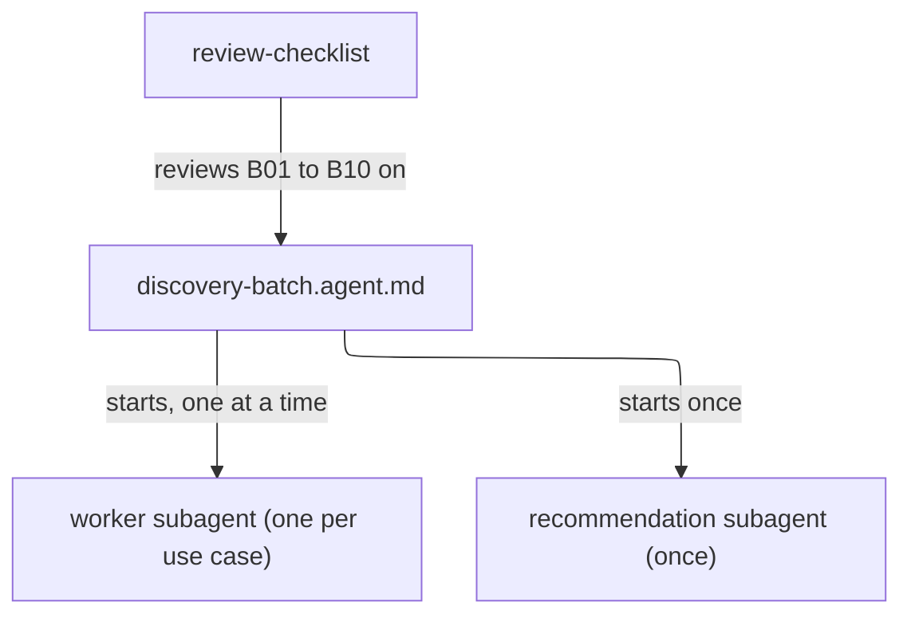

# Discovery Batch Agent

## Purpose

A GitHub Copilot custom agent, set to Claude Sonnet 5.5, that runs discovery for several use cases in one go, each use case in its own isolated subagent, then runs workflow recommendation and the review export once and hands the review to the lead in the main conversation, so a lead no longer starts `run-discovery` folder by folder.

## Navigation

[Job Behavior Specifications](../README.md#navigation) / **Discovery Batch Agent**

- [Design](#design)
  - [Diagram](#diagram)
- [Technology](#technology)
- [Behavior](#behavior)
- [Relationships](#relationships)
- [Links](#links)

## Design

One file, [discovery-batch.agent.md](discovery-batch.agent.md), first written ad hoc (see [README.original.md](README.original.md)). It asks the lead first which use cases to run (names or slugs), finds each one's folder, vendor and specification path in `use-case-index.csv`, derives the proposal ID `uc-<vendor-slug>-<use-case-slug>`, uses the fixed recommendations ID `recommendations`, and asks once only for what it can neither read nor derive. After one confirmation table it loops over the use cases one at a time. Each goes to a fresh subagent that runs source screening, identity and access, and behavior documentation through the installed skills and returns a fixed nine-line record, so no use case sees another one's context. Workflow recommendation runs once after the loop over every index row that has a specification, in its own subagent after one lead confirmation, the exporter runs once, and the review is handed to `record-review-decisions` in the main conversation, where the lead decides each row. The agent's only own write is a row of the use case index, following the index rules of `run-discovery`. It is reviewed against [review-checklist.md](review-checklist.md), one tagged item per behavior `B01` to `B10`, which is the check for a file that cannot be run; no Copilot run has been made, so no behavior is claimed to pass in the client until the lead has run the [Subagent Smoke Test](../subagent-smoke-test/README.md#design). A use case skipped because its proposal file exists but with no index row gets a row with a blank `spec` and is reported as `spec unknown`; the recommendation subagent's brief says the list is already confirmed; the final report lists every failed, blocked or malformed use case with its missing fact or reason.

Use: install the skills the agent names, copy `discovery-batch.agent.md` into the workspace's `.github/agents/` folder, choose the `discovery-batch` agent in Copilot Chat and name the use cases to run. Run the [Subagent Smoke Test](../subagent-smoke-test/README.md#design) first: it shows whether the client's Copilot starts subagents and whether a subagent can load a skill.

Decisions (record of the build; override in chat): runs are sequential, because the client's throttling and cost are unknown; the agent does not call `run-discovery` per use case, because that skill exports and walks the review for one folder and a subagent cannot ask the lead; the worker instructions sit inside the agent file and are passed to each subagent, so one file is installed; a worker never asks the lead anything, so a missing fact becomes a blocked stage that the final report lists; the index rules are read from `run-discovery`, not copied; `editFiles` stays in the front matter tools because the agent writes index rows, so `B09` rests on the agent's wording and the lead's review, not on the tool list, and the tool names are unverified in the client (narrow the list once known).

### Diagram

## Technology

- A GitHub Copilot custom agent (VS Code agent mode): one `discovery-batch.agent.md` in plain Markdown with YAML front matter (`name`, `description`, `model: Claude Sonnet 5.5 (copilot)`, `tools`), no code and no Craft term. It is installed by copying the file into the workspace's `.github/agents/` folder. It needs a subagent tool and the skills installed beside it (`propose-tracker-updates`, `discover-identity-access`, `document-job-behavior`, `recommend-workflows`, `record-review-decisions`, and `run-discovery` read only for its index rules), and Node 26 for the exporter's command line. It holds no copy of the Tracker Data Contract. It is non-executable, so its behaviors are checked by file review and end "(untested: benchmark pending)". Detail is in [requirements.md](requirements.md#requirements).

## Behavior

- **B01** When a lead asks for a batch, then it first asks only which use cases to run (names or slugs), finds each one's folder, vendor and specification path in `use-case-index.csv` at the repository root, asks for a folder only for a name with no row, and then asks once only for what it can neither read nor derive (repository root, export folder, proposals root, exporter path, review folder, the lead's name and the date). (untested: benchmark pending)
- **B02** When it prepares the run, then it derives every proposal ID as `uc-<vendor-slug>-<use-case-slug>`, uses the fixed ID `recommendations`, asks for neither, stops and writes nothing (naming both folders) when two folders give the same ID, and shows one table (use case, vendor, folder, proposal ID, and `skip` where `tracker-updates/<id>/tracker-updates.csv` exists) before anything runs. (untested: benchmark pending)
- **B03** When the lead confirms the table, then it writes or updates each folder's index row, runs one subagent per use case one after another (source screening, identity and access, behavior documentation, each through its installed skill), keeps only the fixed nine-line reply record, and sets that row's `spec` after each use case; a worker never asks the lead anything. (untested: benchmark pending)
- **B04** When a use case fails, is blocked, or its subagent reply is not in the fixed record, then the batch goes on with the next one, the agent does not repair the reply, and the final report lists the failed stage with the missing fact or reason. (untested: benchmark pending)
- **B05** When a use case's proposal file already exists, then it is skipped and shown as `skip` in the table unless the lead asks for a rerun, and when it has no index row, then its row is written with its folder and vendor and a blank `spec` and the final report lists it as `spec unknown`. (untested: benchmark pending)
- **B06** When the loop ends, then workflow recommendation runs once, in its own subagent, over every index row that has a `spec` (earlier use cases included), with the fixed ID `recommendations`, after one lead confirmation that shows the list with the warning that a partial list drops the other use cases' mappings. (untested: benchmark pending)
- **B07** When recommendation ends, then the exporter runs once (it stops on exit 1 or 2 and shows the error unchanged), and the agent reports per use case the stage outcomes, the recommendation counts and the exporter's counts including rejected proposal rows. (untested: benchmark pending)
- **B08** When the export has run, then it hands the review folder, the lead's name and the date to `record-review-decisions` in the main conversation so the lead decides each row interactively; it reads no review cell, records no decision and does not rerun the exporter after a decision. (untested: benchmark pending)
- **B09** When it runs, then its only own write is an index row, and it never writes to the tracker, a proposal file, a specification or a review cell, and never releases, acknowledges, decides or applies anything. (untested: benchmark pending)
- **B10** When no subagent tool exists, then it says `NO SUBAGENT TOOL`, says that `run-discovery` handles one folder at a time, and stops without running any use case itself. (untested: benchmark pending)

## Relationships

- [Discovery Orchestrator](../discovery-orchestrator/README.md#purpose) — owns the use case index rules and `run-discovery`, which this agent reads and follows.
- [Workflow Recommender](../workflow-recommender/README.md#purpose) — the skill run once over the index.
- [Review Decisions](../lead-tracker-skills/review-decisions/README.md#design) — the skill the review is handed to in the main conversation.
- [Review CSV Exporter](../tracker-tools/review-csv-exporter/README.md#purpose) — the tool the agent runs once.
- [Tracker Update Proposer](../tracker-update-proposer/README.md#purpose), [Identity Access Discovery](../identity-access-discovery/README.md#purpose) and [Copilot Drafting Guide](../copilot-drafting-guide/README.md#purpose) — the stage skills each worker runs.
- [Subagent Smoke Test](../subagent-smoke-test/README.md#design) — the check that shows whether the client supports subagents and skills in subagents.

## Links

- [review-checklist.md](review-checklist.md) — the internal review items `B01` to `B10`.
- [requirements.md](requirements.md#requirements) — what the agent must do, must not do and need not match.
- [contract.md](contract.md#contract) — inputs, the confirmation table, the worker reply record, the index writes and the wording rules.
- [README.original.md](README.original.md) — the original document.
