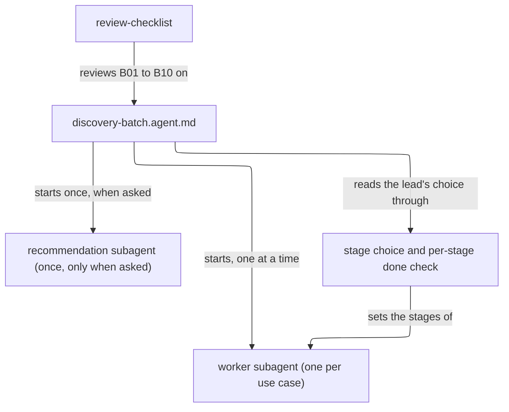
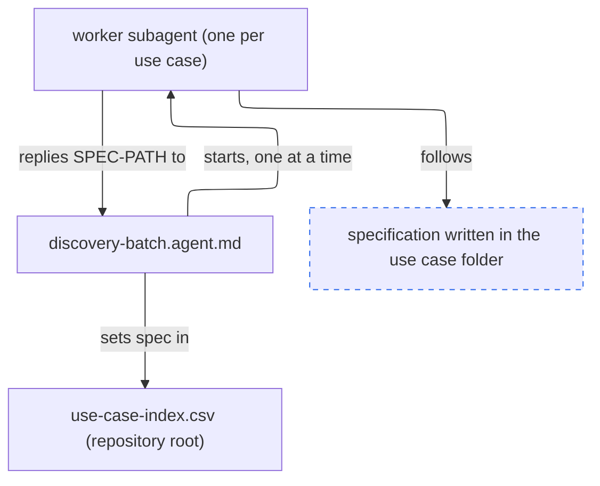

# Discovery Batch Agent

## Purpose

A GitHub Copilot custom agent, set to Claude Sonnet 5.5, that runs discovery for several use cases in one go, for the stages the lead chooses, each use case in its own isolated subagent, then runs workflow recommendation when asked and the review export once and hands the review to the lead in the main conversation, so a lead no longer starts `run-discovery` folder by folder.

## Navigation

[Job Behavior Specifications](../README.md#navigation) / **Discovery Batch Agent**

- [Design](#design)
  - [Diagram](#diagram)
- [Technology](#technology)
- [Behavior](#behavior)
- [Relationships](#relationships)
- [Links](#links)

## Design

One file, [discovery-batch.agent.md](discovery-batch.agent.md), first written ad hoc (see [README.original.md](README.original.md)). It asks the lead first which use cases to run (names or slugs), which stages to run (screening, identity and access, specification; any combination; default all three) and whether to run workflow recommendation (default no), finds each one's folder, vendor and specification path in `use-case-index.csv`, derives the proposal ID `uc-<vendor-slug>-<use-case-slug>`, uses the fixed recommendations ID `recommendations`, and asks once only for what it can neither read nor derive (including the validator path). Before the table it checks that the proposals root is a dedicated folder (not `.`, existing, holding nothing besides `tracker-updates`) and reads each use case's proposal file and index row to mark every stage `run`, `skip: not chosen` or `skip: already done` (screening is done by a Use Cases row with `source_status`, identity by an Identity & Access row, specification by a non-blank `spec`; it never writes the proposal file, and specification is never blocked for missing screening). After one confirmation table it loops over the use cases one at a time. Each goes to a fresh subagent whose brief carries a `Stages to run:` line; it runs only the `run` stages in the fixed order through the installed skills, each writing only its own rows, then runs the Tracker Reconciler's `validate` on its own proposal folder (it may rerun its own stage once) and returns a fixed ten-line record whose tenth line is `VALIDATION`, so no use case sees another one's context; a failed validation, a missing `VALIDATION` line or a validator that cannot run fails the use case. Workflow recommendation runs only when asked, once after the loop over every index row that has a specification, in its own subagent after one lead confirmation, the exporter runs once after every run into the same review folder so earlier decisions are kept, and the review is handed to `record-review-decisions` in the main conversation, where the lead decides each row. The agent's only own write is a row of the use case index, following the index rules of `run-discovery`. It is reviewed against [review-checklist.md](review-checklist.md), one tagged item per behavior `B01` to `B10`, which is the check for a file that cannot be run; no Copilot run has been made, so no behavior is claimed to pass in the client until the lead has run the [Subagent Smoke Test](../subagent-smoke-test/README.md#design). A use case skipped because its proposal file exists but with no index row gets a row with a blank `spec` and is reported as `spec unknown`; the recommendation subagent's brief says the list is already confirmed; the final report lists per stage the outcome (done, not chosen, already done, blocked or failed) and every failed, blocked or malformed use case with its missing fact or reason. A done stage is repeated only when the lead asks for that rerun, because screening writes no `source_status` row for a clean source and so shows `run` again unless left out of the stage list.

Use: install the skills the agent names, copy `discovery-batch.agent.md` into the workspace's `.github/agents/` folder, choose the `discovery-batch` agent in Copilot Chat and name the use cases to run. Run the [Subagent Smoke Test](../subagent-smoke-test/README.md#design) first: it shows whether the client's Copilot starts subagents and whether a subagent can load a skill.

Decisions (record of the build; override in chat): runs are sequential, because the client's throttling and cost are unknown; the agent does not call `run-discovery` per use case, because that skill exports and walks the review for one folder and a subagent cannot ask the lead; the worker instructions sit inside the agent file and are passed to each subagent, so one file is installed; a worker never asks the lead anything, so a missing fact becomes a blocked stage that the final report lists; the index rules are read from `run-discovery`, not copied; `editFiles` stays in the front matter tools because the agent writes index rows, so `B09` rests on the agent's wording and the lead's review, not on the tool list, and the tool names are unverified in the client (narrow the list once known).

### Diagram

## Technology

- A GitHub Copilot custom agent (VS Code agent mode): one `discovery-batch.agent.md` in plain Markdown with YAML front matter (`name`, `description`, `model: Claude Sonnet 5.5 (copilot)`, `tools`), no code and no Craft term. It is installed by copying the file into the workspace's `.github/agents/` folder. It needs a subagent tool and the skills installed beside it (`propose-tracker-updates`, `discover-identity-access`, `document-job-behavior`, `recommend-workflows`, `record-review-decisions`, and `run-discovery` read only for its index rules), and Node 26 for the exporter's and the validator's command lines. It holds no copy of the Tracker Data Contract. It is non-executable, so its behaviors are checked by file review and end "(untested: benchmark pending)". Detail is in [requirements.md](requirements.md#requirements).

## Behavior

- **B01** When a lead asks for a batch, then it first asks only which use cases to run (names or slugs), which stages to run (screening, identity and access, specification; any combination; default all three) and whether to run workflow recommendation too (default no), finds each use case's folder, vendor and specification path in `use-case-index.csv` at the repository root, asks for a folder only for a name with no row, and then asks once only for what it can neither read nor derive (repository root, export folder, proposals root, exporter path, validator path, review folder, the lead's name and the date). (untested: benchmark pending)
- **B02** When it prepares the run, then it derives every proposal ID as `uc-<vendor-slug>-<use-case-slug>`, uses the fixed ID `recommendations`, asks for neither, stops and writes nothing (naming both folders) when two folders give the same ID, and shows one table (use case, vendor, folder, proposal ID and, for each stage, `run`, `skip: not chosen` or `skip: already done`) before anything runs. It also stops before anything runs, writing nothing, when the proposals root is `.`, does not exist or holds anything besides its `tracker-updates` folder. (untested: benchmark pending)
- **B03** When the lead confirms the table, then it writes or updates each folder's index row and runs one subagent per use case one after another, each running only that use case's `run` stages in the fixed order screening, identity and access, specification, through its installed skills, each stage writing only its own rows in the proposal file and leaving the other stages' rows as they are; it keeps only the fixed ten-line reply record, sets that row's `spec` after each use case, and a worker never asks the lead anything. After its stages each worker runs the Tracker Reconciler's `validate` on its own proposal folder, fixes nothing itself beyond rerunning its own stage once, and adds a tenth line `VALIDATION: ok` or `VALIDATION: failed: <file:line message; ...>` to the reply record. (untested: benchmark pending)
- **B04** When a use case fails, is blocked, or its subagent reply is not in the fixed record, then the batch goes on with the next one, the agent does not repair the reply, and the final report lists the failed stage with the missing fact or reason. A `VALIDATION: failed` line, a missing `VALIDATION` line or a validator that cannot run makes the use case failed, with the errors and their lines in the report. (untested: benchmark pending)
- **B05** When a stage's own result is already there (Identity & Access rows in the use case's proposal file for identity and access, a Use Cases row with `source_status` for screening, a non-blank `spec` in the index row for specification), then that stage is shown as `skip: already done` and not repeated unless the lead asks for a rerun of that stage, specification is never blocked for missing screening, and a use case with no index row gets a row with its folder and vendor and a blank `spec` and is listed as `spec unknown`. (untested: benchmark pending)
- **B06** When the lead asked for workflow recommendation, then it runs once after the loop, in its own subagent, over every index row that has a `spec` (earlier use cases included), with the fixed ID `recommendations`, after one lead confirmation that shows the list with the warning that a partial list drops the other use cases' mappings; when not asked, the agent says it was not run. (untested: benchmark pending)
- **B07** When the loop ends, or recommendation ends, then the exporter runs once after every run into the same review folder, so earlier review decisions are kept (it stops on exit 1 or 2 and shows the error unchanged), and the agent reports per use case the outcome of each stage (done, not chosen, already done, blocked or failed), the recommendation counts if it ran and the exporter's counts including rejected proposal rows. (untested: benchmark pending)
- **B08** When the export has run, then it hands the review folder, the lead's name and the date to `record-review-decisions` in the main conversation so the lead decides each row interactively; it reads no review cell, records no decision and does not rerun the exporter after a decision. (untested: benchmark pending)
- **B09** When it runs, then its only own write is an index row, and it never writes to the tracker, a proposal file, a specification or a review cell, and never releases, acknowledges, decides or applies anything. (untested: benchmark pending)
- **B10** When no subagent tool exists, then it says `NO SUBAGENT TOOL`, says that `run-discovery` handles one folder at a time, and stops without running any use case itself. (untested: benchmark pending)

## Plan

### Planned Navigation

[Job Behavior Specifications](../README.md#plan) / **Discovery Batch Agent**

- [Planned Design](#planned-design)
  - [Planned Diagram](#planned-diagram)
- [Steps](#steps)
- [Acceptance Mapping](#acceptance-mapping)
- [Assumptions And Open Questions](#assumptions-and-open-questions)
- [Planned Relationships](#planned-relationships)
- [Planned Links](#planned-links)

### Planned Design

The Worker brief carries the rule. It already passes the use case's `Folder:` and says each stage writes only under `<proposals root>/tracker-updates/<proposal-id>/`; it now says the specification is the one exception, written at `<folder>/<use case name>.md`, and that the `SPEC-PATH` line of the reply record is that path. The agent sets the index `spec` from `SPEC-PATH` as before. The reply record, the stage choice, the done checks and the agent's own writes do not change.

Rule followed by every skill and agent that names a specification: the use case index `use-case-index.csv` at the repository root is the single lookup: its row's `folder` is the use case's own folder and its `spec` is the root-relative path of the specification; a new specification is written in the use case's own folder as `<folder>/<use case name>.md`, never in a proposal folder. A skill run by hand with no path uses it, and when there is no index row, `spec` is blank or the file is missing, the skill asks once for the path and, if none is given, reports "no specification" and uses no other location (no fallback to the inventory's source location, no scan for the file).

Behavior wording (amended at build; no behavior is added): **B03** (no new behavior; the cap of 10 holds). New wording adds, after "through its installed skills,": "the specification written at `<folder>/<use case name>.md` in the use case's own folder as the one exception to writing only under the proposals root, " and "its `SPEC-PATH` line is that path," before "it keeps only the fixed ten-line reply record". The rest of B03 is unchanged. Tests and checklist items tagged B03 stay as they are; one line is added under B03 in the checklist.

#### Planned Diagram

### Steps

1. Edit `discovery-batch.agent.md`: the Worker brief states the specification's location, the exception to the proposals-root rule, and that `SPEC-PATH` is that path.
2. Update `contract.md` (Worker subagent and Worker reply record) and add one line under B03 in `review-checklist.md`.
3. Rewrite README `B03` as above, update Design, and dissolve this Plan into Design.

### Acceptance Mapping

| Acceptance | Behaviors | Step | Check |
| --- | --- | --- | --- |
| The Worker brief names the folder as the specification's home, the exception to the proposals root, and `SPEC-PATH` as that path | B03 | 1, 2 | file review against the checklist line |
| The agent's own writes and its wording stay as they were | B09 | 1 | the checklist's scan for `Craft` and for any copy of the contract |

### Assumptions And Open Questions

Assumptions (override any in chat):

1. **Policy and scope.** Planned under `deciding-what-to-ask`, as one part of the request `shared-use-case-file-location`: the other affected components each carry their own Plan, and the root holds the convention. Nothing is built.
2. **Location.** A newly drafted specification is written in the use case's own folder; the proposal folder holds only proposal files. Confirmed by the user on 2026-11-17. Override by naming the proposal folder `<proposals root>/tracker-updates/<use-case-id>/` instead; the specification is then vendor-readable only if that folder is shared, so the root's vendor-separation rule would also need to change.
3. **File name.** `<use case name>.md`, as the reference specification is named after its use case. Override by naming another pattern.
4. **Existing specifications are not moved.** A batch-written specification keeps working because its index `spec` already points at it, wherever it is.
5. **Tracker Data Contract.** It defines no specification location, so it and its copies in the skill folders do not change and nothing is recopied.
6. **Behavior cap.** The component lists 10 behaviors, so none is added: **B03** is reworded in the Plan above and at build; tests and checklist items tagged for it stay.

Open questions: none. The location choice was confirmed by the user on 2026-11-17; where a hand-run skill finds no index row it asks once for a path, as recorded above.

### Planned Relationships

- [Copilot Drafting Guide](../copilot-drafting-guide/README.md#purpose) — the worker's specification stage writes at the location the brief names.
- [Discovery Orchestrator](../discovery-orchestrator/README.md#design) — owns the index rules and the same location rule for one folder at a time.

### Planned Links

- [requirements.md](requirements.md#planned-change-shared-use-case-file-location) — what the change must do, with the planned change section.
- [contract.md](contract.md#planned-change-shared-use-case-file-location) — the interface, with the planned change section.

## Relationships

- [Discovery Orchestrator](../discovery-orchestrator/README.md#purpose) — owns the use case index rules and `run-discovery`, which this agent reads and follows.
- [Workflow Recommender](../workflow-recommender/README.md#purpose) — the skill run once over the index.
- [Review Decisions](../lead-tracker-skills/review-decisions/README.md#design) — the skill the review is handed to in the main conversation.
- [Review CSV Exporter](../tracker-tools/review-csv-exporter/README.md#purpose) — the tool the agent runs once.
- [Tracker Update Proposer](../tracker-update-proposer/README.md#purpose), [Identity Access Discovery](../identity-access-discovery/README.md#purpose) and [Copilot Drafting Guide](../copilot-drafting-guide/README.md#purpose) — the stage skills each worker runs.
- [Tracker Reconciler](../tracker-tools/tracker-reconciler/README.md#purpose) — its `validate` command, run by each worker.
- [Subagent Smoke Test](../subagent-smoke-test/README.md#design) — the check that shows whether the client supports subagents and skills in subagents.

## Links

- [review-checklist.md](review-checklist.md) — the internal review items `B01` to `B10`.
- [requirements.md](requirements.md#requirements) — what the agent must do, must not do and need not match.
- [contract.md](contract.md#contract) — inputs, the confirmation table, the worker reply record, the index writes and the wording rules.
- [README.original.md](README.original.md) — the original document.
