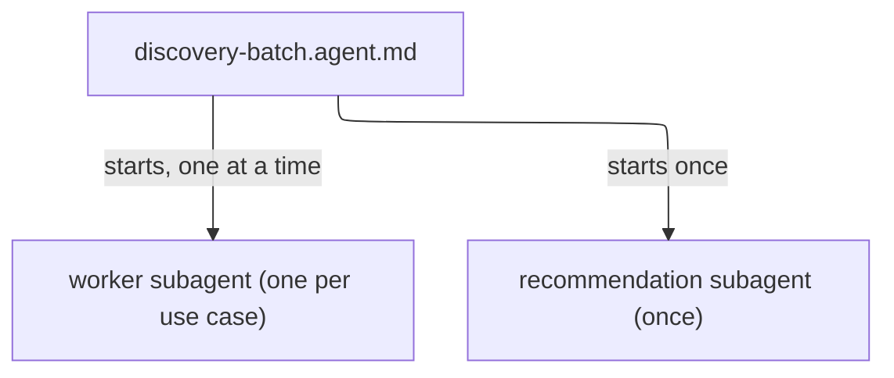
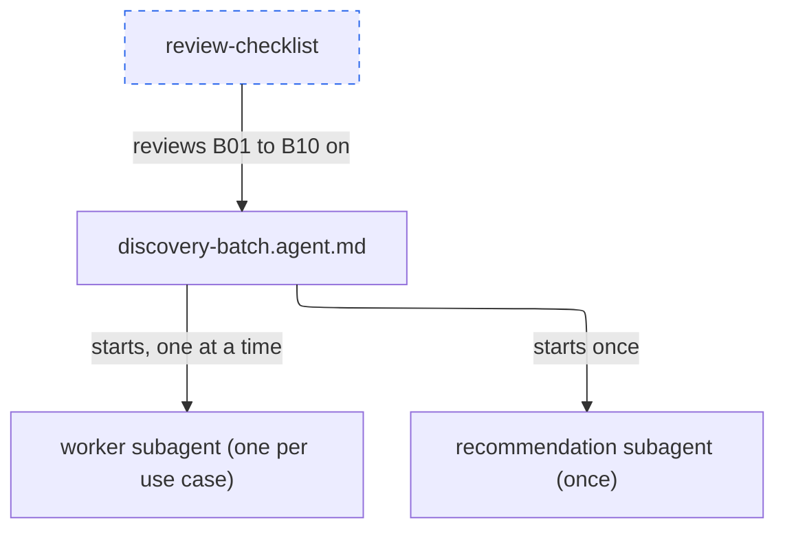

# Discovery Batch Agent

## Purpose

A GitHub Copilot custom agent, set to Claude Sonnet 5.5, that runs discovery for several use cases in one go, each use case in its own isolated subagent, then runs workflow recommendation and the review export once and hands the review to the lead in the main conversation, so a lead no longer starts `run-discovery` folder by folder.

## Navigation

[Job Behavior Specifications](../README.md#navigation) / **Discovery Batch Agent**

- [Design](#design)
  - [Diagram](#diagram)
- [Technology](#technology)
- [Behavior](#behavior)
- [Plan](#plan)
  - [Planned Navigation](#planned-navigation)
  - [Planned Design](#planned-design)
    - [Planned Diagram](#planned-diagram)
  - [Steps](#steps)
  - [Acceptance Mapping](#acceptance-mapping)
  - [Assumptions And Open Questions](#assumptions-and-open-questions)
  - [Planned Relationships](#planned-relationships)
  - [Planned Links](#planned-links)
- [Relationships](#relationships)
- [Links](#links)

## Design

One file, [discovery-batch.agent.md](discovery-batch.agent.md), written before this component had a plan or a checklist (see [README.original.md](README.original.md)). It asks the lead first which use cases to run (names or slugs), finds each one's folder, vendor and specification path in `use-case-index.csv`, derives the proposal ID `uc-<vendor-slug>-<use-case-slug>`, uses the fixed recommendations ID `recommendations`, and asks once only for what it can neither read nor derive. After one confirmation table it loops over the use cases one at a time. Each goes to a fresh subagent that runs source screening, identity and access, and behavior documentation through the installed skills and returns a fixed nine-line record, so no use case sees another one's context. Workflow recommendation runs once after the loop over every index row that has a specification, in its own subagent after one lead confirmation, the exporter runs once, and the review is handed to `record-review-decisions` in the main conversation, where the lead decides each row. The agent's only own write is a row of the use case index, following the index rules of `run-discovery`. It is not yet reviewed against a checklist and has not been run in the client environment.

Use: install the skills the agent names, copy `discovery-batch.agent.md` into the workspace's `.github/agents/` folder, choose the `discovery-batch` agent in Copilot Chat and name the use cases to run. Run the [Subagent Smoke Test](../subagent-smoke-test/README.md#design) first: it shows whether the client's Copilot starts subagents and whether a subagent can load a skill.

Decisions (record of the build; override in chat): runs are sequential, because the client's throttling and cost are unknown; the agent does not call `run-discovery` per use case, because that skill exports and walks the review for one folder and a subagent cannot ask the lead; the worker instructions sit inside the agent file and are passed to each subagent, so one file is installed; a worker never asks the lead anything, so a missing fact becomes a blocked stage that the final report lists; the index rules are read from `run-discovery`, not copied.

### Diagram

## Technology

- A GitHub Copilot custom agent (VS Code agent mode): one `discovery-batch.agent.md` in plain Markdown with YAML front matter (`name`, `description`, `model: Claude Sonnet 5.5 (copilot)`, `tools`), no code and no Craft term. It is installed by copying the file into the workspace's `.github/agents/` folder. It needs a subagent tool and the skills installed beside it (`propose-tracker-updates`, `discover-identity-access`, `document-job-behavior`, `recommend-workflows`, `record-review-decisions`, and `run-discovery` read only for its index rules), and Node 26 for the exporter's command line. It holds no copy of the Tracker Data Contract. It is non-executable, so its behaviors are checked by file review and end "(untested: benchmark pending)". Detail is in [requirements.md](requirements.md#requirements).

## Behavior

- **B01** When a lead asks for a batch, then it first asks only which use cases to run (names or slugs), finds each one's folder, vendor and specification path in `use-case-index.csv` at the repository root, asks for a folder only for a name with no row, and then asks once only for what it can neither read nor derive (repository root, export folder, proposals root, exporter path, review folder, the lead's name and the date). (untested: benchmark pending)
- **B02** When it prepares the run, then it derives every proposal ID as `uc-<vendor-slug>-<use-case-slug>`, uses the fixed ID `recommendations`, asks for neither, stops and writes nothing (naming both folders) when two folders give the same ID, and shows one table (use case, vendor, folder, proposal ID, and `skip` where `tracker-updates/<id>/tracker-updates.csv` exists) before anything runs. (untested: benchmark pending)
- **B03** When the lead confirms the table, then it writes or updates each folder's index row, runs one subagent per use case one after another (source screening, identity and access, behavior documentation, each through its installed skill), keeps only the fixed nine-line reply record, and sets that row's `spec` after each use case; a worker never asks the lead anything. (untested: benchmark pending)
- **B04** When a use case fails, is blocked, or its subagent reply is not in the fixed record, then the batch goes on with the next one, the agent does not repair the reply, and the final report lists the failed stage with the missing fact or reason. (untested: benchmark pending)
- **B05** When a use case's proposal file already exists, then it is skipped and shown as `skip` in the table unless the lead asks for a rerun, and when it has no index row, then its row is written with its folder and vendor and a blank `spec` and the final report lists it as `spec unknown`. (untested: benchmark pending)
- **B06** When the loop ends, then workflow recommendation runs once, in its own subagent, over every index row that has a `spec` (earlier use cases included), with the fixed ID `recommendations`, after one lead confirmation that shows the list with the warning that a partial list drops the other use cases' mappings. (untested: benchmark pending)
- **B07** When recommendation ends, then the exporter runs once (it stops on exit 1 or 2 and shows the error unchanged), and the agent reports per use case the stage outcomes, the recommendation counts and the exporter's counts including rejected proposal rows. (untested: benchmark pending)
- **B08** When the export has run, then it hands the review folder, the lead's name and the date to `record-review-decisions` in the main conversation so the lead decides each row interactively; it reads no review cell, records no decision and does not rerun the exporter after a decision. (untested: benchmark pending)
- **B09** When it runs, then its only own write is an index row, and it never writes to the tracker, a proposal file, a specification or a review cell, and never releases, acknowledges, decides or applies anything. (untested: benchmark pending)
- **B10** When no subagent tool exists, then it says `NO SUBAGENT TOOL`, says that `run-discovery` handles one folder at a time, and stops without running any use case itself. (untested: benchmark pending)

## Plan

### Planned Navigation

[Job Behavior Specifications](../README.md#plan) / **Discovery Batch Agent**

- [Planned Design](#planned-design)
  - [Planned Diagram](#planned-diagram)
- [Steps](#steps)
- [Acceptance Mapping](#acceptance-mapping)
- [Assumptions And Open Questions](#assumptions-and-open-questions)
- [Planned Relationships](#planned-relationships)
- [Planned Links](#planned-links)

### Planned Design

The build keeps the agent file's design and closes its gaps against the confirmed behaviors: a use case skipped because its proposal file exists but with no index row gets a row with a blank `spec` and is reported as `spec unknown` (`B05`); the brief of the recommendation subagent says the list is already confirmed, so the recommender's own confirmation does not ask again (`B06`); the final report lists every failed or blocked stage with its missing fact (`B04`); and the duplicate-ID stop, the malformed-reply rule and the setting of `spec` after each use case match the behaviors word for word. It adds an internal review checklist with one item per behavior, which is the check for a component that cannot be run directly, and records in Design that `editFiles` stays in the tools list because the agent writes index rows, so the never-write rules (`B09`) rest on the agent's wording and the lead's review, not on the tool list. Claims about Copilot depend on the smoke tests: the build is not gated on them, but no behavior is claimed to pass in the client until the lead has run them, and the agent's own `B10` stop and the worker brief's fallback of opening a skill's `SKILL.md` in the workspace are the two paths if test 1 or test 2 fails. If neither works the design fails and `run-discovery` stays the way to work. The agent is built after the [Workflow Recommender](../workflow-recommender/README.md#planned-design), whose built skill reads the index and uses the fixed ID, because the agent's `B06` and its never-ask rule would contradict the recommender as it is today.

#### Planned Diagram

### Steps

1. [discovery-batch.agent.md](discovery-batch.agent.md): add the `spec unknown` row rule for a skipped use case with no index row (`B05`); state in the recommendation subagent's brief that the list is confirmed (`B06`); make the final report list every failed or blocked stage with its missing fact (`B04`); check the duplicate-ID stop, the malformed-reply rule and the setting of `spec` against `B02`, `B03` and `B04`; keep the front matter `model` as given and leave no Craft term in the file.
2. [review-checklist.md](review-checklist.md) (new): one internal item per behavior `B01` to `B10`, each tagged, a `Rules` item (front matter, the nine-line worker record equal to [contract.md](contract.md#worker-reply-record), no Craft term, `editFiles` stated in Design) and a note that no Copilot run has been made.
3. [README.md](README.md) and [craft.json](craft.json): dissolve this Plan into `Design` and its diagram, add the checklist to `Links`, and record in Design that the tool names in the front matter are unverified and that `B09` is enforced by wording only.
4. [requirements.md](requirements.md) and [contract.md](contract.md): keep them in step with the agent file after step 1.
5. Validate, narrowest first: the checklist items against the agent file, a wording scan of the agent file for any Craft term, a front matter check, then the root `test` check to confirm the contract copies and the tools are unchanged (`B05` of the root).

### Acceptance Mapping

| Acceptance | Behaviors | Step | Check |
| --- | --- | --- | --- |
| 1. It asks only the use case list first, reads folder, vendor and specification from the index, asks a folder only for a name with no row, then asks once for the undeclared facts and never for a proposal ID. | B01, B02 | 1, 2 | checklist `[B01]`, `[B02]` |
| 2. One confirmation table with `skip`, a duplicate-ID stop that writes nothing, and resume that skips unless asked, writing a blank-`spec` row for a skipped use case with no row. | B02, B05 | 1, 2 | checklist `[B02]`, `[B05]` |
| 3. One sequential subagent per use case with the fixed nine-line record; blocked, failed or malformed use cases do not stop the batch and appear in the final report; `spec` is set after each use case. | B03, B04 | 1, 2 | checklist `[B03]`, `[B04]` |
| 4. After the loop it runs the recommender once over every index row with a `spec` after one warned confirmation, runs the exporter once, and hands the review to `record-review-decisions` in the main conversation. | B06, B07, B08 | 1, 2 | checklist `[B06]`, `[B07]`, `[B08]` |
| 5. It never writes to the tracker, a proposal file, a specification or a review cell (its only write is an index row), and with no subagent tool it says so and stops. | B09, B10 | 1, 2 | checklist `[B09]`, `[B10]`; wording scan |

Validation: the commands in step 5, narrowest first. No Copilot or client-environment result is claimed.

### Assumptions And Open Questions

Assumptions (override by telling the builder, or by editing the file named):

- **Behaviors confirmed** by the user on 2026-11-16 as `B01` to `B10`, with the skipped-without-row rule added to `B05` at the user's choice. Parallel runs are not a behavior; a backlog item proposes them.
- **Name and place.** "Discovery Batch Agent", folder `discovery-batch-agent`, agent file `discovery-batch.agent.md`, a deliverable leaf and a sibling of the Discovery Orchestrator at the root, because the pattern and the name are already in use. Override by naming another.
- **The ad hoc README is preserved** as `README.original.md` by `git mv` and left unchanged.
- **`requirements.md` and `contract.md` are written and kept short.** The planner proposed leaving them out so the record format and the index rules would not drift; they hold the worker record and the rules the agent follows, and the checklist compares them with the agent file. Override by dropping them.
- **Smoke test.** The [Subagent Smoke Test](../subagent-smoke-test/README.md#design) stays a component of its own with no plan; this component links to it and gates its claims on it. The build is not gated on it.
- **Fallbacks stay as built.** If a subagent cannot load a skill, the worker opens the skill's `SKILL.md` and follows it, and the lead reports the result. Override by removing the fallback.
- **`editFiles` stays in the tools list**, so `B09` is wording only. Narrow the list once the client's tool names are known.
- **Sequential runs only.** Parallel runs are a later change.
- **Budget** USD 1 and 1800 seconds, as the Workflow Recommender has, since the build is one Markdown file, one checklist and records.
- **No automated check** exists or is added; the root `test` check covers only the contract copies and the tools.
- **Not shipped yet.** The Client Transfer Package plan is amended to carry the agent file and the two smoke test prompts; build it after this component.

Open questions: none about behavior. Whether the client's Copilot starts subagents and lets them load skills is a fact only the smoke tests can show, so the behaviors stay unclaimed until the lead has run them.

### Planned Relationships

- [Discovery Orchestrator](../discovery-orchestrator/README.md#purpose) — owns the use case index rules and `run-discovery`, which this agent reads and follows.
- [Workflow Recommender](../workflow-recommender/README.md#planned-design) — the skill run once over the index; build it first.
- [Review Decisions](../lead-tracker-skills/review-decisions/README.md#design) — the skill the review is handed to in the main conversation.
- [Review CSV Exporter](../tracker-tools/review-csv-exporter/README.md#purpose) — the tool the agent runs once.
- [Tracker Update Proposer](../tracker-update-proposer/README.md#purpose), [Identity Access Discovery](../identity-access-discovery/README.md#purpose) and [Copilot Drafting Guide](../copilot-drafting-guide/README.md#purpose) — the stage skills each worker runs.
- [Subagent Smoke Test](../subagent-smoke-test/README.md#design) — the check that shows whether the client supports subagents and skills in subagents.

### Planned Links

- [requirements.md](requirements.md#requirements) — what the agent must do, must not do and need not match.
- [contract.md](contract.md#contract) — inputs, the confirmation table, the worker reply record, the index writes and the wording rules.
- [review-checklist.md](review-checklist.md) — the internal review items `B01` to `B10`, added when built.
- [README.original.md](README.original.md) — the original document.

## Relationships

- [Discovery Orchestrator](../discovery-orchestrator/README.md#purpose) — owns the use case index rules and `run-discovery`, which this agent reads and follows.
- [Workflow Recommender](../workflow-recommender/README.md#purpose) — the skill run once over the index.
- [Review Decisions](../lead-tracker-skills/review-decisions/README.md#design) — the skill the review is handed to in the main conversation.
- [Review CSV Exporter](../tracker-tools/review-csv-exporter/README.md#purpose) — the tool the agent runs once.
- [Tracker Update Proposer](../tracker-update-proposer/README.md#purpose), [Identity Access Discovery](../identity-access-discovery/README.md#purpose) and [Copilot Drafting Guide](../copilot-drafting-guide/README.md#purpose) — the stage skills each worker runs.
- [Subagent Smoke Test](../subagent-smoke-test/README.md#design) — the check that shows whether the client supports subagents and skills in subagents.

## Links

- [requirements.md](requirements.md#requirements) — what the agent must do, must not do and need not match.
- [contract.md](contract.md#contract) — inputs, the confirmation table, the worker reply record, the index writes and the wording rules.
- [README.original.md](README.original.md) — the original document.
