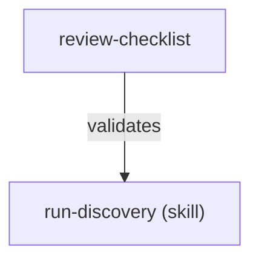
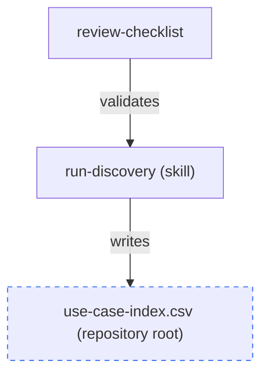

# Discovery Orchestrator

## Purpose

A GitHub Copilot agent skill that takes one use-case folder through the discovery stages in order (source screening, identity and access, behavior documentation, workflow recommendation), refreshes the consolidated review CSVs, and walks a lead through the pending rows, so leads review and decide in one flow and each folder is processed without duplicates or hand transposing.

## Navigation

[Job Behavior Specifications](../README.md#navigation) / **Discovery Orchestrator**

- [Design](#design)
  - [Diagram](#diagram)
- [Technology](#technology)
- [Behavior](#behavior)
- [Plan](#plan)
  - [Planned Navigation](#planned-navigation)
  - [Planned Design](#planned-design)
    - [Planned Diagram](#planned-diagram)
  - [Planned Behavior](#planned-behavior)
  - [Steps](#steps)
  - [Acceptance Mapping](#acceptance-mapping)
  - [Assumptions And Open Questions](#assumptions-and-open-questions)
  - [Planned Relationships](#planned-relationships)
  - [Planned Links](#planned-links)
- [Relationships](#relationships)
- [Links](#links)

## Design

One skill folder, `run-discovery`, holds `SKILL.md` only. The skill takes a use-case folder through the four stages by invoking the existing skills in order (behavior documentation as `document-job-behavior` then `propose-tracker-updates` in specification-update mode), skips behavior documentation and workflow recommendation when the source status is `not-located` or `empty`, runs the review CSV exporter, reports per stage, and then walks the lead through the pending rows in the exporter's `order`, recording accept, reject or clarify only from the lead's own words in that row's review cells. It asks once for the facts only the developer has, uses one recommendations proposal ID per session, and runs workflow recommendation over a lead-confirmed list of every specification processed so far. It holds no copy of the Tracker Data Contract: review columns are read from the exporter's headings file. [review-checklist.md](review-checklist.md) is the internal file review of the skill, one item per behavior.

Decisions (record of the build; override in chat): the skill folder holds only `SKILL.md`, with no copy of the Tracker Data Contract, so the review columns are read from the exporter's headings file; the review cells are edited directly in the CSV and the exporter rerun re-validates them; the lead's name and date are asked once per session and never taken from the environment; workflow recommendation uses one proposal ID per session so repeat runs do not duplicate mappings.

### Diagram

## Technology

- A GitHub Copilot agent skill (VS Code agent mode), plain Markdown with no code. The skill folder holds only `SKILL.md`, with no Craft term, as the sibling skill folders. It needs the four existing skills installed beside it, Node 26 and the exporter's command line. Detail is in [requirements.md](requirements.md#requirements).

## Behavior

- **B01** When a lead names a use-case folder, then it states the use case, its vendor and source location read from the folder, and the four stages it will run in order: source screening, identity and access, behavior documentation, workflow recommendation. (untested: benchmark pending)
- **B02** When the stages run, then each runs through its own existing skill, one after another, each writing only its own proposal file. (untested: benchmark pending)
- **B03** When a stage needs a fact only the developer has (proposal ID, vendor, source location), then it asks once and never invents it. (untested: benchmark pending)
- **B04** When a use case's source is empty or not located, then it records the blocker through source screening, skips behavior documentation and workflow recommendation for that use case, and says why. (untested: benchmark pending)
- **B05** When a use case's behavior documentation is done, then workflow recommendation runs over every specification processed so far, not only the current folder. (untested: benchmark pending)
- **B06** When the stages finish, then it runs the review CSV exporter and reports, per stage, what was proposed, skipped or blocked. (untested: benchmark pending)
- **B07** When the next folder is chosen, then earlier folders are not rerun unless the lead asks, and their rows stay in the review CSVs. (untested: benchmark pending)
- **B08** When it runs, then it never writes to the tracker, releases a question, records an acknowledgement or a decision on its own, or applies a change. (untested: benchmark pending)
- **B09** When the review CSVs are ready, then it walks the lead through the pending rows one use case at a time in the exporter's order (conflicts, suggestions for the lead's fields, then plain evidence-backed adds), showing the current value, the proposed value, the evidence and any conflict, and records accept, reject or clarify with a comment in the review columns only on the lead's own words. (untested: benchmark pending)
- **B10** When the lead asks to accept all plain adds of one use case, then it records them as accepted in that lead's name in one step, only for that use case and only for adds with no conflict. (untested: benchmark pending)

## Plan

### Planned Navigation

[Job Behavior Specifications](../README.md#plan) / **Discovery Orchestrator**

- [Planned Design](#planned-design)
  - [Planned Diagram](#planned-diagram)
- [Planned Behavior](#planned-behavior)
- [Steps](#steps)
- [Acceptance Mapping](#acceptance-mapping)
- [Assumptions And Open Questions](#assumptions-and-open-questions)
- [Planned Relationships](#planned-relationships)
- [Planned Links](#planned-links)

### Planned Design

Use-case folders may sit at any depth under one repository root (for example `<vendor>/<job>/`), so the skill stops asking for what it can derive and keeps one record of where each use case lives. It owns a new file, `use-case-index.csv` at the repository root, with one row per use case (`use_case_name,slug,vendor,folder,spec`). It writes the row for a folder when the folder starts, fills `spec` after behavior documentation, and is the only writer: the file is never edited by hand and no other skill writes it. The proposal ID of a folder is derived as `uc-<vendor-slug>-<use-case-slug>`, so the skill no longer asks for it, and it stops before any stage when another folder already has the same ID. Workflow recommendation takes the whole index as its list, with the fixed proposal ID `recommendations`; the lead still confirms the full list once, because the recommender rewrites all its Mappings rows each run and a partial list would drop the other use cases' mapping proposals. The exact columns, slug rule, duplicate and move rules are in [contract.md](contract.md#planned-use-case-index-derived-proposal-id-and-fixed-recommendations-id). The export step now runs the Markdown skills `reconcile-tracker` and then `export-review` of the [Lead Tracker Skills](../lead-tracker-skills/README.md#planned-design) in place of the Node exporter command, because executables are blocked in the client environment. The skill still writes no proposal file, holds no copy of the Tracker Data Contract and never writes to the tracker. The Tracker Data Contract is not changed: a derived slug is a slug, and the reconciler checks only that `update_id` is `<proposal_id>:<tab>:<record_key>:<field>`.

#### Planned Diagram

### Planned Behavior

These replace the current wording of the named behaviors when built; the other behaviors (`B01`, `B04`, `B08` and `B10`) are unchanged. `B06`, `B07` and `B09` change only because the Node exporter is replaced by skills (see the Lead Tracker Skills plan, which is built with this change).

- **B02** When the stages run, then each runs through its own existing skill, one after another, each writing only its own proposal file; the orchestrator's own writes are its use case index row and the review cells, never a proposal file. (untested: benchmark pending)
- **B03** When a folder starts, then it reads the use case name and vendor from the folder, derives the proposal ID `uc-<vendor-slug>-<use-case-slug>`, stops before any stage if another folder already has the same ID, writes or updates that folder's row in `use-case-index.csv`, and asks once only for facts it can neither read nor derive (vendor or source location when absent, repository root, export folder, proposals root, the folder for the reconciliation files, the folder for the review CSVs, the lead's name and date), never asking for or inventing a proposal ID. (untested: benchmark pending)
- **B05** When a use case's behavior documentation is done, then it sets that row's `spec` in the index and runs workflow recommendation over every row of the index with the fixed proposal ID `recommendations`, shows the full list once with a warning that a partial list drops the other use cases' mappings, and runs only after the lead confirms. (untested: benchmark pending)
- **B06** When the stages finish, then it runs `reconcile-tracker` and then `export-review` on the proposals and the tracker export, stops and shows the error unchanged if either stops, and reports per stage what was proposed, skipped or blocked and then the counts including rejected proposal rows. (untested: benchmark pending)
- **B07** When the next folder is chosen, then earlier folders are not rerun unless the lead asks, and the review files are refreshed for the named use case only, so the rows and review cells of the earlier folders stay as they were. (untested: benchmark pending)
- **B09** When the review CSVs are ready, then it walks the lead through the pending rows one use case at a time in the `order` column of the review files (conflicts, suggestions for the lead's fields, then plain evidence-backed adds), showing the current value, the proposed value, the evidence and any conflict, and records accept, reject or clarify with a comment in the review columns only on the lead's own words. (untested: benchmark pending)

### Steps

1. [contract.md](contract.md): replace the proposal ID and recommendations ID inputs, stage 4 and the prohibitions text, replace the `Exporter call and report` section with running `reconcile-tracker` then `export-review` (and the review walk's rerun after recording with the export skill's `check review files` mode), and move the planned index section into the contract proper.
2. [run-discovery/SKILL.md](run-discovery/SKILL.md): `Before you start` (stop asking for both IDs; ask once for the repository root), `Run one folder` (derive the ID, duplicate check, index row), `Workflow recommendation` (the index list, the fixed ID, the confirmation with the partial-list warning), `Export and report` (the two skills in place of the `node` call, the review headings read from the sibling `export-review/review-headings.csv`, the prerequisite line now naming the skills installed beside it and no Node) and `Never` (the index row is the only own write besides the review cells).
3. [requirements.md](requirements.md) and this README: the goal and workflow-recommendation lines, the `Decisions` paragraph, the Design, and `B02`, `B03`, `B05`.
4. [review-checklist.md](review-checklist.md): `B02`, `B03`, `B05` and `Rules` match the new wording; add the task and `tasks.md` to [craft.json](craft.json) when built.

### Acceptance Mapping

| Acceptance | Behaviors | Step | Check |
| --- | --- | --- | --- |
| The skill never asks for a proposal ID and derives `uc-<vendor-slug>-<use-case-slug>` | B03 | 1, 2 | checklist `B03`, mechanical slug cases |
| A duplicate ID stops the run before any stage and writes nothing | B03 | 1, 2 | checklist `B03`, mechanical duplicate and move cases |
| The index is created or updated per processed folder with the five columns, root-relative paths and `spec` set after stage 3 | B02, B03, B05 | 1, 2 | checklist `B02`, `B03`, `B05` |
| The recommender list is every index row, shown once with the partial-list warning, using the ID `recommendations` | B05 | 2 | checklist `B05` |
| The skill runs `reconcile-tracker` then `export-review` instead of the exporter command, asks for no exporter path, reads the review columns from the `export-review` folder's headings file and stops showing the error unchanged | B03, B06, B07, B09 | 1, 2 | checklist `B03`, `B06`, `B07`, `B09` |
| Checklist, README, requirements and contract agree and no Craft term is in the skill | all | 3, 4 | wording scan, checklist `Rules` |

Validation, narrowest first: the checklist items for the changed behaviors, the wording scan of the skill folder, a throwaway script outside the repository that checks the example index rows, slug cases, duplicate and move cases against the contract, then the root `test` check to confirm `B05` (contract copies) is still green. Nothing is built and no Copilot run is claimed; the user's manual client-environment testing is recorded as user-reported evidence for the version tested.

### Assumptions And Open Questions

Assumptions (override any in chat):

1. The index is named `use-case-index.csv` and sits at the repository root the developer names once per session; columns are snake_case as in the Tracker Data Contract. Override by naming another file or columns; the contract section and the recommender's copy of the names change together.
2. The orchestrator's `contract.md` owns the index definition because it is the only writer; the recommender restates the five column names as a read-only consumer because skills are installed standalone. The cost is five names repeated once, checked by a checklist item in each component. Putting the definition in the Tracker Data Contract instead would need a new byte-identical copy in a skill folder, an edit to the root `B05` test lists and a re-pack of the Client Transfer Package, for a file that is not tracker data.
3. The Tracker Data Contract and its copies are not changed. Naming the derived ID in the contract would mean editing the contract component, re-copying it into the three skill folders, re-packing, and updating the root contract.
4. A moved folder (the derived ID matches a row whose old `folder` no longer exists on disk) updates that row's `folder` and `spec` and says so in the report; if the old folder still exists it is a duplicate and the run stops. Confirmed by the user, 2026-11-16. Override: any ID match in a different folder stops the run.
5. A folder with source status `not-located` or `empty` stays in the index with a blank `spec`, so the recommender lists it as `missing` and never drops it silently. Confirmed by the user, 2026-11-16. `B04` is unchanged: such a folder does not start workflow recommendation, but its row appears as `missing` in the next run over the index.
6. The index `spec` path is root-relative and is the path the proposer's `source` pointers use; `spec_refs` (`<use-case-slug>/Q<n>@v<n>`) are references, not paths, and are unaffected.
7. The proposer, Identity Access Discovery and the drafting skill are not changed: they already say "if not given, ask once", and the orchestrator now passes the ID, so they stay usable alone with an MR number or branch name.
8. Rows are kept sorted by `folder` so the file diffs stably.
9. The orchestrator runs `reconcile-tracker` first and then `export-review`, keeping the reconciliation folder between them, and reads the review headings from the sibling `export-review/` folder (it still holds no copy of the Tracker Data Contract). This follows the Lead Tracker Skills plan, because executables are blocked in the client environment; it is folded into this build and no other plan line (the index, the derived ID, the fixed recommendations ID) changes. Override by keeping the Node exporter call where Node is allowed.

Open questions: none. The two choices above were confirmed by the user on 2026-11-16.

### Planned Relationships

- [Workflow Recommender](../workflow-recommender/README.md#planned-design) — reads the index this skill writes and shares the fixed proposal ID `recommendations`.
- [Proposal Reconciliation](../lead-tracker-skills/proposal-reconciliation/README.md#planned-design) — the skill this one runs first to classify the proposals against the export.
- [Review Queue Export](../lead-tracker-skills/review-queue-export/README.md#planned-design) — the skill this one runs to write the review CSVs and whose headings file it reads.

### Planned Links

- [requirements.md](requirements.md#planned-change-use-case-index) — the planned requirement changes.
- [contract.md](contract.md#planned-use-case-index-derived-proposal-id-and-fixed-recommendations-id) — the index file, slug and ID rules.

## Relationships

- [Tracker Update Proposer](../tracker-update-proposer/README.md#purpose) — the skill that runs source screening and specification update.
- [Identity Access Discovery](../identity-access-discovery/README.md#purpose) — the skill that runs the identity and access stage.
- [Copilot Drafting Guide](../copilot-drafting-guide/README.md#purpose) — the skill that runs behavior documentation.
- [Workflow Recommender](../workflow-recommender/README.md#purpose) — the skill that runs workflow recommendation.
- [Review CSV Exporter](../tracker-tools/review-csv-exporter/README.md#purpose) — the tool that writes the consolidated review CSVs the lead reviews.
- [Tracker Data Contract](../tracker-data-contract/README.md#purpose) — the proposal format, owner classes and review rules the flow follows.

## Links

- [run-discovery/SKILL.md](run-discovery/SKILL.md) — the skill.
- [review-checklist.md](review-checklist.md) — the file review of the skill against B01 to B10.
- [requirements.md](requirements.md#requirements) — what the skill must do, must not do and need not match, and the follow-on work.
- [contract.md](contract.md#contract) — the invocation, inputs, stages, exporter call, review walk and wording rules.
