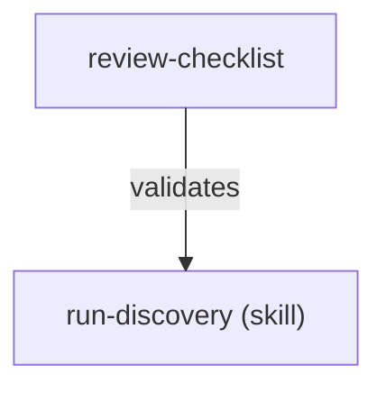

# Discovery Orchestrator

## Purpose

A GitHub Copilot agent skill that takes one use-case folder through the discovery stages in order (source screening, identity and access, behavior documentation, workflow recommendation), refreshes the consolidated review CSVs, and walks a lead through the pending rows, so leads review and decide in one flow and each folder is processed without duplicates or hand transposing.

## Navigation

[Job Behavior Specifications](../README.md#navigation) / **Discovery Orchestrator**

- [Design](#design)
  - [Diagram](#diagram)
- [Technology](#technology)
- [Behavior](#behavior)
- [Relationships](#relationships)
- [Links](#links)

## Design

One skill folder, `run-discovery`, holds `SKILL.md` only. The skill takes a use-case folder through the four stages by invoking the existing skills in order (behavior documentation as `document-job-behavior` then `propose-tracker-updates` in specification-update mode), skips behavior documentation and workflow recommendation when the source status is `not-located` or `empty`, runs the review CSV exporter, reports per stage, and then walks the lead through the pending rows in the exporter's `order`, recording accept, reject or clarify only from the lead's own words in that row's review cells. It asks once for the facts only the developer has, uses one recommendations proposal ID per session, and runs workflow recommendation over a lead-confirmed list of every specification processed so far. It holds no copy of the Tracker Data Contract: review columns are read from the exporter's headings file. [review-checklist.md](review-checklist.md) is the internal file review of the skill, one item per behavior.

Decisions (record of the build; override in chat): the skill folder holds only `SKILL.md`, with no copy of the Tracker Data Contract, so the review columns are read from the exporter's headings file; the review cells are edited directly in the CSV and the exporter rerun re-validates them; the lead's name and date are asked once per session and never taken from the environment; workflow recommendation uses one proposal ID per session so repeat runs do not duplicate mappings.

### Diagram

## Technology

- A GitHub Copilot agent skill (VS Code agent mode), plain Markdown with no code. The skill folder holds only `SKILL.md`, with no Craft term, as the sibling skill folders. It needs the four existing skills installed beside it, Node 26 and the exporter's command line. Detail is in [requirements.md](requirements.md#requirements).

## Behavior

- **B01** When a lead names a use-case folder, then it states the use case, its vendor and source location read from the folder, and the four stages it will run in order: source screening, identity and access, behavior documentation, workflow recommendation. (untested: benchmark pending)
- **B02** When the stages run, then each runs through its own existing skill, one after another, each writing only its own proposal file. (untested: benchmark pending)
- **B03** When a stage needs a fact only the developer has (proposal ID, vendor, source location), then it asks once and never invents it. (untested: benchmark pending)
- **B04** When a use case's source is empty or not located, then it records the blocker through source screening, skips behavior documentation and workflow recommendation for that use case, and says why. (untested: benchmark pending)
- **B05** When a use case's behavior documentation is done, then workflow recommendation runs over every specification processed so far, not only the current folder. (untested: benchmark pending)
- **B06** When the stages finish, then it runs the review CSV exporter and reports, per stage, what was proposed, skipped or blocked. (untested: benchmark pending)
- **B07** When the next folder is chosen, then earlier folders are not rerun unless the lead asks, and their rows stay in the review CSVs. (untested: benchmark pending)
- **B08** When it runs, then it never writes to the tracker, releases a question, records an acknowledgement or a decision on its own, or applies a change. (untested: benchmark pending)
- **B09** When the review CSVs are ready, then it walks the lead through the pending rows one use case at a time in the exporter's order (conflicts, suggestions for the lead's fields, then plain evidence-backed adds), showing the current value, the proposed value, the evidence and any conflict, and records accept, reject or clarify with a comment in the review columns only on the lead's own words. (untested: benchmark pending)
- **B10** When the lead asks to accept all plain adds of one use case, then it records them as accepted in that lead's name in one step, only for that use case and only for adds with no conflict. (untested: benchmark pending)

## Relationships

- [Tracker Update Proposer](../tracker-update-proposer/README.md#purpose) — the skill that runs source screening and specification update.
- [Identity Access Discovery](../identity-access-discovery/README.md#purpose) — the skill that runs the identity and access stage.
- [Copilot Drafting Guide](../copilot-drafting-guide/README.md#purpose) — the skill that runs behavior documentation.
- [Workflow Recommender](../workflow-recommender/README.md#purpose) — the skill that runs workflow recommendation.
- [Review CSV Exporter](../tracker-tools/review-csv-exporter/README.md#purpose) — the tool that writes the consolidated review CSVs the lead reviews.
- [Tracker Data Contract](../tracker-data-contract/README.md#purpose) — the proposal format, owner classes and review rules the flow follows.

## Links

- [run-discovery/SKILL.md](run-discovery/SKILL.md) — the skill.
- [review-checklist.md](review-checklist.md) — the file review of the skill against B01 to B10.
- [requirements.md](requirements.md#requirements) — what the skill must do, must not do and need not match, and the follow-on work.
- [contract.md](contract.md#contract) — the invocation, inputs, stages, exporter call, review walk and wording rules.
