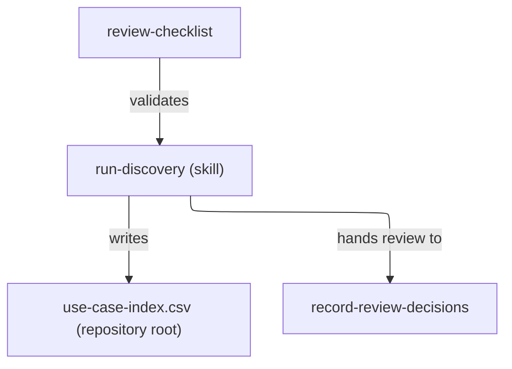
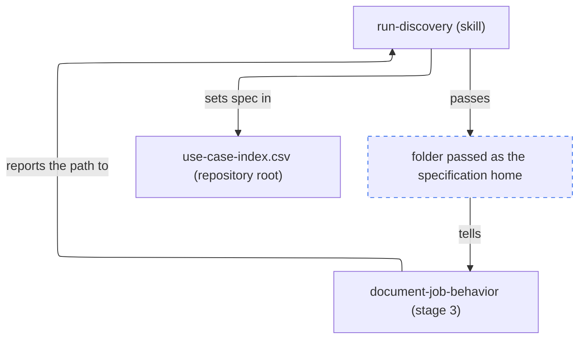

# Discovery Orchestrator

## Purpose

A GitHub Copilot agent skill that takes one use-case folder through the discovery stages in order (source screening, identity and access, behavior documentation, workflow recommendation), refreshes the consolidated review CSVs, and hands the review to `record-review-decisions`, so each folder, at any depth under one repository root, is processed without duplicates or hand transposing.

## Navigation

[Job Behavior Specifications](../README.md#navigation) / **Discovery Orchestrator**

- [Design](#design)
  - [Diagram](#diagram)
- [Technology](#technology)
- [Behavior](#behavior)
- [Relationships](#relationships)
- [Links](#links)

## Design

One skill folder, `run-discovery`, holds `SKILL.md` only. The skill takes a use-case folder through the four stages by invoking the existing skills in order (behavior documentation as `document-job-behavior` then `propose-tracker-updates` in specification-update mode) and skips behavior documentation and workflow recommendation when the source status is `not-located` or `empty`.

Use-case folders may sit at any depth under one repository root. The skill owns `use-case-index.csv` at that root, one row per use case (`use_case_name,slug,vendor,folder,spec`); it writes a folder's row when the folder starts, fills `spec` after behavior documentation, and is the only writer. The proposal ID of a folder is derived as `uc-<vendor-slug>-<use-case-slug>`, never asked for (it is the use case ID defined in the Tracker Data Contract, and the stages derive their keys from the index row's name and vendor), and a duplicate ID stops the run before any stage and writes nothing. Workflow recommendation takes every index row as its list with the fixed proposal ID `recommendations`; the lead confirms the full list once, shown with a partial-list warning, because the recommender rewrites all its Mappings rows each run. The exact columns, slug rule, duplicate and move rules are in [contract.md](contract.md#use-case-index-derived-proposal-id-and-fixed-recommendations-id). The Tracker Data Contract is unchanged.

It asks once for the facts it can neither read nor derive, runs the review CSV exporter (a Node command, because scripts run in the client environment), reports per stage, and then hands the review folder, the lead's name and the date to [Review Decisions](../lead-tracker-skills/review-decisions/README.md#design), which owns the review walk, the accept-all step and every write to the review cells. The orchestrator records no decision and edits no review cell. It holds no copy of the Tracker Data Contract. [review-checklist.md](review-checklist.md) is the internal file review of the skill, one item per behavior.

Decisions (record of the build; override in chat): the index is named `use-case-index.csv` and its definition lives in this component's contract because this skill is its only writer (the recommender restates the column names as a read-only consumer); a moved folder (same ID, old folder gone) updates its row, while an old folder still present is a duplicate; a folder skipped for no usable source stays in the index with a blank `spec`; rows are sorted by `folder`; the lead's name and date are asked once per session and never taken from the environment.

### Diagram

## Technology

- A GitHub Copilot agent skill (VS Code agent mode), plain Markdown with no code. The skill folder holds only `SKILL.md`, with no Craft term, as the sibling skill folders. It needs the five existing skills installed beside it (the four stage skills and `record-review-decisions`), Node 26 and the exporter's command line. Detail is in [requirements.md](requirements.md#requirements).

## Behavior

- **B01** When a lead names a use-case folder, then it states the use case, its vendor and source location read from the folder, and the four stages it will run in order: source screening, identity and access, behavior documentation, workflow recommendation. (untested: benchmark pending)
- **B02** When the stages run, then each runs through its own existing skill, one after another, each writing only its own proposal file; the orchestrator's own write is its use case index row, never a proposal file and never a review cell. (untested: benchmark pending)
- **B03** When a folder starts, then it reads the use case name and vendor from the folder, derives the proposal ID `uc-<vendor-slug>-<use-case-slug>`, stops before any stage if another folder already has the same ID, writes or updates that folder's row in `use-case-index.csv`, and asks once only for facts it can neither read nor derive (vendor or source location when absent, repository root, export folder, proposals root, exporter path, the folder for the review CSVs, the lead's name and the date), never asking for or inventing a proposal ID. (untested: benchmark pending)
- **B04** When a use case's source is empty or not located, then it records the blocker through source screening, skips behavior documentation and workflow recommendation for that use case, and says why. (untested: benchmark pending)
- **B05** When a use case's behavior documentation is done, then it sets that row's `spec` in the index and runs workflow recommendation over every row of the index with the fixed proposal ID `recommendations`, shows the full list once with a warning that a partial list drops the other use cases' mappings, and runs only after the lead confirms. (untested: benchmark pending)
- **B06** When the stages finish, then it runs the review CSV exporter and reports, per stage, what was proposed, skipped or blocked. (untested: benchmark pending)
- **B07** When the next folder is chosen, then earlier folders are not rerun unless the lead asks, and their rows stay in the review CSVs. (untested: benchmark pending)
- **B08** When it runs, then it never writes to the tracker, releases a question, records an acknowledgement or a decision on its own, or applies a change. (untested: benchmark pending)
- **B09** When the review CSVs are ready, then it hands the review folder, the lead's name and the date to `record-review-decisions`, which walks the lead through the pending rows and records every decision; the orchestrator records no decision itself. (untested: benchmark pending)
- **B10** When the lead asks to accept all plain adds of one use case, then it passes the request to `record-review-decisions`, which records them as accepted in that lead's name in one step, only for that use case and only for adds with no conflict. (untested: benchmark pending)

## Plan

### Planned Navigation

[Job Behavior Specifications](../README.md#plan) / **Discovery Orchestrator**

- [Planned Design](#planned-design)
  - [Planned Diagram](#planned-diagram)
- [Steps](#steps)
- [Acceptance Mapping](#acceptance-mapping)
- [Assumptions And Open Questions](#assumptions-and-open-questions)
- [Planned Relationships](#planned-relationships)
- [Planned Links](#planned-links)

### Planned Design

The orchestrator is the index's only writer, so it states the rule the other skills follow. At stage 3 it names the folder as the specification's home, `<folder>/<use case name>.md`, and sets the row's `spec` from the root-relative path the drafting stage reports. The `spec` column definition in the contract gains one sentence: the index row is the single lookup for a specification, and a new specification is written in the row's own folder. Nothing else about the index, the stages or the review hand-over changes.

Rule followed by every skill and agent that names a specification: the use case index `use-case-index.csv` at the repository root is the single lookup: its row's `folder` is the use case's own folder and its `spec` is the root-relative path of the specification; a new specification is written in the use case's own folder as `<folder>/<use case name>.md`, never in a proposal folder. A skill run by hand with no path uses it, and when there is no index row, `spec` is blank or the file is missing, the skill asks once for the path and, if none is given, reports "no specification" and uses no other location (no fallback to the inventory's source location, no scan for the file).

Behavior wording (amended at build; no behavior is added): **B05** (no new behavior; the cap of 10 holds). New wording: "When a use case's behavior documentation is done, then it sets that row's `spec` in the index from the root-relative path the stage reports (the stage writes the specification at `<folder>/<use case name>.md`, told that folder as its home) and runs workflow recommendation over every row of the index with the fixed proposal ID `recommendations`, shows the full list once with a warning that a partial list drops the other use cases' mappings, and runs only after the lead confirms. (untested: benchmark pending)" Tests and checklist items tagged B05 stay as they are.

#### Planned Diagram

### Steps

1. Edit `run-discovery/SKILL.md`: stage 3 passes the folder as the specification's home and `spec` is set from the reported path.
2. Add one sentence to the `spec` column definition in `contract.md` (Use case index) and one line under B05 in `review-checklist.md`.
3. Rewrite README `B05` as above, update Design, and dissolve this Plan into Design.

### Acceptance Mapping

| Acceptance | Behaviors | Step | Check |
| --- | --- | --- | --- |
| Stage 3 is told the folder as the specification's home and `spec` is set from the reported path | B05 | 1, 3 | file review against the checklist line |
| The `spec` column definition names the one write location and the lookup rule, in plain Markdown with no Craft term | B05 | 2 | the checklist's scan for `Craft` |

### Assumptions And Open Questions

Assumptions (override any in chat):

1. **Policy and scope.** Planned under `deciding-what-to-ask`, as one part of the request `shared-use-case-file-location`: the other affected components each carry their own Plan, and the root holds the convention. Nothing is built.
2. **Location.** A newly drafted specification is written in the use case's own folder; the proposal folder holds only proposal files. Confirmed by the user on 2026-11-17. Override by naming the proposal folder `<proposals root>/tracker-updates/<use-case-id>/` instead; the specification is then vendor-readable only if that folder is shared, so the root's vendor-separation rule would also need to change.
3. **File name.** `<use case name>.md`, as the reference specification is named after its use case. Override by naming another pattern.
4. **Existing specifications are not moved.** A batch-written specification keeps working because its index `spec` already points at it, wherever it is.
5. **Tracker Data Contract.** It defines no specification location, so it and its copies in the skill folders do not change and nothing is recopied.
6. **Behavior cap.** The component lists 10 behaviors, so none is added: **B05** is reworded in the Plan above and at build; tests and checklist items tagged for it stay.

Open questions: none. The location choice was confirmed by the user on 2026-11-17; where a hand-run skill finds no index row it asks once for a path, as recorded above.

### Planned Relationships

- [Copilot Drafting Guide](../copilot-drafting-guide/README.md#purpose) — stage 3 writes the specification at the location the orchestrator names.
- [Tracker Update Proposer](../tracker-update-proposer/README.md#purpose) and [Identity Access Discovery](../identity-access-discovery/README.md#purpose) — resolve a specification and the core files through the index this skill writes.

### Planned Links

- [requirements.md](requirements.md#planned-change-shared-use-case-file-location) — what the change must do, with the planned change section.
- [contract.md](contract.md#planned-change-shared-use-case-file-location) — the interface, with the planned change section.

## Relationships

- [Tracker Update Proposer](../tracker-update-proposer/README.md#purpose) — the skill that runs source screening and specification update.
- [Identity Access Discovery](../identity-access-discovery/README.md#purpose) — the skill that runs the identity and access stage.
- [Copilot Drafting Guide](../copilot-drafting-guide/README.md#purpose) — the skill that runs behavior documentation.
- [Workflow Recommender](../workflow-recommender/README.md#purpose) — the skill that runs workflow recommendation; reads the index this skill writes and shares the fixed proposal ID `recommendations`.
- [Review Decisions](../lead-tracker-skills/review-decisions/README.md#design) — the skill this one hands the review to after the export.
- [Review CSV Exporter](../tracker-tools/review-csv-exporter/README.md#purpose) — the tool that writes the consolidated review CSVs the lead reviews.
- [Tracker Data Contract](../tracker-data-contract/README.md#purpose) — the proposal format, owner classes and review rules the flow follows, and the use case ID that is the proposal ID derived here.

## Links

- [run-discovery/SKILL.md](run-discovery/SKILL.md) — the skill.
- [review-checklist.md](review-checklist.md) — the file review of the skill against B01 to B10.
- [requirements.md](requirements.md#requirements) — what the skill must do, must not do and need not match, and the follow-on work.
- [contract.md](contract.md#contract) — the invocation, inputs, stages, exporter call, use case index, review hand-over and wording rules.
