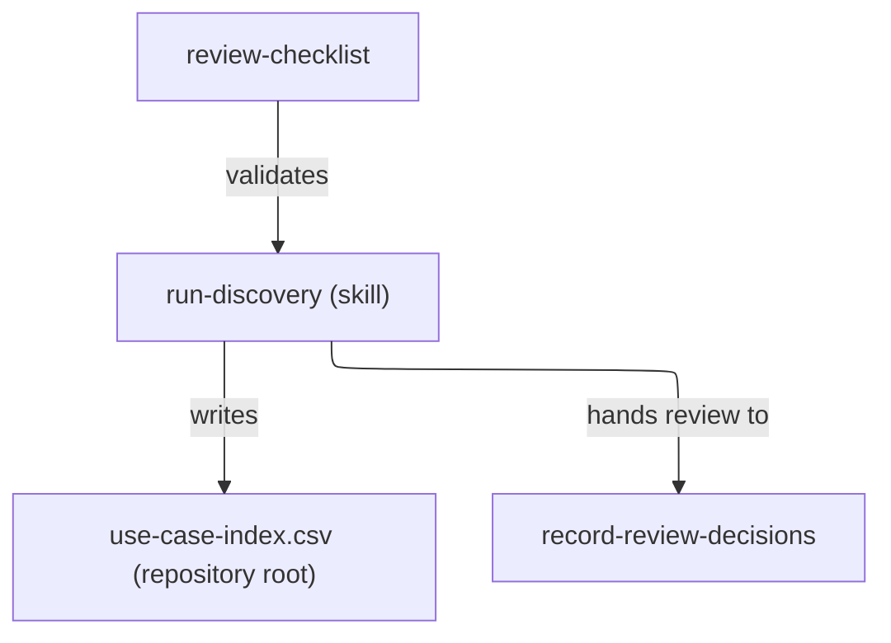

# Discovery Orchestrator

## Purpose

A GitHub Copilot agent skill that takes one use-case folder through the discovery stages in order (source screening, identity and access, behavior documentation, workflow recommendation), refreshes the consolidated review CSVs, and hands the review to `record-review-decisions`, so each folder, at any depth under one repository root, is processed without duplicates or hand transposing.

## Navigation

[Job Behavior Specifications](../README.md#navigation) / **Discovery Orchestrator**

- [Design](#design)
  - [Diagram](#diagram)
- [Technology](#technology)
- [Behavior](#behavior)
- [Plan](#plan)
  - [Planned Navigation](#planned-navigation)
  - [Planned Design](#planned-design)
  - [Steps](#steps)
  - [Acceptance Mapping](#acceptance-mapping)
  - [Assumptions And Open Questions](#assumptions-and-open-questions)
  - [Planned Relationships](#planned-relationships)
  - [Planned Links](#planned-links)
- [Relationships](#relationships)
- [Links](#links)

## Design

One skill folder, `run-discovery`, holds `SKILL.md` only. The skill takes a use-case folder through the four stages by invoking the existing skills in order (behavior documentation as `document-job-behavior` then `propose-tracker-updates` in specification-update mode) and skips behavior documentation and workflow recommendation when the source status is `not-located` or `empty`.

Use-case folders may sit at any depth under one repository root. The skill owns `use-case-index.csv` at that root, one row per use case (`use_case_name,slug,vendor,folder,spec`); it writes a folder's row when the folder starts, fills `spec` after behavior documentation, and is the only writer. The proposal ID of a folder is derived as `uc-<vendor-slug>-<use-case-slug>`, never asked for, and a duplicate ID stops the run before any stage and writes nothing. Workflow recommendation takes every index row as its list with the fixed proposal ID `recommendations`; the lead confirms the full list once, shown with a partial-list warning, because the recommender rewrites all its Mappings rows each run. The exact columns, slug rule, duplicate and move rules are in [contract.md](contract.md#use-case-index-derived-proposal-id-and-fixed-recommendations-id). The Tracker Data Contract is unchanged.

It asks once for the facts it can neither read nor derive, runs the review CSV exporter (a Node command, because scripts run in the client environment), reports per stage, and then hands the review folder, the lead's name and the date to [Review Decisions](../lead-tracker-skills/review-decisions/README.md#design), which owns the review walk, the accept-all step and every write to the review cells. The orchestrator records no decision and edits no review cell. It holds no copy of the Tracker Data Contract. [review-checklist.md](review-checklist.md) is the internal file review of the skill, one item per behavior.

Decisions (record of the build; override in chat): the index is named `use-case-index.csv` and its definition lives in this component's contract because this skill is its only writer (the recommender restates the column names as a read-only consumer); a moved folder (same ID, old folder gone) updates its row, while an old folder still present is a duplicate; a folder skipped for no usable source stays in the index with a blank `spec`; rows are sorted by `folder`; the lead's name and date are asked once per session and never taken from the environment.

### Diagram

## Technology

- A GitHub Copilot agent skill (VS Code agent mode), plain Markdown with no code. The skill folder holds only `SKILL.md`, with no Craft term, as the sibling skill folders. It needs the five existing skills installed beside it (the four stage skills and `record-review-decisions`), Node 26 and the exporter's command line. Detail is in [requirements.md](requirements.md#requirements).

## Behavior

- **B01** When a lead names a use-case folder, then it states the use case, its vendor and source location read from the folder, and the four stages it will run in order: source screening, identity and access, behavior documentation, workflow recommendation. (untested: benchmark pending)
- **B02** When the stages run, then each runs through its own existing skill, one after another, each writing only its own proposal file; the orchestrator's own write is its use case index row, never a proposal file and never a review cell. (untested: benchmark pending)
- **B03** When a folder starts, then it reads the use case name and vendor from the folder, derives the proposal ID `uc-<vendor-slug>-<use-case-slug>`, stops before any stage if another folder already has the same ID, writes or updates that folder's row in `use-case-index.csv`, and asks once only for facts it can neither read nor derive (vendor or source location when absent, repository root, export folder, proposals root, exporter path, the folder for the review CSVs, the lead's name and the date), never asking for or inventing a proposal ID. (untested: benchmark pending)
- **B04** When a use case's source is empty or not located, then it records the blocker through source screening, skips behavior documentation and workflow recommendation for that use case, and says why. (untested: benchmark pending)
- **B05** When a use case's behavior documentation is done, then it sets that row's `spec` in the index and runs workflow recommendation over every row of the index with the fixed proposal ID `recommendations`, shows the full list once with a warning that a partial list drops the other use cases' mappings, and runs only after the lead confirms. (untested: benchmark pending)
- **B06** When the stages finish, then it runs the review CSV exporter and reports, per stage, what was proposed, skipped or blocked. (untested: benchmark pending)
- **B07** When the next folder is chosen, then earlier folders are not rerun unless the lead asks, and their rows stay in the review CSVs. (untested: benchmark pending)
- **B08** When it runs, then it never writes to the tracker, releases a question, records an acknowledgement or a decision on its own, or applies a change. (untested: benchmark pending)
- **B09** When the review CSVs are ready, then it hands the review folder, the lead's name and the date to `record-review-decisions`, which walks the lead through the pending rows and records every decision; the orchestrator records no decision itself. (untested: benchmark pending)
- **B10** When the lead asks to accept all plain adds of one use case, then it passes the request to `record-review-decisions`, which records them as accepted in that lead's name in one step, only for that use case and only for adds with no conflict. (untested: benchmark pending)

## Relationships

- [Tracker Update Proposer](../tracker-update-proposer/README.md#purpose) — the skill that runs source screening and specification update.
- [Identity Access Discovery](../identity-access-discovery/README.md#purpose) — the skill that runs the identity and access stage.
- [Copilot Drafting Guide](../copilot-drafting-guide/README.md#purpose) — the skill that runs behavior documentation.
- [Workflow Recommender](../workflow-recommender/README.md#purpose) — the skill that runs workflow recommendation; reads the index this skill writes and shares the fixed proposal ID `recommendations`.
- [Review Decisions](../lead-tracker-skills/review-decisions/README.md#design) — the skill this one hands the review to after the export.
- [Review CSV Exporter](../tracker-tools/review-csv-exporter/README.md#purpose) — the tool that writes the consolidated review CSVs the lead reviews.
- [Tracker Data Contract](../tracker-data-contract/README.md#purpose) — the proposal format, owner classes and review rules the flow follows.

## Links

- [run-discovery/SKILL.md](run-discovery/SKILL.md) — the skill.
- [review-checklist.md](review-checklist.md) — the file review of the skill against B01 to B10.
- [requirements.md](requirements.md#requirements) — what the skill must do, must not do and need not match, and the follow-on work.
- [contract.md](contract.md#contract) — the invocation, inputs, stages, exporter call, use case index, review hand-over and wording rules.

## Plan

### Planned Navigation

[Job Behavior Specifications](../README.md#plan) / **Discovery Orchestrator**

- [Planned Design](#planned-design)
- [Steps](#steps)
- [Acceptance Mapping](#acceptance-mapping)
- [Assumptions And Open Questions](#assumptions-and-open-questions)
- [Planned Relationships](#planned-relationships)
- [Planned Links](#planned-links)

### Planned Design

A wording change only. The proposal ID the orchestrator derives, `uc-<vendor-slug>-<use-case-slug>`, is now defined in the [Tracker Data Contract](../tracker-data-contract/README.md#planned-design) as the use case ID, the identity of a use case in every tracker local reference. The orchestrator's text gains one sentence saying so: the proposal ID is the use case ID defined in the Tracker Data Contract, and the stages derive their keys from the index row's name and vendor. Nothing else changes: the slug rule, the five index columns, the duplicate-ID stop, the moved-folder rule, the fixed ID `recommendations` and every behavior stay as they are, and `B03` is not reworded. The skill still holds no copy of the contract and does not define the ID's use in rows; each stage skill derives its own keys.

### Steps

1. [contract.md](contract.md), the `Proposal ID` bullet of the use case index section (and the matching `Inputs` bullet): add one sentence, "The proposal ID is the use case ID defined in the Tracker Data Contract; the stages derive their keys from the index row's name and vendor."
2. [README.md](README.md), the Design paragraph that says the proposal ID is derived as `uc-<vendor-slug>-<use-case-slug>`: add the same sentence.
3. [run-discovery/SKILL.md](run-discovery/SKILL.md), the bullet at line 36 ("The proposal ID of the folder is ..."): add the same sentence. A search shows no other line changed.
4. Validate: the three files carry the sentence once each; the slug rule, the five column names, the duplicate rule, `B03` and the rest of the three files are unchanged (a diff shows only the added sentences); no Craft term in the skill folder.

### Acceptance Mapping

| Acceptance | Behaviors | Step | Check |
| --- | --- | --- | --- |
| 1. contract.md, README.md and `run-discovery/SKILL.md` each say the proposal ID is the use case ID defined in the Tracker Data Contract and that the stages derive their keys from the index row's name and vendor. | B03 | 1 to 3 | the diff and checklist `[B03]` |
| 2. Nothing else changes: the slug rule, index columns, duplicate stop and the behavior wording stay. | B03 | 4 | the diff |

Validation: the commands in step 4.

### Assumptions And Open Questions

Assumptions (override by telling the builder, or by editing the file named):

- **Wording only**, so no behavior is reworded (`B03` keeps its text) and no checklist item changes.
- **No contract copy** is held here, so nothing is copied.
- **Build order:** after the Tracker Data Contract and the skill components, whose rules it refers to; it does not depend on any of their files.

Open questions: none.

### Planned Relationships

- [Tracker Data Contract](../tracker-data-contract/README.md#planned-design) — defines the use case ID that is the proposal ID derived here.

### Planned Links

- [contract.md](contract.md#planned-proposal-id-is-the-use-case-id) — the exact planned sentence.
