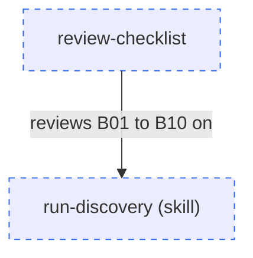

# Discovery Orchestrator

## Purpose

A GitHub Copilot agent skill that takes one use-case folder through the discovery stages in order (source screening, identity and access, behavior documentation, workflow recommendation), refreshes the consolidated review CSVs, and walks a lead through the pending rows, so leads review and decide in one flow and each folder is processed without duplicates or hand transposing.

## Navigation

[Job Behavior Specifications](../README.md#navigation) / **Discovery Orchestrator**

- [Design](#design)
- [Technology](#technology)
- [Behavior](#behavior)
- [Relationships](#relationships)
- [Links](#links)

## Design

Not built yet.

## Technology

- A GitHub Copilot agent skill (VS Code agent mode), plain Markdown with no code. The skill folder holds only `SKILL.md`, with no Craft term, as the sibling skill folders. It needs the four existing skills installed beside it, Node 26 and the exporter's command line. Detail is in [requirements.md](requirements.md#requirements).

## Behavior

- **B01** When a lead names a use-case folder, then it states the use case, its vendor and source location read from the folder, and the four stages it will run in order: source screening, identity and access, behavior documentation, workflow recommendation. (untested: benchmark pending)
- **B02** When the stages run, then each runs through its own existing skill, one after another, each writing only its own proposal file. (untested: benchmark pending)
- **B03** When a stage needs a fact only the developer has (proposal ID, vendor, source location), then it asks once and never invents it. (untested: benchmark pending)
- **B04** When a use case's source is empty or not located, then it records the blocker through source screening, skips behavior documentation and workflow recommendation for that use case, and says why. (untested: benchmark pending)
- **B05** When a use case's behavior documentation is done, then workflow recommendation runs over every specification processed so far, not only the current folder. (untested: benchmark pending)
- **B06** When the stages finish, then it runs the review CSV exporter and reports, per stage, what was proposed, skipped or blocked. (untested: benchmark pending)
- **B07** When the next folder is chosen, then earlier folders are not rerun unless the lead asks, and their rows stay in the review CSVs. (untested: benchmark pending)
- **B08** When it runs, then it never writes to the tracker, releases a question, records an acknowledgement or a decision on its own, or applies a change. (untested: benchmark pending)
- **B09** When the review CSVs are ready, then it walks the lead through the pending rows one use case at a time in the exporter's order (conflicts, suggestions for the lead's fields, then plain evidence-backed adds), showing the current value, the proposed value, the evidence and any conflict, and records accept, reject or clarify with a comment in the review columns only on the lead's own words. (untested: benchmark pending)
- **B10** When the lead asks to accept all plain adds of one use case, then it records them as accepted in that lead's name in one step, only for that use case and only for adds with no conflict. (untested: benchmark pending)

## Relationships

- [Tracker Update Proposer](../tracker-update-proposer/README.md#purpose) — the skill that runs source screening and specification update.
- [Identity Access Discovery](../identity-access-discovery/README.md#purpose) — the skill that runs the identity and access stage.
- [Copilot Drafting Guide](../copilot-drafting-guide/README.md#purpose) — the skill that runs behavior documentation.
- [Workflow Recommender](../workflow-recommender/README.md#purpose) — the skill that runs workflow recommendation.
- [Review CSV Exporter](../tracker-tools/review-csv-exporter/README.md#purpose) — the tool that writes the consolidated review CSVs the lead reviews.
- [Tracker Data Contract](../tracker-data-contract/README.md#purpose) — the proposal format, owner classes and review rules the flow follows.

## Links

- [requirements.md](requirements.md#requirements) — what the skill must do, must not do and need not match, and the follow-on work.
- [contract.md](contract.md#contract) — the invocation, inputs, stages, exporter call, review walk and wording rules.

## Plan

### Planned Navigation

[Job Behavior Specifications](../README.md#plan) / **Discovery Orchestrator**

- [Planned Design](#planned-design)
  - [Planned Diagram](#planned-diagram)
- [Steps](#steps)
- [Acceptance Mapping](#acceptance-mapping)
- [Assumptions And Open Questions](#assumptions-and-open-questions)
- [Planned Relationships](#planned-relationships)
- [Planned Links](#planned-links)

### Planned Design

One skill folder, `run-discovery`, holds `SKILL.md` (frontmatter `name: run-discovery`, user-invocable) and one internal checklist beside it, `review-checklist.md`. The skill takes a use-case folder through the four stages by invoking the existing skills in order (behavior documentation as drafting then specification-update proposals), skips the dependent stages when the source is empty or not located, runs the exporter, reports per stage, and then walks the lead through the pending rows in the exporter's order, recording a decision only from the lead's own words in the row's review cells. It holds no copy of the Tracker Data Contract; the review columns are read from the exporter's headings file and the contract's rules are enforced by the skills it calls.

#### Planned Diagram

### Steps

1. **`run-discovery/SKILL.md`** (B01 to B10): before you start (what must be present, asked once, nothing invented), run one folder, ask once, the stages, export and report, next folder, never, walk the review rows, accept all plain adds of one use case.
2. **`review-checklist.md`:** the file review and scans for B01 to B10, tagged by behavior, with the wording scan.
3. **Docs:** the built `Design` and diagram, Technology and Links in this README, kept in step with `requirements.md` and `contract.md`.
4. **Validate:** the file review in `review-checklist.md`, then the root `test` check to confirm nothing in the root integration tests broke. No check is declared here.

### Acceptance Mapping

| Acceptance | Behaviors | Step | Review check |
| --- | --- | --- | --- |
| 1. States the use case and four stages; runs each through its own skill in order; asks once for a missing fact; records a source blocker and skips dependent stages; recommends over every specification processed so far | B01, B02, B03, B04, B05 | 1, 2 | `review-checklist.md` read of `SKILL.md`: opening statement, the four skills in order, the ask-once list, the blocker and skip rule, the all-specifications rule |
| 2. Runs the exporter and reports per stage; a later folder leaves earlier rows in place | B06, B07 | 1, 2 | The export and report step; the no-rerun rule |
| 3. Walks rows in the exporter's order; decisions only from the lead's words; accept all plain adds of one use case; nothing written to the tracker | B08, B09, B10 | 1, 2 | The prohibitions; the walk, order and review-cell-only rule; the one-use-case, adds-without-conflict, in-the-lead's-name rule |

Every behavior keeps `(untested: benchmark pending)`; the user's manual client-environment tests are recorded as user-reported evidence, not a pass here.

### Assumptions And Open Questions

Assumptions (override by telling the builder, or by editing the file named):

- Skill folder and name `run-discovery`, a verb and a noun like the siblings. Rename the folder, the `name:` line and `contract.md` to change it.
- The folder holds only `SKILL.md`, with no copy of the Tracker Data Contract, so the root `B05` copy test is unchanged. To include the copies, extend that test too.
- Behavior documentation is two invocations, as end-to-end step 4 says. B02 stays as confirmed and `contract.md` records the two-skill stage; reword B02 to "its own existing skill or skills" if you prefer.
- "Specifications processed so far" comes from the proposals under the proposals root, with the lead confirming the list, not from a new log file. A small run log can be added.
- The skill edits only the review cells in the CSV and reruns the exporter, which stops on a broken file. If hand-editing breaks rows, add an exporter `record-decision` subcommand.
- The lead's name and today's date are asked once per session and are never taken from the environment.
- One recommendations proposal ID per session stops repeat runs duplicating mappings.
- The budget (USD 4, 3,600 s) is enough for one skill file, a checklist and two records.

Open questions (behavior or real ambiguity): none.

### Planned Relationships

- [Tracker Update Proposer](../tracker-update-proposer/README.md#purpose) — runs source screening and specification-update proposals.
- [Identity Access Discovery](../identity-access-discovery/README.md#purpose) — runs the identity and access stage.
- [Copilot Drafting Guide](../copilot-drafting-guide/README.md#purpose) — runs behavior documentation.
- [Workflow Recommender](../workflow-recommender/README.md#purpose) — runs workflow recommendation.
- [Review CSV Exporter](../tracker-tools/review-csv-exporter/README.md#planned-design) — writes the review CSVs the lead walks through.
- [Tracker Data Contract](../tracker-data-contract/README.md#purpose) — the ownership classes and review rules the flow follows.

### Planned Links

- [requirements.md](requirements.md#requirements) — requirements, prohibitions and follow-on work.
- [contract.md](contract.md#contract) — invocation, stages, exporter call and review walk.
