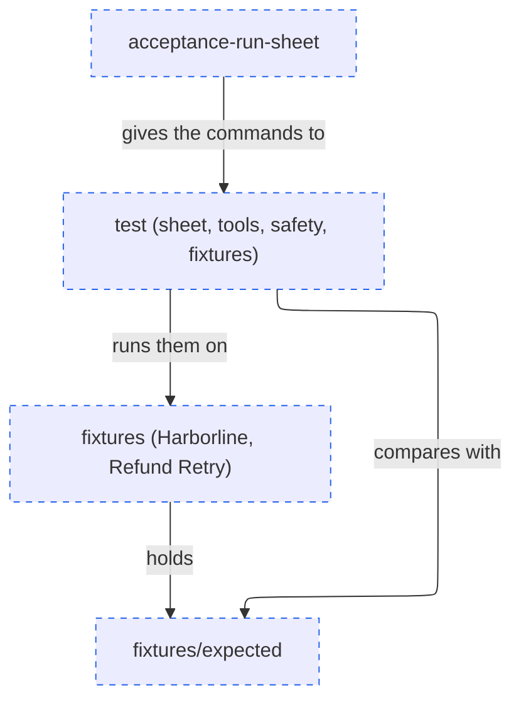

# End-To-End Acceptance Test

## Purpose

A manual acceptance test of the whole lead flow, run by a person in the client environment on fictional data: a run sheet that walks the lead, a developer and a vendor stand-in from discovery of one use case through review decisions, the master and vendor workbooks, a vendor answer, its incorporation into the specification and the daily summary, with the exact prompt or command and the expected result at every step and a place to record pass or fail, plus the fictional fixtures and the automated tests that prove every documented command.

## Navigation

[Job Behavior Specifications](../README.md#navigation) / **End-To-End Acceptance Test**

- [Design](#design)
- [Technology](#technology)
- [Behavior](#behavior)
- [Plan](#plan)
  - [Planned Navigation](#planned-navigation)
  - [Planned Design](#planned-design)
    - [Planned Diagram](#planned-diagram)
  - [Steps](#steps)
  - [Acceptance Mapping](#acceptance-mapping)
  - [Assumptions And Open Questions](#assumptions-and-open-questions)
  - [Planned Relationships](#planned-relationships)
  - [Planned Links](#planned-links)
- [Relationships](#relationships)
- [Links](#links)

## Design

Not built yet.

## Technology

- Node 26 with native TypeScript (erasable syntax, `.ts` import extensions), no dependencies of its own, ES modules and `node:test` with real temporary directories, as the root tests and Tracker Tools do. The tests import the tools' command modules by relative path and resolve `exceljs` from the installed Master Workbook Updater. The run sheet and fixtures are Markdown and CSV; Excel work is done by hand by the person running the test. No root `package.json`. Detail is in [requirements.md](requirements.md#requirements).

## Behavior

- **B01** When a person opens the run sheet, then the prerequisites and the record sheet come first, before step S01.
- **B02** When any step is read, then it names who does it, the skill or tool, the file or sheet, the exact prompt or command, the expected result and a pass or fail box.
- **B03** When the discovery and review steps are run on the fictional folder, then the review CSVs, their counts and the decisions (accept, reject, clarify, accept all plain adds, and revisit) match the expected outputs.
- **B04** When the apply steps are run, starting from an empty export, then the master and vendor workbooks match the expected outputs, and a rerun on the same inputs changes nothing.
- **B05** When the vendor answers in its own workbook, the lead copies the answer into the master and accepts it, then only that question's vendor-owned columns reach the master and `status` stays the lead's.
- **B06** When the developer incorporates the accepted answer, then `document-job-behavior` gives specification version 2 and `propose-tracker-updates` gives a proposal that validates, with no duplicate question row.
- **B07** When the summary step is run on the export, then it matches the expected summary for the fixed date, with the unanswered question overdue.
- **B08** When a step fails, then the sheet tells the person to stop, record the failure and the error line, edit no file to get past it, and use the reference fixture, marked "fallback used", only where the sheet says so.
- **B09** When the fixtures are read, then they are fictional, carry expected outputs for every step, and hold no copy of `tracker-data-contract.md` or `tracker-schema.csv`.
- **B10** When the safety checks are run, then the vendor workbook has no internal column, a duplicate folder stops `run-discovery` naming both folders and writing nothing, and every rerun changes nothing.

## Plan

### Planned Navigation

[Job Behavior Specifications](../README.md#plan) / **End-To-End Acceptance Test**

- [Planned Design](#planned-design)
  - [Planned Diagram](#planned-diagram)
- [Steps](#steps)
- [Acceptance Mapping](#acceptance-mapping)
- [Assumptions And Open Questions](#assumptions-and-open-questions)
- [Planned Relationships](#planned-relationships)
- [Planned Links](#planned-links)

### Planned Design

The component holds four parts, all inside its own folder. [acceptance-run-sheet.md](requirements.md#requirements) is the runbook a person follows. `fixtures/` holds the fictional data (vendor Harborline, use case Refund Retry, derived ID `uc-harborline-refund-retry`): the use case folder, an empty tracker export, reference proposals for both specification versions, the vendor's answer, and `expected/` with the reference outputs. `test/` holds the automated tests. The run sheet is also the test's input: the tests extract the fenced command of each step, substitute the `{pack}` and `{sandbox}` placeholders and run it on a copy of the fixtures, so a documented command cannot drift from the tools. The steps are, in order: discovery of the folder (S01), the duplicate-folder safety stop (S02), the review export (S03), the lead's decisions in chat including a revisit (S04), the master workbook built from the empty export with the accepted rows (S05), the release of a question by hand and the first vendor workbook (S06, S06b, S06c), the vendor's answer (S07), the answer copied into the master (S08), the lead accepting it by hand (S09), the developer incorporating it through the specification skills (S10), the manual export of the master to CSV (S11, a known gap) and the daily summary (S12). The Copilot steps (S01, the live stop of S02, S04, S10) cannot be proven by code; they are proven only when a person runs the sheet, and the tests use reference proposals and a scripted edit of the same review cells as stand-ins. Exact commands, field values and the order of S05 to S09 are fixed when built, after the builder runs the scripted sequence against the tools as they are then.

#### Planned Diagram

### Steps

1. Create the component records: this README, `requirements.md`, `contract.md`, `craft.json` and `tasks.md`.
2. Write the fictional fixtures under `fixtures/` as [contract.md](contract.md#contract) lays out, and keep every file free of a copy of the contract or schema and of any secret-looking value.
3. Write `acceptance-run-sheet.md`: the prerequisites and the record sheet first, then the steps S01 to S12 in the fixed shape, the failure-handling section, and the known-gap note on S11.
4. Run the scripted sequence of the tools once during the build to fix the order of S05 to S09 and produce `fixtures/expected/`; review the outputs by eye, then keep them as fixed fixtures. Never regenerate them inside a test.
5. Write the tests in `test/` (`sheet.test.ts`, `tools.test.ts`, `safety.test.ts`, `fixtures.test.ts`), each title tagged with its behavior ID.
6. Validate, then keep this README's Design, Behavior and diagram, the requirements and the contract in step with what was built.

### Acceptance Mapping

| Acceptance | Behaviors | Step | Test |
| --- | --- | --- | --- |
| The run sheet opens with prerequisites and the record sheet, and every step names who, tool, file or sheet, exact command or prompt, expected result and a pass or fail box | B01, B02 | 3 | `[B01]`, `[B02]` in `test/sheet.test.ts` |
| The documented commands for the discovery export, review, apply and summary steps, run from the sheet's own text on the fixtures, give the expected outputs, and every rerun changes nothing | B03, B04, B07, B10 | 3, 4, 5 | `[B03]`, `[B04]`, `[B07]`, `[B10]` in `test/tools.test.ts` |
| The vendor round trip and the developer incorporation reach the expected master cells and a proposal that validates | B05, B06 | 3, 4, 5 | `[B05]`, `[B06]` in `test/tools.test.ts` |
| Failure handling is written for every step, including the stop on a fail and the fallback marking | B08 | 3 | `[B08]` in `test/sheet.test.ts` |
| The fixtures are fictional, hold expected outputs for every step and no copy of the contract or schema, and the vendor workbook has no internal column | B09, B10 | 2, 5 | `[B09]` in `test/fixtures.test.ts`, `[B10]` in `test/safety.test.ts` |

Validation, narrowest first: `node --test "end-to-end-acceptance-test/test/*.test.ts"` (the root `test` check with the component as `{path}`), then `node --test "test/*.test.ts"` at the root to confirm `B05` and the contract-copy count are unaffected. The tests need `npm ci` already run in the Master Workbook Updater and the Vendor Workbook Updater. No typecheck, lint, boundaries or coverage check is declared in the project, so none is run. The Copilot steps are not claimed as passed by any code.

### Assumptions And Open Questions

Assumptions (override any in chat):

1. **Name and place.** The component is `end-to-end-acceptance-test`, a direct child of the root, because it spans several components and owns none of their contents. The other name considered was End-To-End Test Script, set aside because "script" is also the vendor's script.
2. **Planner.** The planner agent proposed the steps; this plan was written from its report. Nothing is built.
3. **Build order.** It is built after the use case ID change in the root Plan (Tracker Tools first, then the root task), because the fixtures and the run sheet use ID keys such as `uc-harborline-refund-retry/Q1` and the tools match by name today. Override by asking to build it now with name keys, and rewriting the fixtures after the ID change.
4. **Use case, questions and ID.** The fictional vendor is Harborline and the use case is Refund Retry, with ID `uc-harborline-refund-retry` (derived, never stored). Q1 is accepted and answered, Q2 is rejected, and Q3 is marked clarify, then accepted at the revisit, and left unanswered so it is overdue in the summary. Override by editing the fixtures.
5. **Starting point.** The master is built from an empty export with `update-master-workbook --from-export`, so no sample workbook or binary is committed; fixtures hold CSV and Markdown only, and the workbooks are produced by the steps.
6. **Vendor Workbook Updater.** It is exercised once (S06c) by applying one accepted vendor-visible update to the downloaded vendor workbook on a copy of the review files, because the Master Workbook Updater already rebuilds vendor workbooks and skips nothing that the Vendor Workbook Updater needs. Override by a second release batch for Q3, which leaves Q3 listed as marked applied but not in the master.
7. **Release is by hand.** The tools never set `batch_ref`, `released_on` or `status` released (forbidden to them), so S06 is a hand edit in Excel with an expected-cell list.
8. **Known gap.** No tool exports the master back to CSV (the open backlog item `master-csv-export`), so S11 is a manual Save As per sheet plus a `manifest.csv`, with `fixtures/expected/export-after-answer/` as the comparison and the fallback input for S12. If that item is built first, S11 becomes one command.
9. **The tests run the sheet's own command text**, so documented commands are proven rather than paraphrased. Override by hand-copied commands in the tests, which is looser.
10. **Safety.** The run is done in a throwaway sandbox that is a copy of `fixtures/`, never the real repository root or a real export, because `run-discovery` writes `use-case-index.csv` at the repository root.
11. **Budget.** This component gets cost 2 and 3600 seconds, and the root's allocation and child limit are raised by the same amounts in the root's own record. Override by naming another share.
12. **Out of scope.** Packaging is dropped. The Client Transfer Package, its decision to ship the sheet and fixtures, and its own removal are not touched here.
13. **Skill output is not deterministic.** Real Copilot proposals will differ from the reference proposals, so S01 has a "fallback used" mark and later steps compare key columns, not whole files.

Open questions: none. The ten behaviors and the name were confirmed by the user on 2026-11-16.

### Planned Relationships

- [Discovery Orchestrator](../discovery-orchestrator/README.md#purpose) — the skill S01 and S02 run.
- [Review Decisions](../lead-tracker-skills/review-decisions/README.md#design) — the skill S04 runs.
- [Copilot Drafting Guide](../copilot-drafting-guide/README.md#purpose) and [Tracker Update Proposer](../tracker-update-proposer/README.md#purpose) — the skills S10 runs.
- [Tracker Tools](../tracker-tools/README.md#purpose) — the exporter, both workbook updaters, the reconciler and the summary that S03 to S12 run.
- [Tracker Data Contract](../tracker-data-contract/README.md#purpose) — the schema the tests read by relative path.

### Planned Links

- [requirements.md](requirements.md#requirements) — what the test must do, must match and must not do.
- [contract.md](contract.md#contract) — the run sheet's shape, the fixture layout and the failure rules.

## Relationships

- [Discovery Orchestrator](../discovery-orchestrator/README.md#purpose) — the skill S01 and S02 run.
- [Review Decisions](../lead-tracker-skills/review-decisions/README.md#design) — the skill S04 runs.
- [Copilot Drafting Guide](../copilot-drafting-guide/README.md#purpose) and [Tracker Update Proposer](../tracker-update-proposer/README.md#purpose) — the skills S10 runs.
- [Tracker Tools](../tracker-tools/README.md#purpose) — the tools S03 to S12 run.
- [Tracker Data Contract](../tracker-data-contract/README.md#purpose) — the schema the tests read.

## Links

- [requirements.md](requirements.md#requirements) — what the test must do, must match and must not do.
- [contract.md](contract.md#contract) — the run sheet's shape, the fixture layout and the failure rules.
