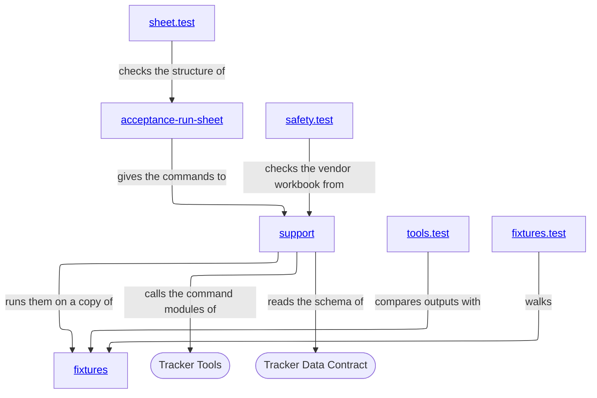

# End-To-End Acceptance Test

## Purpose

A manual acceptance test of the whole lead flow, run by a person in the client environment on fictional data: a run sheet that walks the lead, a developer and a vendor stand-in from discovery of one use case through review decisions, the master and vendor workbooks, a vendor answer, its incorporation into the specification and the daily summary, with the exact prompt or command and the expected result at every step and a place to record pass or fail, plus the fictional fixtures and the automated tests that prove every documented command.

## Design

The folder holds four parts, all inside its own folder. [acceptance-run-sheet](acceptance-run-sheet.md) is the runbook a person follows: prerequisites and a record sheet first, a failure-handling section, then the steps. [fixtures](fixtures/expected/s03-review-rows.csv) holds the fictional data (vendor Harborline, use case Refund Retry, derived ID `uc-harborline-refund-retry`): the use case folder, an empty tracker export, reference proposals for both specification versions, the vendor's answer and `expected/`, the reference outputs of every step, reviewed by eye once and kept fixed. [test](test/support.ts) holds the automated tests. The run sheet is also the tests' input: they extract the fenced command of each step, substitute the `{pack}` and `{sandbox}` placeholders, and run it through the tool's own command module on a copy of the fixtures in a real temporary directory, so a documented command cannot drift from the tools.

The steps, in order: S01 discovery, S02 the duplicate-folder stop, S03 the review export, S04 the lead's decisions in chat (walk, accept all plain adds, revisit), S05 the master workbook built from the empty export, S06 the lead's hand release of Q1 and Q3, S06b the first Harborline workbook (`--new-vendor`), S07 the vendor's answer typed into its workbook, S08 the vendor workbook synced into the master (`--vendor`, which copies only the vendor-owned columns), S09 the lead accepting Q1 by hand, S10 the developer incorporating it through the specification skills, S10b the proposal validated, S11 the manual export of the master to CSV (a known gap, backlog item `master-csv-export`), S11b the version 2 proposal reconciled against that export (no addition, so no duplicate question row), S12 the daily summary and S13 the Vendor Workbook Updater run on the same review files and the answered workbook. The Copilot steps (S01, the live stop of S02, S04, S10) cannot be proven by code and are proven only when a person runs the sheet; the tests use the reference proposals and a scripted edit of the same review cells as stand-ins, and the hand Excel steps (S06, S07, S09) and S11 are done in test code with `exceljs`.

Decisions (record of the build; override in chat):

- Tests: [sheet.test.ts](test/sheet.test.ts) checks the sheet's structure (B01, B02, B08); [tools.test.ts](test/tools.test.ts) runs the documented commands and compares with `expected/` (B03 to B07, and the reruns); [safety.test.ts](test/safety.test.ts) checks the vendor workbook for internal columns and the duplicate-folder case (B10); [fixtures.test.ts](test/fixtures.test.ts) checks the fixtures (B09). [support](test/support.ts) runs the whole scripted sequence once per test file. A failure names the step, the file and the first differing line.
- The expected files are plain CSV, text and Markdown: the review rows and decisions, the non-empty cells of the Use Cases and Questions rows of each master (`tab,ref,field,value`), the vendor workbook headings and cells, the counts line of each command, the full `export-after-answer/` folder and `summary.md`. They were produced once by running the sequence, read by eye and fixed; no test regenerates them.
- Dates: the review decisions and the master build are 2026-11-18, the release 2026-11-19 (due 2026-11-23, release plus two working days), the answer and its sync 2026-11-25, the version 2 proposal 2026-11-30, the export and the summary 2026-12-01 (QN-0003 is 8 days overdue). People: lead Lena Park, developer Dev Okafor, vendor stand-in Harborline Contact.
- Reruns: S03, S06b, S08, S12 and S13 are rerun as written and change nothing. S05 is rerun from the new master (`--master`), as its own report says, because a rerun from the empty export would rebuild an empty master from review rows already marked applied.
- The Vendor Workbook Updater (S13) runs after the export, not on a first workbook, because it needs an export that holds the vendor; with every review row already applied it applies nothing and proves it reads the review files and the answered workbook the Master Workbook Updater produced.
- Fallbacks exist only for S01 and S10 (the reference proposals) and S11 (the reference export); every other step stops and records the failure.
- Q3 is accepted at the revisit but never released to an answer, so it is the overdue question in the summary; Q2 is rejected and never reaches the master.
- Stage 4 of `run-discovery` (workflow recommendations) is Copilot-only and skipped in S01; the fixtures hold no recommendations proposal.
- The sandbox is a throwaway copy of `fixtures/`, never the real repository root, because `run-discovery` writes `use-case-index.csv` at the root.
- Packaging is out of scope; the Client Transfer Package decides whether to ship the sheet and fixtures.

### Diagram

## Technology

- Node 26 with native TypeScript (erasable syntax, `.ts` import extensions), no dependencies of its own, ES modules and `node:test` with real temporary directories, as the root tests and Tracker Tools do. The tests import the tools' command modules by relative path and resolve `exceljs` from the installed Master Workbook Updater (`npm ci` there and in the Vendor Workbook Updater first). The run sheet and fixtures are Markdown and CSV, plus one fictional script; Excel work is done by hand by the person running the test. No root `package.json`. The declared check is the root `test` with this component as `{path}`; no typecheck, lint, boundaries or coverage check is declared. Detail is in [requirements.md](requirements.md#requirements).

## Behavior

- **B01** When a person opens the run sheet, then the prerequisites and the record sheet come first, before step S01.
- **B02** When any step is read, then it names who does it, the skill or tool, the file or sheet, the exact prompt or command, the expected result and a pass or fail box.
- **B03** When the discovery and review steps are run on the fictional folder, then the review CSVs, their counts and the decisions (accept, reject, clarify, accept all plain adds, and revisit) match the expected outputs.
- **B04** When the apply steps are run, starting from an empty export, then the master and vendor workbooks match the expected outputs, and a rerun on the same inputs changes nothing.
- **B05** When the vendor answers in its own workbook, the lead copies the answer into the master and accepts it, then only that question's vendor-owned columns reach the master and `status` stays the lead's.
- **B06** When the developer incorporates the accepted answer, then `document-job-behavior` gives specification version 2 and `propose-tracker-updates` gives a proposal that validates, with no duplicate question row.
- **B07** When the summary step is run on the export, then it matches the expected summary for the fixed date, with the unanswered question overdue.
- **B08** When a step fails, then the sheet tells the person to stop, record the failure and the error line, edit no file to get past it, and use the reference fixture, marked "fallback used", only where the sheet says so.
- **B09** When the fixtures are read, then they are fictional, carry expected outputs for every step, and hold no copy of `tracker-data-contract.md` or `tracker-schema.csv`.
- **B10** When the safety checks are run, then the vendor workbook has no internal column, a duplicate folder stops `run-discovery` naming both folders and writing nothing, and every rerun changes nothing.

## Relationships

- [Discovery Orchestrator](../discovery-orchestrator/README.md#purpose) — the skill S01 and S02 run.
- [Review Decisions](../lead-tracker-skills/review-decisions/README.md#design) — the skill S04 runs.
- [Copilot Drafting Guide](../copilot-drafting-guide/README.md#purpose) and [Tracker Update Proposer](../tracker-update-proposer/README.md#purpose) — the skills S10 runs.
- [Tracker Tools](../tracker-tools/README.md#purpose) — the tools S03 to S13 run.
- [Tracker Data Contract](../tracker-data-contract/README.md#purpose) — the schema the tests read.

## Links

- [requirements.md](requirements.md#requirements) — what the test must do, must match and must not do.
- [contract.md](contract.md#contract) — the run sheet's shape, the fixture layout and the failure rules.
- [acceptance-run-sheet.md](acceptance-run-sheet.md) — the runbook a person follows.
- [test/support.ts](test/support.ts) — the sheet parser, the sandbox and the scripted run of every step.
- [fixtures/expected/s03-review-rows.csv](fixtures/expected/s03-review-rows.csv) — one of the reference outputs; the folder holds all of them.
