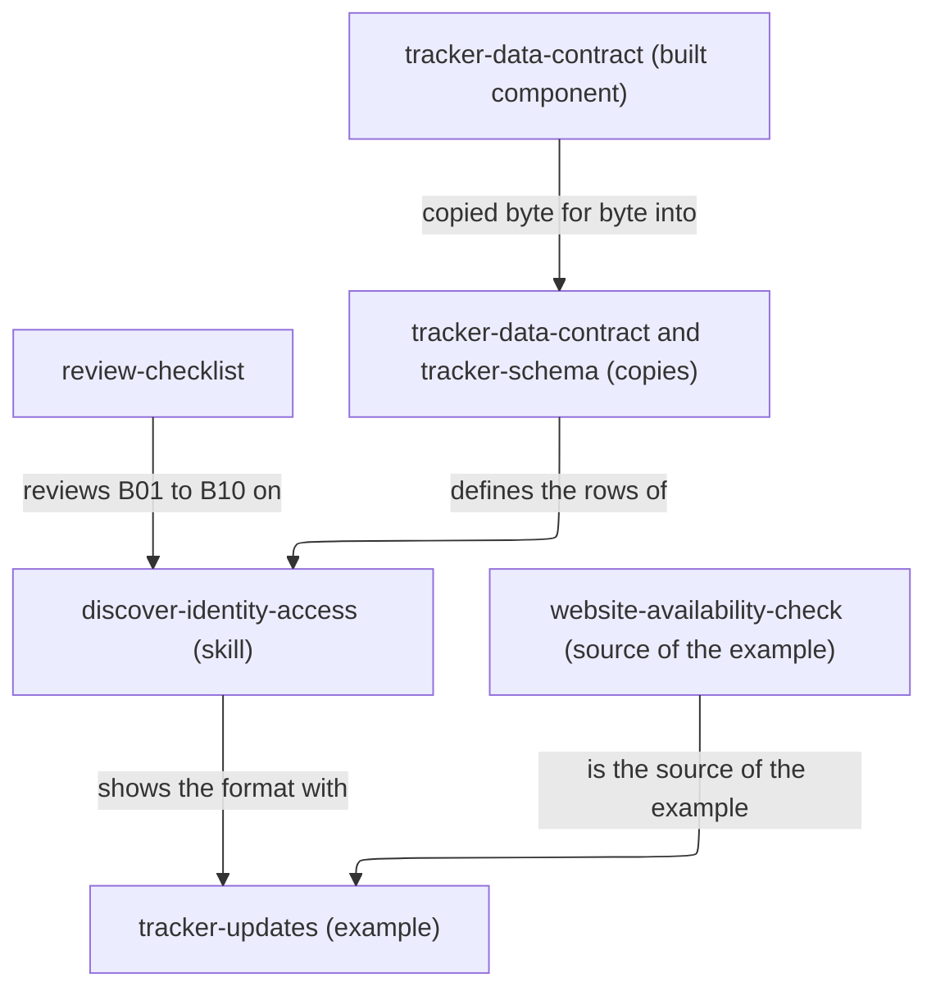

# Identity Access Discovery

## Purpose

A GitHub Copilot agent skill that reads a use case's source and configuration and proposes Identity & Access rows (services, environments, observed operations and identity references), so access requests can start from day one and leads can see possible shared requests.

## Navigation

[Job Behavior Specifications](../README.md#navigation) / **Identity Access Discovery**

- [Design](#design)
  - [Diagram](#diagram)
- [Behavior](#behavior)
- [Relationships](#relationships)
- [Links](#links)

## Design

The component delivers one skill folder, [discover-identity-access](discover-identity-access/SKILL.md), and one internal checklist. The folder holds the instructions written once ([SKILL.md](discover-identity-access/SKILL.md)), byte-identical copies of the contract ([tracker-data-contract.md](discover-identity-access/tracker-data-contract.md)) and the schema ([tracker-schema.csv](discover-identity-access/tracker-schema.csv)) from the built Tracker Data Contract, and an example proposal for the website use case ([tracker-updates.csv](discover-identity-access/tracker-updates.csv)). The folder name and the skill `name` stay `discover-identity-access`.

The skill runs from the first day as a lightweight sweep across all known use cases, in parallel with source screening and before any specification exists, and it does not wait for an acknowledgement. Its inputs are the source and configuration, the two files `external_tools.md` and `logic.md` (a missing one is reported, never invented), tagged supporting documents and dependency observations that a developer supplies. It writes only Identity & Access rows to `tracker-updates/<proposal-id>/tracker-updates.csv`, one record per use case and endpoint and environment, with the local reference `<use-case-id>/<endpoint>/<environment>`. The use case ID `uc-<vendor-slug>-<use-case-slug>` is defined once in the [Tracker Data Contract](../tracker-data-contract/README.md#design) (the vendor and the use case name as slugs, derived and never stored), so two vendors' same-named use cases do not share a key; a key in the use case name form is not valid. The ID needs the vendor, which the skill takes from the inventory or the developer; when it is not known the skill asks the lead once, never invents one, writes no keyed row for that use case until it is known and names the use case in the report.

Each record gives the service, endpoint and environment, the observed operations, the exact identity or variable reference names with runtime values `unknown`, observed and proposed access in separate columns, the permissions to confirm, the unknowns with who resolves each, and evidence pointers that begin `source:`, `document:` or `dependency:`. A row that rests only on a document or an observation is marked as not confirmed in source. A literal credential is reported as its location and `value withheld`; no secret reaches any output. The proposed request follows the observed authentication: a website sign-in asks for an approved identity or account, application permissions and a supported automated authentication or SSO where it applies; an API source asks for approved API identity or credential provisioning and the permissions or scopes the source supports, with no blanket SSO question; an unknown authentication gets a conditional request and stays `proposed`. Existing CI identity reuse is always `unconfirmed`.

A record is suggested `ready-to-raise` only when its endpoint, environment, authentication type, identity reference and permission are all known, whatever the state of any specification and of the other unknowns; otherwise it is `proposed`. Identical endpoints are only flagged through `shared_request_flag` and `shared_with`, never merged; a lead sets `consolidated_request_ref`. The skill never writes the coordinator, the vendor action owner, a ticket, a raised date, an expected availability or a verification, and never marks anything approved, provisioned or verified. Rows are ordered by use case ID, then endpoint, then environment, and `shared_with` lists other rows by the same key. Repeat runs refresh the same records by their local reference, with `set` and `base_value` for a changed spec field and no overwrite of a human field. The skill ends with a report of unread files, use cases with no source to sweep, endpoints with no evidence and rows with no pointer, and says that approval or provisioning is separate from verified working access and from behavior acknowledgement.

The example file is written from the real source in `website-availability-check/src/`: one record for the one configured endpoint, `CHECK_URL`, whose runtime value is unknown. The source sends no credential, so the authentication type is `unknown`, there is no identity reference or permission to name, the proposed request is conditional on the website owner's answer, and the record is `proposed`, not `ready-to-raise`. The notifier of that source only prints an alert and sends nothing, so it has no endpoint and no row. The example is written under a fictional vendor, `Example Vendor`, so its key is `uc-example-vendor-website-availability-check/CHECK_URL/unknown`; its `vendor` row says the vendor is fictional and given for the example. It uses the revision `unrevised`, because the sample has no recorded revision. [review-checklist.md](review-checklist.md) is internal, with one item per behavior; the skill folder never mentions the internal records.

Testing policy: the behaviors are checked by the file review and by the user's manual client-environment testing on real use cases, and are marked `untested: benchmark pending`. No Copilot run has been made for this skill. The example's format was checked mechanically with a throwaway script (header, schema fields, field classes and operations, composed unique `update_id` values, a source on every row, and pointer line ranges inside the real files).

### Diagram

## Behavior

- **B01** When it reads source, configuration, `external_tools.md`, `logic.md` and tagged documents for one use case, then it lists each external service, endpoint and environment with the observed operations and an evidence pointer that shows whether it rests on source or only on a supporting document (a document never makes a row source-verified), and it runs as an early lightweight sweep across all known use cases in parallel with detailed behavior discovery, not after acknowledgements or document completion. (untested: benchmark pending)
- **B02** When it records identities, then it gives exact variable or reference names with runtime values `unknown`, and never guesses a name, a permission or a value. (untested: benchmark pending)
- **B03** When it finds a literal credential in source, then it records the location and `value withheld`, and no secret appears in any output, and approvals are by secure reference or provisioning only. (untested: benchmark pending)
- **B04** When it records access, then there is one record per use case and endpoint and environment, keyed `<use-case-id>/<endpoint>/<environment>`, with observed access and proposed access in separate columns, and the permissions to confirm, the unknowns and who resolves each unknown are listed; when the vendor is not known it asks the lead once, never invents one, and writes no keyed row until it is known. (untested: benchmark pending)
- **B05** When the observed authentication is a website sign-in, then the proposed request asks for an approved identity or account, the application permissions and a supported automated authentication or SSO where it applies; when it is an API, then it asks for approved API identity or credential provisioning and the permissions or scopes the source supports, and no blanket SSO question. (untested: benchmark pending)
- **B06** When endpoints of several use cases look identical, then it only sets `shared_request_flag` and lists the other rows in `shared_with` for lead review, and each use case keeps its own row so a lead who consolidates after confirming endpoint, environment, identity and permissions keeps traceability. (untested: benchmark pending)
- **B07** When a request has its endpoint, environment, authentication type, identity reference and permission known, then it suggests `ready-to-raise` independent of specification state and of other unknowns, which stay listed with their resolver. (untested: benchmark pending)
- **B08** When it writes rows, then it leaves coordinator, vendor action owner, ticket, `raised_on`, expected availability (shown as `unknown`) and verification blank, suggests only `proposed` or `ready-to-raise` for the request status, and never marks anything approved, provisioned or verified. (untested: benchmark pending)
- **B09** When it finishes, then it reports unread files, use cases whose source was not available to sweep, endpoints with no evidence and rows with no pointer, and says approval or provisioning is separate from verified working access and from behavior acknowledgement, and the developer or platform team verifies access. (untested: benchmark pending)
- **B10** When its folder is read, then it contains no Craft term, needs nothing installed in VS Code agent mode, and holds byte-identical copies of the contract and schema. (untested: benchmark pending)

## Relationships

- [Tracker Data Contract](../tracker-data-contract/README.md#purpose) — the Identity & Access columns and the proposal format this skill follows, copied into its folder.
- [Website Availability Check](../website-availability-check/README.md#purpose) — the read-only source the example rows are derived from.

## Links

- [requirements.md](requirements.md#requirements) — what the component must do and what it need not.
- [contract.md](contract.md#contract) — the shapes, formats and wording rules.
- [review-checklist.md](review-checklist.md) — the internal review items tagged B01 to B10.
- [discover-identity-access/SKILL.md](discover-identity-access/SKILL.md) — the skill instructions.
- [discover-identity-access/tracker-updates.csv](discover-identity-access/tracker-updates.csv) — the example proposal for the website use case.
