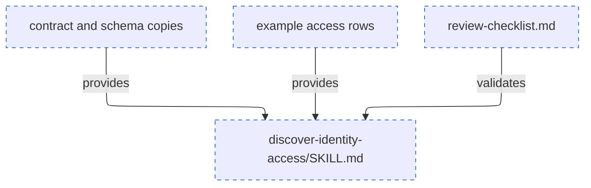

# Identity Access Discovery

## Purpose

A GitHub Copilot agent skill that reads a use case's source and configuration and proposes Identity & Access rows (services, environments, observed operations and identity references), so access requests can start from day one and leads can see possible shared requests.

## Navigation

[Job Behavior Specifications](../README.md#navigation) / **Identity Access Discovery**

- [Design](#design)
- [Behavior](#behavior)
- [Plan](#plan)
- [Relationships](#relationships)
- [Links](#links)

## Design

Not built yet.

## Behavior

- **B01** When it reads source, configuration, `external_tools.md`, `logic.md` and tagged documents for one use case, then it lists each external service, endpoint and environment with the observed operations and an evidence pointer that shows whether it rests on source or only on a supporting document (a document never makes a row source-verified), and it runs as an early lightweight sweep across all known use cases in parallel with detailed behavior discovery, not after acknowledgements or document completion. (untested: benchmark pending)
- **B02** When it records identities, then it gives exact variable or reference names with runtime values `unknown`, and never guesses a name, a permission or a value. (untested: benchmark pending)
- **B03** When it finds a literal credential in source, then it records the location and `value withheld`, and no secret appears in any output, and approvals are by secure reference or provisioning only. (untested: benchmark pending)
- **B04** When it records access, then there is one row per use case and endpoint with observed access and proposed access in separate columns, and the permissions to confirm, the unknowns and who resolves each unknown are listed. (untested: benchmark pending)
- **B05** When the observed authentication is a website sign-in, then the proposed request asks for an approved identity or account, the application permissions and a supported automated authentication or SSO where it applies; when it is an API, then it asks for approved API identity or credential provisioning and the permissions or scopes the source supports, and no blanket SSO question. (untested: benchmark pending)
- **B06** When endpoints of several use cases look identical, then it only sets `shared_request_flag` and lists the other rows in `shared_with` for lead review, and each use case keeps its own row so a lead who consolidates after confirming endpoint, environment, identity and permissions keeps traceability. (untested: benchmark pending)
- **B07** When a request has its endpoint, environment, authentication type, identity reference and permission known, then it suggests `ready-to-raise` independent of specification state and of other unknowns, which stay listed with their resolver. (untested: benchmark pending)
- **B08** When it writes rows, then it leaves coordinator, vendor action owner, ticket, `raised_on`, expected availability (shown as `unknown`) and verification blank, suggests only `proposed` or `ready-to-raise` for the request status, and never marks anything approved, provisioned or verified. (untested: benchmark pending)
- **B09** When it finishes, then it reports unread files, use cases whose source was not available to sweep, endpoints with no evidence and rows with no pointer, and says approval or provisioning is separate from verified working access and from behavior acknowledgement, and the developer or platform team verifies access. (untested: benchmark pending)
- **B10** When its folder is read, then it contains no Craft term, needs nothing installed in VS Code agent mode, and holds byte-identical copies of the contract and schema. (untested: benchmark pending)

## Plan

### Planned Navigation

[Job Behavior Specifications](../README.md#plan) / **Identity Access Discovery**

- [Planned Design](#planned-design)
  - [Planned Diagram](#planned-diagram)
- [Steps](#steps)
- [Acceptance Mapping](#acceptance-mapping)
- [Assumptions And Open Questions](#assumptions-and-open-questions)
- [Planned Relationships](#planned-relationships)
- [Planned Links](#planned-links)

### Planned Design

The component delivers one skill folder, `discover-identity-access/`, holding `SKILL.md`, byte-identical copies of the contract and schema and an example set of access rows for the website use case, plus an internal checklist. It runs from the first day as a lightweight sweep across all known use cases, on source, configuration and the two supplied files `external_tools.md` and `logic.md` (with any tagged documents), and does not wait for a specification or an acknowledgement. Repeat runs refresh the same rows, so a later finding or correction updates the existing row by its reference and leaves lead-entered fields alone. Dependency observations that a developer supplies become rows with their evidence reference.

#### Planned Diagram

### Steps

1. Write `discover-identity-access/SKILL.md` (evidence rules, one row per use case and endpoint, authentication-specific requests, secret handling, shared-request flag, ready-to-raise rule, repeat runs, report).
2. Copy the contract and schema byte for byte into the skill folder and write the example rows from the website job source (one use case, one endpoint per row).
3. Write `review-checklist.md` with one item per behavior and run the file review, the secret scan and the hygiene scan.

### Acceptance Mapping

| Acceptance condition | Behaviors | Step | Validation |
| --- | --- | --- | --- |
| Given a source sample it produces one row per use case and endpoint with evidence, `unknown` runtime values, and separate observed and proposed access, and it can run across the whole inventory early (B01, B02, B04). | B01, B02, B04 | 2 | [B01], [B02], [B04], file review; the user's manual test results recorded when reported |
| No secret value appears and no request, approval, availability or verification fact is invented (B03, B08). | B03, B08 | 1 | [B03], [B08], secret scan and rules read |
| The request wording matches the observed authentication, with no blanket SSO question for an API source (B05). | B05 | 1 | [B05], rules read; the user's manual test results recorded when reported |
| It flags shared endpoints without consolidating them, marks `ready-to-raise` rows correctly, keeps approval separate from verification and the folder passes the hygiene check (B06, B07, B09, B10). | B06, B07, B09, B10 | 3 | [B06], [B07], [B09], [B10], file review and scan; the user's manual test results recorded when reported |

Checks: none declared; verification is the component's `review-checklist.md` file review, plus the record validators at the end of each plan and build.

### Assumptions And Open Questions

Assumptions (override any of them in chat before `/craft:build`):

1. The platform's own service identity names (NPADR and service IDs) are never invented; the skill proposes the need and the lead or the coordinator raises the request.
2. A leader or Vasanth coordinates; the skill leaves `our_coordinator` and the vendor action owner blank, and `our_coordinator` is free text in the contract. Override: name a default coordinator.
3. Behaviors are checked by file review and by the user's manual client-environment testing on real use cases (testing policy in the [root requirements](../requirements.md#requirements)), and marked `untested: benchmark pending`.
4. Access rows are one per use case and endpoint (and environment), as the user decided; the earlier one-row-per-service shape is replaced. A lead may consolidate identical endpoints by naming one row that carries the ticket (`consolidated_request_ref`); the other rows stay.
5. Broader network connectivity, environment setup and router availability are an open, deferred scope pending a developer sample sheet. They are not in this skill's behaviors or in the contract, and are not authorized scope.
6. `external_tools.md` and `logic.md` are read when present; a missing one is reported, never invented.
7. Roles and sequence (confirmed): this skill independently produces proposed access rows per use case and endpoint from source and supporting evidence, with no prior behavior specification. It may run in parallel with source screening before any specification is drafted; leads then review and consolidate the rows and raise ready requests while drafting proceeds. Supporting documents allow preliminary findings without pretending the source is verified. Access requests do not wait for acknowledgement.

Open questions: none about behavior; the infrastructure scope is open as described above.

### Planned Relationships

- [Tracker Data Contract](../tracker-data-contract/README.md#plan) — the Identity & Access columns and the proposal format this skill follows, copied into its folder.
- [Website Availability Check](../website-availability-check/README.md#purpose) — the read-only source the example rows are derived from.

### Planned Links

- [requirements.md](requirements.md#requirements) — what the component must do and what it need not.
- [contract.md](contract.md#contract) — the shapes, formats and wording rules.

## Relationships

- [Tracker Data Contract](../tracker-data-contract/README.md#purpose) — the Identity & Access columns and the proposal format this skill follows, copied into its folder.
- [Website Availability Check](../website-availability-check/README.md#purpose) — the read-only source the example rows are derived from.

## Links

- [requirements.md](requirements.md#requirements) — what the component must do and what it need not.
- [contract.md](contract.md#contract) — the shapes, formats and wording rules.
