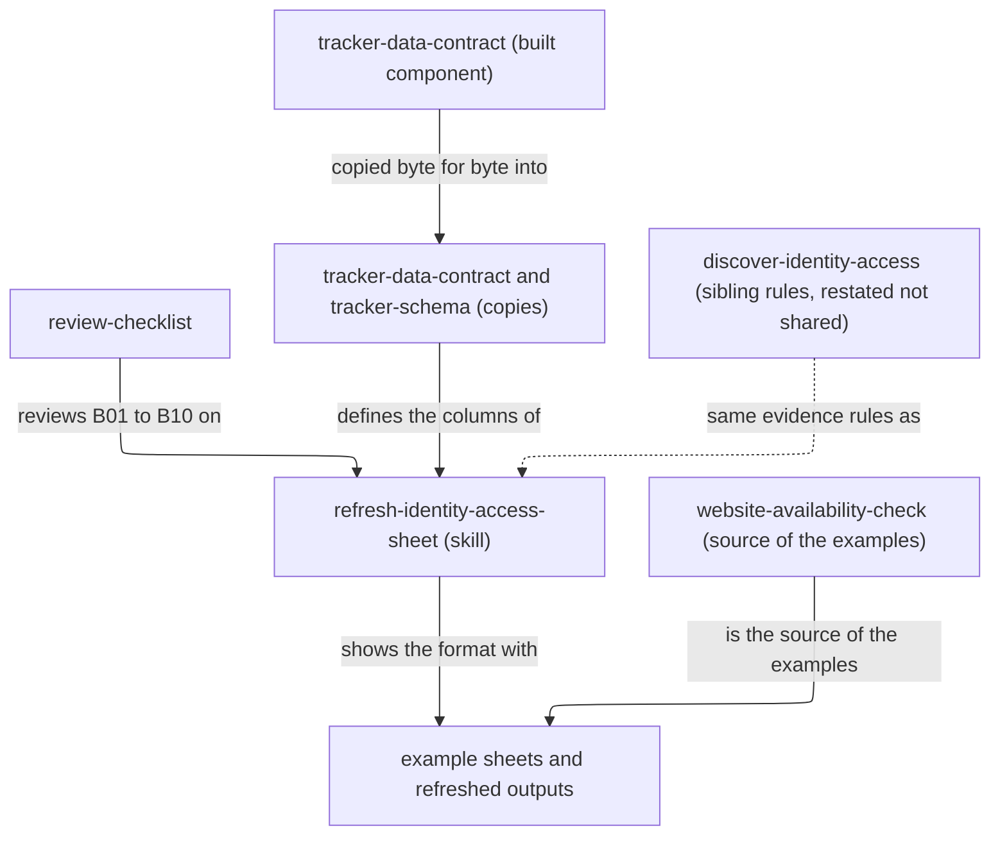
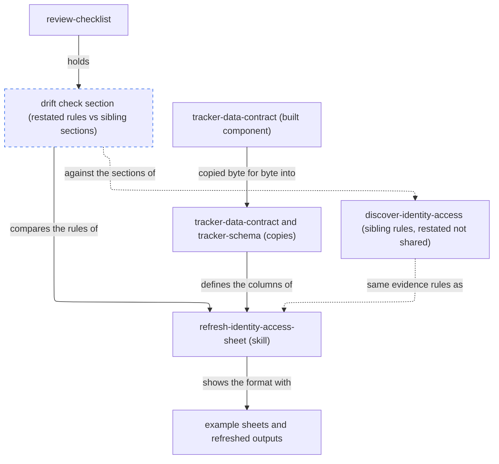

# Identity Access Sheet Refresh

## Purpose

A GitHub Copilot agent skill that takes one vendor's hand-filled Identity & Access sheet, saved as CSV, and the source of the use cases in it, and writes a separate CSV in the sheet's own columns with values corrected from the source, missing endpoints added and evidence filled, so developers can paste it back into the sheet as a quick stopgap.

## Navigation

[Job Behavior Specifications](../README.md#navigation) / **Identity Access Sheet Refresh**

- [Design](#design)
  - [Diagram](#diagram)
- [Behavior](#behavior)
- [Relationships](#relationships)
- [Links](#links)

## Design

The component delivers one skill folder, [refresh-identity-access-sheet](refresh-identity-access-sheet/SKILL.md), and one internal checklist, [review-checklist](review-checklist.md), which sits beside the folder so Copilot does not load it. The folder holds the instructions written once ([SKILL.md](refresh-identity-access-sheet/SKILL.md)), byte-identical copies of the contract ([tracker-data-contract.md](refresh-identity-access-sheet/tracker-data-contract.md)) and the schema ([tracker-schema.csv](refresh-identity-access-sheet/tracker-schema.csv)) from the Tracker Data Contract, and two fictional example pairs for the website availability check use case under `Example Vendor`.

The skill is run in Copilot chat once per vendor sheet, or per use case when a lead splits a large sheet. Its inputs are the sheet saved as CSV (with the tracker's own Identity & Access headings), the source and configuration of each use case in it, `external_tools.md` and `logic.md` where present, a developer-given map from each `use_case_ref` to a folder (the index row `folder` when none is given), and the scope. It reads evidence by the rules of `discover-identity-access`, restated because the folder is self-contained, pairs each sheet row with a finding by use case, endpoint and environment in three tiers (exact, loose and unambiguous, otherwise), and writes `access-sheet-refresh/<sheet-stem>[-<scope>]-refreshed.csv`: the sheet's columns in the sheet's order plus a trailing `change` column (`unchanged`, `corrected`, `new`, `not in source`), rows in sheet order with `new` rows after the last row of their use case. It copies human-owned, forbidden, computed and extra columns exactly, marks a row with no evidence `not in source`, withholds secrets, and fills `evidence_refs` with `source:` pointers. It reads the file back and states the result before it reports.

The first example pair ([sheet](refresh-identity-access-sheet/example-access-sheet.csv), [output](refresh-identity-access-sheet/example-access-sheet-refreshed.csv)) shows a `corrected` row (the developer typed a POST that follows redirects and a service login; the source shows an anonymous GET without redirects) and a `not in source` row (a reporting API the source does not show). The second pair ([sheet](refresh-identity-access-sheet/example-ambiguous-sheet.csv), [output](refresh-identity-access-sheet/example-ambiguous-sheet-refreshed.csv)) shows an ambiguous case: `prod` and `test` rows both loosely match the one finding, so nothing is paired, both rows are `not in source` and the finding is a `new` row. No example shows `unchanged`, because the source has one finding; the skill states that a rerun on its own refreshed output, without `change`, gives `unchanged`.

Testing policy: the behaviors are checked by the file review and by the user's manual client-environment testing on real use cases, and are marked `untested: benchmark pending`. No Copilot run has been made for this skill. The example format was checked mechanically with a throwaway script (field counts, header, one final line feed, human-owned and forbidden columns equal to the input, `new` rows blank, every `source:` pointer resolves to lines in `website-availability-check/src/`, copies byte-identical, no Craft term); the script is not kept.

The component writes nothing outside its own folder when built, and the skill never touches the input sheet, the tracker or any proposal file. The root's `Components` row, its `B02` and `B05` and its root test are the parent's to amend, not this component's.

### Diagram

## Behavior

- **B01** When a sheet row and a source finding have the same use case, normalized endpoint and normalized environment, then the output has one row for them: `unchanged` if no tracker cell differs after the source-backed fields are standardized, `corrected` if the source contradicts or standardizes a value or if `evidence_refs` was blank or incomplete and is now filled; a field the source does not show keeps the developer's text. (untested: benchmark pending)
- **B02** When a sheet row and a source finding match only loosely, then the skill pairs them only if the pairing is one-to-one and unambiguous, giving one `corrected` row and naming the loose pairing and what differed in the report; if several rows or findings are candidates, nothing is paired, the sheet row is `not in source`, the finding is a `new` row and the report lists them as a possible match for the developer to decide; a row or finding is never used twice and no duplicate is made. (untested: benchmark pending)
- **B03** When the source shows an endpoint and environment that no sheet row pairs with, then the output adds a `new` row with `use_case_ref` and `vendor` taken from that use case's other sheet rows, every spec field from the source, and every human-owned column other than `use_case_ref`, and every forbidden column, blank. (untested: benchmark pending)
- **B04** When a sheet row has no source evidence (no source for its use case, a missing `external_tools.md` or `logic.md`, or an endpoint nothing in the source shows), then the row is copied unchanged and marked `not in source`, never deleted, corrected or guessed at, and the report lists it with the reason. (untested: benchmark pending)
- **B05** When a row is written, then every human-owned and forbidden column is copied exactly as typed, any column the sheet has beyond the schema is copied through, and the skill never generates a value for a forbidden column. (untested: benchmark pending)
- **B06** When a literal credential appears in the source, the sheet or a document, then the output and the report give only its location and `value withheld`, a secret typed into a sheet cell is replaced by `value withheld` in the output with the cell named in the report, and identity references stay as names with runtime values `unknown`. (untested: benchmark pending)
- **B07** When `evidence_refs` is filled, then it holds `;`-separated `source:<path>#L<a>-L<b>` pointers from the source read, in the form `discover-identity-access` uses; existing non-source pointers in the sheet are kept, and a row resting only on those is not described as source-confirmed. (untested: benchmark pending)
- **B08** When the skill finishes, then it has written one new CSV separate from the input, whose header is the sheet's own columns in the sheet's order plus a trailing `change` column, the report tells the developer to paste only the tracker columns back, and it writes nowhere else, never touches the input sheet, the tracker or any proposal file, and processes only the use cases or vendor the developer names so a lead can split a large sheet. (untested: benchmark pending)
- **B09** When the same inputs are run again, then the output is byte-identical (fixed row order, quoting and line ends), and before reporting the skill reads the file back and checks the field count per row, the quoting, the header, that human-owned columns equal the input exactly, that no secret is present and the one final line feed, fixes any problem and states the result. (untested: benchmark pending)
- **B10** When its folder is read, then it contains no Craft term, needs nothing installed in Copilot chat, and holds byte-identical copies of the contract and schema. (untested: benchmark pending)

## Plan

### Planned Navigation

[Job Behavior Specifications](../README.md#plan) / **Identity Access Sheet Refresh**

- [Planned Design](#planned-design)
  - [Planned Diagram](#planned-diagram)
- [Steps](#steps)
- [Acceptance Mapping](#acceptance-mapping)
- [Assumptions And Open Questions](#assumptions-and-open-questions)
- [Planned Relationships](#planned-relationships)
- [Planned Links](#planned-links)

### Planned Design

A text-only change to the skill, its records and its review checklist; no code and no new behavior (the component stays at ten). The skill restates only part of the evidence rules of the sibling discovery skill, and the missing parts are what a `new` row and a corrected `auth_type` rest on. The skill gains the `auth_type` criteria (a sign-in page, form, session cookie, browser sign-in step or SSO redirect is `website-sign-in`; an authorization header, API key, token, client identifier and secret or an SDK client created with credentials is `api-credential`; a certificate, key file or network allow-list is `other`, described in `observed_access`; no credential in the source is `unknown`, never `other`), the per-type `proposed_access` rules, `permissions_to_confirm` listing every permission the source does not show without ever guessing a permission or scope, the `unknowns` list rules including the exact text `reuse of an existing CI identity: unconfirmed`, the `NAME (runtime value unknown)` form with no value taken from a runtime, a log or a CI setting, and the document-only prefix rule. The review checklist gains a drift section: one row per restated rule with the sibling section it must match, the deliberate differences that must stay, and a pass rule. The skill folder never names the sibling skill; the checklist, outside the folder, does.

Planned wording of the amended behaviors (B04, B05, B08 and B09 are unchanged):

- **B01** When a sheet row and a source finding have the same use case, normalized endpoint and normalized environment, then the output has one row for them: `unchanged` if no tracker cell differs after the source-backed fields are standardized, `corrected` if the source contradicts or standardizes a value, if `evidence_refs` was blank or incomplete and is now filled, if a blank `unknowns` is filled, or if `auth_type` is set or corrected; a field the source does not show keeps the developer's text, except that when `auth_type` is set or corrected the row's `proposed_access` is rewritten to the request that type calls for and its `permissions_to_confirm` keeps the developer's entries and adds the permissions the source does not show, and a blank `unknowns` is filled with what the source does not show, never guessing a permission or scope.
- **B03** When the source shows an endpoint and environment that no sheet row pairs with, then the output adds a `new` row with `use_case_ref` and `vendor` taken from that use case's other sheet rows, every spec field from the source, `auth_type` from the evidence (`unknown` where none), `proposed_access` and `permissions_to_confirm` by the rules of that type with every permission the source does not show listed, `unknowns` listing what the source does not show including `reuse of an existing CI identity: unconfirmed`, and every human-owned column other than `use_case_ref`, and every forbidden column, blank.
- **B06** When a literal credential appears in the source, the sheet or a document, then the output and the report give only its location and `value withheld`, a secret typed into a sheet cell is replaced by `value withheld` in the output with the cell named in the report, `identity_reference` holds names written as `NAME (runtime value unknown)` and never a value taken from a runtime, a log or a CI setting, and reuse of an existing CI identity is listed in `unknowns` as `reuse of an existing CI identity: unconfirmed` and never stated as certain.
- **B07** When `evidence_refs` is filled, then it holds `;`-separated `source:<path>#L<a>-L<b>` pointers from the source read; existing non-source pointers in the sheet are kept, and a row resting only on those is not described as source-confirmed; a `not in source` row, copied exactly as typed, keeps its `observed_access` and its prefix (`From a supporting document, not confirmed in source:` or `From a supplied observation, not confirmed in source:`) as typed, and a paired row that gains a `source:` pointer loses that prefix once the source shows the observed access.
- **B10** When its folder is read, then it contains no Craft term, does not name any other skill, needs nothing installed in Copilot chat, and holds byte-identical copies of the contract and schema; and the evidence rules it restates match the sibling's sections except the listed deliberate differences, as the checklist's drift section checks.

Examples: only the `corrected` row of `example-access-sheet-refreshed.csv` changes (its blank `auth_type` becomes `unknown`, its `proposed_access` becomes the conditional wording of the ambiguous example's `new` row, its `permissions_to_confirm` adds what the source does not show, and its blank `unknowns` is filled); the ambiguous pair and the input sheet already comply.

#### Planned Diagram

### Steps

1. `refresh-identity-access-sheet/SKILL.md`, text only; it names no other skill and no Craft term, and puts each restated rule in its own words so it matches the sibling in meaning:
   - Reading the evidence: replace the `auth_type` line with the four criteria; add a "Proposed access and permissions" subsection (the per-type `proposed_access` wording, `permissions_to_confirm` listing every permission the source does not show, never guessing a permission or scope; on a `new` row fill all of it; on a paired row rewrite `proposed_access` when this run sets or corrects `auth_type` or when it is blank, keep the developer's `permissions_to_confirm` entries and add the missing ones, and otherwise leave the developer's text); add an "Unknowns" rule (a `;`-list of what the evidence does not show, the exact text `reuse of an existing CI identity: unconfirmed` where a pipeline or build identity could serve, a blank `unknowns` filled on a paired row and a non-blank one kept as typed, `unknown_owner` not suggested, and the report noting when a filled `unknowns` no longer lines up with a typed `unknown_owner`).
   - Identities and secrets: the `NAME (runtime value unknown)` form; never a value from a runtime, a log or a CI setting; the CI bullet points to the exact `unknowns` text.
   - Evidence pointers: the prefix rule (a `not in source` row is copied exactly as typed, prefix included; a paired row that gains a `source:` pointer drops the prefix only when the source shows the observed access; a `new` row has no prefix).
   - The `change` column: `auth_type` set or corrected and a filled blank `unknowns` count as `corrected`; the `new` row field rules.
   - Report part 3 also lists rows whose `proposed_access` was rewritten because `auth_type` changed, by row and column only; "Always" describes the changed example.
2. `review-checklist.md`: add the drift section (see below) after the rules item, amend the items for B01, B03, B06, B07 and B10 to the new wording, and add "the folder does not name the sibling skill" to the rules item.
3. Examples in `refresh-identity-access-sheet/`: change only the `corrected` row of `example-access-sheet-refreshed.csv` as in Planned Design; leave the other three example files; rerun the mechanical check (field counts, header, human and forbidden columns equal to the input, `source:` pointers resolve, one final line feed, no Craft term).
4. `README.md`: amend B01, B03, B06, B07 and B10 as in Planned Design; update the Design paragraph on the first example pair; say that the checklist holds a drift check against the sibling; draw the drift section in the Diagram; extend the Relationships line for the sibling with "checked by the review checklist's drift section"; dissolve this Plan.
5. `requirements.md`: add the rules for `auth_type`, `proposed_access`, `permissions_to_confirm`, `unknowns`, identities and the prefix to "Must match the source" and the acceptance lines for B01, B03, B06, B07 and B10.
6. `contract.md`: add the `NAME (runtime value unknown)` form to "Handling of identities" and the rows whose `proposed_access` was rewritten for a changed `auth_type` to "Report parts".
7. Do not touch the contract and schema copies; confirm with `cmp` that they still equal the Tracker Data Contract's files, and search the folder for Craft terms and for the sibling's name.

The drift section of the checklist holds: when to run it (on any review of this folder, and whenever the sibling's evidence sections change); a table with one row per restated rule (fields written and never guessing; the `service`, `endpoint`, `environment` and `observed_operations` rules; the pointer forms, the document-only prefix and dropping it; identities and secrets with the exact CI text and `NAME (runtime value unknown)`; the four `auth_type` definitions; the per-type `proposed_access` and `permissions_to_confirm`; the `unknowns` rules), each with the refresh section, the sibling section and pass or fail; the deliberate differences that must stay (no shared flag computation, no `request_status` or `unknown_owner` suggestion, no `ready-to-raise`, `use_case_ref` filled on `new` rows, no revision in pointers, a `not in source` row copied exactly as typed, `proposed_access` rewritten on a paired row only when `auth_type` is set or corrected or blank); the pass rule (every restated rule matches in meaning and in the exact fixed strings, any other difference is listed as deliberate or fixed in this skill only); and the limit that the comparison is manual with no tool and no Copilot run.

### Acceptance Mapping

| Acceptance | Behaviors | Step | Check |
| --- | --- | --- | --- |
| A paired row with a corrected `auth_type` is `corrected` with the rules for that type applied | B01 | 1, 3 | `[B01]` checklist item and a read of the changed example row |
| A `new` row carries the rules for `auth_type`, `proposed_access`, `permissions_to_confirm` and `unknowns` | B03 | 1, 3 | `[B03]` checklist item and the ambiguous example's `new` row |
| Identity form, prefix, byte-equal `not in source` rows, drift section and self-containment | B06, B07, B10 | 1, 2, 7 | `[B06]`, `[B07]`, `[B10]` checklist items, the drift table, `cmp` and the folder search |

Validation: the project declares no `configuration.checks`, so none is run; the checks are the mechanical example check, `cmp` of the two copies, the folder search and the review checklist. All behaviors stay marked `untested: benchmark pending`.

### Assumptions And Open Questions

Assumptions (override any in chat):

1. **Policy and scope.** Planned under `deciding-what-to-ask`; a text-only change to this component. The sibling discovery skill, the root and the Tracker Data Contract do not change. Nothing is built.
2. **Confirmed behaviors.** The user confirmed on 2026-11-17: the skill rewrites `proposed_access` when it sets or corrects `auth_type`, and a row is `corrected` when only a blank `unknowns` was filled.
3. **Drift check home (A1).** It lives in this component's `review-checklist.md`, because it is internal and outside the skill folder and may name the sibling. Override: a separate `drift-check.md` beside the checklist.
4. **`proposed_access` rewrite (A2).** On a paired row only when this run sets or corrects `auth_type`, or when it is blank; otherwise the developer's text stays. Override: rewrite on every row, or never.
5. **Kept entries (A3).** The developer's `permissions_to_confirm` entries are kept and the not-shown ones are appended; a non-blank `unknowns` on a paired row is kept as typed and only a blank one is filled. Override: replace or append.
6. **Prefix (A4).** Dropped only when the source shows the observed access; if the source is silent, the text and prefix stay. Override: drop it whenever a `source:` pointer is added.
7. **`unknown_owner` (A5).** Still copied as typed; a filled `unknowns` may then not line up with it, and the report says so. Override: leave `unknowns` untouched on paired rows.
8. **Amended behaviors (A6).** B01, B03, B06, B07 and B10; B04 is unchanged because it already says a `not in source` row is copied as typed. Override: move the clauses between behaviors.
9. **Examples (A7).** Only the first refreshed example's `corrected` row changes. Override: also change the ambiguous pair.
10. **Records (A8).** The README, requirements and contract are amended in step with the skill because they record the same behavior.
11. **Deliberate differences.** No shared-flag computation, no `request_status` or `unknown_owner` suggestion, no `ready-to-raise`, `use_case_ref` filled on `new` rows, no revision in pointers.
12. **Sibling note.** An optional one-line note in the discovery skill's review checklist (a change to its evidence sections needs a check of this component's drift section) is recorded as a backlog item, not planned here.

Open questions: none. Both behavior questions were confirmed by the user on 2026-11-17.

### Planned Relationships

- [Identity Access Discovery](../identity-access-discovery/README.md#purpose) — the evidence rules this skill restates; the checklist's drift section compares them with its sections, and it is not edited here.
- [Tracker Data Contract](../tracker-data-contract/README.md#purpose) — the contract and schema copies stay byte-identical.

### Planned Links

- [requirements.md](requirements.md#planned-change-restated-evidence-rules-and-drift-check) — what the change must do, with the planned change section.
- [contract.md](contract.md#planned-change-restated-evidence-rules-and-drift-check) — the contract, with the planned change section.

## Relationships

- [Tracker Data Contract](../tracker-data-contract/README.md#purpose) — the Identity & Access columns, owner classes and pointer forms the skill follows, copied into its folder.
- [Identity Access Discovery](../identity-access-discovery/README.md#purpose) — the evidence, secret and pointer rules the skill restates and keeps the same as.
- [Website Availability Check](../website-availability-check/README.md#purpose) — the read-only source the example rows are derived from.

## Links

- [refresh-identity-access-sheet/SKILL.md](refresh-identity-access-sheet/SKILL.md) — the skill's instructions.
- [review-checklist.md](review-checklist.md) — the internal review items, one per behavior.
- [requirements.md](requirements.md#requirements) — what the component must do and what it need not.
- [contract.md](contract.md#contract) — the matching rules, the `change` values, the output file and the report.
