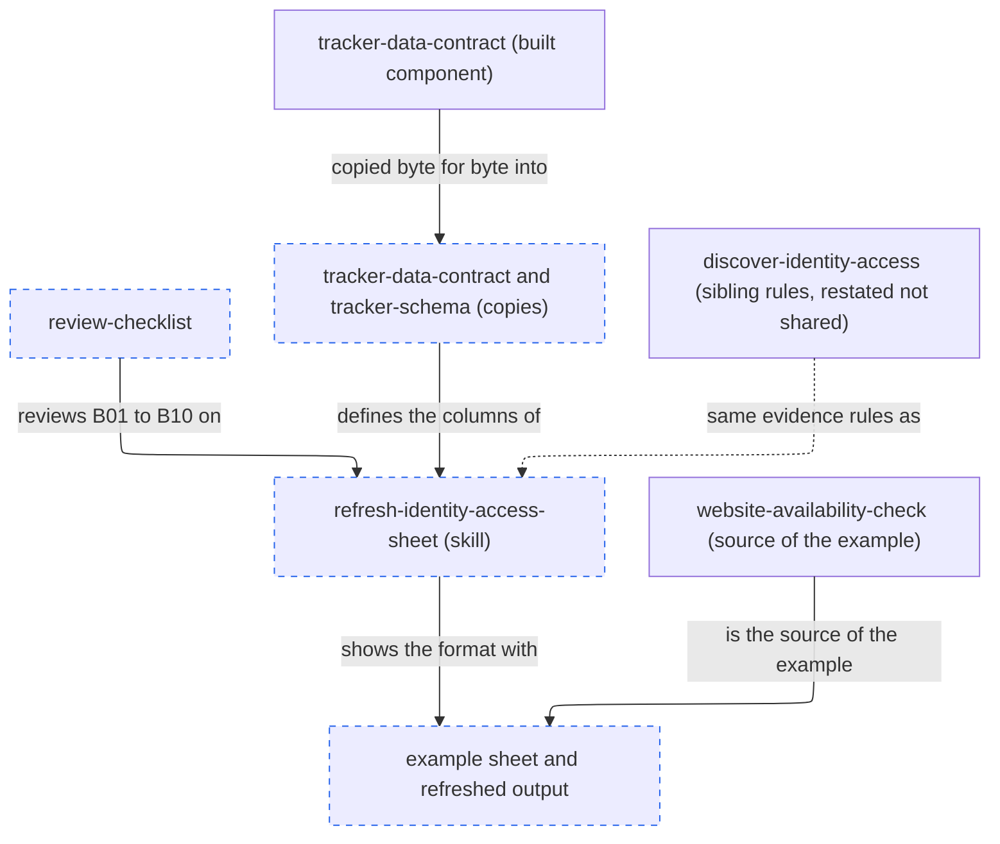

# Identity Access Sheet Refresh

## Purpose

A GitHub Copilot agent skill that takes one vendor's hand-filled Identity & Access sheet, saved as CSV, and the source of the use cases in it, and writes a separate CSV in the sheet's own columns with values corrected from the source, missing endpoints added and evidence filled, so developers can paste it back into the sheet as a quick stopgap.

## Navigation

[Job Behavior Specifications](../README.md#navigation) / **Identity Access Sheet Refresh**

- [Design](#design)
- [Behavior](#behavior)
- [Plan](#plan)
- [Relationships](#relationships)
- [Links](#links)

## Design

Not built yet.

## Behavior

- **B01** When a sheet row and a source finding have the same use case, normalized endpoint and normalized environment, then the output has one row for them: `unchanged` if no tracker cell differs after the source-backed fields are standardized, `corrected` if the source contradicts or standardizes a value or if `evidence_refs` was blank or incomplete and is now filled; a field the source does not show keeps the developer's text. (untested: benchmark pending)
- **B02** When a sheet row and a source finding match only loosely, then the skill pairs them only if the pairing is one-to-one and unambiguous, giving one `corrected` row and naming the loose pairing and what differed in the report; if several rows or findings are candidates, nothing is paired, the sheet row is `not in source`, the finding is a `new` row and the report lists them as a possible match for the developer to decide; a row or finding is never used twice and no duplicate is made. (untested: benchmark pending)
- **B03** When the source shows an endpoint and environment that no sheet row pairs with, then the output adds a `new` row with `use_case_ref` and `vendor` taken from that use case's other sheet rows, every spec field from the source, and every human-owned and forbidden column blank. (untested: benchmark pending)
- **B04** When a sheet row has no source evidence (no source for its use case, a missing `external_tools.md` or `logic.md`, or an endpoint nothing in the source shows), then the row is copied unchanged and marked `not in source`, never deleted, corrected or guessed at, and the report lists it with the reason. (untested: benchmark pending)
- **B05** When a row is written, then every human-owned and forbidden column is copied exactly as typed, any column the sheet has beyond the schema is copied through, and the skill never generates a value for a forbidden column. (untested: benchmark pending)
- **B06** When a literal credential appears in the source, the sheet or a document, then the output and the report give only its location and `value withheld`, a secret typed into a sheet cell is replaced by `value withheld` in the output with the cell named in the report, and identity references stay as names with runtime values `unknown`. (untested: benchmark pending)
- **B07** When `evidence_refs` is filled, then it holds `;`-separated `source:<path>#L<a>-L<b>` pointers from the source read, in the form `discover-identity-access` uses; existing non-source pointers in the sheet are kept, and a row resting only on those is not described as source-confirmed. (untested: benchmark pending)
- **B08** When the skill finishes, then it has written one new CSV separate from the input, whose header is the sheet's own columns in the sheet's order plus a trailing `change` column, the report tells the developer to paste only the tracker columns back, and it writes nowhere else, never touches the input sheet, the tracker or any proposal file, and processes only the use cases or vendor the developer names so a lead can split a large sheet. (untested: benchmark pending)
- **B09** When the same inputs are run again, then the output is byte-identical (fixed row order, quoting and line ends), and before reporting the skill reads the file back and checks the field count per row, the quoting, the header, that human-owned columns equal the input exactly, that no secret is present and the one final line feed, fixes any problem and states the result. (untested: benchmark pending)
- **B10** When its folder is read, then it contains no Craft term, needs nothing installed in Copilot chat, and holds byte-identical copies of the contract and schema. (untested: benchmark pending)

## Plan

### Planned Navigation

[Job Behavior Specifications](../README.md#plan) / **Identity Access Sheet Refresh**

- [Planned Design](#planned-design)
  - [Planned Diagram](#planned-diagram)
- [Steps](#steps)
- [Acceptance Mapping](#acceptance-mapping)
- [Assumptions And Open Questions](#assumptions-and-open-questions)
- [Planned Relationships](#planned-relationships)
- [Planned Links](#planned-links)

### Planned Design

One skill folder, `refresh-identity-access-sheet`, holds the instructions written once (`SKILL.md`), byte-identical copies of the contract (`tracker-data-contract.md`) and the schema (`tracker-schema.csv`) from the Tracker Data Contract, and a fictional example pair for the website use case under `Example Vendor`: a hand-typed sheet (`example-access-sheet.csv`) and the expected output (`example-access-sheet-refreshed.csv`), written from the real source in `website-availability-check/src/` and covering `unchanged`, `corrected`, `new` and `not in source` rows. The internal `review-checklist.md` sits beside the folder, as in the sibling skills, so Copilot does not load it.

The skill is run in Copilot chat once per vendor sheet, or per use case when a lead splits a large sheet. Its inputs are the sheet saved as CSV (it carries the tracker's own Identity & Access column headings), the source and configuration of each use case in it, and `external_tools.md` and `logic.md` where present. A use case is identified by the sheet's `use_case_ref`, and the developer states once which folder each value belongs to; with no folder given, the use case's index row `folder` is the lookup. It reads evidence by the rules of `discover-identity-access` (restated, because the folder is self-contained), pairs each sheet row with a source finding by use case, endpoint and environment with the tiers in `contract.md`, and writes `access-sheet-refresh/<sheet-stem>[-<scope>]-refreshed.csv`: the sheet's columns in the sheet's order plus a trailing `change` column, rows in sheet order with `new` rows after the last row of their use case. It copies human-owned and forbidden columns exactly, marks a row with no evidence `not in source`, withholds secrets and fills `evidence_refs` with `source:` pointers. It reads the file back before reporting.

The component writes nothing outside its own folder when built, and the skill never touches the input sheet, the tracker or any proposal file. The root records the new component in its `Components` table and its own plan; the root's `B02` and `B05` and the root tests are the parent's to amend, not this component's.

#### Planned Diagram

### Steps

1. Create `README.md` (Design, diagram and behaviors as built), `requirements.md`, `contract.md` (the matching key and normalization, the `change` values, the output file name and row order, the report parts) and the task narrative in this folder.
2. Copy `tracker-data-contract.md` and `tracker-schema.csv` byte for byte from `tracker-data-contract/` into `refresh-identity-access-sheet/`.
3. Write `refresh-identity-access-sheet/SKILL.md`: inputs; the ownership classes read from the schema; the key and matching rules; the four `change` values; the evidence, secret, identity and authentication rules and the `source:` pointer form, restated; the output file, row order and scope; the self-check; and the report.
4. Add `example-access-sheet.csv` (a fictional hand-typed sheet for the website check use case under `Example Vendor`) and `example-access-sheet-refreshed.csv` (the expected output), written from the real source in `website-availability-check/src/`. Check mechanically that the pointers resolve to real line ranges and that human-owned columns are byte-equal.
5. Write `review-checklist.md` with one internal item per behavior, then dissolve this Plan into Design.

### Acceptance Mapping

| Acceptance | Behaviors | Step | Check |
| --- | --- | --- | --- |
| One row per use case, endpoint and environment with the right `change` value, and no duplicate from a loose or ambiguous match | B01, B02, B03, B04 | 3, 4 | review-checklist `[B01]` to `[B04]` on the example pair |
| Human-owned and forbidden columns are byte-equal to the input and no forbidden value is generated | B05 | 3, 4 | mechanical example check, `[B05]` |
| No secret value appears in the output or the report | B06 | 3 | review-checklist `[B06]` |
| `source:` pointers resolve, the output is a new CSV with the sheet's header plus `change`, nothing else is written, and a scoped run writes only that scope | B07, B08 | 3, 4 | mechanical example check and `[B07]`, `[B08]` |
| A rerun is byte-identical, the self-check result is stated, and the folder has no Craft term and byte-identical copies | B09, B10 | 2, 3 | file scan and copy comparison, `[B09]`, `[B10]` |

### Assumptions And Open Questions

Assumptions (override any in chat):

1. **Policy and scope.** Planned under `deciding-what-to-ask`; the request is the backlog item `access-sheet-refresh-skill`, an urgent stopgap before `adopt-manual-access-records`. The behaviors were confirmed as proposed by the user's go-ahead on 2026-11-17. Nothing is built.
2. **Use case identification.** The sheet carries the tracker's own Identity & Access columns, which have `use_case_ref` and no use case name, so a use case is identified by `use_case_ref` plus a developer-given map from each value to a folder. Override by naming another identifying column in the skill.
3. **Where a use case's files are.** The use case folder holds its source, `external_tools.md` and `logic.md` (the user chose the use case folder on 2026-11-17 for specifications); the index row's `folder` is the lookup when the developer gives no folder. A use case with no folder has its rows marked `not in source`.
4. **Placement and name.** A new component at `identity-access-sheet-refresh/` beside `identity-access-discovery`, with the skill folder `refresh-identity-access-sheet`. Override by naming another folder.
5. **Copies.** The contract and schema are byte-identical copies in the folder, as in the sibling skills. Override by linking to the contract instead.
6. **Output file.** `access-sheet-refresh/<sheet-stem>[-<scope>]-refreshed.csv`; the developer may name another path. The developer names the use cases or vendor in scope and the output holds only those rows. Override by copying out-of-scope rows through unchanged.
7. **Row order.** Sheet order is kept; `new` rows follow the last row of their use case, ordered by endpoint then environment.
8. **`change` values.** Filling `evidence_refs` counts as `corrected`, so most matched rows will be `corrected`. Override by calling a row `unchanged` when only `evidence_refs` was filled.
9. **Contradiction rule.** A spec field is rewritten only where the source shows a concrete different value; where the source is silent the developer's text stays.
10. **New rows.** `unknown_owner` and `request_status` stay blank, so nothing is invented. Override by letting the skill suggest `proposed` or `ready-to-raise` under the sibling's rules.
11. **Internal columns.** `shared_request_flag` and `shared_with` are not computed (the sheet has no internal columns); they are copied through if present. Only `source:` pointers are generated; existing `document:` and `dependency:` pointers are kept.
12. **Testing.** File review and the user's manual client-environment testing; no Copilot result is claimed. The skill needs no scripts, no install and has no checks of its own.
13. **Parent-owned changes.** The root's `Components` row and diagram, its `B02` and `B05` wording, the root test that compares the contract and schema copies, and the backlog row are the parent's to change and are recorded as bounded requests to the root, not edited here.

Open questions: none.

### Planned Relationships

- [Tracker Data Contract](../tracker-data-contract/README.md#purpose) — the Identity & Access columns, owner classes and proposal pointer forms the skill follows, copied into its folder.
- [Identity Access Discovery](../identity-access-discovery/README.md#purpose) — the evidence, secret and pointer rules the skill restates and keeps the same as.
- [Website Availability Check](../website-availability-check/README.md#purpose) — the read-only source the example rows are derived from.

### Planned Links

- [requirements.md](requirements.md#requirements) — what the component must do and what it need not.
- [contract.md](contract.md#contract) — the matching rules, the `change` values, the output file and the report.

## Relationships

None yet. The Plan above names the planned relationships.

## Links

- [requirements.md](requirements.md#requirements) — what the component must do and what it need not.
- [contract.md](contract.md#contract) — the shapes, formats and wording rules.
