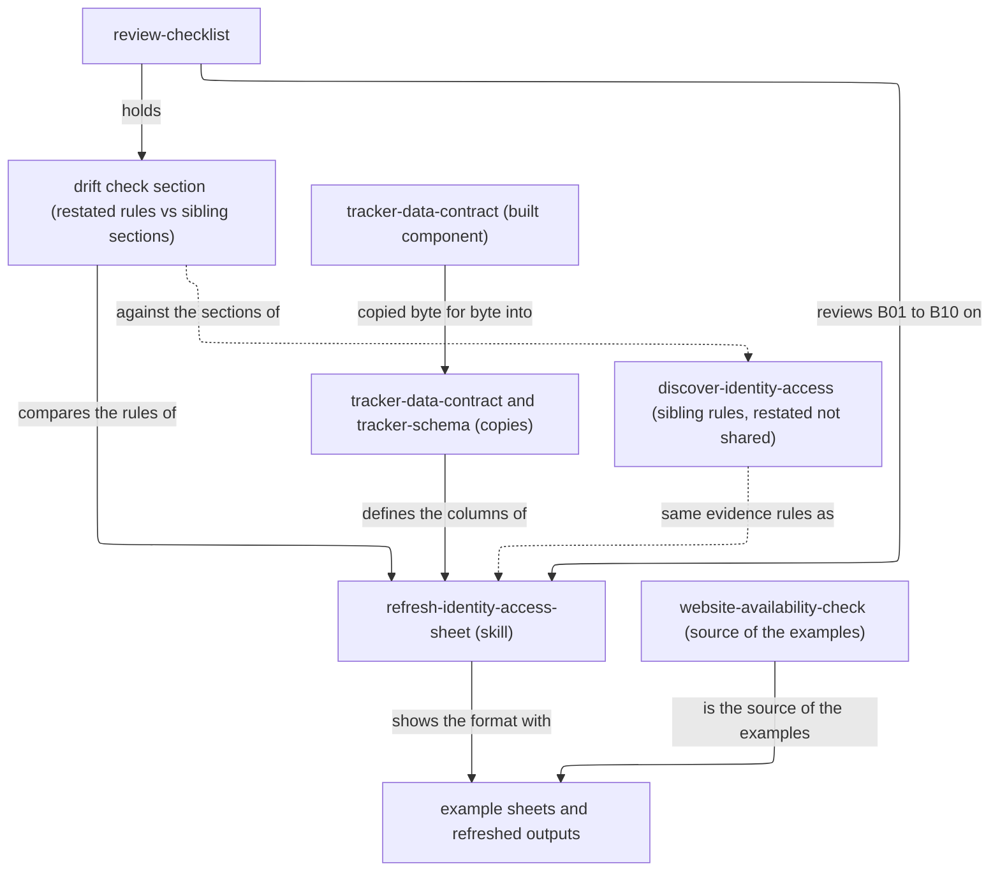

# Identity Access Sheet Refresh

## Purpose

A GitHub Copilot agent skill that takes one vendor's hand-filled Identity & Access sheet, saved as CSV, and the source of the use cases in it, and writes a separate CSV in the sheet's own columns with values corrected from the source, missing endpoints added and evidence filled, so developers can paste it back into the sheet as a quick stopgap.

## Navigation

[Job Behavior Specifications](../README.md#navigation) / **Identity Access Sheet Refresh**

- [Design](#design)
  - [Diagram](#diagram)
- [Behavior](#behavior)
- [Relationships](#relationships)
- [Links](#links)

## Design

The component delivers one skill folder, [refresh-identity-access-sheet](refresh-identity-access-sheet/SKILL.md), and one internal checklist, [review-checklist](review-checklist.md), which sits beside the folder so Copilot does not load it. The folder holds the instructions written once ([SKILL.md](refresh-identity-access-sheet/SKILL.md)), byte-identical copies of the contract ([tracker-data-contract.md](refresh-identity-access-sheet/tracker-data-contract.md)) and the schema ([tracker-schema.csv](refresh-identity-access-sheet/tracker-schema.csv)) from the Tracker Data Contract, and two fictional example pairs for the website availability check use case under `Example Vendor`.

The skill is run in Copilot chat once per vendor sheet, or per use case when a lead splits a large sheet. Its inputs are the sheet saved as CSV (with the tracker's own Identity & Access headings), the source and configuration of each use case in it, `external_tools.md` and `logic.md` where present, a developer-given map from each `use_case_ref` to a folder (the index row `folder` when none is given), and the scope. It reads evidence by the rules of `discover-identity-access`, restated because the folder is self-contained (the `auth_type` criteria, the per-type `proposed_access` wording, `permissions_to_confirm` listing every permission the source does not show, the `unknowns` rules with the exact text `reuse of an existing CI identity: unconfirmed`, the `NAME (runtime value unknown)` form and the document-only prefix), pairs each sheet row with a finding by use case, endpoint and environment in three tiers (exact, loose and unambiguous, otherwise), and writes `access-sheet-refresh/<sheet-stem>[-<scope>]-refreshed.csv`: the sheet's columns in the sheet's order plus a trailing `change` column (`unchanged`, `corrected`, `new`, `not in source`), rows in sheet order with `new` rows after the last row of their use case. It copies human-owned, forbidden, computed and extra columns exactly (listing in the report any human-owned or forbidden value outside its allowed list or format, unchanged), marks a row with no evidence `not in source`, withholds secrets, and fills `evidence_refs` with `source:` pointers. The `auth_type` it writes is always one of the schema's four allowed values: the type the source shows, else the kind the developer's free text unambiguously names, else `unknown`, with the original wording in the report. It rewrites a spec text column only under its rules and never shortens the developer's wording on its own initiative. It reads the file back and states the result before it reports.

The first example pair ([sheet](refresh-identity-access-sheet/example-access-sheet.csv), [output](refresh-identity-access-sheet/example-access-sheet-refreshed.csv)) shows a `corrected` row (the developer typed a POST that follows redirects, a service login and the free-text `auth_type` `public page, no login`; the source shows an anonymous GET without redirects, so `auth_type` becomes `unknown` and `proposed_access`, `permissions_to_confirm` and `unknowns` follow the rules for it) and a `not in source` row (a reporting API the source does not show). The second pair ([sheet](refresh-identity-access-sheet/example-ambiguous-sheet.csv), [output](refresh-identity-access-sheet/example-ambiguous-sheet-refreshed.csv)) shows an ambiguous case: `prod` and `test` rows both loosely match the one finding, so nothing is paired, both rows are `not in source` and the finding is a `new` row. No example shows `unchanged`, because the source has one finding; the skill states that a rerun on its own refreshed output, without `change`, gives `unchanged`. No example shows the mapping of a clear free text to `website-sign-in` or `api-credential`, because the sample source has no sign-in or API credential; the checklist covers it by reading.

The review checklist also holds a drift check: one row per restated rule with the sibling section it must match, the deliberate differences that must stay (no shared-flag computation, no `request_status` or `unknown_owner` suggestion, no `ready-to-raise`, `use_case_ref` filled on `new` rows, no revision in pointers) and a pass rule. The skill folder never names the sibling skill; the checklist, outside the folder, does. The example CSVs were compared column by column with the sample workbook's Identity & Access rows for style and value form; where the sample and the sibling differ in a fixed form (the sample's `Variable NAME (name only)` and specification pointer against `NAME (runtime value unknown)` and `source:` pointers), the sibling's form and the schema win.

Testing policy: the behaviors are checked by the file review and by the user's manual client-environment testing on real use cases, and are marked `untested: benchmark pending`. No Copilot run has been made for this skill. The example format was checked mechanically with a throwaway command (field counts, header, one final line feed, human-owned and forbidden columns equal to the input, `new` rows blank, `auth_type` an allowed value, copies byte-identical, no Craft term); the script is not kept.

The component writes nothing outside its own folder when built, and the skill never touches the input sheet, the tracker or any proposal file. The root's `Components` row, its `B02` and `B05` and its root test are the parent's to amend, not this component's.

### Diagram

## Behavior

- **B01** When a sheet row and a source finding have the same use case, normalized endpoint and normalized environment, then the output has one row for them: `unchanged` if no tracker cell differs after the source-backed fields are standardized, `corrected` if the source contradicts or standardizes a value, if `evidence_refs` was blank or incomplete and is now filled, if a blank `unknowns` is filled, or if `auth_type` is set or corrected; a field the source does not show keeps the developer's text, except that when `auth_type` is set or corrected the row's `proposed_access` is rewritten to the request that type calls for and its `permissions_to_confirm` keeps the developer's entries and adds the permissions the source does not show, and a blank `unknowns` is filled with what the source does not show, never guessing a permission or scope; the output's `auth_type` is always one of `website-sign-in`, `api-credential`, `other` or `unknown`, being the type the source shows, else the kind the developer's free text unambiguously names where the source is silent, else `unknown`, with the row `corrected` and the report listing the developer's original wording by row and column; and a spec text column is rewritten only under these rules, never shortened on the skill's own initiative. (untested: benchmark pending)
- **B02** When a sheet row and a source finding match only loosely, then the skill pairs them only if the pairing is one-to-one and unambiguous, giving one `corrected` row and naming the loose pairing and what differed in the report; if several rows or findings are candidates, nothing is paired, the sheet row is `not in source`, the finding is a `new` row and the report lists them as a possible match for the developer to decide; a row or finding is never used twice and no duplicate is made. (untested: benchmark pending)
- **B03** When the source shows an endpoint and environment that no sheet row pairs with, then the output adds a `new` row with `use_case_ref` and `vendor` taken from that use case's other sheet rows, every spec field from the source, `auth_type` from the evidence (`unknown` where none), `proposed_access` and `permissions_to_confirm` by the rules of that type with every permission the source does not show listed, `unknowns` listing what the source does not show including, where a pipeline or build identity could serve, `reuse of an existing CI identity: unconfirmed`, and every human-owned column other than `use_case_ref`, and every forbidden column, blank. (untested: benchmark pending)
- **B04** When a sheet row has no source evidence (no source for its use case, a missing `external_tools.md` or `logic.md`, or an endpoint nothing in the source shows), then the row is copied unchanged and marked `not in source`, never deleted, corrected or guessed at, and the report lists it with the reason. (untested: benchmark pending)
- **B05** When a row is written, then every human-owned and forbidden column is copied exactly as typed, any column the sheet has beyond the schema is copied through, the skill never generates a value for a forbidden column, and the report lists every value in a human-owned or forbidden column that is outside its allowed list or format (a `request_status` or `verification` outside its list, a date that is not `YYYY-MM-DD`, an `expected_availability` that is neither a date nor `unknown`) by row and column, without changing it. (untested: benchmark pending)
- **B06** When a literal credential appears in the source, the sheet or a document, then the output and the report give only its location and `value withheld`, a secret typed into a sheet cell is replaced by `value withheld` in the output with the cell named in the report, `identity_reference` holds names written as `NAME (runtime value unknown)` and never a value taken from a runtime, a log or a CI setting, and reuse of an existing CI identity is listed in `unknowns` as `reuse of an existing CI identity: unconfirmed` and never stated as certain. (untested: benchmark pending)
- **B07** When `evidence_refs` is filled, then it holds `;`-separated `source:<path>#L<a>-L<b>` pointers from the source read; existing non-source pointers in the sheet are kept, and a row resting only on those is not described as source-confirmed; a `not in source` row, copied exactly as typed, keeps its `observed_access` and its prefix (`From a supporting document, not confirmed in source:` or `From a supplied observation, not confirmed in source:`) as typed, and a paired row that gains a `source:` pointer loses that prefix once the source shows the observed access. (untested: benchmark pending)
- **B08** When the skill finishes, then it has written one new CSV separate from the input, whose header is the sheet's own columns in the sheet's order plus a trailing `change` column, the report tells the developer to paste only the tracker columns back, and it writes nowhere else, never touches the input sheet, the tracker or any proposal file, and processes only the use cases or vendor the developer names so a lead can split a large sheet. (untested: benchmark pending)
- **B09** When the same inputs are run again, then the output is byte-identical (fixed row order, quoting and line ends), and before reporting the skill reads the file back and checks the field count per row, the quoting, the header, that human-owned columns equal the input exactly, that no secret is present and the one final line feed, fixes any problem and states the result. (untested: benchmark pending)
- **B10** When its folder is read, then it contains no Craft term, does not name any other skill, needs nothing installed in Copilot chat, and holds byte-identical copies of the contract and schema; and the evidence rules it restates match the sibling's sections except the listed deliberate differences, as the checklist's drift section checks, including the allowed `auth_type` values and the shapes of the spec text columns. (untested: benchmark pending)

## Relationships

- [Tracker Data Contract](../tracker-data-contract/README.md#purpose) — the Identity & Access columns, owner classes and pointer forms the skill follows, copied into its folder.
- [Identity Access Discovery](../identity-access-discovery/README.md#purpose) — the evidence, secret and pointer rules the skill restates and keeps the same as, checked by the review checklist's drift section; not edited here.
- [Website Availability Check](../website-availability-check/README.md#purpose) — the read-only source the example rows are derived from.

## Links

- [refresh-identity-access-sheet/SKILL.md](refresh-identity-access-sheet/SKILL.md) — the skill's instructions.
- [review-checklist.md](review-checklist.md) — the internal review items, one per behavior, and the drift check against the sibling.
- [requirements.md](requirements.md#requirements) — what the component must do and what it need not.
- [contract.md](contract.md#contract) — the matching rules, the `change` values, the output file and the report.
