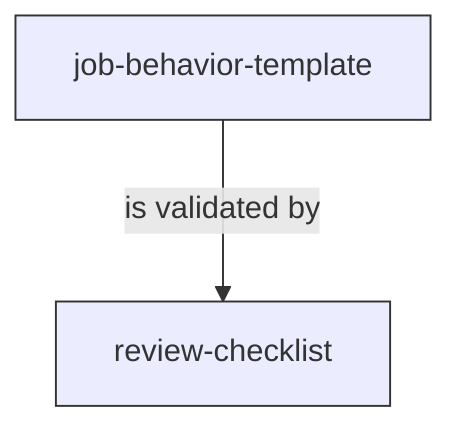
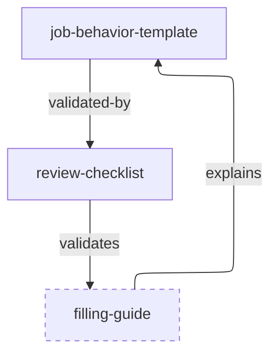

# Job Behavior Template

## Purpose

The blank, reusable form a developer fills in to document one vendor job from its source code, written in plain language for a business reviewer and usable with a text editor or GitHub Copilot alone.

## Navigation

[Job Behavior Specifications](../README.md#navigation) / **Job Behavior Template**

- [Design](#design)
  - [Diagram](#diagram)
- [Behavior](#behavior)
- [Plan](#plan)
- [Relationships](#relationships)
- [Links](#links)

## Design

The component is one Markdown form, [job-behavior-template](job-behavior-template.md), and one internal review checklist, [review-checklist](review-checklist.md). The form is the only file delivered; it carries its own fill-in guidance and mentions no Craft.

Sections of the form, derived from B01 to B10 (also in [contract.md](contract.md#part-list), for review):

1. How to fill in this form (B01, B02, B03)
2. Header with job ID (B04, B07)
3. Change log (B07)
4. What this document says and does not say (B10)
5. Current behavior, `CUR-n` (B02, B03)
6. Assumptions and unknowns, `ASM-n` (B02, B06, B10)
7. Inputs, outputs, parameters, external dependencies (B04)
8. Diagram with plain-text description (B05)
9. Acceptance scenarios with covers lines (B06)
10. Operational context (B09)
11. Acknowledgement, blank (B08)

Assumptions: versions are whole numbers; the vendor never edits the document; the acknowledgement is recorded by our team and left blank by the template; Markdown with a Mermaid diagram; no requested-changes part and no traceability table. The "vendor", "our client" and "our team" terms are defined in the form.

### Diagram

## Behavior

- **B01** When a developer opens the template, then its first part explains in plain language how to fill it in, mentions no Craft and needs no tool beyond a text editor or GitHub Copilot. (untested: benchmark pending)
- **B02** When a job's behavior is recorded, then each statement sits in exactly one of two labelled kinds, current behavior from the source (`CUR-`) or assumptions and unknowns (`ASM-`), and an inferred statement is never recorded as current behavior. (untested: benchmark pending)
- **B03** When a current behavior is entered, then it has an ID, a business-language when/then statement and a pointer to the source evidence, or it is moved to assumptions and unknowns. (untested: benchmark pending)
- **B04** When the contracts are filled in, then the job has a stable job ID and inputs, outputs, parameters (name and this job's value) and external dependencies each have a table, and each dependency states its role and the direction of every call. (untested: benchmark pending)
- **B05** When the diagram is drawn, then the job is one black box and the diagram shows only external systems, outgoing calls and incoming responses, with a plain-text description beside it and no internal modules, classes or architecture. (untested: benchmark pending)
- **B06** When acceptance scenarios are written, then they form their own part, each is given/when/then with a "covers" line naming the current behavior IDs it proves, every current behavior is covered by at least one scenario, and an unknown that gets answered carries a "resolved: now CUR-n" note. (untested: benchmark pending)
- **B07** When a version is issued, then the header holds the use case name, version number, date, status (draft or acknowledged) and source revision with the script link, a change log has one entry per version, and an acknowledged version is never edited in place: a change makes the next version. (untested: benchmark pending)
- **B08** When the vendor's acknowledgement is recorded by our team, then a short block holds the company name, date, version reviewed, script link and revision, a tick box that the supplied script is the one running in production today, one overall confirmation of the current behaviors, a reference to the vendor's own tracker entry or reply, and a plain statement of what the acknowledgement does and does not claim, with no person name or role. (untested: benchmark pending)
- **B09** When operational context is recorded, then schedule and frequency, logging, monitoring and alerts, owner and failure handling each default to unknown until someone confirms them. (untested: benchmark pending)
- **B10** When the document is read, then each unknown is a separate item the vendor answers one by one, the document states it says nothing about how the job will be built or grouped on the migration platform, and it has no similarity, grouping or implementation field. (untested: benchmark pending)

## Plan

### Planned Navigation

[Job Behavior Specifications](../README.md#plan) / **Job Behavior Template**

- [Planned Design](#planned-design)
  - [Planned Diagram](#planned-diagram)
- [Planned Behavior](#planned-behavior)
- [Steps](#steps)
- [Acceptance Mapping](#acceptance-mapping)
- [Assumptions And Open Questions](#assumptions-and-open-questions)
- [Planned Relationships](#planned-relationships)
- [Planned Links](#planned-links)

### Planned Design

The form is revised: no fill-in part, no job ID, a header followed by "About this document" and a contents list before the change log, IDs `B`, `Q` and `AC`, evidence pointers for source or vendor documents, a vertical one-box diagram, linked scenarios, operational context that cites evidence or says `unknown`, and an acknowledgement log. A short `filling-guide.md` carries the guidance that used to open the form. The checklist is revised to match. The built Design above stays the current truth until the build.

#### Planned Diagram

### Planned Behavior

The plan changes these behaviors. The build merges them into `## Behavior` and deletes this subsection.

- **B01** When a document is made from the template, then it contains no fill-in instructions, no Craft reference and no internal job ID, and a separate filling guide explains in plain language how to fill it in and needs only a text editor or GitHub Copilot. (untested: benchmark pending)
- **B02** When a job's behavior is recorded, then each statement sits in exactly one of two kinds, current behavior (`B1`, `B2`, ...) or question (`Q1`, `Q2`, ...), an inferred statement is never recorded as current behavior, and a question is asked only when the source cannot show the answer and the answer would change what the migrated workflow must do. (untested: benchmark pending)
- **B03** When a current behavior is entered, then it has an ID, a business-language when/then statement and an evidence pointer to the source (file and place) or to a vendor-provided document (document and place), and it states no reason, schedule or other fact that the evidence does not show. (untested: benchmark pending)
- **B04** When the contracts are filled in, then inputs, outputs, parameters (name and this job's value) and external dependencies each have a table, each dependency states its role and the direction of every call, and a parameter value that the source states is listed there and is not turned into a question. (untested: benchmark pending)
- **B05** When the diagram is drawn, then the job is one black box with only external systems, outgoing calls and incoming responses, laid out vertically with the project's diagram settings, with the behavior IDs in the edge labels as plain text and a plain-text description beside it that links each ID. (untested: benchmark pending)
- **B06** When acceptance scenarios are written, then they form their own part, each (`AC1`, `AC2`, ...) is given/when/then with a "covers" line that links the behavior rows it proves, every current behavior is covered by at least one scenario, and an answered question carries a "resolved: now Bn" note. (untested: benchmark pending)
- **B07** When a document is issued, then the header holds the use case name, version, date, status (draft or acknowledged) and source revision with the script link and no job ID, an "About this document" part and a contents list with links follow the header before the change log, and the change log has one entry per version in the same file. (untested: benchmark pending)
- **B08** When the vendor acknowledges, then an acknowledgement log has one row per version (company name, date acknowledged, version reviewed, script link and revision, production-script tick box, one overall confirmation, tracker entry or reply reference) with no person name or role, earlier rows are never edited, our team tags the repository at each acknowledgement, and a plain statement says what the acknowledgement does and does not claim. (untested: benchmark pending)
- **B09** When operational context is recorded, then it is its own part and never a current behavior, and each row of schedule and trigger, logging, monitoring and alerts, owner and failure handling cites a vendor document or configuration in the source or says `unknown`. (untested: benchmark pending)
- **B10** When the document is read, then the "About this document" part states its purpose and says nothing about how the job will be built or grouped, each question is a separate item the vendor answers one by one, and there is no similarity, grouping or implementation field. (untested: benchmark pending)

### Steps

1. Revise `job-behavior-template.md`: remove the fill-in part; drop the job ID; put the "About this document" part (purpose and scope) and a contents list after the header and before the change log; use the IDs `B`, `Q`, `AC`; give evidence pointers for source or vendor document; add the question rule as a short note at the questions part; draw the diagram as the project's vertical one-box form with plain-text description and linked IDs; give the acceptance scenarios their "covers" links with anchors; make operational context cite evidence or `unknown`; make the acknowledgement an acknowledgement log. The builder re-derives the part list from the behaviors and records it in `contract.md` and Design for the user to review.
2. Create `filling-guide.md`: a short plain-language guide for people filling the template without Copilot (where to type, the two kinds of statement, the question rule, how to type the acknowledgement, how to tag the repository). It mentions no Craft.
3. Revise `review-checklist.md` with one item per behavior tagged `[B01]` to `[B10]`, left unticked until a fresh dry-run review passes.
4. Rename nothing; keep every file inside this component.

### Acceptance Mapping

| Acceptance condition | Behaviors | Step | Validation check |
| --- | --- | --- | --- |
| Template and filling guide meet B01 to B10 with no fill-in text, Craft reference or job ID | B01–B10 | 1, 2 | review-checklist.md items [B01]–[B10], dry-run review |
| Every checklist item passes in a dry-run review | B01–B10 | 3 | dry-run review by a reviewer who has not seen the document |

Checks: the root declares no automated check for documents. The validation is the component's `review-checklist.md` dry-run review (see the verification gap in `requirements.md`) plus the record validators.

### Assumptions And Open Questions

Assumptions (override any of them in chat before `/craft:build`). This plan follows the user's review of a generated specification on 2026-11-15 and replaces the earlier plan:

1. IDs: current behaviors `B1`, `B2`, ..., questions `Q1`, `Q2`, ..., acceptance scenarios `AC1`, `AC2`, .... `B1` is distinct from this project's component-record behavior IDs (`B01` style) because they are in different files. Override: name another scheme.
2. One file per use case with a version and change log; after acknowledgement a change adds a change-log entry and bumps the version, and our team tags the repository at each acknowledgement (for example `<use-case-name>-v<n>`) so that version is recoverable. This replaces the earlier "one file per version" design. Override: go back to a copy per version.
3. The document has no job ID. The use case name, the vendor's own name for it, is the identity and the file name and is never renamed. Our internal ID lives only in the later tracker. Developers create each use case's document when they pick up the job, not all stubbed up front, and the tracker rows for all use cases are created up front. Override: keep a job ID in the header, or stub all documents first.
4. Question rule: ask the vendor only what the source cannot show and whose answer would change what the migrated workflow must do. Never ask what the source already states (a value, an address, a setting: it is a current behavior or a parameter, covered by the vendor's overall confirmation), and never ask the reason behind a behavior the source shows (for example why a certificate check is off): state the behavior and leave any security or design review to our team. Our team may answer questions from its own knowledge before sending, by running the skill with those answers. Override: list the kinds of question to add or remove.
5. Operational context (schedule and trigger, logging, monitoring and alerts, owner, failure handling) is its own part and never a current behavior. Each row cites a vendor document or a configuration present in the source, otherwise it says `unknown`; a missing schedule that matters to the workflow is also a question. Override: drop the part.
6. The diagram is one black box laid out vertically (`flowchart TB`) with the same front matter and settings the project's component records use (layout elk and the loose security line). The user reads Mermaid in VS Code and the vendor will read it in a GitHub link, which renders Mermaid; if a viewer ignores the layout setting the diagram still renders vertically. Behavior IDs are plain text in the edge labels and the plain-text description beside it links each ID, because links inside Mermaid are not reliable across viewers. Override: ask for another layout.
7. Every "covers" line links to the behavior rows and the text description beside the diagram links the behavior IDs, using anchors that work on GitHub. Override: plain text only.
8. The acknowledgement is typed in the Markdown source, since Markdown has no fill-in fields and checkbox clicking depends on the viewer. The skill records an acknowledgement only from facts a developer gives it (company, date, version, reference) and writes exactly those; it never ticks or confirms anything on its own. Override: never let the skill write it.
9. The "How to fill in this form" part is removed from the document; the guidance moves to `filling-guide.md` and to the skill. Override: keep a short part in the template.
10. "About this document" merges the purpose and the earlier "what this document says and does not say" part and sits after the header and before the change log; a contents list with links follows the header. Override: another order.
11. No client-requested changes and no approved-migration items, and no separate traceability table, as agreed earlier.

### Planned Relationships

- None outside its lineage. It is used by [Website Check Job Behavior](../website-check-job-behavior/README.md#purpose) and [Copilot Drafting Guide](../copilot-drafting-guide/README.md#purpose), which are siblings.

### Planned Links

- [requirements.md](requirements.md#requirements) — what the component must do and what it need not.
- [contract.md](contract.md#contract) — the content the document must carry and the wording rules.
- [filling-guide.md](filling-guide.md) — the plain-language filling guide (created by the build).
- [review-checklist.md](review-checklist.md) — the dry-run review items, tagged by behavior.

## Relationships

- None outside its lineage. It is used by [Website Check Job Behavior](../website-check-job-behavior/README.md#purpose) and [Copilot Drafting Guide](../copilot-drafting-guide/README.md#purpose), which are siblings.

## Links

- [requirements.md](requirements.md#requirements) — what the component must do and what it need not.
- [contract.md](contract.md#contract) — the content the document must carry, the part list and the wording rules.
- [job-behavior-template.md](job-behavior-template.md) — the blank form delivered by this component.
- [review-checklist.md](review-checklist.md) — the dry-run review items, tagged by behavior.
