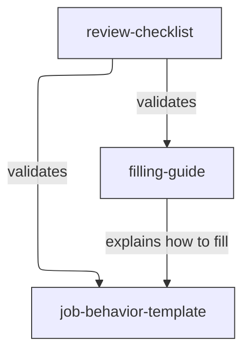
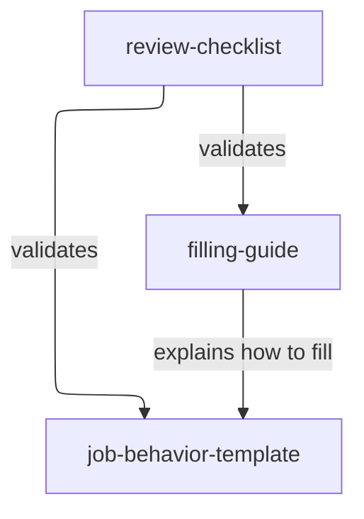

# Job Behavior Template

## Purpose

The blank, reusable form a developer fills in to document one vendor job from its source code, written in plain language for a business reviewer and usable with a text editor or GitHub Copilot alone.

## Navigation

[Job Behavior Specifications](../README.md#navigation) / **Job Behavior Template**

- [Design](#design)
  - [Diagram](#diagram)
- [Behavior](#behavior)
- [Plan](#plan)
- [Relationships](#relationships)
- [Links](#links)

## Design

The component is one Markdown form, [job-behavior-template](job-behavior-template.md), a short plain-language [filling-guide](filling-guide.md) and one internal review checklist, [review-checklist](review-checklist.md). The form and the guide are the deliverables and mention no Craft; the form has no fill-in part and no job ID.

Parts of the form, derived from B01 to B10 (also in [contract.md](contract.md#part-list), for review):

1. Header (B07)
2. About this document, with a contents list (B01, B07, B10)
3. Change log (B07)
4. Current behaviors, `B1`.. with evidence pointers (B02, B03)
5. Questions, `Q1`.. (B02, B10)
6. Inputs, outputs, parameters, external dependencies (B04)
7. Diagram with plain-text description (B05)
8. Acceptance scenarios, `AC1`.. with covers lines (B06)
9. Operational context (B09)
10. Acknowledgement log (B08)

Assumptions: versions are whole numbers in one file with a change log; the repository is tagged at each acknowledgement; the vendor never edits the document; the acknowledgement is typed in the Markdown source by our team and blank in the template; anchors are explicit `<a id>` tags that work on GitHub; no requested-changes part and no traceability table. The "vendor", "our team", "tracker" and "black box" terms are defined in the form. No automated checks are declared; the dry-run review in the checklist is the validation.

### Diagram

## Behavior

- **B01** When a document is made from the template, then it contains no fill-in instructions, no Craft reference and no internal job ID, and a separate filling guide explains in plain language how to fill it in and needs only a text editor or GitHub Copilot. (untested: benchmark pending)
- **B02** When a job's behavior is recorded, then each statement sits in exactly one of two kinds, current behavior (`B1`, `B2`, ...) or question (`Q1`, `Q2`, ...), an inferred statement is never recorded as current behavior, and a question is asked only when the source cannot show the answer and the answer would change what the migrated workflow must do. (untested: benchmark pending)
- **B03** When a current behavior is entered, then it has an ID, a business-language when/then statement and an evidence pointer to the source (file and place) or to a vendor-provided document (document and place), and it states no reason, schedule or other fact that the evidence does not show. (untested: benchmark pending)
- **B04** When the contracts are filled in, then inputs, outputs, parameters (name and this job's value) and external dependencies each have a table, each dependency states its role and the direction of every call, and a parameter value that the source states is listed there and is not turned into a question. (untested: benchmark pending)
- **B05** When the diagram is drawn, then the job is one black box with only external systems, outgoing calls and incoming responses, laid out vertically with the project's diagram settings, with the behavior IDs in the edge labels as plain text and a plain-text description beside it that links each ID. (untested: benchmark pending)
- **B06** When acceptance scenarios are written, then they form their own part, each (`AC1`, `AC2`, ...) is given/when/then with a "covers" line that links the behavior rows it proves, every current behavior is covered by at least one scenario, and an answered question carries a "resolved: now Bn" note. (untested: benchmark pending)
- **B07** When a document is issued, then the header holds the use case name, version, date, status (draft or acknowledged) and source revision with the script link and no job ID, an "About this document" part and a contents list with links follow the header before the change log, and the change log has one entry per version in the same file. (untested: benchmark pending)
- **B08** When the vendor acknowledges, then an acknowledgement log has one row per version (company name, date acknowledged, version reviewed, script link and revision, production-script tick box, one overall confirmation, tracker entry or reply reference) with no person name or role, earlier rows are never edited, our team tags the repository at each acknowledgement, and a plain statement says what the acknowledgement does and does not claim. (untested: benchmark pending)
- **B09** When operational context is recorded, then it is its own part and never a current behavior, and each row of schedule and trigger, logging, monitoring and alerts, owner and failure handling cites a vendor document or configuration in the source or says `unknown`. (untested: benchmark pending)
- **B10** When the document is read, then the "About this document" part states its purpose and says nothing about how the job will be built or grouped, each question is a separate item the vendor answers one by one, and there is no similarity, grouping or implementation field. (untested: benchmark pending)

## Plan

### Planned Navigation

[Job Behavior Specifications](../README.md#plan) / **Job Behavior Template**

- [Planned Design](#planned-design)
  - [Planned Diagram](#planned-diagram)
- [Planned Behavior](#planned-behavior)
- [Steps](#steps)
- [Acceptance Mapping](#acceptance-mapping)
- [Assumptions And Open Questions](#assumptions-and-open-questions)
- [Planned Links](#planned-links)

### Planned Design

No part is added or removed. The heading, the glossary, the About sentence and the question rule are reworded in place, and the filling guide and the review checklist follow the same wording. The parts, anchors and IDs are unchanged, so the reference specification and the skill's template copy stay in step by the same edit.

#### Planned Diagram

### Planned Behavior

These lines change wording only. B01, B02, B05, B07 and B10 were confirmed on 2026-11-15; B03, B04, B06, B08 and B09 carry the user's component-review decisions (2026-11-15) and are confirmed by the user on 2026-11-16. No behavior is added; the component stays at ten.

- **B01** When a use case document is made from the template, then it contains no fill-in instructions, no Craft reference and no internal job ID, and a separate filling guide explains in plain language how to fill it in and needs only a text editor or GitHub Copilot. (untested: benchmark pending)
- **B02** When a use case's behavior is recorded, then each statement sits in exactly one of two kinds, current behavior (`B1`, `B2`, ...) or question (`Q1`, `Q2`, ...), an inferred statement or a recommendation is never recorded as current behavior, and a question is asked only when the source cannot show the answer and the answer would change what the migrated use case must do (the preserved behavior). (untested: benchmark pending)
- **B03** When a current behavior is entered, then it has an ID, a business-language when/then statement and an evidence pointer to the source (file and place) or to a vendor-provided document (document and place) so that source-observed and document-described behavior stay distinguishable, and it states no reason, schedule or other fact that the evidence does not show and records only the outcome the evidence proves, keeping a request that succeeded, a status the use case reports and an actual delivery separate. (untested: benchmark pending)
- **B04** When the contracts are filled in, then inputs, outputs, parameters (name and this use case's value) and external dependencies each have a table, each dependency states its role and the direction of every request, response and data transfer, and a parameter value that the source states is listed there and is not turned into a question. (untested: benchmark pending)
- **B05** When the diagram is drawn, then the use case is one black box with only external systems and the requests, responses and data transfers the evidence supports, in either direction, laid out vertically with the project's diagram settings, with the behavior IDs in the edge labels as plain text and a plain-text description beside it that links each ID. (untested: benchmark pending)
- **B06** When acceptance scenarios are written, then they form their own part, each (`AC1`, `AC2`, ...) is given/when/then with a "covers" line that links the behavior rows it proves, every current behavior (including an explicit retry or failure-handling action in the source) is covered by at least one scenario, and an answered question carries a "resolved" note that points to the behavior or section the answer updated. (untested: benchmark pending)
- **B07** When a document is issued, then its heading reads `Use Case Behavior`, the header holds the use case name, version, date, status (draft or acknowledged) and source revision with the script link and no job ID, an "About this document" part and a contents list with links follow the header before the change log, and the change log has one entry per version in the same file. (untested: benchmark pending)
- **B08** When the vendor acknowledges, then an acknowledgement log has one row per version (company name, date acknowledged, version reviewed, script link and revision, production-script tick box, one overall confirmation, tracker entry or reply reference) with no person name or role, earlier rows are never edited, our team tags the repository at each acknowledgement, and a plain statement says the acknowledgement confirms that the named script and revision are the current production script and that the documented behavior is current for that version, and does not approve any future implementation or claim the behavior is error-free. (untested: benchmark pending)
- **B09** When operational context is recorded, then it is its own part and never a current behavior, though a row may point to the current behavior that records an explicit retry or failure-handling action, and each row of schedule and trigger, logging, monitoring and alerts, owner and failure handling cites a vendor document or configuration in the source or says `unknown`. (untested: benchmark pending)
- **B10** When the document is read, then the "About this document" part states its purpose and says nothing about how the use case will be migrated, each question is a separate item the vendor answers one by one, and there is no similarity, grouping, workflow or implementation field and no mention of them. (untested: benchmark pending)

### Steps

1. Reword `job-behavior-template.md` (heading `Use Case Behavior: {use case name}`, glossary, the About sentence without `grouped`, the question rule, the outcome-evidence rule, requests, responses and data transfers in either direction, retry and failure-handling actions as current behaviors with scenarios, the answer-update rule and the acknowledgement statement) and `filling-guide.md` the same way.
2. Update `contract.md`, `requirements.md` and `review-checklist.md` for the reworded lines.
3. Run the file review of every checklist item, the wording scan for `workflow` and `grouping`, and the record validators.

### Acceptance Mapping

| Acceptance condition | Behaviors | Step | Validation |
| --- | --- | --- | --- |
| B01 to B10 pass the file review with the revised wording, and the form, its filling guide and the review checklist agree with the reworded lines (B01 to B10). | B01 to B10 | 2 | `[B01]` to `[B10]` checklist items |
| The form records the outcome evidence proves (request success, reported status and actual delivery kept apart), allows requests, responses and data transfers in either direction, puts explicit retry or failure handling in current behaviors and scenarios, updates the right section when an answer arrives and states what an acknowledgement does and does not confirm (B03, B04, B05, B06, B08, B09). | B03, B04, B05, B06, B08, B09 | 2 | `[B03]`, `[B04]`, `[B05]`, `[B06]`, `[B08]`, `[B09]` checklist items |
| The form carries the heading `Use Case Behavior`, defines vendor, our team, tracker and black box and adds a `use case` line, and contains no `workflow` or grouping text (B02, B07, B10). | B02, B07, B10 | 3 | `[B02]`, `[B07]`, `[B10]` and the wording scan |

Checks: none declared; verification is the component's `review-checklist.md` file review, plus the record validators at the end of each plan and build.

### Assumptions And Open Questions

Assumptions (override any of them in chat before `/craft:build`):

1. The rewording is confirmed by the user (2026-11-15). Folder and file names do not change; `job-behavior-template` keeps its name because the skill folder, the links and the installed skill path depend on it (backlog item `use-case-naming-alignment` covers a later rename).
2. The About sentence currently says the form says nothing about how the job will be built or grouped. Saying `grouped` in a vendor-readable file contradicts the new rule that vendor text never mentions workflows or grouping, so the word is removed. Override: keep the sentence.
3. Document version 1 of the reference specification has never been issued to a vendor or client, so the reword is made in place with no new version and no change-log entry (confirmed 2026-11-15).
4. A question's answer updates the section it belongs to (a parameter, a dependency, operational context or a current behavior); a new current behavior is created only when the answer establishes behavior. This replaces the rule that every answered question becomes a current behavior. Override: keep one behavior per answered question.
5. Acknowledgement history is preserved: earlier rows stay, and the log's wording says what the vendor confirms (current production script and documented behavior for the named version and revision) and that it is not an approval of any future implementation.

Open questions: none about behavior.

### Planned Links

- [requirements.md](requirements.md#requirements) — what the component must do and what it need not.
- [contract.md](contract.md#contract) — the shapes, formats and wording rules.

## Relationships

- None outside its lineage. It is used by [Website Check Job Behavior](../website-check-job-behavior/README.md#purpose) and [Copilot Drafting Guide](../copilot-drafting-guide/README.md#purpose), which are siblings.

## Links

- [requirements.md](requirements.md#requirements) — what the component must do and what it need not.
- [contract.md](contract.md#contract) — the content the document must carry, the part list and the wording rules.
- [job-behavior-template.md](job-behavior-template.md) — the blank form delivered by this component.
- [filling-guide.md](filling-guide.md) — the plain-language filling guide.
- [review-checklist.md](review-checklist.md) — the dry-run review items, tagged by behavior.
