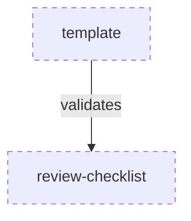

# Job Behavior Template

## Purpose

The blank, reusable form a developer fills in to document one client job from its source code, written in plain language for a business reviewer and usable with a text editor or GitHub Copilot alone.

## Navigation

[Job Behavior Specifications](../README.md#navigation) / **Job Behavior Template**

- [Design](#design)
- [Behavior](#behavior)
- [Plan](#plan)
- [Relationships](#relationships)
- [Links](#links)

## Design

Not built yet.

## Behavior

- **B01** When a developer opens the template, then its first part explains in plain language how to fill it in, mentions no Craft and needs no tool beyond a text editor or GitHub Copilot. (untested: benchmark pending)
- **B02** When a job's behavior is recorded, then each statement sits in exactly one of four labelled kinds, source-evidenced current behavior (`CUR-`), assumptions and unknowns (`ASM-`), client-requested changes (`CHG-`) and approved migration behavior (`MIG-`), and `MIG-` statements exist only after the client acknowledges. (untested: benchmark pending)
- **B03** When a current behavior is entered, then it has an ID, a business-language when/then statement and a pointer to the source evidence, or it is marked inferred and moved to assumptions. (untested: benchmark pending)
- **B04** When the contracts are filled in, then inputs, outputs, parameters and external dependencies each have a table, and each dependency states its role and the direction of every call. (untested: benchmark pending)
- **B05** When the diagram is drawn, then the job is one black box and the diagram shows only external systems, outgoing calls and incoming responses, with a plain-text description beside it and no internal modules, classes or architecture. (untested: benchmark pending)
- **B06** When acceptance scenarios are written, then each is given/when/then and names the behavior IDs it covers, and a traceability table shows every behavior covered by a scenario and every changed or approved statement linked to the statements it came from. (untested: benchmark pending)
- **B07** When a baseline is issued, then the header holds the use case name, baseline number, date, status and source revision, a stable job ID sits beside the name, and a change log has one entry per baseline saying what changed and who asked. (untested: benchmark pending)
- **B08** When the client acknowledges, then a block records, for each open item, accepted, changed or rejected, with a named business owner and technical reviewer, the baseline number and date, and a plain statement of what the acknowledgement does and does not claim. (untested: benchmark pending)
- **B09** When operational context is recorded, then schedule and frequency, logging, monitoring and alerts, owner and failure handling each default to unknown until someone confirms them. (untested: benchmark pending)
- **B10** When a job may later share a workflow with similar jobs, then the template holds only the job ID and its parameters and has no similarity, grouping or implementation field, and it says the specification does not describe how the job will be built or grouped. (untested: benchmark pending)

## Plan

### Planned Navigation

[Job Behavior Specifications](../README.md#plan) / **Job Behavior Template**

- [Planned Purpose](#planned-purpose)
- [Planned Design](#planned-design)
  - [Planned Diagram](#planned-diagram)
- [Steps](#steps)
- [Acceptance Mapping](#acceptance-mapping)
- [Assumptions And Open Questions](#assumptions-and-open-questions)
- [Planned Relationships](#planned-relationships)
- [Planned Links](#planned-links)

### Planned Purpose

The blank, reusable form a developer fills in to document one client job from its source code, written in plain language for a business reviewer and usable with a text editor or GitHub Copilot alone.

### Planned Design

The component is one Markdown form and one review checklist. The form is the single client-facing file: it carries its own fill-in guidance and all four kinds of statement, the contracts, the black-box diagram, the acceptance scenarios, the traceability table, the header with change log, the acknowledgement block and the operational context. The checklist is internal and is not sent to the client.

#### Planned Diagram

### Steps

1. Create `job-behavior-template.md`, the blank form. Its sections are derived from B01 to B10 by the builder, not fixed in this plan; the builder records the resulting section list and the ID scheme in `contract.md` and its Design so the user can review it.
2. Create `review-checklist.md` with one item per behavior, tagged `[B01]` to `[B10]`, written so a reviewer who has not seen the document can answer pass or fail.
3. Keep every file free of Craft names, commands and paths; the only client-facing file is `job-behavior-template.md`.

### Acceptance Mapping

| Acceptance condition | Behaviors | Step | Validation check |
| --- | --- | --- | --- |
| The template asks for every element in B02 to B10 and mentions no Craft | B01–B10 | 1, 2, 3 | review-checklist.md items [B01]–[B10] dry-run review |
| Every checklist item passes in a dry-run review | B01–B10 | 2 | dry-run review by a reviewer who has not seen the document |

Checks: the root declares no automated check for documents. The validation is the component's `review-checklist.md` dry-run review (see the verification gap below) plus the record validators.

### Assumptions And Open Questions

Assumptions (override any of them in chat before `/craft:build`):

1. The component is a single Markdown form plus a checklist; the form is the only file the client receives. Folder `job-behavior-template`, name "Job Behavior Template". Override: ask for another name.
2. The sections of the form are derived from the behaviors by the builder and reviewed by the user after the build, because the user asked that no section list be preselected. Override: give the section list in chat before `/craft:build`.
3. Behavior IDs keep the `B01` form so the traceability check matches them, and job statements use the prefixes `CUR-`, `ASM-`, `CHG-`, `MIG-` with a number. Override: name another scheme.
4. Baselines are whole numbers (1, 2, 3), the header has five fields plus a stable job ID, and a document is never edited in place after acknowledgement. Override: ask for a different scheme.
5. Format is Markdown with a Mermaid diagram plus a plain-text description. Override: ask for Word or another format.
6. A sample acknowledgement block is left blank; the template never fills it. Override: ask for a worked sample.
7. The ten-behavior cap is met by merging related ideas (for example job identity, parameters and the no-grouping statement into B04 and B10). Open question: none about behavior.

### Planned Relationships

- None outside its lineage. It is used by [Website Check Job Behavior](../website-check-job-behavior/README.md#purpose) and [Copilot Drafting Guide](../copilot-drafting-guide/README.md#purpose), which are siblings.

### Planned Links

- [requirements.md](requirements.md#requirements) — what the component must do and what it need not.
- [contract.md](contract.md#contract) — the content the document must carry and the wording rules.
- [review-checklist.md](review-checklist.md) — the dry-run review items, tagged by behavior (created by the build).

## Relationships

- None outside its lineage. It is used by [Website Check Job Behavior](../website-check-job-behavior/README.md#purpose) and [Copilot Drafting Guide](../copilot-drafting-guide/README.md#purpose), which are siblings.

## Links

- [requirements.md](requirements.md#requirements) — what the component must do and what it need not.
- [contract.md](contract.md#contract) — the content the document must carry and the wording rules.
