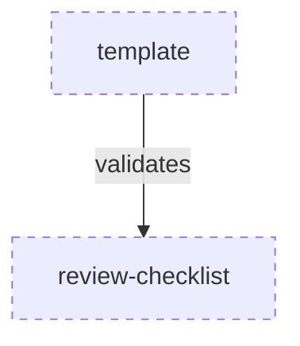

# Job Behavior Template

## Purpose

The blank, reusable form a developer fills in to document one vendor job from its source code, written in plain language for a business reviewer and usable with a text editor or GitHub Copilot alone.

## Navigation

[Job Behavior Specifications](../README.md#navigation) / **Job Behavior Template**

- [Design](#design)
- [Behavior](#behavior)
- [Plan](#plan)
- [Relationships](#relationships)
- [Links](#links)

## Design

Not built yet.

## Behavior

- **B01** When a developer opens the template, then its first part explains in plain language how to fill it in, mentions no Craft and needs no tool beyond a text editor or GitHub Copilot. (untested: benchmark pending)
- **B02** When a job's behavior is recorded, then each statement sits in exactly one of two labelled kinds, current behavior from the source (`CUR-`) or assumptions and unknowns (`ASM-`), and an inferred statement is never recorded as current behavior. (untested: benchmark pending)
- **B03** When a current behavior is entered, then it has an ID, a business-language when/then statement and a pointer to the source evidence, or it is moved to assumptions and unknowns. (untested: benchmark pending)
- **B04** When the contracts are filled in, then the job has a stable job ID and inputs, outputs, parameters (name and this job's value) and external dependencies each have a table, and each dependency states its role and the direction of every call. (untested: benchmark pending)
- **B05** When the diagram is drawn, then the job is one black box and the diagram shows only external systems, outgoing calls and incoming responses, with a plain-text description beside it and no internal modules, classes or architecture. (untested: benchmark pending)
- **B06** When acceptance scenarios are written, then they form their own part, each is given/when/then with a "covers" line naming the current behavior IDs it proves, every current behavior is covered by at least one scenario, and an unknown that gets answered carries a "resolved: now CUR-n" note. (untested: benchmark pending)
- **B07** When a version is issued, then the header holds the use case name, version number, date, status (draft or acknowledged) and source revision with the script link, a change log has one entry per version, and an acknowledged version is never edited in place: a change makes the next version. (untested: benchmark pending)
- **B08** When the vendor's acknowledgement is recorded by our team, then a short block holds the company name, date, version reviewed, script link and revision, a tick box that the supplied script is the one running in production today, one overall confirmation of the current behaviors, a reference to the vendor's own tracker entry or reply, and a plain statement of what the acknowledgement does and does not claim, with no person name or role. (untested: benchmark pending)
- **B09** When operational context is recorded, then schedule and frequency, logging, monitoring and alerts, owner and failure handling each default to unknown until someone confirms them. (untested: benchmark pending)
- **B10** When the document is read, then each unknown is a separate item the vendor answers one by one, the document states it says nothing about how the job will be built or grouped on the migration platform, and it has no similarity, grouping or implementation field. (untested: benchmark pending)

## Plan

### Planned Navigation

[Job Behavior Specifications](../README.md#plan) / **Job Behavior Template**

- [Planned Purpose](#planned-purpose)
- [Planned Design](#planned-design)
  - [Planned Diagram](#planned-diagram)
- [Steps](#steps)
- [Acceptance Mapping](#acceptance-mapping)
- [Assumptions And Open Questions](#assumptions-and-open-questions)
- [Planned Relationships](#planned-relationships)
- [Planned Links](#planned-links)

### Planned Purpose

The blank, reusable form a developer fills in to document one vendor job from its source code, written in plain language for a business reviewer and usable with a text editor or GitHub Copilot alone.

### Planned Design

The component is one Markdown form and one internal review checklist. The form is the only file this component delivers: it carries its own fill-in guidance, the two kinds of statement, the contracts, the black-box diagram, the acceptance scenarios, the header with change log, the acknowledgement block and the operational context.

#### Planned Diagram

### Steps

1. Create `job-behavior-template.md`, the blank form. Its sections are derived from B01 to B10 by the builder, not fixed in this plan; the builder records the resulting section list and the ID scheme in `contract.md` and its Design so the user can review it.
2. Create `review-checklist.md` with one item per behavior, tagged `[B01]` to `[B10]`, written so a reviewer who has not seen the document can answer pass or fail.
3. Keep `job-behavior-template.md` free of Craft names, commands and paths; it is the only file this component delivers.

### Acceptance Mapping

| Acceptance condition | Behaviors | Step | Validation check |
| --- | --- | --- | --- |
| The template asks for every element in B02 to B10 and mentions no Craft | B01–B10 | 1, 2, 3 | review-checklist.md items [B01]–[B10], dry-run review |
| Every checklist item passes in a dry-run review | B01–B10 | 2 | dry-run review by a reviewer who has not seen the document |

Checks: the root declares no automated check for documents. The validation is the component's `review-checklist.md` dry-run review (see the verification gap in `requirements.md`) plus the record validators.

### Assumptions And Open Questions

Assumptions (override any of them in chat before `/craft:build`). This plan replaces the earlier plan of commit `8c80eed`, as the user revised the content on 2026-11-14 (two statement kinds, "version", one overall confirmation, a skill):

1. Folder `job-behavior-template`, name "Job Behavior Template". Override: ask for another name.
2. The sections of the form are derived from the behaviors by the builder and reviewed by the user after the build, because the user asked that no section list be preselected. Override: give the section list in chat before `/craft:build`.
3. Statement IDs use the prefixes `CUR-` and `ASM-` with a number, and behavior IDs of this component keep the `B01` form so the traceability check matches them. Override: name another scheme.
4. Versions are whole numbers (Version 1, 2, 3), the header has five fields plus a stable job ID, and an acknowledged version is never edited in place. Override: ask for another scheme.
5. The vendor does not edit the document. It stays in our repository, only our team edits it, and our team records the acknowledgement from the vendor's tracker entry or reply. The unknowns are answered one by one by the vendor in the tracker, which is a later backlog item, and our team puts the answers into the next version. Override: let the vendor edit a copy.
6. No vendor-requested changes and no approved-migration items: this is an as-is migration, and the acknowledgement block is the only record of what was agreed. Override: ask for a requested-changes part.
7. Acceptance scenarios have no separate traceability table; each scenario's "covers" line is the mapping. Override: ask for a table.
8. Format is Markdown with a Mermaid diagram plus a plain-text description. Override: ask for Word.
9. The acknowledgement block is left blank by the template and by any tool. A worked sample, if shown, is marked as a sample.
10. The documents say "vendor" for the party that currently runs and maintains the jobs on its own platform and acknowledges each document, "our client" for the owner of the platform we are building, and "our team" for the developers who write the documents with the skill. Override: ask for other terms.

### Planned Relationships

- None outside its lineage. It is used by [Website Check Job Behavior](../website-check-job-behavior/README.md#purpose) and [Copilot Drafting Guide](../copilot-drafting-guide/README.md#purpose), which are siblings.

### Planned Links

- [requirements.md](requirements.md#requirements) — what the component must do and what it need not.
- [contract.md](contract.md#contract) — the content the document must carry and the wording rules.
- [review-checklist.md](review-checklist.md) — the dry-run review items, tagged by behavior (created by the build).

## Relationships

- None outside its lineage. It is used by [Website Check Job Behavior](../website-check-job-behavior/README.md#purpose) and [Copilot Drafting Guide](../copilot-drafting-guide/README.md#purpose), which are siblings.

## Links

- [requirements.md](requirements.md#requirements) — what the component must do and what it need not.
- [contract.md](contract.md#contract) — the content the document must carry and the wording rules.
