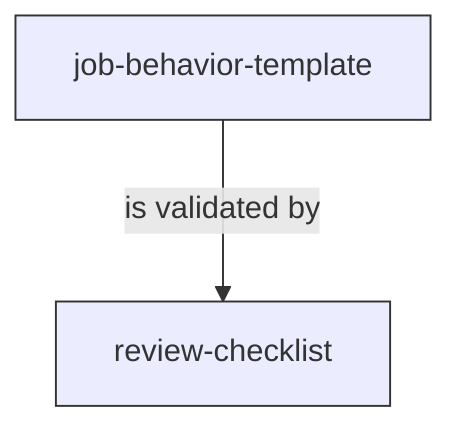

# Job Behavior Template

## Purpose

The blank, reusable form a developer fills in to document one vendor job from its source code, written in plain language for a business reviewer and usable with a text editor or GitHub Copilot alone.

## Navigation

[Job Behavior Specifications](../README.md#navigation) / **Job Behavior Template**

- [Design](#design)
  - [Diagram](#diagram)
- [Behavior](#behavior)
- [Relationships](#relationships)
- [Links](#links)

## Design

The component is one Markdown form, [job-behavior-template](job-behavior-template.md), and one internal review checklist, [review-checklist](review-checklist.md). The form is the only file delivered; it carries its own fill-in guidance and mentions no Craft.

Sections of the form, derived from B01 to B10 (also in [contract.md](contract.md#section-list-for-the-user-to-review), for review):

1. How to fill in this form (B01, B02, B03)
2. Header with job ID (B04, B07)
3. Change log (B07)
4. What this document says and does not say (B10)
5. Current behavior, `CUR-n` (B02, B03)
6. Assumptions and unknowns, `ASM-n` (B02, B06, B10)
7. Inputs, outputs, parameters, external dependencies (B04)
8. Diagram with plain-text description (B05)
9. Acceptance scenarios with covers lines (B06)
10. Operational context (B09)
11. Acknowledgement, blank (B08)

Assumptions: versions are whole numbers; the vendor never edits the document; the acknowledgement is recorded by our team and left blank by the template; Markdown with a Mermaid diagram; no requested-changes part and no traceability table. The "vendor", "our client" and "our team" terms are defined in the form.

### Diagram

## Behavior

- **B01** When a developer opens the template, then its first part explains in plain language how to fill it in, mentions no Craft and needs no tool beyond a text editor or GitHub Copilot. (untested: benchmark pending)
- **B02** When a job's behavior is recorded, then each statement sits in exactly one of two labelled kinds, current behavior from the source (`CUR-`) or assumptions and unknowns (`ASM-`), and an inferred statement is never recorded as current behavior. (untested: benchmark pending)
- **B03** When a current behavior is entered, then it has an ID, a business-language when/then statement and a pointer to the source evidence, or it is moved to assumptions and unknowns. (untested: benchmark pending)
- **B04** When the contracts are filled in, then the job has a stable job ID and inputs, outputs, parameters (name and this job's value) and external dependencies each have a table, and each dependency states its role and the direction of every call. (untested: benchmark pending)
- **B05** When the diagram is drawn, then the job is one black box and the diagram shows only external systems, outgoing calls and incoming responses, with a plain-text description beside it and no internal modules, classes or architecture. (untested: benchmark pending)
- **B06** When acceptance scenarios are written, then they form their own part, each is given/when/then with a "covers" line naming the current behavior IDs it proves, every current behavior is covered by at least one scenario, and an unknown that gets answered carries a "resolved: now CUR-n" note. (untested: benchmark pending)
- **B07** When a version is issued, then the header holds the use case name, version number, date, status (draft or acknowledged) and source revision with the script link, a change log has one entry per version, and an acknowledged version is never edited in place: a change makes the next version. (untested: benchmark pending)
- **B08** When the vendor's acknowledgement is recorded by our team, then a short block holds the company name, date, version reviewed, script link and revision, a tick box that the supplied script is the one running in production today, one overall confirmation of the current behaviors, a reference to the vendor's own tracker entry or reply, and a plain statement of what the acknowledgement does and does not claim, with no person name or role. (untested: benchmark pending)
- **B09** When operational context is recorded, then schedule and frequency, logging, monitoring and alerts, owner and failure handling each default to unknown until someone confirms them. (untested: benchmark pending)
- **B10** When the document is read, then each unknown is a separate item the vendor answers one by one, the document states it says nothing about how the job will be built or grouped on the migration platform, and it has no similarity, grouping or implementation field. (untested: benchmark pending)

## Relationships

- None outside its lineage. It is used by [Website Check Job Behavior](../website-check-job-behavior/README.md#purpose) and [Copilot Drafting Guide](../copilot-drafting-guide/README.md#purpose), which are siblings.

## Links

- [requirements.md](requirements.md#requirements) — what the component must do and what it need not.
- [contract.md](contract.md#contract) — the content the document must carry, the section list and the wording rules.
- [job-behavior-template.md](job-behavior-template.md) — the blank form delivered by this component.
- [review-checklist.md](review-checklist.md) — the dry-run review items, tagged by behavior.
