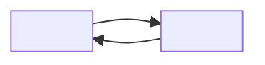

# Job Behavior: <use case name>

## 1. How to fill in this form

Use this form to record what one job does today, based on its source code. A business reviewer will read it, so write in short, plain sentences and explain any technical term the first time you use it. You need only a text editor or GitHub Copilot. Copy this form, keep every numbered part and its heading, and replace each text in angle brackets with your own words.

Rules to follow while you fill it in:

1. One job per document. Give the job one stable job ID in part 2 and never change it.
2. Every statement goes in exactly one of two kinds:
   - **Current behavior** (`CUR-1`, `CUR-2`, ...): something you saw in the source code and can point to. Part 5.
   - **Assumption or unknown** (`ASM-1`, `ASM-2`, ...): anything you inferred, guessed or could not find out. Part 6.
3. If you are not sure that the source shows a behavior, it is not current behavior. Put it in part 6. Never present a guess as current behavior.
4. Write each current behavior as "When ... then ..." in business language. Say what happens, not how the code is built. A file name may appear only in the source pointer.
5. Call each issued edition of the document a "version".
6. Where a part asks for something you do not know, write `unknown`. Do not leave it empty and do not invent an answer.
7. Leave part 11 (Acknowledgement) blank. Only our team fills it in, later, from the vendor's reply.
8. Do not describe how the job will be built or grouped on the migration platform.

Words used in this form: the **vendor** runs and maintains the job today and reviews this document; **our client** owns the platform the job will move to; **our team** writes this document. A **tracker** is the vendor's own ticket or issue system where it answers questions. A **black box** is a single closed box that stands for the whole job, so you show only what goes in and out.

## 2. Header

| Field | Value |
| --- | --- |
| Use case name | <name of what the job does, in business words> |
| Job ID | <stable ID, for example JOB-001; never changes between versions> |
| Version | <whole number: 1, 2, 3, ...> |
| Date | <date this version was issued, YYYY-MM-DD> |
| Status | <draft or acknowledged> |
| Source revision | <revision identifier of the script this version was written from> |
| Script link | <link to that script at that revision> |

An acknowledged version is never edited. If anything changes, issue the next version, add a line to part 3 and set the new version's status to draft.

## 3. Change log

One line per version, newest last.

| Version | Date | What changed, in plain words | Why (source change or answered unknown) |
| --- | --- | --- | --- |
| 1 | <date> | First version. | First documentation of the job. |

## 4. What this document says and does not say

This document records what the job does today, as seen in its source code, and lists what is still unknown. It says nothing about how the job will be built or grouped on the migration platform. It does not describe changes the vendor might want, and it does not approve any inferred behavior.

## 5. Current behavior

Only statements you can point to in the source. Use one row per behavior and number them in order. If you cannot give a source pointer, move the statement to part 6.

| ID | When ... then ... (business language) | Source pointer (file and place) |
| --- | --- | --- |
| CUR-1 | When <situation>, then <what the job does>. | <file name and line or function> |

## 6. Assumptions and unknowns

Each item is separate so the vendor can answer it one by one. Never merge two questions into one item.

| ID | Assumption or unknown | Question for the vendor | Status |
| --- | --- | --- | --- |
| ASM-1 | <what you assume or could not find out> | <one clear question> | open |

When an unknown is answered, keep its row, set the status to "resolved: now CUR-n" naming the new current behavior, and add that behavior in part 5 in the next version.

## 7. Inputs, outputs, parameters and external dependencies

### Inputs

| Input | What it is | Where it comes from |
| --- | --- | --- |
| <name> | <plain description> | <source of the input> |

### Outputs

| Output | What it is | Who or what receives it |
| --- | --- | --- |
| <name> | <plain description> | <receiver> |

### Parameters

| Parameter name | This job's value |
| --- | --- |
| <name> | <value used by this job, or `unknown`> |

### External dependencies

For each outside system, say what role it plays and the direction of every call: whether the job calls it (outgoing) or it calls the job (incoming).

| System | Role | Direction of each call |
| --- | --- | --- |
| <system name> | <what it does for the job> | <outgoing call: what is asked; response: what comes back> |

## 8. Diagram

Draw the job as one black box. Show only the outside systems, the calls going out and the responses coming back. Do not show internal modules, classes or architecture.

Description in plain text (write this beside the diagram, so the document is understandable without it):

<One or two sentences naming each external system, what the job sends it and what comes back.>

## 9. Acceptance scenarios

Scenarios show how a reviewer can check the current behaviors. Every current behavior in part 5 must be covered by at least one scenario.

| ID | Given | When | Then | Covers |
| --- | --- | --- | --- | --- |
| SC-1 | <starting situation> | <what happens> | <what the job does> | covers: CUR-<n> |

## 10. Operational context

Write `unknown` until someone confirms the answer.

| Topic | Answer |
| --- | --- |
| Schedule and frequency | unknown |
| Logging | unknown |
| Monitoring and alerts | unknown |
| Owner | unknown |
| Failure handling | unknown |

## 11. Acknowledgement

Our team records this block from the vendor's tracker entry or reply. Leave it blank when you write the document. Do not record any person's name or role.

| Field | Value |
| --- | --- |
| Company name | |
| Date acknowledged | |
| Version reviewed | |
| Script link and revision | |
| Tracker entry or reply reference | |

- [ ] The supplied script is the one running in production today.
- [ ] The vendor confirms, overall, that the current behaviors in part 5 are correct for this version.

What this acknowledgement means: the vendor has reviewed the behavior stated in this document, for the version and script named above. It does not claim that the behavior is free of errors, that any assumption or unknown in part 6 is approved, or that future issues will not occur.
