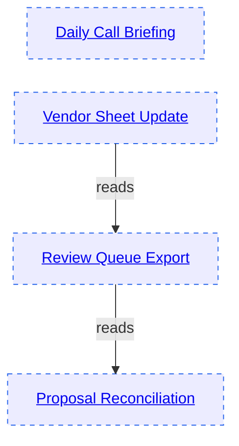

# Lead Tracker Skills

## Purpose

The Markdown-only Copilot agent skills that do the lead tracker tools' jobs on CSV files (reconcile proposals with an export, consolidate the review CSVs, write the daily summary and prepare a vendor's sheets), for the client environment where executables are blocked. The Node tools in Tracker Tools stay as the reference implementation and are not shipped.

## Navigation

[Job Behavior Specifications](../README.md#navigation) / **Lead Tracker Skills**

- [Components](#components)
- [Design](#design)
- [Relationships](#relationships)
- [Links](#links)
- [Plan](#plan)
  - [Planned Navigation](#planned-navigation)
  - [Planned Components](#planned-components)
  - [Planned Design](#planned-design)
    - [Planned Diagram](#planned-diagram)
  - [Planned Relationships](#planned-relationships)
  - [Planned Links](#planned-links)

## Components

| Component | Purpose |
| --- | --- |
| [Proposal Reconciliation](proposal-reconciliation/README.md#purpose) | A GitHub Copilot agent skill that compares reviewed tracker proposals with the latest tracker export and writes additions, field updates, conflicts, suggestions and vendor-safe folders as CSV and Markdown files for a lead to review and apply by hand, never overwriting human edits. |
| [Review Queue Export](review-queue-export/README.md#purpose) | A GitHub Copilot agent skill that turns the reconciliation files and the tracker export into the four consolidated review CSVs, one wide row per record ordered by what needs a lead's judgment, keeping the lead's review cells across refreshes. |
| [Daily Call Briefing](daily-call-briefing/README.md#purpose) | A GitHub Copilot agent skill that writes the internal daily summary across all vendor tracks from a tracker export (use cases by stage, overdue questions, blockers, access actions, mappings pending a decision and next batch suggestions). |
| [Vendor Sheet Update](vendor-sheet-update/README.md#purpose) | A GitHub Copilot agent skill that applies the review rows a lead accepted to one vendor's vendor-facing sheets, writes per-tab vendor-safe CSV files and a report for the lead to paste into the vendor workbook and check before upload, and marks the applied rows. |

## Design

Not built yet.

## Relationships

- [Tracker Data Contract](../tracker-data-contract/README.md#purpose) — the schema and formats every skill follows, copied into each skill folder.
- [Tracker Tools](../tracker-tools/README.md#purpose) — the reference Node tools and the source of the golden outputs.
- [Discovery Orchestrator](../discovery-orchestrator/README.md#planned-design) — runs `reconcile-tracker` and `export-review` in place of the exporter command, and reads the review headings from the `export-review` folder.

## Links

- [requirements.md](requirements.md#requirements) — what the group's skills share and must not do.
- [contract.md](contract.md#contract) — the rules every skill folder follows.

## Plan

### Planned Navigation

[Job Behavior Specifications](../README.md#plan) / **Lead Tracker Skills**

- [Planned Components](#planned-components)
- [Planned Design](#planned-design)
  - [Planned Diagram](#planned-diagram)
- [Planned Relationships](#planned-relationships)
- [Planned Links](#planned-links)

### Planned Components

| Component | Purpose |
| --- | --- |
| [Proposal Reconciliation](proposal-reconciliation/README.md#planned-design) | A GitHub Copilot agent skill that compares reviewed tracker proposals with the latest tracker export and writes additions, field updates, conflicts, suggestions and vendor-safe folders as CSV and Markdown files for a lead to review and apply by hand, never overwriting human edits. |
| [Review Queue Export](review-queue-export/README.md#planned-design) | A GitHub Copilot agent skill that turns the reconciliation files and the tracker export into the four consolidated review CSVs, one wide row per record ordered by what needs a lead's judgment, keeping the lead's review cells across refreshes. |
| [Daily Call Briefing](daily-call-briefing/README.md#planned-design) | A GitHub Copilot agent skill that writes the internal daily summary across all vendor tracks from a tracker export (use cases by stage, overdue questions, blockers, access actions, mappings pending a decision and next batch suggestions). |
| [Vendor Sheet Update](vendor-sheet-update/README.md#planned-design) | A GitHub Copilot agent skill that applies the review rows a lead accepted to one vendor's vendor-facing sheets, writes per-tab vendor-safe CSV files and a report for the lead to paste into the vendor workbook and check before upload, and marks the applied rows. |

### Planned Design

The group holds four sibling skills of one kind, each the Markdown-only counterpart of a Node lead tool. The reconciliation skill writes the files that the review export skill reads, so classification rules exist once; the vendor update skill reads the review CSVs and the headings file that the export skill writes; the daily briefing stands apart and reads only the tracker export. The four share one `tracker-table-rules.md` (mastered in the reconciliation skill, copied byte for byte into the others) and each holds byte-identical copies of the Tracker Data Contract's contract and schema, as the existing skills do. The group has no behavior of its own.

#### Planned Diagram

### Planned Relationships

- [Tracker Data Contract](../tracker-data-contract/README.md#purpose) — the schema and formats every skill follows.
- [Tracker Tools](../tracker-tools/README.md#plan) — the reference Node tools, not shipped.

### Planned Links

- [requirements.md](requirements.md#requirements) — what the group's skills share and must not do.
- [contract.md](contract.md#contract) — the rules every skill folder follows.
