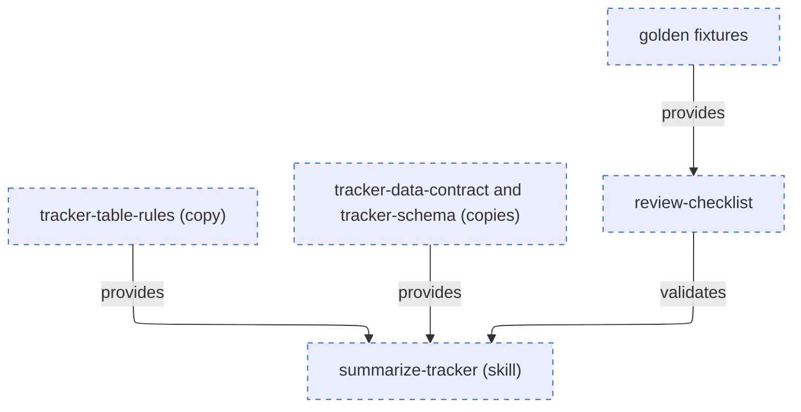

# Daily Call Briefing

## Purpose

A GitHub Copilot agent skill that writes the internal daily summary across all vendor tracks from a tracker export (use cases by stage, overdue questions, blockers, access actions, mappings pending a decision and next batch suggestions), so the daily call has an agenda where no executable may run.

## Navigation

[Job Behavior Specifications](../../README.md#navigation) / [Lead Tracker Skills](../README.md#navigation) / **Daily Call Briefing**

- [Design](#design)
- [Technology](#technology)
- [Behavior](#behavior)
- [Plan](#plan)
  - [Planned Navigation](#planned-navigation)
  - [Planned Design](#planned-design)
    - [Planned Diagram](#planned-diagram)
  - [Steps](#steps)
  - [Acceptance Mapping](#acceptance-mapping)
  - [Assumptions And Open Questions](#assumptions-and-open-questions)
  - [Planned Relationships](#planned-relationships)
  - [Planned Links](#planned-links)
- [Relationships](#relationships)
- [Links](#links)

## Design

Not built yet.

## Technology

- A GitHub Copilot agent skill (VS Code agent mode), plain Markdown with no code to run, as the sibling skills. It needs only Copilot: no Node, Python or other executable is installed or run, because the client environment blocks executables. Detail is in [requirements.md](requirements.md#requirements).

## Behavior

- **B01** When it runs on an export and a date from the lead, then it counts use cases per vendor track and per stage, with a `no stage` column. (untested: benchmark pending)
- **B02** When question rows are overdue by the contract's rule, then they are listed grouped by owner with `unassigned` last, and complete answers awaiting lead review are listed apart and not as vendor-overdue. (untested: benchmark pending)
- **B03** When there are blockers, then source blockers are listed first and then other blockers, each with an owner or flagged unassigned. (untested: benchmark pending)
- **B04** When it lists identity and access rows, then the request, vendor action and verification signals are shown separately. (untested: benchmark pending)
- **B05** When mappings exist, then those pending a decision, pending clarification or suggested for re-review are listed. (untested: benchmark pending)
- **B06** When batches and capacity exist, then it gives advisory next batch suggestions and the provisional limits, labelled advisory. (untested: benchmark pending)
- **B07** When an item has no owner, then it is flagged unassigned and never given one. (untested: benchmark pending)
- **B08** When a file, column or status is missing or invalid, then it stops naming the file and line and writes nothing. (untested: benchmark pending)
- **B09** When it writes the summary, then the output starts with the `INTERNAL` line, the sections follow the call agenda, a count line leads each section and no row appears twice. (untested: benchmark pending)
- **B10** When it runs twice on the same inputs and date, then the output is identical, every released question row is classified exactly once, and the date is asked of the lead and never taken from the environment. (untested: benchmark pending)

## Plan

### Planned Navigation

[Job Behavior Specifications](../../README.md#plan) / [Lead Tracker Skills](../README.md#plan) / **Daily Call Briefing**

- [Planned Design](#planned-design)
  - [Planned Diagram](#planned-diagram)
- [Steps](#steps)
- [Acceptance Mapping](#acceptance-mapping)
- [Assumptions And Open Questions](#assumptions-and-open-questions)
- [Planned Relationships](#planned-relationships)
- [Planned Links](#planned-links)

### Planned Design

One skill folder, `summarize-tracker`, replaces the job of the Tracker Summary in the client environment, where executables are blocked: the skill follows the explicit procedure in [contract.md](contract.md#contract), taken from the tool's own contract and behaviors, on CSV files, with the same output shapes as the tool so the other skills and tools read them unchanged. The tool stays in the repository as the reference implementation and the source of the golden expected outputs, and is not shipped to the client. Copilot's output varies and a large CSV can exceed its context, so the skill works in chunks, writes a count line first, checks that rows in equal rows classified, never invents a row, and stops with a named error instead of guessing; a lead can cheaply verify the count line and a few rows and compare the golden cases. The Tracker Data Contract is not changed; the skill holds byte-identical copies of the contract and schema like its sibling skills.

#### Planned Diagram

### Steps

1. Create the skill folder `summarize-tracker/` holding `SKILL.md` (front matter `name: summarize-tracker`, a description with trigger phrases, `user-invocable: true`) written from [contract.md](contract.md) with no Craft term.
2. Add the byte-identical copies of `tracker-data-contract.md` and `tracker-schema.csv` from the Tracker Data Contract, and the table rules and other files named in the contract's Folder section.
3. Generate the golden inputs and expected outputs by a one-off script in the scratchpad, outside the repository, that runs the reference tool on the fictional fixtures, and write `golden/COMPARE.md` (how to run the skill into a scratch folder, compare with VS Code Compare Selected, and the normalizations).
4. Write `review-checklist.md` with one item per behavior and the rules scan.
5. At build close, merge this Plan into the Design, diagram, Relationships and Links of this README and of the group's.

Build after Proposal Reconciliation (for the table rules); it can be built in parallel with Review Queue Export.

### Acceptance Mapping

| Acceptance | Behaviors | Step | Check |
| --- | --- | --- | --- |
| On the three-vendor golden export, each section of the summary matches the expected one. | B01, B02, B03, B04, B05, B06, B09 | 1, 2, 3 | checklist items, golden comparison |
| Unowned items are flagged and never assigned. | B07 | 1, 3, 4 | checklist items, golden comparison |
| A bad export stops with a named error and writes nothing. | B08 | 1, 3, 4 | checklist items, golden comparison |
| A repeat run on the same inputs and date is identical, and every released question row is counted once. | B10 | 1, 3, 4 | checklist items, golden comparison |

Validation, narrowest first: the checklist items for the behaviors, the wording scan of the skill folder, a mechanical check of the example rows against the contract by a throwaway script outside the repository, the golden comparison by the lead, then the root `test` check to confirm the contract-copy test is still green. No Copilot run is claimed; the user's manual client-environment testing is recorded as user-reported evidence for the version tested.

### Assumptions And Open Questions

Assumptions (override any in chat):

1. The group is `lead-tracker-skills` with four sibling skill components, additive: nothing existing moves, and the skills are not placed under `tracker-tools`, whose members share Node checks. Names and folders follow the sibling skills' style; override by naming others.
2. The Node tool stays unchanged in `tracker-tools` as the reference implementation and the source of golden expected outputs, and is no longer shipped to the client; the Client Transfer Package is changed by its own record (see the root plan).
3. The skill writes no executable and runs nothing: it reads and writes only the CSV and Markdown files the lead names, never the tracker or SharePoint.
4. Golden inputs and expected outputs are generated by a one-off script in the scratchpad that runs the reference tool, are committed as text in the skill folder and ship to the client; no fixture file is named `tracker-schema.csv` or `tracker-data-contract.md`, so the root copy test does not count it as an extra copy.
5. Rows in must equal rows classified, written as a count line at the top of each output; a mismatch stops the run. Chunk sizes are set by the backlog item `skill-scale-limits`.
6. The run date is asked of the lead and never taken from the environment, as in the orchestrator. Override by taking today's date from the environment.
7. Working-day arithmetic is Monday to Friday minus the holidays file, with day 0 the release day even on a weekend (the Tracker Summary's behavior, which the contract does not state), shown with worked examples in `tracker-table-rules.md`.

Open questions: none. The behavior choices were confirmed by the user on 2026-11-16.

### Planned Relationships

- [Tracker Data Contract](../../tracker-data-contract/README.md#purpose) — the schema, owner classes, proposal format and review rules the skill follows, copied into its folder.
- [Tracker Tools](../../tracker-tools/README.md#purpose) — the reference Node implementation and the source of the golden outputs; not shipped to the client.
- [Proposal Reconciliation](../proposal-reconciliation/README.md#purpose) — owns the table rules master this skill copies.

### Planned Links

- [requirements.md](requirements.md#requirements) — what the skill must do and must not do, and the verification and risks.
- [contract.md](contract.md#contract) — inputs, outputs, procedure, folder layout and stop errors.

## Relationships

- [Tracker Data Contract](../../tracker-data-contract/README.md#purpose) — the schema, owner classes, proposal format and review rules the skill follows, copied into its folder.
- [Tracker Tools](../../tracker-tools/README.md#purpose) — the reference Node implementation and the source of the golden outputs; not shipped to the client.
- [Proposal Reconciliation](../proposal-reconciliation/README.md#purpose) — owns the table rules master this skill copies.

## Links

- [requirements.md](requirements.md#requirements) — what the skill must do and must not do, and the verification and risks.
- [contract.md](contract.md#contract) — inputs, outputs, procedure, folder layout and stop errors.
