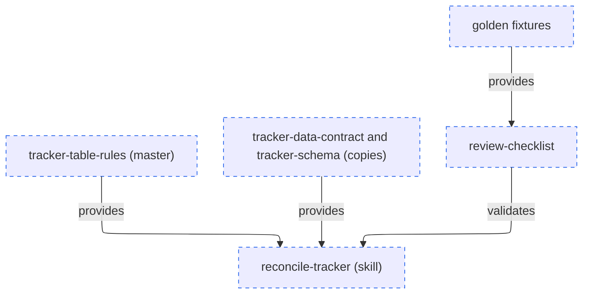

# Proposal Reconciliation

## Purpose

A GitHub Copilot agent skill that compares reviewed tracker proposals with the latest tracker export and writes additions, field updates, conflicts, suggestions and vendor-safe folders as CSV and Markdown files for a lead to review and apply by hand, never overwriting human edits, so the lead tool's job can be done where no executable may run.

## Navigation

[Job Behavior Specifications](../../README.md#navigation) / [Lead Tracker Skills](../README.md#navigation) / **Proposal Reconciliation**

- [Design](#design)
- [Technology](#technology)
- [Behavior](#behavior)
- [Plan](#plan)
  - [Planned Navigation](#planned-navigation)
  - [Planned Design](#planned-design)
    - [Planned Diagram](#planned-diagram)
  - [Steps](#steps)
  - [Acceptance Mapping](#acceptance-mapping)
  - [Assumptions And Open Questions](#assumptions-and-open-questions)
  - [Planned Relationships](#planned-relationships)
  - [Planned Links](#planned-links)
- [Relationships](#relationships)
- [Links](#links)

## Design

Not built yet.

## Technology

- A GitHub Copilot agent skill (VS Code agent mode), plain Markdown with no code to run, as the sibling skills. It needs only Copilot: no Node, Python or other executable is installed or run, because the client environment blocks executables. Detail is in [requirements.md](requirements.md#requirements).

## Behavior

- **B01** When a proposed record is absent from the export, then it is an addition with its source, specification version and merge request link, human fields only as `suggested_` values, and a suggested reference that follows the highest reference in the export. (untested: benchmark pending)
- **B02** When a spec field differs on an existing row, then it is a field update with the current and proposed value, a human field is only suggested, and a changed question wording is a `current_spec_text` update with a text-review suggestion. (untested: benchmark pending)
- **B03** When a proposal row is already reflected in the export, or the same inputs are processed again, then it yields nothing and the files hold the same rows in the same order. (untested: benchmark pending)
- **B04** When a `base_value` differs, a row has a later edit, the export is older than the proposal, or two proposals disagree, then it is a conflict with both values, the record and the rows that refer to it are held, and unrelated changes are still reported. (untested: benchmark pending)
- **B05** When a new question resembles an existing one, then a link suggestion is listed with an approximate score (marked `uncertain-review` unless clearly equal), and nothing is linked, merged or answered. (untested: benchmark pending)
- **B06** When a proposal sets a forbidden, computed or central-reference field, a released `question_text` or a disallowed `request_status`, then the row is rejected and listed with its reason. (untested: benchmark pending)
- **B07** When a decided mapping's considered versions are older than a proposed version, then re-review is suggested only for could-affect or unknown impact, unknown is listed as unknown, and decision fields are never edited. (untested: benchmark pending)
- **B08** When the lead names a vendor, then `vendor/<slug>/` holds only that vendor's released question rows and vendor-visible columns, passes the vendor-safe self-check, and holds no addition, conflict, suggestion, group, link or mapping. (untested: benchmark pending)
- **B09** When an input has a bad header, tab, field, a secret-looking value or an unknown use case, or a count does not tally, then it stops naming the file and line and writes nothing. (untested: benchmark pending)
- **B10** When it runs, then it changes no input, reference, answer, owner, status, ticket, date or acknowledgement, releases nothing, and writes no secret value. (untested: benchmark pending)

## Plan

### Planned Navigation

[Job Behavior Specifications](../../README.md#plan) / [Lead Tracker Skills](../README.md#plan) / **Proposal Reconciliation**

- [Planned Design](#planned-design)
  - [Planned Diagram](#planned-diagram)
- [Steps](#steps)
- [Acceptance Mapping](#acceptance-mapping)
- [Assumptions And Open Questions](#assumptions-and-open-questions)
- [Planned Relationships](#planned-relationships)
- [Planned Links](#planned-links)

### Planned Design

One skill folder, `reconcile-tracker`, replaces the job of the Tracker Reconciler in the client environment, where executables are blocked: the skill follows the explicit procedure in [contract.md](contract.md#contract), taken from the tool's own contract and behaviors, on CSV files, with the same output shapes as the tool so the other skills and tools read them unchanged. The tool stays in the repository as the reference implementation and the source of the golden expected outputs, and is not shipped to the client. Copilot's output varies and a large CSV can exceed its context, so the skill works in chunks, writes a count line first, checks that rows in equal rows classified, never invents a row, and stops with a named error instead of guessing; a lead can cheaply verify the count line and a few rows and compare the golden cases. The Tracker Data Contract is not changed; the skill holds byte-identical copies of the contract and schema like its sibling skills.

#### Planned Diagram

### Steps

1. Create the skill folder `reconcile-tracker/` holding `SKILL.md` (front matter `name: reconcile-tracker`, a description with trigger phrases, `user-invocable: true`) written from [contract.md](contract.md) with no Craft term.
2. Add the byte-identical copies of `tracker-data-contract.md` and `tracker-schema.csv` from the Tracker Data Contract, and the table rules and other files named in the contract's Folder section.
3. Generate the golden inputs and expected outputs by a one-off script in the scratchpad, outside the repository, that runs the reference tool on the fictional fixtures, and write `golden/COMPARE.md` (how to run the skill into a scratch folder, compare with VS Code Compare Selected, and the normalizations).
4. Write `review-checklist.md` with one item per behavior and the rules scan.
5. At build close, merge this Plan into the Design, diagram, Relationships and Links of this README and of the group's.

Build first: it holds the master of `tracker-table-rules.md` and writes the golden outputs the export skill reads.

### Acceptance Mapping

| Acceptance | Behaviors | Step | Check |
| --- | --- | --- | --- |
| On the website proposal against an empty export it produces the additions, and rerun after they are applied it produces none, with the same rows in the same order. | B01, B03 | 1, 2, 3 | checklist items, golden comparison |
| Conflicts, held rows, rejected rows and re-review suggestions match the golden cases. | B02, B04, B06, B07 | 1, 3, 4 | checklist items, golden comparison |
| Link suggestions never link, merge or answer, and no input, reference, answer or status is changed. | B05, B10 | 1, 3, 4 | checklist items, golden comparison |
| Vendor folders pass the vendor-safe self-check and hold only that vendor's released question rows. | B08 | 1, 3, 4 | checklist items, golden comparison |
| A bad input or a tally mismatch stops with a named error and writes nothing. | B09 | 1, 3, 4 | checklist items, golden comparison |

Validation, narrowest first: the checklist items for the behaviors, the wording scan of the skill folder, a mechanical check of the example rows against the contract by a throwaway script outside the repository, the golden comparison by the lead, then the root `test` check to confirm the contract-copy test is still green. No Copilot run is claimed; the user's manual client-environment testing is recorded as user-reported evidence for the version tested.

### Assumptions And Open Questions

Assumptions (override any in chat):

1. The group is `lead-tracker-skills` with four sibling skill components, additive: nothing existing moves, and the skills are not placed under `tracker-tools`, whose members share Node checks. Names and folders follow the sibling skills' style; override by naming others.
2. The Node tool stays unchanged in `tracker-tools` as the reference implementation and the source of golden expected outputs, and is no longer shipped to the client; the Client Transfer Package is changed by its own record (see the root plan).
3. The skill writes no executable and runs nothing: it reads and writes only the CSV and Markdown files the lead names, never the tracker or SharePoint.
4. Golden inputs and expected outputs are generated by a one-off script in the scratchpad that runs the reference tool, are committed as text in the skill folder and ship to the client; no fixture file is named `tracker-schema.csv` or `tracker-data-contract.md`, so the root copy test does not count it as an extra copy.
5. Rows in must equal rows classified, written as a count line at the top of each output; a mismatch stops the run. Chunk sizes are set by the backlog item `skill-scale-limits`.
6. `tracker-table-rules.md` is mastered in this skill's folder and copied byte for byte into the other three skill folders, with one new root test for the four copies. Override by placing the master at the group level, with the same copies.
7. Vendor folders are produced only for the vendors the lead names, one pass per vendor.
8. Reconcile is run per proposal folder or per use case, not as one batch over everything, so a run fits Copilot's context; the chunk size is set by the backlog item `skill-scale-limits`.

Open questions: none. The behavior choices were confirmed by the user on 2026-11-16.

### Planned Relationships

- [Tracker Data Contract](../../tracker-data-contract/README.md#purpose) — the schema, owner classes, proposal format and review rules the skill follows, copied into its folder.
- [Tracker Tools](../../tracker-tools/README.md#purpose) — the reference Node implementation and the source of the golden outputs; not shipped to the client.
- [Review Queue Export](../review-queue-export/README.md#purpose) — reads the reconciliation files this skill writes and shares its table rules.
- [Vendor Sheet Update](../vendor-sheet-update/README.md#purpose) — shares its table rules.

### Planned Links

- [requirements.md](requirements.md#requirements) — what the skill must do and must not do, and the verification and risks.
- [contract.md](contract.md#contract) — inputs, outputs, procedure, folder layout and stop errors.

## Relationships

- [Tracker Data Contract](../../tracker-data-contract/README.md#purpose) — the schema, owner classes, proposal format and review rules the skill follows, copied into its folder.
- [Tracker Tools](../../tracker-tools/README.md#purpose) — the reference Node implementation and the source of the golden outputs; not shipped to the client.
- [Review Queue Export](../review-queue-export/README.md#purpose) — reads the reconciliation files this skill writes and shares its table rules.
- [Vendor Sheet Update](../vendor-sheet-update/README.md#purpose) — shares its table rules.

## Links

- [requirements.md](requirements.md#requirements) — what the skill must do and must not do, and the verification and risks.
- [contract.md](contract.md#contract) — inputs, outputs, procedure, folder layout and stop errors.
