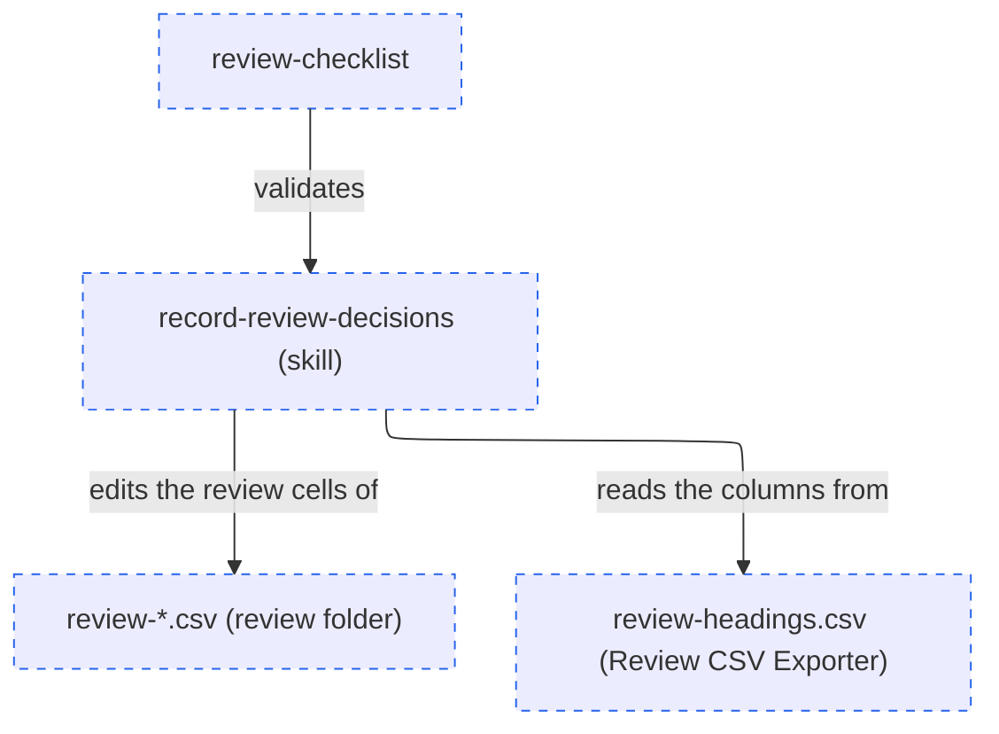

# Review Decisions

## Purpose

A GitHub Copilot agent skill that walks a lead through the pending rows of the review CSVs, records accept, reject or clarify only from the lead's own words in that row's review cells, accepts a use case's plain additions in one step, and lets the lead come back later to change an earlier decision, so decisions are made in chat and nobody edits the review CSVs by hand.

## Navigation

[Job Behavior Specifications](../../README.md#navigation) / [Lead Tracker Skills](../README.md#navigation) / **Review Decisions**

- [Design](#design)
- [Technology](#technology)
- [Behavior](#behavior)
- [Plan](#plan)
  - [Planned Navigation](#planned-navigation)
  - [Planned Design](#planned-design)
    - [Planned Diagram](#planned-diagram)
  - [Steps](#steps)
  - [Acceptance Mapping](#acceptance-mapping)
  - [Assumptions And Open Questions](#assumptions-and-open-questions)
  - [Planned Relationships](#planned-relationships)
  - [Planned Links](#planned-links)
- [Relationships](#relationships)
- [Links](#links)

## Design

Not built yet.

## Technology

- A GitHub Copilot agent skill (VS Code agent mode), plain Markdown with no code, as the sibling skills. It needs only Copilot, the review folder the Review CSV Exporter wrote and that tool's `review-headings.csv`; it runs no executable. Detail is in [requirements.md](requirements.md#requirements).

## Behavior

- **B01** When the lead names a review folder, then it lists the pending rows (blank `review_status`, or `changed_since_review` = `yes`) one use case at a time in the `order` column and shows for each the use case, the record, the kind, the current value, proposed value and state of each field, the conflict, the suggestions, the evidence and the reason. (untested: benchmark pending)
- **B02** When the lead answers accept, reject or clarify with an optional comment, then it records the answer only from the lead's own words in that row's `review_status`, `reviewer`, `review_note` and `reviewed_on` with the name and date the lead gave, clears that row's `changed_since_review`, and edits no other cell and no other row. (untested: benchmark pending)
- **B03** When an answer is unclear, then it asks again and records nothing. (untested: benchmark pending)
- **B04** When the lead asks to accept all plain adds of one use case, then it records `accepted` in one step for that use case's pending `add` rows with no conflict and no held change, touches no other row, and lists the rows it recorded and the rows it left. (untested: benchmark pending)
- **B05** When the lead asks to change an earlier decision by naming a record or asking to revisit a use case, then it lists the decided rows in that scope with their status, reviewer, date and note and, on the lead's pick and new status, overwrites that row's review cells, keeping the earlier status and name in the note. (untested: benchmark pending)
- **B06** When a row to be changed has `applied_on` set, then it warns that the change was already applied by hand in the tracker and changes the decision only after the lead confirms; `applied_on` stays as it is unless the lead gives a date or says to clear it. (untested: benchmark pending)
- **B07** When the lead gives a date after applying a change by hand, then it sets `applied_on` on that row only. (untested: benchmark pending)
- **B08** When it has recorded, then it reads the file back, checks that only the intended cells changed and that the status is one the exporter allows, and says that the next export refresh keeps the decision. (untested: benchmark pending)
- **B09** When it runs, then it never writes to the tracker, proposes or applies a change, edits a cell outside the review cells, or records a decision, name or date the lead did not say. (untested: benchmark pending)
- **B10** When the review folder, the headings file, the lead's name or the date is missing, then it asks once and never takes the name or date from the environment. (untested: benchmark pending)

## Plan

### Planned Navigation

[Job Behavior Specifications](../../README.md#plan) / [Lead Tracker Skills](../README.md#plan) / **Review Decisions**

- [Planned Design](#planned-design)
  - [Planned Diagram](#planned-diagram)
- [Steps](#steps)
- [Acceptance Mapping](#acceptance-mapping)
- [Assumptions And Open Questions](#assumptions-and-open-questions)
- [Planned Relationships](#planned-relationships)
- [Planned Links](#planned-links)

### Planned Design

One skill folder, `record-review-decisions`, holds `SKILL.md` and an internal `review-checklist.md`. The skill is the only place where a lead's decision is written into the review CSVs. It takes over the review walk and the accept-all step that the [Discovery Orchestrator](../../discovery-orchestrator/README.md#planned-design) carries today, adds the revisit of an earlier decision, and can be called on its own, so a lead who only wants to flip one record does not have to run discovery. The orchestrator hands the review folder, the lead's name and the date to it after the export. The skill finds the review columns through the Review CSV Exporter's headings file, holds no copy of the Tracker Data Contract, runs no executable, and checks its own edit by reading the file back; the exporter keeps the decisions on every later refresh. The inputs, the cells written, the note format and the stop rules are in [contract.md](contract.md#contract).

#### Planned Diagram

### Steps

1. Create `record-review-decisions/SKILL.md` from [contract.md](contract.md#contract): front matter `name: record-review-decisions` (equal to the folder name), a description with trigger phrases (review the pending rows, record a decision, accept all plain adds, change an earlier decision, revisit a use case's decisions), `user-invocable: true`, and the sections Before you start, Review the pending rows, Record a decision, Accept all plain adds, Change an earlier decision, Check the file and Never. No Craft term.
2. Create `record-review-decisions/review-checklist.md`, one item per behavior `B01` to `B10` plus `Rules`, in the form of the orchestrator's checklist.
3. Move the review walk and the accept-all text out of the orchestrator's skill unchanged where it still fits, then add the revisit, the `applied_on` warning, the clearing of `changed_since_review` and the read-back check. The orchestrator itself changes in its own plan.
4. Keep this README's Design and diagram, [requirements.md](requirements.md#requirements) and [contract.md](contract.md#contract) in step with the built skill, and add the task result to [tasks.md](tasks.md).

### Acceptance Mapping

| Acceptance | Behaviors | Step | Check |
| --- | --- | --- | --- |
| The skill lists pending rows one use case at a time in the `order` column with every shown item, asks once for the folder, headings file, name and date, and finds columns through the headings file | B01, B10 | 1, 2 | checklist `B01`, `B10`, mechanical check of the keys against the headings file |
| A decision is recorded only from the lead's words in that row's four cells, `changed_since_review` is cleared, no other cell or row changes, and an unclear answer is asked again | B02, B03 | 1, 2, 3 | checklist `B02`, `B03`, example rows |
| Accept all touches only that use case's pending plain adds and lists recorded and left rows | B04 | 1, 3 | checklist `B04` |
| An earlier decision can be changed, the earlier status and name stay in the note, a row with `applied_on` is warned about first and `applied_on` is set or cleared only on the lead's word | B05, B06, B07 | 1, 3 | checklist `B05`, `B06`, `B07`, example rows |
| The skill reads its edit back, never writes outside the review cells or to the tracker, and the checklist, README, requirements and contract agree with no Craft term in the folder | B08, B09 | 1, 2, 4 | checklist `B08`, `B09`, `Rules`, wording scan |

Validation, narrowest first: the checklist items for the behaviors, the wording scan of the skill folder, a mechanical check of the example rows and the review column keys against the exporter's headings file by a throwaway script outside the repository, then the root `test` check to confirm nothing else moved. Nothing is built and no Copilot run is claimed; the user's manual client-environment testing is recorded as user-reported evidence for the version tested.

### Assumptions And Open Questions

Assumptions (override any in chat):

1. The component is `review-decisions` in the [Lead Tracker Skills](../README.md#planned-design) group, additive, and the skill folder is `record-review-decisions`. The other name considered was Review Decision Recorder. Override by naming another.
2. The planner agent was blocked by an HTTP 403 in this session and was not retried. This plan was written from a direct read of the repository by the planning session. Re-run `/craft:plan` for this component later if an independent planner pass is wanted.
3. It is a skill and not a script because a decision is the lead's own words in chat and the edit is a few cells. Confirmed by the user, 2026-11-16 ("we can have it as a skill for now"). A script (the follow-on recorded in the orchestrator's requirements) would be added only if hand edits by Copilot break rows.
4. The skill does not rerun the exporter after recording, because a standalone call would then need the export and proposals folders too. It reads its own edit back instead (`B08`). The cost is that a stray hand edit elsewhere in the file is caught only by the next export run, which stops naming the file and line. Override by having it rerun the exporter with the folders it is given.
5. The earlier decision is kept in `review_note` as `Earlier: <status> by <name> on <date>. <new comment>`, because the review CSVs have no history column and the exporter keeps the note as a free cell. Override by adding a history column, which changes the exporter's headings and contract.
6. Recording a decision clears `changed_since_review` on that row. Finding: the exporter keeps `yes` on every later refresh until the lead clears it (`src/review.ts`, `old.changed === "yes"`), and the built orchestrator edits only four cells and never clears it, so a changed row stays pending after the lead decides. This skill fixes that, and the orchestrator no longer records decisions itself.
7. Returning a row to pending (a blank status) is not offered; a revisit changes the status among `accepted`, `rejected` and `clarify`. Override by adding a "reopen" answer that blanks the four cells.
8. `applied_on` is never cleared silently: it changes only on a date the lead gives or on the lead saying to clear it, because the tracker may already hold the applied change and the lead must correct it by hand.
9. The skill refuses to write a note that looks like a secret, because the exporter stops on a secret-looking review cell.
10. The headings file is the Review CSV Exporter's `data/review-headings.csv`, asked for once; a key missing from it stops the run. The skill holds no copy of the Tracker Data Contract, as the orchestrator does not.

Open questions: none. The ten behaviors were confirmed by the user on 2026-11-16.

### Planned Relationships

- [Review CSV Exporter](../../tracker-tools/review-csv-exporter/README.md#purpose) — writes the review CSVs this skill edits and owns the headings file it reads.
- [Discovery Orchestrator](../../discovery-orchestrator/README.md#planned-design) — hands the review folder, the lead's name and the date to this skill after the export.
- [Vendor Workbook Updater](../../tracker-tools/vendor-workbook-updater/README.md#purpose) — reads the accepted rows this skill records.

### Planned Links

- [requirements.md](requirements.md#requirements) — what the skill must do and must not do.
- [contract.md](contract.md#contract) — inputs, cells written, note format and stop rules.

## Relationships

- [Review CSV Exporter](../../tracker-tools/review-csv-exporter/README.md#purpose) — writes the review CSVs this skill edits and owns the headings file it reads.
- [Discovery Orchestrator](../../discovery-orchestrator/README.md#purpose) — runs discovery and hands the review to this skill.
- [Vendor Workbook Updater](../../tracker-tools/vendor-workbook-updater/README.md#purpose) — reads the accepted rows this skill records.

## Links

- [requirements.md](requirements.md#requirements) — what the skill must do and must not do.
- [contract.md](contract.md#contract) — inputs, cells written, note format and stop rules.
