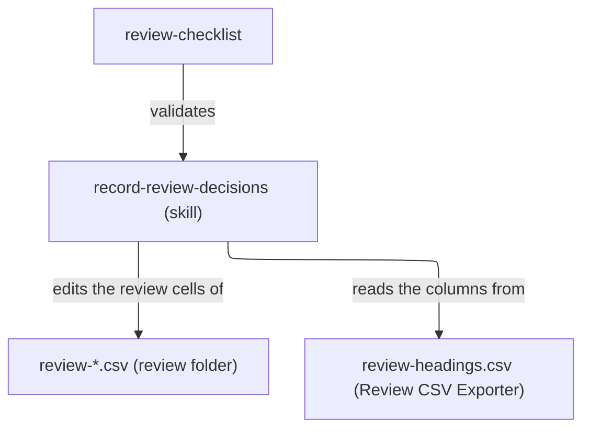

# Review Decisions

## Purpose

A GitHub Copilot agent skill that walks a lead through the pending rows of the review CSVs, records accept, reject or clarify only from the lead's own words in that row's review cells, accepts a use case's plain additions in one step, and lets the lead come back later to change an earlier decision, so decisions are made in chat and nobody edits the review CSVs by hand.

## Navigation

[Job Behavior Specifications](../../README.md#navigation) / [Lead Tracker Skills](../README.md#navigation) / **Review Decisions**

- [Design](#design)
  - [Diagram](#diagram)
- [Technology](#technology)
- [Behavior](#behavior)
- [Relationships](#relationships)
- [Links](#links)

## Design

One skill folder, [record-review-decisions](record-review-decisions/SKILL.md), holds `SKILL.md`; the internal [review-checklist.md](review-checklist.md) sits beside it, as in the sibling skills, so Copilot does not load it. The skill is the only place where a lead's decision is written into the review CSVs. It walks the pending rows, records a decision in that row's review cells, accepts a use case's plain adds in one step, and lets the lead change an earlier decision. It finds the review columns through the Review CSV Exporter's headings file, holds no copy of the Tracker Data Contract, runs no executable, and checks its own edit by reading the file back; the exporter keeps the decisions on every later refresh. The inputs, cells written, note format and stop rules are in [contract.md](contract.md#contract).

### Diagram

## Technology

- A GitHub Copilot agent skill (VS Code agent mode), plain Markdown with no code, as the sibling skills. It needs only Copilot, the review folder the Review CSV Exporter wrote and that tool's `review-headings.csv`; it runs no executable. Detail is in [requirements.md](requirements.md#requirements).

## Behavior

- **B01** When the lead names a review folder, then it lists the pending rows (blank `review_status`, or `changed_since_review` = `yes`) one use case at a time in the `order` column and shows for each the use case, the record, the kind, the current value, proposed value and state of each field, the conflict, the suggestions, the evidence and the reason. (untested: benchmark pending)
- **B02** When the lead answers accept, reject or clarify with an optional comment, then it records the answer only from the lead's own words in that row's `review_status`, `reviewer`, `review_note` and `reviewed_on` with the name and date the lead gave, clears that row's `changed_since_review`, and edits no other cell and no other row. (untested: benchmark pending)
- **B03** When an answer is unclear, then it asks again and records nothing. (untested: benchmark pending)
- **B04** When the lead asks to accept all plain adds of one use case, then it records `accepted` in one step for that use case's pending `add` rows with no conflict and no held change, touches no other row, and lists the rows it recorded and the rows it left. (untested: benchmark pending)
- **B05** When the lead asks to change an earlier decision by naming a record or asking to revisit a use case, then it lists the decided rows in that scope with their status, reviewer, date and note and, on the lead's pick and new status, overwrites that row's review cells, keeping the earlier status and name in the note. (untested: benchmark pending)
- **B06** When a row to be changed has `applied_on` set, then it warns that the change was already applied by hand in the tracker and changes the decision only after the lead confirms; `applied_on` stays as it is unless the lead gives a date or says to clear it. (untested: benchmark pending)
- **B07** When the lead gives a date after applying a change by hand, then it sets `applied_on` on that row only. (untested: benchmark pending)
- **B08** When it has recorded, then it reads the file back, checks that only the intended cells changed and that the status is one the exporter allows, and says that the next export refresh keeps the decision. (untested: benchmark pending)
- **B09** When it runs, then it never writes to the tracker, proposes or applies a change, edits a cell outside the review cells, or records a decision, name or date the lead did not say. (untested: benchmark pending)
- **B10** When the review folder, the headings file, the lead's name or the date is missing, then it asks once and never takes the name or date from the environment. (untested: benchmark pending)

## Relationships

- [Review CSV Exporter](../../tracker-tools/review-csv-exporter/README.md#purpose) — writes the review CSVs this skill edits and owns the headings file it reads.
- [Discovery Orchestrator](../../discovery-orchestrator/README.md#purpose) — runs discovery and can call this skill after the export; its own review walk is removed by separate work in that component.
- [Vendor Workbook Updater](../../tracker-tools/vendor-workbook-updater/README.md#purpose) — reads the accepted rows this skill records.

## Links

- [requirements.md](requirements.md#requirements) — what the skill must do and must not do.
- [contract.md](contract.md#contract) — inputs, cells written, note format and stop rules.
- [review-checklist.md](review-checklist.md) — internal review items for B01 to B10 and the wording rules.
- [record-review-decisions/SKILL.md](record-review-decisions/SKILL.md) — the skill itself.
