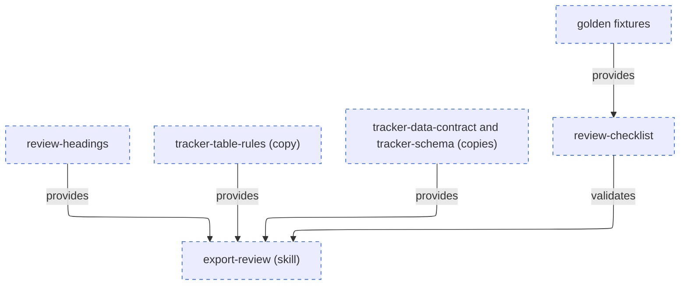

# Review Queue Export

## Purpose

A GitHub Copilot agent skill that turns the reconciliation files and the tracker export into the four consolidated review CSVs, one wide row per record ordered by what needs a lead's judgment, keeping the lead's review cells across refreshes, so leads review and decide without transposing proposal rows and without an executable.

## Navigation

[Job Behavior Specifications](../../README.md#navigation) / [Lead Tracker Skills](../README.md#navigation) / **Review Queue Export**

- [Design](#design)
- [Technology](#technology)
- [Behavior](#behavior)
- [Plan](#plan)
  - [Planned Navigation](#planned-navigation)
  - [Planned Design](#planned-design)
    - [Planned Diagram](#planned-diagram)
  - [Steps](#steps)
  - [Acceptance Mapping](#acceptance-mapping)
  - [Assumptions And Open Questions](#assumptions-and-open-questions)
  - [Planned Relationships](#planned-relationships)
  - [Planned Links](#planned-links)
- [Relationships](#relationships)
- [Links](#links)

## Design

Not built yet.

## Technology

- A GitHub Copilot agent skill (VS Code agent mode), plain Markdown with no code to run, as the sibling skills. It needs only Copilot: no Node, Python or other executable is installed or run, because the client environment blocks executables. Detail is in [requirements.md](requirements.md#requirements).

## Behavior

- **B01** When it runs on the reconciliation files, the proposals and the export, then it writes `review-use-cases.csv`, `review-questions.csv`, `review-identity-access.csv` and `review-mappings.csv` with the headings file's header, header-only for an empty tab, one wide row per record. (untested: benchmark pending)
- **B02** When a record has several field proposals, then they join into one row with the current value, the proposed value and the state of each changed field. (untested: benchmark pending)
- **B03** When a record appears in several proposals or folders, then it appears once, keyed by its central reference or `new:<local_key>`. (untested: benchmark pending)
- **B04** When a record already matches the export, then it gets no row and its review cells are dropped with it. (untested: benchmark pending)
- **B05** When a refresh meets reviewed rows, then the five review cells are kept, `content_digest` is the literal `unhashed`, and `changed_since_review` is `yes` when the content cells differ from the previous row's and stays `yes` until the lead clears it. (untested: benchmark pending)
- **B06** When a row has a conflict or a held change, then it is a `conflict` row in tier 1 showing both values, and nothing is overwritten. (untested: benchmark pending)
- **B07** When rows are written, then they are ordered by tier (conflicts, then suggestions for the lead's fields, then plain adds), use case, tab and identity, with `order` 1 to N across the four files. (untested: benchmark pending)
- **B08** When a reconciliation file does not account for every proposal row, a review file has a bad heading or a status outside the list, or a value looks like a secret, then it stops naming the file and line and writes nothing. (untested: benchmark pending)
- **B09** When it refreshes named use cases only, then the rows and review cells of every other use case stay exactly as they were. (untested: benchmark pending)
- **B10** When it runs twice on the same inputs, then the files are identical, and it never changes an input or the tracker. (untested: benchmark pending)

## Plan

### Planned Navigation

[Job Behavior Specifications](../../README.md#plan) / [Lead Tracker Skills](../README.md#plan) / **Review Queue Export**

- [Planned Design](#planned-design)
  - [Planned Diagram](#planned-diagram)
- [Steps](#steps)
- [Acceptance Mapping](#acceptance-mapping)
- [Assumptions And Open Questions](#assumptions-and-open-questions)
- [Planned Relationships](#planned-relationships)
- [Planned Links](#planned-links)

### Planned Design

One skill folder, `export-review`, replaces the job of the Review CSV Exporter in the client environment, where executables are blocked: the skill follows the explicit procedure in [contract.md](contract.md#contract), taken from the tool's own contract and behaviors, on CSV files, with the same output shapes as the tool so the other skills and tools read them unchanged. The tool stays in the repository as the reference implementation and the source of the golden expected outputs, and is not shipped to the client. Copilot's output varies and a large CSV can exceed its context, so the skill works in chunks, writes a count line first, checks that rows in equal rows classified, never invents a row, and stops with a named error instead of guessing; a lead can cheaply verify the count line and a few rows and compare the golden cases. The Tracker Data Contract is not changed; the skill holds byte-identical copies of the contract and schema like its sibling skills.

#### Planned Diagram

### Steps

1. Create the skill folder `export-review/` holding `SKILL.md` (front matter `name: export-review`, a description with trigger phrases, `user-invocable: true`) written from [contract.md](contract.md) with no Craft term.
2. Add the byte-identical copies of `tracker-data-contract.md` and `tracker-schema.csv` from the Tracker Data Contract, and the table rules and other files named in the contract's Folder section.
3. Generate the golden inputs and expected outputs by a one-off script in the scratchpad, outside the repository, that runs the reference tool on the fictional fixtures, and write `golden/COMPARE.md` (how to run the skill into a scratch folder, compare with VS Code Compare Selected, and the normalizations).
4. Write `review-checklist.md` with one item per behavior and the rules scan.
5. At build close, merge this Plan into the Design, diagram, Relationships and Links of this README and of the group's.

Build after Proposal Reconciliation; it reads that skill's outputs and holds a copy of its table rules.

### Acceptance Mapping

| Acceptance | Behaviors | Step | Check |
| --- | --- | --- | --- |
| The four files have exactly the headings of the headings file, header-only for an empty tab. | B01 | 1, 2, 3 | checklist items, golden comparison |
| Rows are merged, keyed, matched against the export and ordered as in the golden cases. | B02, B03, B04, B07 | 1, 3, 4 | checklist items, golden comparison |
| Review cells survive a refresh, `changed_since_review` follows the content cells, and a scoped refresh leaves other use cases untouched. | B05, B09 | 1, 3, 4 | checklist items, golden comparison |
| A conflict or held change is a tier 1 `conflict` row with both values and nothing overwritten. | B06 | 1, 3, 4 | checklist items, golden comparison |
| A bad reconciliation tally, heading, status or secret-looking value stops with a named error and writes nothing, and a rerun gives identical files. | B08, B10 | 1, 3, 4 | checklist items, golden comparison |

Validation, narrowest first: the checklist items for the behaviors, the wording scan of the skill folder, a mechanical check of the example rows against the contract by a throwaway script outside the repository, the golden comparison by the lead, then the root `test` check to confirm the contract-copy test is still green. No Copilot run is claimed; the user's manual client-environment testing is recorded as user-reported evidence for the version tested.

### Assumptions And Open Questions

Assumptions (override any in chat):

1. The group is `lead-tracker-skills` with four sibling skill components, additive: nothing existing moves, and the skills are not placed under `tracker-tools`, whose members share Node checks. Names and folders follow the sibling skills' style; override by naming others.
2. The Node tool stays unchanged in `tracker-tools` as the reference implementation and the source of golden expected outputs, and is no longer shipped to the client; the Client Transfer Package is changed by its own record (see the root plan).
3. The skill writes no executable and runs nothing: it reads and writes only the CSV and Markdown files the lead names, never the tracker or SharePoint.
4. Golden inputs and expected outputs are generated by a one-off script in the scratchpad that runs the reference tool, are committed as text in the skill folder and ship to the client; no fixture file is named `tracker-schema.csv` or `tracker-data-contract.md`, so the root copy test does not count it as an extra copy.
5. Rows in must equal rows classified, written as a count line at the top of each output; a mismatch stops the run. Chunk sizes are set by the backlog item `skill-scale-limits`.
6. The skill does not classify: it reads the reconciliation outputs, so one set of classification rules exists (in `reconcile-tracker`) and the two cannot drift. The cost is that reconcile runs first and its output folder is kept. Override by having this skill restate the rules, at about double the context and a drift risk.
7. `content_digest` is the literal `unhashed` because Copilot cannot compute SHA-256; a change since review is found by comparing the previous row's content cells. Confirmed by the user, 2026-11-16. Override by removing the column, which changes the shared review headings.
8. A full refresh drops a row that now matches the export, and a scoped refresh for named use cases leaves all other rows and review cells untouched. Confirmed by the user, 2026-11-16. Override by making it whole-set only.
9. The headings file is owned here; `update-vendor-workbook` and `run-discovery` read it from the sibling `export-review/` folder and stop with a named error if it is absent or the review header differs.

Open questions: none. The behavior choices were confirmed by the user on 2026-11-16.

### Planned Relationships

- [Tracker Data Contract](../../tracker-data-contract/README.md#purpose) — the schema, owner classes, proposal format and review rules the skill follows, copied into its folder.
- [Tracker Tools](../../tracker-tools/README.md#purpose) — the reference Node implementation and the source of the golden outputs; not shipped to the client.
- [Proposal Reconciliation](../proposal-reconciliation/README.md#purpose) — writes the reconciliation files this skill reads and owns the table rules master.
- [Vendor Sheet Update](../vendor-sheet-update/README.md#purpose) — reads the review CSVs and the headings file this skill writes.

### Planned Links

- [requirements.md](requirements.md#requirements) — what the skill must do and must not do, and the verification and risks.
- [contract.md](contract.md#contract) — inputs, outputs, procedure, folder layout and stop errors.

## Relationships

- [Tracker Data Contract](../../tracker-data-contract/README.md#purpose) — the schema, owner classes, proposal format and review rules the skill follows, copied into its folder.
- [Tracker Tools](../../tracker-tools/README.md#purpose) — the reference Node implementation and the source of the golden outputs; not shipped to the client.
- [Proposal Reconciliation](../proposal-reconciliation/README.md#purpose) — writes the reconciliation files this skill reads and owns the table rules master.
- [Vendor Sheet Update](../vendor-sheet-update/README.md#purpose) — reads the review CSVs and the headings file this skill writes.

## Links

- [requirements.md](requirements.md#requirements) — what the skill must do and must not do, and the verification and risks.
- [contract.md](contract.md#contract) — inputs, outputs, procedure, folder layout and stop errors.
