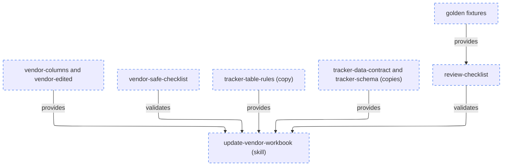

# Vendor Sheet Update

## Purpose

A GitHub Copilot agent skill that applies the review rows a lead accepted to one vendor's vendor-facing sheets, writes per-tab vendor-safe CSV files and a report for the lead to paste into the vendor workbook and check before upload, and marks the applied rows, so accepted values reach the vendor without an executable and without a leak of internal data.

## Navigation

[Job Behavior Specifications](../../README.md#navigation) / [Lead Tracker Skills](../README.md#navigation) / **Vendor Sheet Update**

- [Design](#design)
- [Technology](#technology)
- [Behavior](#behavior)
- [Plan](#plan)
  - [Planned Navigation](#planned-navigation)
  - [Planned Design](#planned-design)
    - [Planned Diagram](#planned-diagram)
  - [Steps](#steps)
  - [Acceptance Mapping](#acceptance-mapping)
  - [Assumptions And Open Questions](#assumptions-and-open-questions)
  - [Planned Relationships](#planned-relationships)
  - [Planned Links](#planned-links)
- [Relationships](#relationships)
- [Links](#links)

## Design

Not built yet.

## Technology

- A GitHub Copilot agent skill (VS Code agent mode), plain Markdown with no code to run, as the sibling skills. It needs only Copilot: no Node, Python or other executable is installed or run, because the client environment blocks executables. Detail is in [requirements.md](requirements.md#requirements).

## Behavior

- **B01** When it runs on the vendor's downloaded tab CSVs, the review CSVs, an export and a vendor, then it writes one CSV per vendor tab (Use Cases, Questions, Identity & Access) in the downloaded header and column order plus a Markdown report, and leaves the inputs untouched. (untested: benchmark pending)
- **B02** When a review row has `review_status` `accepted`, then it applies, and a blank, `rejected` or `clarify` row never applies. (untested: benchmark pending)
- **B03** When a row has `applied_on` set and has not changed since review, then it is skipped, and a rerun adds no duplicate row. (untested: benchmark pending)
- **B04** When the sheets are written, then they hold only that vendor's rows and vendor-visible columns, with no internal column, other vendor's row, unreleased question, group, link, mapping or secret value, and the self-check re-reads the written files to prove it. (untested: benchmark pending)
- **B05** When an accepted new question row is applied and the lead named a release, then it is added with `released_on`, `batch_ref`, a `due_on` of release plus two working days and `not-answered`, and without a release it is left pending and listed. (untested: benchmark pending)
- **B06** When a row is applied, then the vendor's answers, answer status, acknowledgements and vendor-side access fields, and the `released_on` and `due_on` of existing rows, never change. (untested: benchmark pending)
- **B07** When a row's current value differs from the downloaded sheet, the row changed since review, or a field is in conflict or held, then nothing is applied for that row and a conflict is listed. (untested: benchmark pending)
- **B08** When a new record is added, then it takes the suggested reference, and a collision stops the run. (untested: benchmark pending)
- **B09** When the self-check has passed and the lead confirms the rows were pasted, then `applied_on` (the lead's date) is set on those rows only in the review CSVs, written together or not at all. (untested: benchmark pending)
- **B10** When an input is invalid, a value looks like a secret or the self-check fails, then it stops naming the problem and writes nothing, and the report lists what was applied, skipped, in conflict, pending release and the accepted internal values left for the master. (untested: benchmark pending)

## Plan

### Planned Navigation

[Job Behavior Specifications](../../README.md#plan) / [Lead Tracker Skills](../README.md#plan) / **Vendor Sheet Update**

- [Planned Design](#planned-design)
  - [Planned Diagram](#planned-diagram)
- [Steps](#steps)
- [Acceptance Mapping](#acceptance-mapping)
- [Assumptions And Open Questions](#assumptions-and-open-questions)
- [Planned Relationships](#planned-relationships)
- [Planned Links](#planned-links)

### Planned Design

One skill folder, `update-vendor-workbook`, replaces the job of the Vendor Workbook Updater in the client environment, where executables are blocked: the skill follows the explicit procedure in [contract.md](contract.md#contract), taken from the tool's own contract and behaviors, on CSV files, with the same output shapes as the tool so the other skills and tools read them unchanged. The tool stays in the repository as the reference implementation and the source of the golden expected outputs, and is not shipped to the client. Copilot's output varies and a large CSV can exceed its context, so the skill works in chunks, writes a count line first, checks that rows in equal rows classified, never invents a row, and stops with a named error instead of guessing; a lead can cheaply verify the count line and a few rows and compare the golden cases. The Tracker Data Contract is not changed; the skill holds byte-identical copies of the contract and schema like its sibling skills.

#### Planned Diagram

### Steps

1. Create the skill folder `update-vendor-workbook/` holding `SKILL.md` (front matter `name: update-vendor-workbook`, a description with trigger phrases, `user-invocable: true`) written from [contract.md](contract.md) with no Craft term.
2. Add the byte-identical copies of `tracker-data-contract.md` and `tracker-schema.csv` from the Tracker Data Contract, and the table rules and other files named in the contract's Folder section.
3. Generate the golden inputs and expected outputs by a one-off script in the scratchpad, outside the repository, that runs the reference tool on the fictional fixtures, and write `golden/COMPARE.md` (how to run the skill into a scratch folder, compare with VS Code Compare Selected, and the normalizations).
4. Write `review-checklist.md` with one item per behavior and the rules scan.
5. At build close, merge this Plan into the Design, diagram, Relationships and Links of this README and of the group's.

Build last: it needs the review headings of Review Queue Export and the table rules.

### Acceptance Mapping

| Acceptance | Behaviors | Step | Check |
| --- | --- | --- | --- |
| On the golden case the three sheets and the report decisions (applied, skipped, conflicts, pending releases) match the expected ones. | B01, B02, B03, B05, B06, B07, B08 | 1, 2, 3 | checklist items, golden comparison |
| A planted leak (an internal column, another vendor's row, an unreleased question) fails the self-check and writes nothing. | B04, B10 | 1, 3, 4 | checklist items, golden comparison |
| `applied_on` is set only after the self-check passes and the lead confirms the paste. | B09 | 1, 3, 4 | checklist items, golden comparison |
| Vendor-owned columns and existing rows' `released_on` and `due_on` never change, and the inputs are untouched. | B01, B06 | 1, 3, 4 | checklist items, golden comparison |

Validation, narrowest first: the checklist items for the behaviors, the wording scan of the skill folder, a mechanical check of the example rows against the contract by a throwaway script outside the repository, the golden comparison by the lead, then the root `test` check to confirm the contract-copy test is still green. No Copilot run is claimed; the user's manual client-environment testing is recorded as user-reported evidence for the version tested.

### Assumptions And Open Questions

Assumptions (override any in chat):

1. The group is `lead-tracker-skills` with four sibling skill components, additive: nothing existing moves, and the skills are not placed under `tracker-tools`, whose members share Node checks. Names and folders follow the sibling skills' style; override by naming others.
2. The Node tool stays unchanged in `tracker-tools` as the reference implementation and the source of golden expected outputs, and is no longer shipped to the client; the Client Transfer Package is changed by its own record (see the root plan).
3. The skill writes no executable and runs nothing: it reads and writes only the CSV and Markdown files the lead names, never the tracker or SharePoint.
4. Golden inputs and expected outputs are generated by a one-off script in the scratchpad that runs the reference tool, are committed as text in the skill folder and ship to the client; no fixture file is named `tracker-schema.csv` or `tracker-data-contract.md`, so the root copy test does not count it as an extra copy.
5. Rows in must equal rows classified, written as a count line at the top of each output; a mismatch stops the run. Chunk sizes are set by the backlog item `skill-scale-limits`.
6. The output is whole-tab CSV files in the downloaded header order without the workbook's band row; the lead exports each vendor sheet to CSV and pastes the result back. Override by naming a different hand-over form.
7. `applied_on` is set only after the self-check passes and the lead confirms the paste, so a discarded run is never marked applied. Confirmed by the user, 2026-11-16. Override by setting it when the files are written, as the Node tool does.
8. The Node tool's digest-mismatch conflict is dropped because `content_digest` is `unhashed`; the current-value check against the downloaded sheet and `changed_since_review` remain. This follows the confirmed `content_digest` choice.
9. The vendor-safe self-check is mandatory and cannot be skipped by the lead's instruction in the same run; a lead who wants to skip it must not use the skill.

Open questions: none. The behavior choices were confirmed by the user on 2026-11-16.

### Planned Relationships

- [Tracker Data Contract](../../tracker-data-contract/README.md#purpose) — the schema, owner classes, proposal format and review rules the skill follows, copied into its folder.
- [Tracker Tools](../../tracker-tools/README.md#purpose) — the reference Node implementation and the source of the golden outputs; not shipped to the client.
- [Review Queue Export](../review-queue-export/README.md#purpose) — writes the review CSVs and owns the headings file this skill reads from its folder.
- [Proposal Reconciliation](../proposal-reconciliation/README.md#purpose) — owns the table rules master this skill copies.

### Planned Links

- [requirements.md](requirements.md#requirements) — what the skill must do and must not do, and the verification and risks.
- [contract.md](contract.md#contract) — inputs, outputs, procedure, folder layout and stop errors.

## Relationships

- [Tracker Data Contract](../../tracker-data-contract/README.md#purpose) — the schema, owner classes, proposal format and review rules the skill follows, copied into its folder.
- [Tracker Tools](../../tracker-tools/README.md#purpose) — the reference Node implementation and the source of the golden outputs; not shipped to the client.
- [Review Queue Export](../review-queue-export/README.md#purpose) — writes the review CSVs and owns the headings file this skill reads from its folder.
- [Proposal Reconciliation](../proposal-reconciliation/README.md#purpose) — owns the table rules master this skill copies.

## Links

- [requirements.md](requirements.md#requirements) — what the skill must do and must not do, and the verification and risks.
- [contract.md](contract.md#contract) — inputs, outputs, procedure, folder layout and stop errors.
