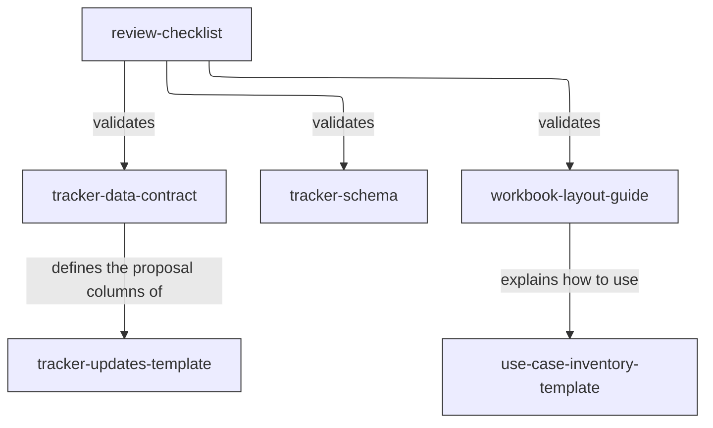

# Tracker Data Contract

## Purpose

The one shared data contract for the use case tracker: tabs, columns, references, status lists, vendor visibility, the proposal file format and the export format, with a guide for building the SharePoint workbooks, so every skill and tool reads and writes the same shapes.

## Navigation

[Job Behavior Specifications](../README.md#navigation) / **Tracker Data Contract**

- [Design](#design)
  - [Diagram](#diagram)
- [Behavior](#behavior)
- [Relationships](#relationships)
- [Links](#links)

## Design

The component is five shared files and one internal checklist, all plain Markdown and CSV with no code: [tracker-data-contract](tracker-data-contract.md) (the contract prose), [tracker-schema](tracker-schema.csv) (one row per column: tab, column, key, owner, visibility, type, allowed values), [workbook-layout-guide](workbook-layout-guide.md), the header-only [tracker-updates-template](tracker-updates-template.csv) and [use-case-inventory-template](use-case-inventory-template.csv), and [review-checklist](review-checklist.md) (one item per behavior). [contract.md](contract.md#contract) is the specification they were written from. The contract and the schema are copied byte for byte into every skill folder that uses them, and the lead tools read the schema from this component's file, so the shapes live in one place.

Questions are one row per use case per question with separate answers; grouping is internal in two extra tabs (Question Groups, Question Links). Use cases carry a source status so missing source is visible from the start, and access requests are one row per use case and endpoint.

Assumptions (override any of them in chat):

1. This is its own component, not part of the root, because every skill and tool consumes it.
2. Central references `UC-###`, `QN-####`, `QG-###`, `QL-####`, `MP-###`, `AX-###`, `BT-###` and `WD-###` are the proposal; a lead names other prefixes if wanted. `QN-####` names a row for one use case and one question.
3. The contract is a design record, not a runtime. No workbook is built here; a lead builds the SharePoint workbooks by hand from the guide.
4. The vendor's `answer_status` values (`not-answered`, `answered`, `partially-answered`, `cannot-answer`) record only the response. The question `status` is one lifecycle set by leads (`clarification-requested` and `closed` exist; there is no `responded` status or `answer_review` column), and `resolver` and `closed_reason` record how a cannot-answer row is resolved. A complete answer awaiting review is not vendor-overdue.
5. The `source_status`, `source_owner`, `source_note`, `supporting_documents`, `last_change_class`, `grouping_impact`, `grouping_impact_lead`, `resolver`, `closed_reason`, `unknown_owner` and `consolidated_request_ref` columns carry the missing-source, access, resolution and grouping-impact rules. The grouping impact is separate from the change class and `unknown` stays visible.
6. Open and not in the contract: the optional `same as` shortcut, any lead prefill of a reviewed answer, the real inventory counts and repository layout, and broader network connectivity and environment setup (deferred until the user decides after the developer sample sheet).
7. `request_status` is human (a skill may only suggest `proposed` or `ready-to-raise`) and `expected_availability` is forbidden (a skill leaves it blank and the workbook shows `unknown`).
8. No skill writes Question Links, Question Groups or Batches; leads create them and copy the reconciler's link suggestions by hand.
9. Separate vendor access is a deployment prerequisite, not an implementation blocker; the vendor storage choice is deferred to the client and settled before the first release.
10. Build decisions: the `link` proposal operation means adding a reference to a list field of an existing record and never targets Question Links; the vendor-side access fields a vendor edits are `vendor_action_owner` and `additional_requirements` (the contract names them only as "vendor-side access fields"); the vendor workbook holds Use Cases, Questions and Identity & Access only, with no Batches tab (the Batches columns keep their `V` marks); a lead sets `acknowledgement_requested_on` and the vendor edits only the other three acknowledgement fields; the schema `visibility` values are `V` and `I`, as the contract's Tabs table writes them; the overdue, follow-up, awaiting-review and age rules are given as helper columns in the guide, outside the contract's columns. Override any of these in chat.

The schema is checked by a one-off script run at build time, not kept in the component: every tab has a key, every column of the contract's tables appears exactly once and in order, owner classes are only spec, human, forbidden or computed, keys and owner classes match the ownership table, enums carry values, and the files pass the hygiene scan. Re-run an equivalent check when the contract changes.

### Diagram

## Behavior

- **B01** When a column is looked up in `tracker-schema.csv`, then it has tab, name, key flag, owner class, visibility, type and allowed values, and every tab has at least one key. (untested: benchmark pending)
- **B02** When a reference is created, then central references follow the contract's scheme (a question row per use case and question, a question group, a link, an access request per use case and endpoint) and are assigned by leads only, and proposals use local references and carry no central reference for a new row. (untested: benchmark pending)
- **B03** When statuses are read, then each list is defined with its meaning (including the source status of a use case, the grouping impact, the vendor's answer status and whether a question is resolved), and behavior acknowledgement, access approval or provisioning, and verified access are separate fields that are never combined. (untested: benchmark pending)
- **B04** When a question row is captured and later released, then `captured_on` and `released_on` are separate, `due_on` is release plus two working days per row and no response or resolver resets it, a row is overdue from day three while it is open and either not completely answered or in `clarification-requested`, a partial or cannot-answer row stays open and overdue with its original due date and is also a follow-up until a lead resolves or closes it, a complete answer awaiting lead review is not vendor-overdue and shows its owner and age, and no due date exists before release. (untested: benchmark pending)
- **B05** When a proposal file is written, then the contract defines its encoding, columns, operations, `update_id` composition and location, the spec, human, forbidden and computed field classes, and that every row traces to a specification or to dependency evidence and a proposal never releases or applies anything. (untested: benchmark pending)
- **B06** When an export is made, then it is one CSV per tab with a manifest, and extra lead columns are allowed and preserved. (untested: benchmark pending)
- **B07** When a vendor view is built, then only that vendor's rows and vendor-visible columns appear, question rows appear only after release with no group, link or other-row reference, mappings and cross-vendor information never appear, and no secret value appears anywhere. (untested: benchmark pending)
- **B08** When a question concerns several use cases, then each use case has its own question row with its own answer and answer status, grouping is internal, and no answer is copied to or inherited by another row, so a new or newly linked row starts blank. (untested: benchmark pending)
- **B09** When a lead builds the workbooks, then `workbook-layout-guide.md` gives the tabs, the vendor's single Questions sheet, the validation lists, the vendor-view rule, the due-date formula, the manual vendor-to-master copy steps, the manual apply steps and the inventory template. (untested: benchmark pending)
- **B10** When the files are scanned, then they contain no Craft term, no real vendor data and no secret. (untested: benchmark pending)

## Relationships

- It depends on nothing outside its lineage. It is used by its siblings [Tracker Update Proposer](../tracker-update-proposer/README.md#purpose), [Identity Access Discovery](../identity-access-discovery/README.md#purpose), [Workflow Recommender](../workflow-recommender/README.md#purpose) and [Tracker Tools](../tracker-tools/README.md#purpose), which read and write the shapes defined here.

## Links

- [requirements.md](requirements.md#requirements) — what the component must do and what it need not.
- [contract.md](contract.md#contract) — the shapes, formats and wording rules.
- [tracker-data-contract.md](tracker-data-contract.md) — the contract prose, copied into the skill folders.
- [tracker-schema.csv](tracker-schema.csv) — the machine-readable column schema.
- [workbook-layout-guide.md](workbook-layout-guide.md) — how a lead builds and maintains the workbooks by hand.
- [tracker-updates-template.csv](tracker-updates-template.csv) — the proposal file header.
- [use-case-inventory-template.csv](use-case-inventory-template.csv) — the inventory header.
- [review-checklist.md](review-checklist.md) — the internal file review, one item per behavior.
