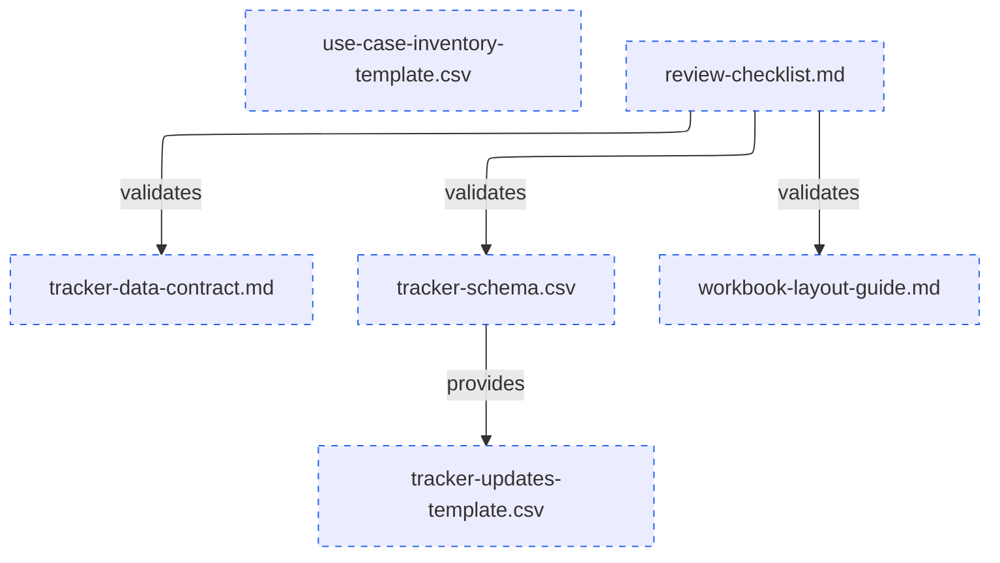

# Tracker Data Contract

## Purpose

The one shared data contract for the use case tracker: tabs, columns, references, status lists, vendor visibility, the proposal file format and the export format, with a guide for building the SharePoint workbooks, so every skill and tool reads and writes the same shapes.

## Navigation

[Job Behavior Specifications](../README.md#navigation) / **Tracker Data Contract**

- [Design](#design)
- [Behavior](#behavior)
- [Plan](#plan)
- [Relationships](#relationships)
- [Links](#links)

## Design

Not built yet.

## Behavior

- **B01** When a column is looked up in `tracker-schema.csv`, then it has tab, name, key flag, owner class, visibility, type and allowed values, and every tab has at least one key. (untested: benchmark pending)
- **B02** When a reference is created, then central references follow the contract's scheme (a question row per use case and question, a question group, a link, an access request per use case and endpoint) and are assigned by leads only, and proposals use local references and carry no central reference for a new row. (untested: benchmark pending)
- **B03** When statuses are read, then each list is defined with its meaning (including the source status of a use case, the grouping impact, the vendor's answer status and whether a question is resolved), and behavior acknowledgement, access approval or provisioning, and verified access are separate fields that are never combined. (untested: benchmark pending)
- **B04** When a question row is captured and later released, then `captured_on` and `released_on` are separate, `due_on` is release plus two working days per row and no response or resolver resets it, a row is overdue from day three while it is open and either not completely answered or in `clarification-requested`, a partial or cannot-answer row stays open and overdue with its original due date and is also a follow-up until a lead resolves or closes it, a complete answer awaiting lead review is not vendor-overdue and shows its owner and age, and no due date exists before release. (untested: benchmark pending)
- **B05** When a proposal file is written, then the contract defines its encoding, columns, operations, `update_id` composition and location, the spec, human, forbidden and computed field classes, and that every row traces to a specification or to dependency evidence and a proposal never releases or applies anything. (untested: benchmark pending)
- **B06** When an export is made, then it is one CSV per tab with a manifest, and extra lead columns are allowed and preserved. (untested: benchmark pending)
- **B07** When a vendor view is built, then only that vendor's rows and vendor-visible columns appear, question rows appear only after release with no group, link or other-row reference, mappings and cross-vendor information never appear, and no secret value appears anywhere. (untested: benchmark pending)
- **B08** When a question concerns several use cases, then each use case has its own question row with its own answer and answer status, grouping is internal, and no answer is copied to or inherited by another row, so a new or newly linked row starts blank. (untested: benchmark pending)
- **B09** When a lead builds the workbooks, then `workbook-layout-guide.md` gives the tabs, the vendor's single Questions sheet, the validation lists, the vendor-view rule, the due-date formula, the manual vendor-to-master copy steps, the manual apply steps and the inventory template. (untested: benchmark pending)
- **B10** When the files are scanned, then they contain no Craft term, no real vendor data and no secret. (untested: benchmark pending)

## Plan

### Planned Navigation

[Job Behavior Specifications](../README.md#plan) / **Tracker Data Contract**

- [Planned Design](#planned-design)
  - [Planned Diagram](#planned-diagram)
- [Steps](#steps)
- [Acceptance Mapping](#acceptance-mapping)
- [Assumptions And Open Questions](#assumptions-and-open-questions)
- [Planned Relationships](#planned-relationships)
- [Planned Links](#planned-links)

### Planned Design

The component delivers five files that sit together and one internal checklist. The contract prose, the machine-readable column schema, the workbook layout guide and two header-only CSV templates are the shared interface. Questions are one row per use case per question, with separate answers; grouping is internal in two extra tabs (Question Groups, Question Links). Use cases carry a source status so missing source is visible from the start, and access requests are one row per use case and endpoint. The contract and the schema are copied byte for byte into every skill folder that uses them, and the lead tools read the schema from this component's file, so the shapes live in one place.

#### Planned Diagram

### Steps

1. Write `tracker-schema.csv` from `contract.md` (one row per column with tab, column, key, owner, visibility, type and allowed values).
2. Write `tracker-data-contract.md` (references, statuses, captured versus released, per-row answers, proposal and export formats, vendor visibility) and `workbook-layout-guide.md`, including the vendor's single Questions sheet and the manual vendor-to-master copy steps.
3. Write the two header-only CSV templates and `review-checklist.md` with one item per behavior.
4. Run the file review, the hygiene scan and the record validators.

### Acceptance Mapping

| Acceptance condition | Behaviors | Step | Validation |
| --- | --- | --- | --- |
| The schema, references, status lists and one owner class per column are defined exactly as `contract.md` states, including the source status, the grouping impact, the vendor answer status, the open and resolved question states and the access rows per use case and endpoint (B01, B02, B03). | B01, B02, B03 | 1 | [B01] to [B03], schema compared with contract.md |
| The captured, released and due rules are per question row, a response never resets the due date, partial, cannot-answer and clarification-requested rows stay open and overdue, a complete answer awaiting review is not vendor-overdue, and the rule that each use case answers on its own row with no inherited answer is written (B04, B08). | B04, B08 | 2 | [B04], [B08], rule text read |
| The proposal file and export formats are fully specified, and proposals are traceable to a specification, to inventory or source-screening evidence or to dependency evidence, and never release or apply anything (B05, B06). | B05, B06 | 2 | [B05], [B06], formats read and the template CSV headers compared |
| The vendor separation rules (no leak of unreleased rows, groups or links), the workbook layout guide and the hygiene scan are in place (B07, B09, B10). | B07, B09, B10 | 3 | [B07], [B09], [B10], guide read and files scanned |

Checks: none declared; verification is the component's `review-checklist.md` file review, plus the record validators at the end of each plan and build.

### Assumptions And Open Questions

Assumptions (override any of them in chat before `/craft:build`):

1. The data contract is its own component and not part of the root, because every skill and tool consumes it. Override: ask for it inside the root.
2. Central references `UC-###`, `QN-####`, `QL-####`, `MP-###`, `AX-###`, `BT-###` and `WD-###` are the planner's proposal. Override: name other prefixes before the build.
3. The contract is a design record, not a runtime. No workbook is built or published here; a lead builds the SharePoint workbooks by hand from the guide.
4. Per-use-case question rows (user's provisional acceptance, to test and iterate) change what `QN-####` means: it now names a row for one use case and one question, and the shared grouping is the internal `QG-###` group with `QL-####` links. The vendor's `answer_status` values (`not-answered`, `answered`, `partially-answered`, `cannot-answer`) are the planner's proposal and record only the response. Resolution is separate and confirmed: a partial or cannot-answer row stays open with its original due date, stays overdue and is also a follow-up; a cannot-answer row stays open until a lead assigns a resolver or closes it, and a resolver alone does not resolve it. The question `status` is one lifecycle (`clarification-requested` and `closed` added; there is no `responded` status, because a received response is an `answer_status` other than `not-answered`; the separate `answer_review` column is removed) and the `resolver` and `closed_reason` columns are the planner's way to record this. Override: restore `answer_review`. A complete answer awaiting lead review is not vendor-overdue and shows its owner and age; a lead-requested clarification stays open on its original due date and can be overdue even if the vendor's `answer_status` is complete; the vendor owns `answer_status` and the lead owns `status` (confirmed, correcting an earlier planner detail).
5. The `source_status` values, `source_owner`, `source_note`, `supporting_documents`, `last_change_class`, `grouping_impact`, `grouping_impact_lead`, `resolver`, `closed_reason`, `unknown_owner` and `consolidated_request_ref` columns are the planner's proposal to carry the confirmed missing-source, access, resolution and grouping-impact rules (the grouping impact is separate from the change class and unknown stays visible; its short reason travels in the proposal row's `reason`). Override: name other columns.
6. Open, not decided here: the optional `same as` shortcut and any lead prefill of a reviewed answer (the contract has no column for either), and the real inventory counts and repository layout. Broader network connectivity, environment setup and router availability are an open, deferred scope with no column in this contract until the user decides after the developer sample sheet.
7. Column ownership is a table in `contract.md` (every column has one class and the keys are named). Writing it exposed two conflicts, resolved here: `request_status` is human so a skill may only suggest `proposed` or `ready-to-raise`, and `expected_availability` stays forbidden so a skill leaves it blank and the workbook shows `unknown`. Override: add a spec-owned `readiness` column and keep `request_status` forbidden.
8. No skill writes Question Links, Question Groups or Batches; leads create them, and the reconciler's link suggestions are copied by hand. Override: let the proposer propose links.
9. Separate vendor access and internal-only analysis are a deployment and intake prerequisite and not an implementation blocker (confirmed). The vendor storage and repository choice is deferred pending the client's confirmation. Override: make it a build prerequisite.

Open questions: the optional `same as` shortcut, and the infrastructure scope (deferred, pending a developer sample sheet). Neither is in the contract.

### Planned Relationships

- [Website Availability Check](../website-availability-check/README.md#purpose) — read-only source evidence used for the example proposal rows in the skills that consume this contract.

### Planned Links

- [requirements.md](requirements.md#requirements) — what the component must do and what it need not.
- [contract.md](contract.md#contract) — the shapes, formats and wording rules.

## Relationships

- [Website Availability Check](../website-availability-check/README.md#purpose) — read-only source evidence used for the example proposal rows in the skills that consume this contract.

## Links

- [requirements.md](requirements.md#requirements) — what the component must do and what it need not.
- [contract.md](contract.md#contract) — the shapes, formats and wording rules.
