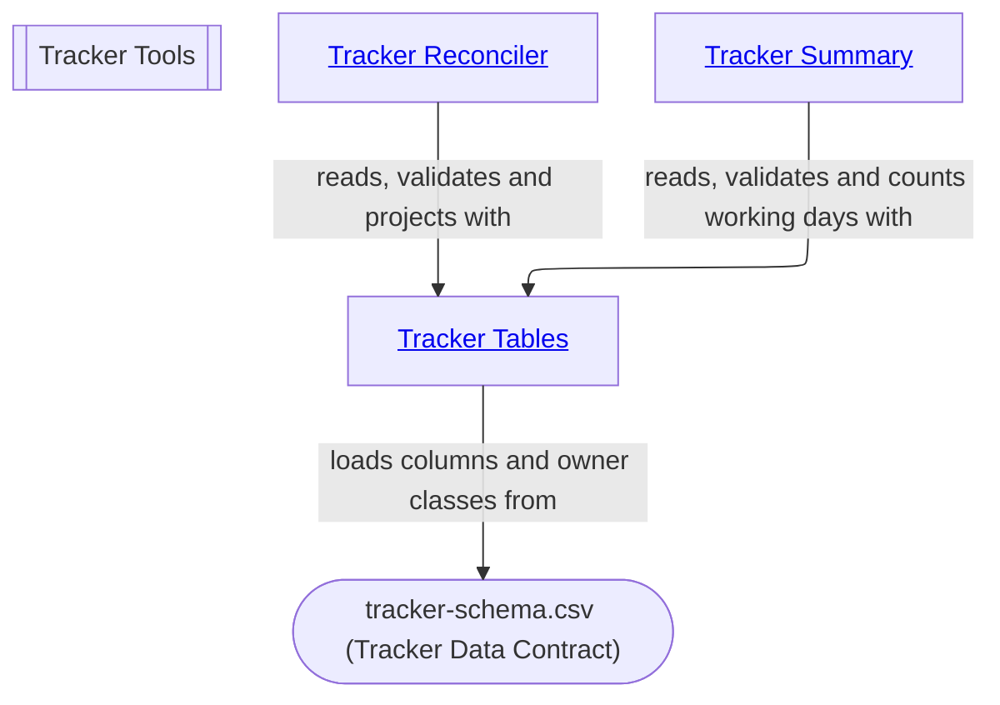
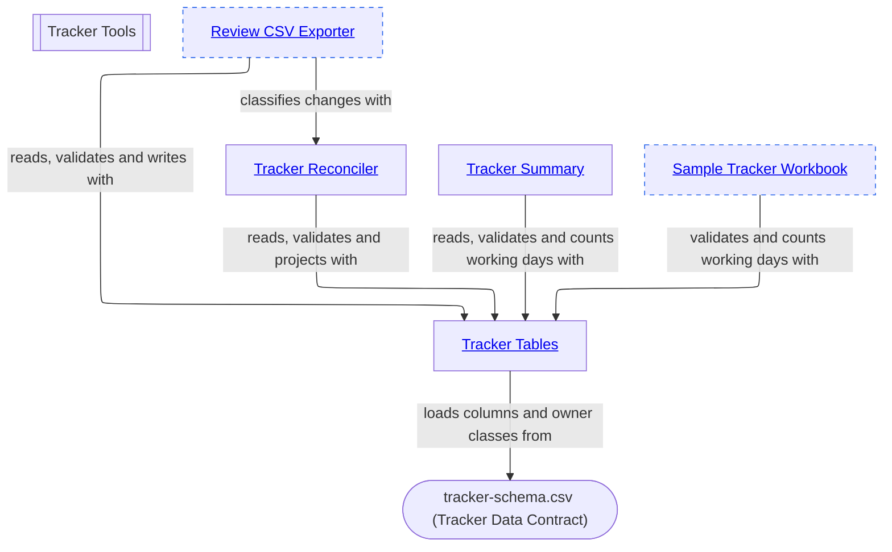

# Tracker Tools

## Purpose

The lead-facing Node tools for the use case tracker: a shared CSV table library, a reconciler that turns reviewed proposals and a tracker export into reviewable changes, and a daily summary. Leads run them by hand; the authoritative tracker stays an Excel workbook on SharePoint.

## Navigation

[Job Behavior Specifications](../README.md#navigation) / **Tracker Tools**

- [Components](#components)
- [Design](#design)
  - [Diagram](#diagram)
- [Technology](#technology)
- [Links](#links)

## Components

| Component | Purpose |
| --- | --- |
| [Tracker Tables](tracker-tables/README.md#purpose) | A Node library that reads and writes the tracker's CSV tables, validates them against the shared schema, builds vendor views and does working-day arithmetic, so the reconciler and the summary share one correct implementation. |
| [Tracker Reconciler](tracker-reconciler/README.md#purpose) | A Node command line tool that compares reviewed tracker proposals with the latest tracker export and writes additions, field updates, conflicts and suggestions for a lead to review and apply by hand, never overwriting human edits. |
| [Tracker Summary](tracker-summary/README.md#purpose) | A Node command line tool that writes the internal daily summary across all vendor tracks from a tracker export: use cases by stage, overdue questions, blocked items, access actions, mappings pending a decision and next batch suggestions. |
| [Sample Tracker Workbook](sample-tracker-workbook/README.md#purpose) | A small, realistic sample of the final Excel tracker, generated from fictional data, so the team can review the format of the sheets before the real tracker is built. |
| [Review CSV Exporter](review-csv-exporter/README.md#purpose) | A Node command line tool that turns tracker proposals and a tracker export into consolidated review CSVs, one wide row per record ordered by what needs a lead's judgment, so leads review adds, updates and suggestions without transposing proposal rows. |

## Design

The group holds three deliverables that leads run by hand on exported CSV files, and it has no behavior of its own. The [Tracker Tables](tracker-tables/README.md#design) library reads, validates and writes the tracker's CSV tables, builds the vendor view and does the working-day arithmetic. The [Tracker Reconciler](tracker-reconciler/README.md#design) and the [Tracker Summary](tracker-summary/README.md#design) command line tools both import it by relative path, and all three read the column list, owner classes, keys and visibility from the shared `tracker-schema.csv` of the Tracker Data Contract, so no column list is repeated in code. The reconciler turns proposals and an export into reviewable files for a lead to apply by hand, and the summary writes the internal daily summary from an export. Neither tool writes to SharePoint, releases a question or changes a file it reads. The shared check declarations (`test`, `coverage`, `testGlob`, `adapterGlob`) live in this group's `craft.json` and are inherited by the members.

### Diagram

## Technology

- Node 26 with native TypeScript (erasable syntax, `.ts` import extensions), no dependencies and `node:test`, as in the sibling `website-availability-check`; CSV is read and written by the library's own code. Checks are declared here and inherited by the members. No `typecheck`, `lint` or `boundaries` check is declared, because each needs a development dependency. Detail is in [requirements.md](requirements.md#requirements).

## Links

- [requirements.md](requirements.md#requirements) — what the group and its members must do and what they need not.
- [contract.md](contract.md#contract) — the shared check declarations and the command line of the members.

## Plan

### Planned Navigation

[Job Behavior Specifications](../README.md#navigation) / **Tracker Tools**

- [Planned Components](#planned-components)
- [Planned Design](#planned-design)
  - [Planned Diagram](#planned-diagram)
- [Planned Relationships](#planned-relationships)

### Planned Components

| Component | Purpose |
| --- | --- |
| [Tracker Tables](tracker-tables/README.md#purpose) | A Node library that reads and writes the tracker's CSV tables, validates them against the shared schema, builds vendor views and does working-day arithmetic. |
| [Tracker Reconciler](tracker-reconciler/README.md#purpose) | A Node command line tool that compares reviewed tracker proposals with the latest tracker export and writes reviewable changes. |
| [Tracker Summary](tracker-summary/README.md#purpose) | A Node command line tool that writes the internal daily summary across all vendor tracks from a tracker export. |
| [Sample Tracker Workbook](sample-tracker-workbook/README.md#planned-purpose) | A small, realistic sample of the final Excel tracker, generated from fictional data, so the team can review the format of the sheets. |
| [Review CSV Exporter](review-csv-exporter/README.md#planned-design) | A Node command line tool that turns tracker proposals and a tracker export into consolidated review CSVs, one wide row per record ordered by what needs a lead's judgment. |

### Planned Design

The group gains a fourth member, the [Sample Tracker Workbook](sample-tracker-workbook/README.md#planned-design), which imports the Tracker Tables library by relative path and reads the shared schema like its siblings. It is a sample for team review, not a lead tool that runs on an export. It inherits the group's checks and declares its own `install`. It departs from two group rules, recorded in its `requirements.md` and left for this group's owner to reconcile when it is built: it adds one pinned `exceljs` dependency (the group says "no dependencies") and writes `.xlsx` (the group says Excel file formats need not be matched). Until then neither the Technology section nor the requirements of this group change. The group also gains a fifth member, the [Review CSV Exporter](review-csv-exporter/README.md#planned-design), a lead tool that imports the Tracker Tables library and the Tracker Reconciler's loaders and classification by relative path, reads the shared schema and writes consolidated review CSVs for a lead to review; it fits the group's stack and adds no dependency.

#### Planned Diagram

### Planned Relationships

None.
